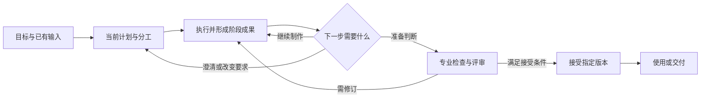
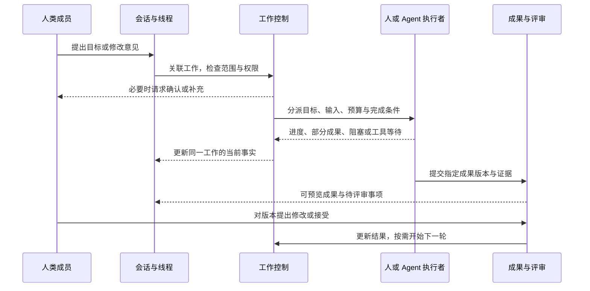
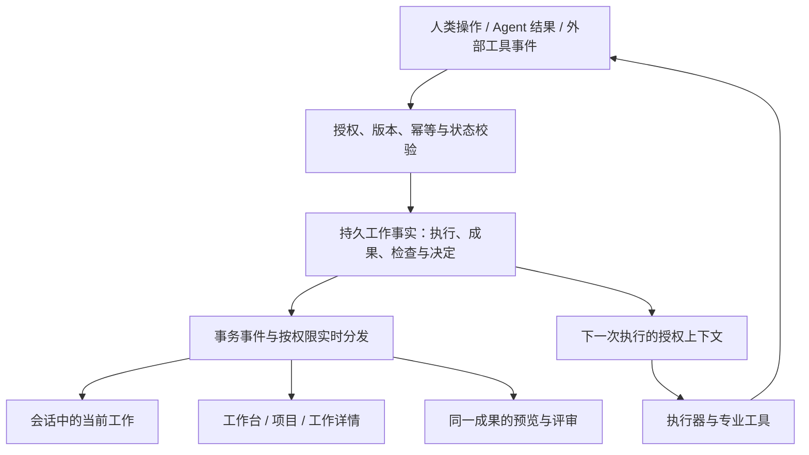

# Myrmidon 产品需求文档

> **把一件工作交给一个由人和 AI 组成的团队，持续推进到可使用的结果。**

**版本：3.0 · 产品设计提案｜2026-10-13**

> **最新需求入口：[完整产品需求清单](REQUIREMENTS.md)**。用户随后补充并明确了 1–24 项要求，以该清单为新增和冲突内容的依据：组织架构树、跨项目汇总工作台、消息永久保存、Tauri 全平台、严格内部验收后交付，以及“会话协商 → 计划确认 → SOP 确认 → AI 执行 / Human 负责的环节小团队 → 验收交接或上游重做”主流程。本文下述旧范围、路由与人工覆盖建议若冲突，以最新清单为准；工程规格和原型尚未同步。

本文回答：谁会使用、每个人如何参与、通用流程如何适配不同业务、人和 Agent 如何协作、执行如何反馈，以及如何保留完整功能而减少重复页面。产品定位与能力范围沿用用户提出的通用方向；下文新增的产品取舍是可评审提案，不代表已实现或已批准开工。

| 阅读问题 | 位置 |
|---|---|
| 谁会用，为什么用，不同人看什么 | [§1 用户与价值](#users) · [§2 用户视角](#perspectives) |
| 一件工作如何完整完成 | [§3 核心工作单元](#work) · [§4 工作旅程](#journey) |
| 同一流程如何兼容不同行业 | [§5 通用流程](#process) · [§6 业务适配](#business) |
| 人和 Agent 如何内部协作 | [§7 责任与协作](#teamwork) |
| 会话、执行、实时反馈和预览如何联动 | [§8 会话与执行](#execution) · [§9 实时成果](#feedback) |
| 文件、知识和记忆起什么作用 | [§10 工作连续性](#context) |
| 如何减少页面与路由冗余，保持功能完整 | [§11 信息架构](#navigation) · [§12 路由与功能归属](#routes) |
| 先做什么，怎样证明有效 | [§13 范围与验证](#validation) · [§14 验收](#acceptance) |

## 0. 本版的产品决策摘要

1. **以一件有明确结果的工作组织产品。** 项目容纳长期协作，会话容纳交流，执行记录实际行动，成果承载最终价值。四者关联，但不互相替代。
2. **面向承担结果责任的人。** OPC 经营者、项目负责人、专业成员、评审者和客户围绕同一工作，以不同职责参与；不为每种身份建设独立产品。
3. **流程通用到“推进与判断”，专业到“怎么做、怎么验”。** 软件测试、小说编辑和视频审片不使用相同专业步骤，但都可以有要求、负责人、成果版本、反馈与接受。
4. **人和 Agent 都可执行，责任与权限必须明确。** 系统承担安排、跟踪、交接与有界修复，人决定目标、关键取舍和必须人工确认的事项。
5. **同一工作可从多个位置进入，但只有一份业务事实和一个规范对象地址。** 频道、待办、成果预览显示同一对象的不同上下文，不产生第二份任务或审批。
6. **简单来自减少用户维护工作。** 系统自动组织能够确定的信息；在影响结果或权限的分歧处提问。高级能力按需展开，不能以隐藏功能代替产品整合。

此前的 UI、数据库和模块清单降为实现资料。既有治理约束、专业能力与工程规格继续保留；本版重新编排章节，旧 PRD 章节号不得直接当作本版引用，衔接见附录。

---

## 1. 谁会用，为什么会把工作交给它

### 1.1 用户正在承担的隐性工作

用户使用多个 AI 和专业工具时，经常同时担任需求解释者、任务分派者、资料搬运者、进度追踪者和最终检查者。模型即使能产出内容，也不会自动保证这些环节连续：上一个决定有没有传给下一个执行者、别人改了哪一版、阻塞由谁处理、交付是否真的满足要求。

Myrmidon 应减少这部分协调与监督劳动，让用户把精力留给目标、专业判断和必要决定。**如果用户仍要在多个 Agent 之间复制背景、反复催办、手工拼接结果，那么即使所有功能都在一个页面里，产品也没有成立。**

### 1.2 优先适用的用户与工作

| 用户 | 常见工作 | 使用触发点 | 希望获得的改变 |
|---|---|---|---|
| OPC 经营者 / 独立创作者 | 产品资料、内容、图片、网站、小型交付 | 同时使用多个工具，工作持续几天，经常需要返工 | 一个人可以推动多种专业工作，不必逐个盯住 AI |
| 小团队负责人 | 项目交付、活动、产品迭代、内容生产 | 人和 AI 并行，交接和评审成为瓶颈 | 清楚谁负责、卡在哪里，只处理真正需要自己的问题 |
| 专业成员 | 产品、设计、开发、运营、剪辑、编辑 | 接到的任务缺背景，成果反复被要求修改 | 带着完整依据开始工作，用熟悉的工具提交可接续成果 |
| 评审者 / 业务决策者 | 方案选择、品牌审核、产品验收 | 需要看很多过程信息，却仍不知道该判断什么 | 直接看到指定版本、要求、变化与待决定事项 |
| 外部客户 / 合作方 | 提需求、澄清、审稿、验收 | 沟通与文件分散，承诺和版本不清 | 在明确范围内参与，知道交给自己的是什么 |
| 团队所有者 / 管理员 | 配置工具、控制费用、维护授权 | Agent 数量与调用成本增长、资料权限复杂 | 设置持续有效的边界，按异常管理，无需介入每一步 |

首轮适合招募经常处理**多步骤、多版本、需要交接或评审**工作的 OPC 与小团队。行业范围可以广，但使用问题应集中。以上是目标用户假设，尚不是已通过访谈证实的市场事实。

### 1.3 用户为什么不继续使用原来的组合

| 现有工作方式 | 继续适合什么 | Myrmidon 必须额外证明的价值 |
|---|---|---|
| 单模型对话 | 一次性问答、快速草稿 | 跨天、换人、换模型后仍能接续，不必重讲背景 |
| 项目管理工具 + IM | 人员协作、跟踪与讨论 | 可以实际调用执行能力，把计划推进到成果，并把反馈带回执行 |
| Agent CLI / 自动化脚本 | 单专业执行、成熟固定流程 | 将执行与需求、其他角色、评审和交付持续关联 |
| 文档 / 网盘 / 知识库 | 保存与检索资料 | 当前工作自动使用正确版本，来源变更能影响相关工作 |
| 专业设计 / 剪辑 / 开发工具 | 深度专业制作 | 专业工具产出的成果能被别人理解、评审与接续 |

对于只想问一个问题、做一次不需保存的生成，Myrmidon 不应强迫建立项目和团队。对于复杂专业编辑，继续使用专业软件更合适。产品价值取决于持续工作中的实际节省，不依赖宣称替代所有工具。

---

## 2. 同一系统，不同人的工作视角

### 2.1 每个人进入系统后首先需要知道什么

| 视角 | 第一眼需要回答 | 日常动作 | 默认不占据注意力的信息 |
|---|---|---|---|
| OPC / 创作者 | 我的工作推进到哪，哪里需要我的判断 | 提目标、补资料、挑方案、修改、接受 | 组织层级、编制、复杂报表 |
| 负责人 | 哪项结果有风险，谁被阻塞，哪些决定必须由我做 | 定要求、调分工、处理例外、确认交付 | 每个工具调用与完整运行日志 |
| 执行成员 | 我负责什么，依据哪版要求，接下来交给谁 | 接受分派、工作、提交成果、说明未验证项 | 无关项目与管理配置 |
| 评审者 | 我要判断哪一版，依据什么，有什么变化 | 看成果、比差异、逐项反馈、接受或退回 | 全部频道历史与底层 Agent 调试信息 |
| 客户 / 外部成员 | 哪些事项等我确认，当前可看成果是哪版 | 澄清、签认、反馈、验收 | 内部任务、成本、候选争论、Agent 内部过程 |
| 管理员 | 授权、费用、执行资源是否异常 | 配置边界、轮换凭据、处理异常、查看审计 | 无授权的私人内容；他人的日常业务决定 |
| Agent | 目标、输入、权限、预算、完成条件是什么 | 接任务、执行、报告事实、请求帮助、交接 | 未授权频道、其他人的私人资料 |

这些是同一数据上的筛选与权限投影。一个人可以在工作 A 是执行者，在工作 B 是评审者，在项目 C 是负责人。身份切换不创建第二份任务，也不要求进入另一套应用。

### 2.2 三种规模下的使用方式

**个人：**用户发起工作，自己同时承担目标提出者和最终接受者。AI 负责可授权的执行与检查。默认只呈现自己的工作、会话、成果和待处理事项；个人自评如实标识，要求独立评审的工作不能被悄悄降级。

**内部团队：**多人对同一工作承担不同角色。系统增加分派、交接、依赖与共享，不改变原工作身份。个人资料仍然私有，团队成员资格不意味着自动看到每个人的所有会话与记忆。

**外部协作：**客户加入授权项目的共享范围。与团队使用同一份需求确认、成果和验收对象，但只获得允许的字段与记录。内部讨论不因邀请客户而整体公开，不另建甲方门户。

### 2.3 成长路径

OPC 可先独立使用，再邀请设计师共同完成一项工作，再邀请客户审核选定成果。每次增加的是参与者、责任与共享范围；不要求迁移项目、重建知识或转换到另一套团队产品。

正式工作必须有明确归属。建议首次形成可跟踪工作时由系统建立私人工作集合，工程上可复用受限项目实体；用户不必先手动建立业务项目。把工作分享给团队时明确选择要共享的工作和资料，不把整个私人集合改成公开。

### 2.4 同一项目中，每个人实际怎样走

| 人的视角 | 一条完整使用路径 | 完成后谁接着做 |
|---|---|---|
| OPC | 描述目标 → 补必要资料 → 工作中看阶段成果 → 对指定版本反馈 → 接受并使用 | 本人开始下一项工作，系统复用已确认上下文 |
| 负责人 | 待处理发现范围分歧 → 查看要求差异与影响 → 决定范围 → 看到分工和依赖继续推进 | 协调者与执行者接续，不要求负责人逐个转述 |
| 专业成员 | 我的任务接下工作 → 查看输入与完成条件 → 用专业工具制作 → 提交成果和未验证项 | 指定检查者或评审者收到真实待办 |
| 评审者 | 待评审直接打开指定版本 → 查看要求与变化 → 定位问题或接受 | 执行者得到具体修改范围，或负责人可组织交付 |
| 客户 | 通知进入共享成果 → 查看说明 → 提出批注、确认变更或验收 | 内部负责人处理反馈；客户不需要进入内部工作项 |
| 管理员 | 发现工具额度或授权异常 → 查看影响范围 → 调整许可或资源 | 受影响工作按政策恢复，业务决定仍由对应负责人负责 |

每条路径都有明确输入、动作、结果和接收者。系统只要求用户处理自己这一段责任，并持续显示下一步的归属。

---

## 3. 产品围绕什么组织：一件需要完成的工作

### 3.1 核心工作单元

“做一套新品发布资料”“完成小说下一章”“修复支付失败”都是工作。它们可以短至一次修改，也可以长至多个阶段。**工作有目标、有结果、有负责人；任务是其内部可分派步骤。**

工程上沿用 WorkItem 的父子关系，不因为产品用语“工作 / 任务”再建两套领域记录。项目组织一组长期相关的工作；频道承载这些工作的交流；一次执行只是完成某个步骤的一次尝试。

一项工作最少需要回答：

| 问题 | 产品应保存的信息 | 谁提供 |
|---|---|---|
| 为什么做 | 目标、使用场景、接收者 | 用户表达，系统整理 |
| 要交什么 | 成果类型、数量、必要格式 | 用户意图 + 专业默认值 |
| 怎么才算可以 | 必须满足的条件、评审方式与接受者 | 负责人确认，专业人员补充 |
| 能做到什么程度 | 范围、期限、预算、工具权限 | 用户与团队政策 |
| 谁负责推进 | 结果负责人、执行分工、当前等待谁 | 系统建议，授权范围内生效 |
| 现在是什么情况 | 当前阶段、有效版本、已知问题、下一动作 | 根据真实工作记录维护 |

这些信息不等于六张必填表。系统从请求、项目规则和已有资料提取，只在缺失信息会影响下一步时询问。未确定的内容显式标为假设，不能伪装成用户要求。

### 3.2 工作的四个组成部分

工作保持稳定身份；执行可以更换，讨论可以分线程，成果可以修订。用户回来时系统首先恢复这件工作，而不是要求用户猜该找哪一次聊天或哪一个 Agent。

### 3.3 产品承诺与责任边界

平台负责保留要求、组织被授权的行动、追踪依赖、组织评审、暴露问题、保存成果与交接上下文。负责人决定目的、不能自动裁定的取舍与必须由人确认的承诺。

产品可以承诺“按约定检查和评审后交付某版运营方案”，不能承诺“方案一定提高营收”。内容被接受、发布成功和业务效果达成是三个不同事实。运营指标、读者反馈等需要观察期，后续结果可以发起新的工作。

---

## 4. 用一件真实工作贯穿所有角色

以“为新品准备一套发布资料”为说明案例：包含一份产品介绍、一组主视觉，若需要再关联落地页实现。这里的业务情节用于设计推演，不是已完成的客户项目。

| 时刻 | 人在做什么 | Agent 与系统承担什么 | 留下的工作事实 |
|---|---|---|---|
| 1. 提出目标 | 经营者描述受众、用途、时间，提供现有产品资料 | 提取已知要求，只追问影响开工的缺口，例如品牌资料与最终接受者 | 工作目标、资料来源、假设与待确认项 |
| 2. 对齐结果 | 负责人确认要交的内容和不可改变的要求 | 提出成果清单与最小计划；说明缺什么能力、预计成本及不确定性 | 经确认的要求、预算和分工 |
| 3. 并行制作 | 文案成员或文案 Agent 写介绍；图片 Agent 出候选；设计师可直接用自己的工具 | 给不同执行者提供各自必要资料，管理依赖，收集实际产物 | 各步骤状态、成果版本与执行记录 |
| 4. 选择方向 | 品牌负责人在候选上给出“保留 B 的构图、改色彩” | 把意见关联到 B 的版本，形成明确修改范围；不删除 A/C | 选型决定、局部反馈与新一轮输入 |
| 5. 处理中途变化 | 经营者决定调整目标受众 | 指出介绍文案、主视觉及落地页哪些内容受到影响，提出代价与新计划 | 新要求版本、受影响工作、继续 / 暂停决定 |
| 6. 内部接受 | 指定评审者判断文案、视觉与必要的功能质量 | 运行尺寸、格式、链接或软件测试等检查；汇总未决问题 | 要求逐项结论、有效证据与接受人 |
| 7. 外部确认 | 若有客户，向其共享选定版本；客户反馈或验收 | 仅展示共享内容，追踪回执；不暴露内部候选争论与成本 | 固定交付清单、反馈或验收回执 |
| 8. 接续使用 | 经营者稍后做同系列第二套资料 | 复用已确认品牌规则与可用成果，明确哪些资料已经变化 | 新工作、复用来源、未重复解释的背景 |

对于 OPC，第 1、2、4、6 步可能都是本人；系统不模拟不存在的部门。对于团队，它们由不同成员完成。没有客户时第 7 步不适用，不制造外部验收。

本例里真正需要减少的是负责人搬运资料、反复转述反馈、找正确版本、催办和核对的次数。发了多少消息、开了几个 Agent、画了多完整的流程图，都不能代替这个结果。

---

## 5. 通用流程究竟如何设计

### 5.1 通用的是六种推进责任

| 通用环节 | 必须解决的问题 | 产生的结果 | 可以怎样简化 |
|---|---|---|---|
| 理解 | 目标与约束是否足够开始 | 可执行的要求与必要假设 | 明确的小修改直接复用已有要求 |
| 组织 | 谁做、先后关系、投入上限是什么 | 最小计划、责任与权限 | 单人单步骤无需展示分派流程 |
| 制作 | 实际工作有没有发生、产出了什么 | 执行记录、阶段成果、阻塞 | 人可在专业工具中直接完成，Agent 不是必经角色 |
| 检验 | 结果符合哪些要求，还有哪些不确定 | 客观检查与专业评审 | 按业务适用，不强制所有工作跑软件测试 |
| 接受 | 谁有权决定这一版足够好 | 固定版本的接受 / 修改决定 | 个人低风险工作可本人接受，标明自评 |
| 使用与延续 | 交给谁、用在哪、下次如何接着做 | 交付或使用记录、可复用上下文 | 无外部接收人不要求客户回执 |

这是每件工作需要有答案的六类问题，不是必须走六页、点击六次批准的固定向导。系统可以自动完成明确的低风险环节；专业工作可以迭代、并行或从中间开始。

任何步骤都可能因资料、权限或依赖进入等待；恢复后从受影响位置继续。图中的执行可以展开成顺序、并行或候选分支，决定权与停止条件仍由同一套规则约束。

### 5.2 工作状态不等于专业步骤

产品对人呈现稳定状态：**待开始、进行中、等待、待接受、已接受、已取消**。等待必须带原因和责任人，例如“等待你选择图片方向”“等待素材授权”“等待上游接口”，不能只显示暂停。

专业步骤由业务定义，例如“分镜”“粗剪”“调色”，或“分析”“编码”“回归”。工作处于“进行中”时，内部可以同时发生多个步骤。已有工程状态与 L1–L4 继续保留，具体映射需在规格同步时确认；本版不直接替换 API 枚举。

每个非终态工作都必须能够回答：**当前谁在推进、下一动作是什么、是否在等待、怎样解除等待。** 进度百分比无法回答这些问题时，优先显示事实与里程碑。

### 5.3 如何生成和调整流程

流程按四类信息组合：用户要的结果、已有输入、专业工作包、团队规则。AI 可以提出步骤与分派；系统检查依赖、能力、预算和权限后执行。

- **首次生成：**只生成足以得到当前结果的计划；缺乏关键能力时先说明缺口，不展示虚假的可执行方案。
- **执行中：**可以细化不改变已确认范围的步骤；超预算、改目标、删验收条件、改变外部承诺必须进入相应决定。
- **收到反馈：**判断是同一要求下的修订，还是需求变化；前者局部重做，后者形成要求差异与影响评估。
- **修改上游：**沿依赖标记受影响成果与评审，通知实际责任人；不把全部工作从头重跑。
- **进入循环：**有明确退出条件和轮次 / 时间 / 成本上限；无法收敛时把备选方案与问题交给负责人。

流程规则的优先级由系统约束：平台授权与不可绕过的限制 → 已确认的项目要求与团队政策 → 专业默认流程 → Agent 建议。矛盾不能通过“取最后一条提示词”解决。

### 5.4 六种必须兼容的工作形态

| 工作形态 | 例子 | 通用机制怎样适配 |
|---|---|---|
| 一步完成 | 改一句介绍、调一张图 | 最小契约、一次执行、结果预览；需要的检查与接受仍有记录 |
| 顺序接力 | 研究 → 写稿 → 编辑 | 下游读取上游已交接版本；上游变化提示受影响步骤 |
| 并行协作 | 文案与视觉同时制作 | 明确共同基线与独立输出，汇合时检查一致性 |
| 探索与选择 | 三种创意方向、两个技术方案 | 候选并存，选择形成决定；探索失败不冒充交付失败 |
| 接手已有工作 | 导入半成品小说、已有代码或设计 | 登记来源和已知状态，从缺失步骤开始，不伪造前序已验证记录 |
| 长期或周期工作 | 连载、每周运营复盘 | 每章 / 每期有自己的结果与接受，长期目标持续存在；周期调度是后续能力 |

动态表单只收集下一步确实需要的信息，已有信息预填并标出处。流程可被专业用户查看与调整，但普通用户不必学习流程语言；可视化编辑属于高级入口，不能是开始工作的前提。

---

## 6. 怎么兼容不同业务，又不失去专业性

### 6.1 每个业务改变的是什么

| 业务 | 专业推进方式示例 | 关键成果 | 可以自动检查 | 必须保留的人类判断 |
|---|---|---|---|---|
| 运营 | 目标与口径 → 活动方案 → 配置 → 观察 → 复盘 | 方案、配置、数据报告 | 配置、数据时窗、计算与链接 | 策略取舍、品牌风险、是否继续投入 |
| 产品 | 问题研究 → 场景与方案 → 原型 → 需求确认 | PRD、旅程、原型、验收条件 | 完整性、冲突、引用与可追踪性 | 用户价值、范围与优先级 |
| UI / UX | 用户流程 → 结构 → 视觉 → 交互验证 | 设计稿、组件、原型 | 尺寸、部分规范与可访问性 | 体验、美感、品牌与可用性判断 |
| 软件 | 分析 → 实现 → 独立验证 → 修复 → 评审 | 代码、构建、测试、发布说明 | 编译、测试、静态检查、部署检查 | 产品接受、架构取舍与必要发布授权 |
| 视频 / 音频 | 脚本 → 素材 → 粗剪 → 精修 → 审片 | 素材、工程、成片、字幕、音轨 | 时长、编码、分辨率、声道等 | 节奏、叙事、审美、授权与内容判断 |
| 广告 | 受众与主张 → 概念 → 候选 → 渠道适配 | 文案、分镜、图像、投放素材 | 字数、尺寸、渠道格式 | 创意、说服力、品牌及法律要求 |
| 图片 | 简报 → 候选 → 选版 → 局部修改 → 导出 | 原图、变体、源文件、导出件 | 尺寸、格式、部分一致性检测 | 构图、视觉方向、是否符合意图 |
| 写作 / 小说 | 研究或设定 → 大纲 → 章节 → 编辑 → 修订 | 引用、人物、世界观、章节、正文 | 来源、结构、部分连续性检查 | 文风、叙事、人物与创作意图 |

这些步骤是起点，不是行业固定流程。“只修订第三章”不要求重建世界观，“只导出已有视频”不要求重新写脚本。

### 6.2 专业工作包的产品职责

一个工作包必须让系统知道：这类工作需要哪些输入、通常怎么推进、要交什么、用什么工具、怎么查看和反馈、如何判断可接受。它是一组可复用的专业做法，可以和其他工作包组合。

团队规则进一步确定品牌、代码规范、审批人、预算与工作习惯。项目可以固定版本，避免工作做到一半因为模板更新而改变验收要求。更换工作包不自动获得工具权限，也不能删除历史结果。

例如发布资料可以组合写作与图片能力；小说可以只使用写作能力；软件项目继续保留云效对齐、缺陷、测试与流水线等深度能力。这些能力在相关工作出现，不要求其他职业看懂软件术语。

### 6.3 通用性必须通过什么检验

增加一个视频包，应主要增加视频输入、工具、成果格式、查看与审片规则，而不是重新实现成员、频道、工作分派、版本和交付。不同专业的人仍能在同一项目内把成果交给对方。

内核若无法表达真实业务关系，应记录场景并做最小扩展；不能为了宣称通用，把所有规则塞进无结构备注。通用性是扩展成本与实际可用性，不是支持的行业名称数量。

---

## 7. Agent + Human 如何内部协作

### 7.1 一件工作中的责任关系

| 角色 | 对什么负责 | 能否由 Agent 承担 |
|---|---|---|
| 结果负责人 | 目标、资源、关键取舍、最终兜底 | 每项正式工作保留人类负责人；日常协调可委托 |
| 协调者 | 拆解、分派、跟踪依赖、整理问题与交接 | 可以；主管 Agent 在授权范围内承担 |
| 执行者 | 产出指定成果、报告事实与未验证项 | 可以是人、Agent，或二者接力 |
| 检查 / 评审者 | 检查要求，指出问题，给出专业判断 | 可由工具、Agent 或人承担，按要求选择 |
| 接受 / 承诺者 | 决定接受指定版本、确认范围和对外承诺 | 低风险接受可明确委托；既有人工必经动作继续保留 |

同一个人可以兼任多个角色；Agent 不可裁决自己的产出。主管 Agent 分派了工作，不等于拥有最终接受权。人类独立创作并自评时如实标记；需要独立评审的项目必须满足其规则。

### 7.2 分工不等于把任务扔给 Agent

一次分派应携带工作目标、固定要求、输入版本、输出约定、可用工具、预算、接收者与完成条件。执行者接受后才成为“已接手”；消息已读不是接手。

系统区分“已安排但尚未开始”“已经在做”“需要协助”“准备交接”。负责人不需要靠追问聊天来确认状态。执行者不可用时给出可替代人选与影响，授权范围内改派，其余请负责人决定。

默认选择满足要求的最简单执行方式。一个 Agent 能完成时无需凑齐主管、执行、审查等多个会话；需要不同能力、独立检查或并行探索时再分工。多 Agent 的额外成本必须能解释。

### 7.3 人和 Agent 之间的五种协作

| 协作方式 | 工作如何交接 | 系统必须处理什么 |
|---|---|---|
| 人提出，Agent 完成 | 人确认目标和边界，Agent 执行并交回成果 | 进度、例外、版本与验收，不靠人持续提示 |
| Agent 起草，人加工 | 人接管明确版本继续编辑 | 保留作者、基线和变更；暂停同一位置的竞争写入 |
| 人完成，Agent 检查 | 人提交专业工具成果，Agent 按要求检查 | 不要求成果一定由 Agent 生成；未知能力如实说明 |
| 多人 / 多 Agent 并行 | 各自在独立输出或隔离分支工作 | 共同基线、依赖、汇合与冲突，不静默覆盖 |
| 人中途接管或换执行者 | 固定当前状态、部分成果与未完成动作 | 可接续交接包、权限重新核验、外部副作用核实 |

交接包至少包含：已经做了什么、有效成果版本、依据哪些决定、哪些尚未验证、下一步、阻塞、剩余预算和可用资料。换模型不迁移隐藏推理或假设能无损恢复原生会话。

### 7.4 哪些事自动做，哪些事找人

| 情况 | 默认行为 |
|---|---|
| 授权范围内检索、起草、检查、局部修复 | 自动推进并留记录，避免重复索取同一授权 |
| 需要在多个有效方案中选择，但已有明确选择规则 | 按规则选择并说明依据；没有规则则提交比较与建议 |
| 输入缺失且影响当前步骤 | 只向能回答的人问必要问题，其他独立工作继续 |
| 要改目标、删必需要求、增加承诺或超出预算 | 给出差异、代价与建议，等待有权人决定 |
| 正式对外交付、合同 / 范围承诺、生产访问授权 | 保留人工决定，不委托 Agent 自行放行 |
| 执行故障或检查失败 | 可恢复且无不确定副作用时有限恢复；否则暂停相关步骤并报告 |
| 内容涉及审美、风格、创作意图 | 由指定评审者决定，AI 提供建议与可检查事实 |

已确认的混编分派默认提案、自动策略、委托范围、职责分离与升级约束继续有效。管理员配置不替代业务责任人决定，模型“认为安全”不授予权限。

### 7.5 分歧、返工与停线

- **质量问题：**在原要求下修改，保留被拒版本与具体反馈。
- **范围变化：**先确认新要求与影响，不偷偷增加工作或继续按旧版验收。
- **意见冲突：**保留不同意见，由指定决定者解决；Agent 不凭发言先后自行选边。
- **并发修改：**检查所读版本，发现他人已改动时要求合并或重新读取。
- **无法收敛：**到预算或轮次上限时暂停，提交已尝试方案和下一建议；软件包沿用内部质量轮次与正式返工的不同计数。
- **停线：**有权暂停者或既有停线规则暂停相关下游；安全依赖不满足时不能用其他步骤“完成了”掩盖问题。

内部返工不必每轮通知负责人，但必须可追溯。需要人决定时，通知应附问题、影响、建议、可选动作和已取得成果，不只发一句“执行失败”。

---

## 8. 会话、频道与执行怎样组织

### 8.1 四种关系必须分清

| 概念 | 用户为什么需要 | 与工作的关系 |
|---|---|---|
| 会话中心 | 找到当前交流、Agent 交互和待回应事项 | 统一进入位置，不是一种新的业务对象 |
| 频道 / 私信 | 确定与谁持续沟通，以及谁有权读取 | 一个频道可讨论多项工作；私信不因关联工作自动共享 |
| 线程 | 围绕一个议题保持上下文，避免消息串扰 | 可关联工作、成果或决定；不是每个线程都要建任务 |
| 执行会话 | 给具体执行补充输入、查看工具行动、处理授权 | 连接一次执行；同一工作可有多次尝试，原记录保留 |

**会话不会因为一个执行完成而消失，执行也不会因为关闭会话页面而停止。** 长期频道不绑定单一模型。真正执行时选择适合的 Agent / 模型与工具，换执行者仍能回到原工作讨论。

### 8.2 从一句话到一次行动

在频道中说“这里的标题太长”，可能只是意见；说“请把当前标题缩到 12 字内”是行动请求。系统结合对象、权限和上下文判断：可直接答复、创建修订草案、或提出工作分派。

对于明确且已有授权的操作，执行并回写关联工作；对范围不清或影响正式要求的操作，先展示拟采取的行动。讨论转工作保留来源消息版本，重复操作定位已有工作，不重复创建。确认要求、接受成果和批准工具通过真实对象命令完成，不能把普通“好的”自动当成所有后续动作的授权。

### 8.3 谁会被唤醒，谁能看到什么

@指定成员、明确分派和被订阅事件可以唤醒 Agent。普通频道消息不会触发所有 Agent；Agent 回复也不会无限互相触发。协调者可以汇总，但原作者、分工与证据可展开查看。

人 ↔ 人私信默认只有参与者可见。人 ↔ Agent 会话需显示该 Agent 的负责人与审计访问政策；不能把团队托管 Agent 误呈现为绝对私密。私人内容转为团队工作前预览将共享的资料，不能默认搬运整段历史。

共享频道由人显式创建，外部成员标记常驻。内部频道不能因增加一名客户而默认公开全历史；向外分享选择过的消息 / 成果并检查附件权限。对外 Agent 回复默认起草，已授权的事实答复可发送，承诺类由人确认。

### 8.4 会话中的完整工作循环

频道中的工作摘要、工作详情中的进展、待办中的审批读取同一状态。任何入口处理后，其他入口同步更新；旧审批不能批准后来生成的新版本。

### 8.5 不把所有过程变成聊天噪音

会话默认展示目标、计划变化、阶段成果、阻塞、待决定和最终结果。工具调用、Agent 互相传递的执行事件按步骤聚合，可展开追查；不连续刷屏淹没人的意见。

未读与待处理分开：读过消息不代表接下任务；静音普通频道不删除预算停线或必须处理的决定。任务与审批有明确处理者、结果和过期规则，不把所有关注事项都做成一条新的通知。

---

## 9. 执行中的实时反馈与成果预览

### 9.1 用户应该持续知道的四件事

**正在做什么、已经得到什么、为什么等待、是否需要我行动。** 反馈必须来自实际执行事件或工作事实，不能用模型一直输出文字制造“仍在工作”的感觉。

| 实际情况 | 用户得到的反馈 | 用户可以做什么 |
|---|---|---|
| 正在规划 | 正在确认的步骤、已有假设、缺失条件 | 补资料、修正目标 |
| 已派发未开始 | 等待的执行者 / 资源、排队原因 | 改派、取消；有依据时才显示预计时间 |
| 正在执行 | 当前步骤、最近有效事件、已完成的可计数部分 | 查看过程、补充意见、请求暂停 |
| 产生阶段成果 | 可查看的具体内容、草稿标记、对应步骤 | 预览、比较、针对内容反馈 |
| 等待授权 / 输入 | 需要谁决定、动作范围、拒绝影响 | 允许、拒绝、回答或转交 |
| 没有新进展 | 最近更新时间、心跳 / 连接状态、已知原因 | 检查、恢复、接管，不能误显示持续正常 |
| 执行完成 | 产出了什么、检查情况、未验证项 | 进入评审，不能直接显示“已接受” |
| 中断 / 失败 | 已保存成果、失败位置、副作用是否明确 | 继续、换执行者、保留部分结果或终止 |

只有总量确知时才显示比例，例如“已生成 2/3 个候选”。模型工作量不确定时显示阶段与事实，不捏造 87% 或完成时间。

### 9.2 同一成果的三个状态

| 状态 | 用途 | 反馈怎样绑定 |
|---|---|---|
| **实时工作稿** | 看正在形成的文档、图片候选、运行中的网页或媒体代理 | 批注时固定当前内容快照 / 修订号；不把意见绑定到不断变化的“最新内容” |
| **提交评审版** | 判断一次具体提交是否可接受 | 固定版本和输入要求，检查与批注都指向此版本 |
| **已接受 / 交付版** | 真正使用、分享或交付 | 保持不可变引用；后续修改产生新版本 |

实时预览不能冒充已接受成果；屏幕能显示网页不等于测试通过。外部成员仅看明确开放的版本或经授权的实时预览，内部生成过程不自动外发。

### 9.3 不同成果怎样实时查看

| 工作 | 预览行为 | 用户反馈如何回到执行 |
|---|---|---|
| 文档 / 小说 | 按段落或章节增量更新，不强行滚走正在阅读的位置 | 引用具体段落与版本，形成修改要求 |
| 图片 / 设计 | 候选准备好后出现；支持并排与区域定位 | 选择候选、指定区域和期望，保留其他候选 |
| 软件 | 显示变更、检查状态；支持时提供隔离运行预览 | 反馈关联提交、界面区域或复现步骤 |
| 视频 / 音频 | 后台处理，先给可用代理与字幕；无片段时显示真实处理阶段 | 时间点 / 时间段反馈，明确针对的片段版本 |
| 数据报告 | 展示当前数据时窗、已完成计算、结果与来源 | 反馈关联指标口径或具体图表 / 数据行 |

格式不支持时提供下载或外部专业工具打开，并明确限制。平台组织专业工具的工作，不用粗糙的内嵌编辑器替代所有专业软件。

### 9.4 运行中修改指令，不能装作立刻生效

一般补充先进入待处理输入，在执行器可接收的安全边界应用，并显示“已收到 / 已应用 / 无法应用”。改变目标或撤回权限时先暂停受影响步骤，确认新范围后继续。

用户接管编辑前明确写入所有权；Agent 不再同时改同一文件或版本。恢复时比较人工改动与原基线，把实际新版本交还执行者。不能在聊天里说“已调整”，后台却仍按旧要求输出。

### 9.5 断线、重复与跨设备

执行、成果、检查和决定先成为持久记录，再向有权客户端推送事件。客户端按对象版本 / 事件序号更新；重连补取遗漏记录并去重，不靠重播全部聊天恢复状态。

关闭页面、切换频道或换设备不终止后台工作。取消和停止是显式命令，收到回执前显示“停止中”；外部动作结果未知时显示“待核实”，不自动重放。权限撤回后停止后续读取、推送和工具操作；已发送给外部模型的信息不能声称被远程收回。

实时事件通常只更新当前可见对象和必要计数，历史消息增量加载，预览按需加载。状态反馈目标沿用在线 P95 ≤1 秒，模型响应和转码时间另计；这是未来测试门槛，不是现有原型的实测结论。

---

## 10. 文件、知识与记忆如何让工作持续

### 10.1 用户真正需要的连续性

“下次还能找到”“换人不用从头解释”“正式要求不会被旧对话覆盖”“个人内容不会误传给团队”，才是知识基础设施的产品价值。文件库、检索和记忆在后台分工，用户围绕当前工作使用资料，不需要先管理一套 RAG 系统。

| 内容 | 应该放在哪里 | 在工作中怎样使用 |
|---|---|---|
| 原始文件与成果 | 文件资产与成果版本 | 直接引用、预览、比较、交付，不强制全部转成文本 |
| 品牌规范、研究资料、SOP、人物设定 | 带来源的知识 | 检索相关片段，给出原件与版本 |
| 偏好、确认过的经验、纠错 | 可治理记忆 | 在适用范围内辅助选择，不覆写硬要求 |
| 当前状态、正式要求与决定 | 工作领域记录 | 直接恢复事实，不能由聊天摘要替代 |
| 仓库、外部文档与专业工具资料 | 连接器与固定来源引用 | 实时读取或受控同步，显示新鲜度与权限 |

### 10.2 自动组装，用户能够核对

每次分派按当前目标、执行角色、阶段、预算与权限选择资料。输入包保留来源、版本、选择理由、缺失项与截断；用户可以查看“这次用了什么”。必需要求不能因上下文预算不足被静默丢弃。

有冲突时优先识别适用范围与确认状态：旧偏好不自动覆盖新确认的品牌要求，小说的试写设定不自动成为正式世界观。无法判断的冲突交给负责人，不用模型自信程度替代确认。

换模型、换人或换机器时沿用工作事实和版本化交接包；模型内部私有状态不构成平台的唯一记忆。

### 10.3 个人与团队的共享边界

作用域为个人、当前工作、项目、团队，以及后续组织级政策。共享动作明确“哪些资料、给谁、用于什么”；引用文件不等于有权读取，Agent 不因在团队名册中就获得所有内容。

检索前、组装前和工具读取时执行授权；搜索摘要、通知、缓存、预览与导出遵守同样边界。外部源权限与平台权限取交集，不能先把敏感材料交给模型再要求它别说出来。

### 10.4 沉淀与纠错

任务完成后保存成果、决定与证据；只把适合复用的材料纳入知识，稳定偏好与经过验证的经验才成为记忆。推断先作为候选，规则型记忆继续要求人审。

用户可以查看、修订、禁用和删除自己的记忆。来源更新、删除或撤权时，新检索和上下文停止使用旧内容，关联摘要与缓存失效；必要审计与备份保留政策另行明确，不能承诺无法做到的即时彻底删除。

无需以独立向量数据库作为首版前提。基础检索先满足真实资料查找和引用，效果证明有必要时再增加语义检索；存储、解析与三方言实现仍遵循现有工程底座。

---

## 11. 页面怎样少而够用

### 11.1 先按工作意图组织，再决定页面

保留既有 **工作台、会话、协作、团队、治理** 五个一级职责区。普通成员主要使用前三个，其他区域按权限与需要出现；没有必要让每个用户每天进入机器、工具与策略管理。

| 区域 | 唯一主要职责 | 不重复承担 |
|---|---|---|
| 工作台 | 找到我现在要处理或继续的工作 | 不再复制一套项目详情、独立执行器或指标大屏 |
| 会话 | 交流、Agent 交互、处理执行中的输入 | 不再复制任务数据库、成果版本与审批状态 |
| 协作 | 组织当前项目的工作、要求、成果与交付 | 不再放跳往会话区的频道二级菜单 |
| 团队 | 管理可复用成员、资源、知识、工具与方法 | 不复制每个项目自己的任务清单 |
| 治理 | 设置权限、预算、连接与审计边界 | 不介入每项业务工作的日常执行 |

顶部项目选择器决定协作范围，详情以对象真实所属项目为准；保留“当前项目”而不恢复已取消的项目组合菜单。个人跨项目待办仍可聚合，但点开的是原对象。

### 11.2 日常工作只需要三种空间

**处理空间：工作台。** 默认显示待我处理和继续工作；我的任务、待审事项、阻塞、最近成果是视图与筛选。同一任务不能同时出现为“我的工作”“我的任务”“待办任务”三套独立记录。通知显示事件，待处理项显示尚未完成的责任，二者通过同一对象关联。

**交流空间：会话。** 当前频道或执行交互为主，需要看成果时展开同一成果查看器，需要看线程时切换上下文。没有成果就不预留空白预览栏。用户不必在“Agent 聊天”“执行会话”“频道工作台”三个页面之间往返。

**工作空间：项目与工作详情。** 项目回答整体结果、分工和风险；工作详情回答这一件工作的要求、计划、成果、评审和活动。列表、看板、阶段图是同一集合的视图。需要集中评审时给同一工作集合加“待评审”筛选和评审布局，不建设第二份评审任务系统。

这是三种使用意图，不是把所有能力塞进三条 URL。成果有独立版本和分享需求，工具、成员与治理有独立权限和生命周期，仍然保留必要的详情与管理入口。

### 11.3 对象详情与上下文面板使用同一套能力

在会话内打开成果，可以预览、比较、批注和接受；全屏打开同一成果，动作、权限与状态不变。面板不是功能缩水版，也不是复制实现。

推荐工作布局：左侧当前区域导航，中间当前讨论或工作，右侧按需显示成果 / 线程 / 执行详情。右侧一次突出一个主对象，可切换，不连开多层抽屉。长篇编辑、设计和视频需要空间时全宽打开，返回保留原会话位置与草稿。

手机按“当前内容 → 详情 → 返回”逐层进入，具备相同关键能力；返回恢复滚动、选定版本与输入状态。鼠标悬停、拖拽与快捷键不能成为唯一操作方式。

### 11.4 不同角色看到的差异

- OPC 工作台突出个人当前工作；高级配置按需进入，不要求填组织和流程表。
- 执行成员默认过滤自己负责的工作；负责人可切换到项目进展，二者使用相同工作列表能力。
- 评审者从待处理进入指定成果版本，已有要求、差异与检查自动带上，无需自己找聊天记录。
- 客户使用相同对象的外部投影，只见共享要求、成果、变更与验收；不另建客户门户或复制路由树。
- 管理员在治理中配置长期规则，在具体工作中查看该规则的适用结果；不在多个页面重复维护权限。

---

## 12. 路由与功能归属：一对象一主地址，多处引用

### 12.1 路由原则

1. **独立身份、独立权限或可单独交接的对象，才需要独立详情地址。** 展示方式、角色、打开来源不是新对象。
2. **列表 / 看板 / 评审布局 / 状态筛选使用查询状态。** 不为相同集合的每个视图注册一套页面。
3. **对象只有一个规范主地址。** 会话内预览属于当前会话的嵌入状态；“打开详情 / 复制对象链接”总是指向原对象。
4. **不建角色专用路由。** 同一地址按服务端权限返回不同投影；隐藏菜单不能代替鉴权。
5. **高级设置集中维护，业务现场提供同一操作的快捷入口。** 快捷操作不创建第二份配置记录。
6. **浏览器前进、返回、刷新和分享可恢复上下文。** 业务对象与持久筛选进入 URL，滚动位置、草稿等按用户与对象保存；密钥和正文不放 URL。

以下是待同步的产品路由方案，前缀统一为 `/t/:tenantID`。尽量沿用已有对象地址；表中合并尚未修改现有规格或原型。

### 12.2 规范地址与页面职责

| 地址 / 路由族 | 保存的使用意图 | 视图参数或对象上下文 |
|---|---|---|
| `/overview` | 个人工作台；外部成员为授权待办投影 | `view=attention/assigned/recent`；按项目、责任和状态筛选 |
| `/chat` | 唯一会话中心，包含频道、私信与执行交互 | `channel_id` 或 `execution_id` 选择主会话；`thread_id` 定位线程 |
| `/p/:projectID` | 当前项目概览与目标结果 | 项目级进展、风险与下一决定；不复制任务详情 |
| `/p/:projectID/work-items` | 当前项目工作集合 | `view=list/board/review`；专业类型与状态为筛选 |
| `/p/:projectID/work-items/:workItemID` | 一件工作的唯一详情 | `tab=brief/plan/results/review/activity`；执行记录作为当前工作上下文 |
| `/p/:projectID/artifacts/:artifactID` | 成果的唯一详情 | `version` 指定不可变版本，`compare` 比较；编辑、预览和批注复用同一对象 |
| `/p/:projectID/deliveries` 与 `/p/:projectID/deliveries/:deliveryID` | 交付集合与固定交付包 | 同一交付对象的内部管理 / 外部验收投影 |
| `/knowledge` | 可访问资料的统一查找与管理入口 | `scope`、`project_id`、`kind=files/knowledge/memory`；统一入口不合并底层生命周期 |
| `/members`、`/agents/:agentID`、`/machines`、`/tools`、`/templates` | 有独立生命周期的团队能力 | 对象详情、版本和授权；不再另建“AI 团队”“Agent 中心”副本 |
| `/goals`、`/reports`、项目专业资源路由 | 独立目标 / 报告与专业工作 | 真实目标树、周期报告、测试用例等保留；不等于任务的重复视图 |
| `/governance/policy`、`/governance/audit` 与必要设置路由 | 授权、预算、审计、连接与个人偏好 | 注册明确的资源与权限；不使用无限兜底页面掩盖信息架构 |

要求、确认单、变更、外部问题反馈等拥有独立签认或生命周期的对象继续保留规范地址，在工作与项目中关联使用；不能为了减少 URL 数量，把它们降为普通聊天消息。

个人工作使用 §2.3 的私人归属，同样进入工作对象地址；没有复制 `/personal/work` 和 `/team/work` 两套详情。直接访问对象时查真实归属与授权；没有权限时不泄露对象名称、历史或计数。

### 12.3 会话上下文的准确寻址

频道和私信都以 `channel_id` 标识；执行交互沿用 `/chat?execution_id=:executionID`。二者作为主会话选择器互斥，避免当前到底在与谁交流不明确。

在频道中打开某个执行或成果，可用 `panel=execution/artifact`、`target_id`、必要的 `version` 表达嵌入上下文；这些参数不另注册对象路由，也不创建副本。打开执行主会话时使用规范 `execution_id` 地址，打开成果详情时使用规范成果地址。

深链接包含稳定对象与版本，不包含权限令牌；仍要服务端鉴权。线程跨频道、成果不在可访问范围、查询参数冲突时明确处理，不偷偷打开另一个项目。逐 token、滚动和自动刷新不堆积浏览器历史；用户主动打开对象或切换工作才形成可返回的导航步骤。

### 12.4 明确合并哪些冗余

| 原有 / 易出现的重复 | 合并后的归属 | 保留的能力 |
|---|---|---|
| 总览、我的任务、我的裁决各一套聚合页 | `/overview` 的对应视图；原 `/my-tasks`、`/inbox` 为待退休入口 | 筛选、集中处理、快捷键、未完成责任、通知入口 |
| 客户待办与内部待办两套页面实现 | 同一工作台的授权投影 | 客户签认、确认变更与验收 |
| 独立执行 session 页、Agent 聊天页、会话页 | `/chat` 的不同真实会话对象 | 工具授权、输入、停止、继续、附件、历史 |
| 任务列表、缺陷列表、待评审列表各复制工作系统 | 同一 WorkItem 集合按类型 / 状态 / 布局展示 | 缺陷专属字段、结构化评审、分派、依赖 |
| 专业流水线列表与通用执行列表复制运行状态 | 工作计划 / 执行记录的专业视图 | 节点结果、日志、失败恢复、外部 CI 关联；独立 CI 运行仍保留身份 |
| 文件预览、项目产物、交付产物三套查看器 | 同一成果 / 文件查看能力，多处引用固定版本 | 批注、差异、导出、候选对比、交付版本 |
| 项目频道菜单与会话频道重复导航 | 频道统一进入会话；工作中保留对象讨论引用 | 所有频道与线程，不增加跨区侧栏菜单 |
| 执行页、聊天卡、评审页各保存一份审批 | 同一 Decision / 工具授权对象 | 当前权限、版本校验、理由、审计和处理结果 |
| 个人知识、团队知识、Agent 记忆分别复制管理系统 | 统一资料入口，按作用域和内容类型显示对应治理动作 | 来源、版本、检索、记忆审核与删除权限 |
| 项目模板、流程模板、AI 起草各自保存流程 | 同一版本化 WorkflowDef / 工作包 | 可视化、AI 草案、比较、发布与实例追踪 |

旧原型未作为生产路由发布；后续同步时逐项改入口、深链接、菜单与测试，再移除退休 UI 路由，不新增 alias / 重定向维持两套入口。领域 API 与对象身份不因 UI 合并而自动改名。若未来涉及已发布客户端，兼容迁移需另作评审。

### 12.5 功能完整性不能靠页面数量证明

| 能力 | 日常使用位置 | 完整管理 / 深度操作位置 |
|---|---|---|
| 目标、计划、分派、依赖 | 工作详情与项目进展 | 目标树、专业计划、团队分派规则 |
| 频道、私信、线程、@提及 | 会话中心 | 同一会话的成员与共享设置 |
| 执行、工具批准、恢复与接管 | 会话或工作上下文 | 同一执行的日志、机器与适配器详情 |
| 实时预览、版本、候选、批注 | 会话内成果查看器 | 同一成果全宽详情与专业工具 |
| 客观检查、主观评审、接受 | 待处理视图 / 工作评审 | 要求映射、原始证据、检查历史与审计 |
| 文件、知识、记忆、外部资料 | 当前工作引用与检索 | 统一资料入口，连接器配置归治理 |
| 对外需求、变更、交付、回执 | 共享会话与项目对象 | 同一对象的签认、版本和发送记录 |
| Agent、主管编排、Heavy、扩编 | 当前工作按需启用 | Agent 档案、编制、预算、模型与工具授权 |
| 软件测试、缺陷、云效与 CI | 软件工作包的工作视图 | 独立用例、测试计划、外部运行与专业配置 |
| 视频、小说、设计等专业能力 | 当前成果与专业步骤 | 对应编辑器、时间线、章节树或设计工具 |
| 目标、日报周报、复盘、工时 | 我的工作与项目 | 已批准的目标 / 报告能力，按阶段实施 |
| 权限、费用、审计、通知 | 当前动作的说明与异常提醒 | 治理与个人设置 |

“完整管理”不必都常驻菜单，必须从相关对象可发现、可深链接、可搜索。只有独立工作意图、生命周期或编辑复杂度足够时才建立专门页面；不能把所有深度功能藏进不可发现的设置抽屉。

---

## 13. 先验证产品价值，再扩展覆盖

### 13.1 首轮验证什么

首轮面向 OPC 与小团队，以文档 / 写作、软件、创意图片三种不同工作检验同一工作内核。软件团队试点基础继续保留，其他场景补充不同执行与评审机制；不把一套演示换三个名称当成三类业务已经支持。

| 验证工作 | 最小完整结果 | 验证的产品假设 |
|---|---|---|
| 文档 / 写作 | 资料输入、起草、反馈、换模型接续、修订与接受 | 背景不必反复解释，主观意见能落实到实际版本 |
| 软件 | 明确要求、编码、独立验证、修复、接受与交付 | 执行可靠、证据可信，负责人不用逐步盯住 Agent |
| 创意图片 | 真实生成候选、选版、区域反馈、修改与导出 | 非文本成果与主观选择能使用相同协作机制 |

至少一条工作由多人接力，至少一条由 OPC 独立完成；外部成员与私人资料隔离单独验证。现有原型只能验证理解与操作路径，不能替代真实模型执行、权限与持久化测试。

### 13.2 交付顺序与完整能力的关系

| 阶段 | 能够完成什么 | 进入下一阶段的依据 |
|---|---|---|
| 共同闭环 | 人提出目标，在一处跟进真实执行、成果、反馈与接受；具备基本频道协作和上下文 | 单项工作实际完成，换设备与中断可恢复，用户不再手工搬运关键状态 |
| 三类业务检验 | 文档、软件、图片都完成真实工作；人和 Agent 可以交接 | 共用核心对象、责任与状态；差异由专业能力承载 |
| 团队规模与专业深度 | 更复杂工作包、长期记忆治理、专业工具、目标报告、Heavy 与主管扩编 | 用户有重复需求，收益覆盖额外成本与管理负担 |
| 高级自动化与治理 | 周期触发、更多连接器、组织政策与大规模执行 | 权限、成本、恢复和质量闭环可控 |

具体发布范围与资源排期仍需产品负责人冻结。既有功能按附录映射保留在规划中，页面合并不改变其业务能力；本版不凭页面数量给工期，不继续套用旧软件版八周估算。

### 13.3 怎样判断系统真的减少工作

试点前记录用户原本完成同类工作的方式；试点中按专业类型与难度匹配比较，保留失败、返工和未完成样本。至少观察连续真实工作，不能用第一次演示的新鲜感证明持续价值。

| 判断 | 记录什么 | 不能用什么替代 |
|---|---|---|
| 结果是否可用 | 谁接受了哪版、实际用于什么、未解决问题 | Agent 声称完成、界面显示成功 |
| 监督是否减少 | 人工澄清、催办、搬运资料、整理反馈与评审所用时间 | 消息数少了但人在线下做更多工作 |
| 交接是否顺畅 | 接手后补问次数、恢复上下文耗时、错误沿用旧要求的次数 | 生成一份长摘要就算交接成功 |
| 协作是否清楚 | 成员能否说出自己的责任、当前版本、下一动作与决定者 | 只完成导航点击测试 |
| 页面合并是否有效 | 完成典型工作要切换的上下文、找错对象与返回丢失情况 | URL 或菜单数量更少 |
| 代价是否合理 | 总执行成本、失败和候选成本、人工投入、订阅或部署负担 | 只计成功的那一次模型调用 |
| 是否持续选择它 | 第二、第三次真实工作是否主动使用，哪些仍回到原工具完成 | 注册数、Agent 数量、演示满意度 |

质量不能因减少监督而下降。若任务能完成但人仍持续搬运背景、安排接力和找版本，应修正工作组织机制；若只在一种业务有效，应修正专业适配边界；不能用新增管理页面掩盖这些问题。

### 13.4 采用与付费假设

OPC 通常由使用者本人决定采用；小团队可能由负责人推动、所有者承担费用，专业成员能否低成本加入决定采用能否持续。初次使用应允许带现有资料和工具完成一件工作，再逐步增加共享与治理，不要求先迁移整个团队。

付费意愿需要验证“节省的协调与监督 + 稳定交付价值”是否高于平台、模型与管理成本。模型凭据、按量费用和预算必须透明。席位 / 空间 / 用量的具体定价尚未确认，本版不把某种商业模式写成已经成立的事实。

---

## 14. 按用户工作验收

以下是未来实现的验收场景。本轮文档只检验设计覆盖与一致性，不声称产品已经运行通过。

| 编号 | 用户与工作场景 | 必须观察到的结果 |
|---|---|---|
| AC-01 | OPC 第一次提交一份待改文稿 | 不先配置组织、机器或流程；收到可用修订，原稿保留，接受者明确 |
| AC-02 | 同一工作由负责人、设计师、开发者和客户参与 | 各自能找到责任与待处理内容；内部状态唯一，外部投影不泄露内部资料 |
| AC-03 | 文案、图片、软件使用不同专业步骤 | 共用工作、版本、反馈与接受；软件保留严格检查，主观质量由指定人判断 |
| AC-04 | 导入半成品小说，只要求改第三章 | 从实际缺失步骤开始；不强制重走创作全流程，也不伪造前序接受记录 |
| AC-05 | Agent 草稿交给人修改，再换模型继续 | 无并发覆盖；明确新基线、人工改动和未完事项；原执行与版本可追溯 |
| AC-06 | 两个人同时决定，或拿旧版本批准 | 服务端识别重复与版本冲突；不能把旧审批用于新成果 |
| AC-07 | 频道中提出意见、@Agent 并转为工作 | 只唤醒必要参与者；行动符合授权；重复转换不建重复任务；已读不代表接受分派 |
| AC-08 | 执行长时间运行并不断产生结果 | 用户知道当前步骤、最近有效事件、阶段成果与等待原因；不显示伪造进度 |
| AC-09 | 在实时预览中批注，随后内容发生变化 | 意见固定到当时修订 / 快照；新版本能追查处理情况，不错误漂移 |
| AC-10 | 运行中补充要求、撤销工具权限或接管 | 显示已收到 / 已应用 / 等待暂停等真实状态；后续执行符合新边界 |
| AC-11 | 断网、关闭页面、换设备、重复事件 | 执行继续；恢复正确位置和事实；消息、任务与外部动作不重复 |
| AC-12 | 共享选定成果给客户，再移除其访问 | 客户只见共享范围；搜索、通知、附件与后续实时推送同步收回权限 |
| AC-13 | 私人资料用于工作、记忆被修正或删除 | 共享清单明确；无权 Agent 无法检索；新上下文不再使用失效内容 |
| AC-14 | 由通知、会话、项目分别打开同一工作与成果 | 规范对象地址一致，权限与版本一致，处理结果同步，浏览器返回可恢复来源 |
| AC-15 | 从工作台连续处理任务、评审、工具批准和交付 | 不必进入多套重复页面；全部已登记待处理类型仍有入口与动作 |
| AC-16 | 手机使用、长会话、大项目与专业成果 | 核心动作完整，输入和阅读位置不丢，按需加载；键盘与触控均可完成 |
| AC-17 | 预算或返工达到上限，外部动作状态不确定 | 停止不合规继续执行，保留部分成果；负责人收到可行动建议；不自动重放 |
| AC-18 | 部分成果接受、部分拒绝，稍后再次交付 | 每项绑定明确版本与回执；接受部分保留，拒绝部分进入修订，不误标整包完成 |

产品验收还需要现场让不同角色解释：自己负责什么、现在看到哪一版、谁在做下一步、哪里需要自己决定。若用户只能靠培训记住一堆页面名，信息架构仍需修改。

---

## 附录 A. 产品逻辑与工程衔接

### A.1 最小稳定内核

| 产品事实 | 已有或需补齐的领域语义 |
|---|---|
| 为什么做、必须满足什么 | Goal、版本化 Requirement |
| 谁负责、如何推进 | WorkItem、Assignment、依赖、预算与状态 |
| 做过什么、怎么接续 | Execution、执行交互、事件、交接与 ContextSnapshot |
| 产出了什么、哪版有效 | Artifact / ArtifactVersion、来源与派生关系 |
| 为什么接受 | Claim、Evidence、Verification、Review、Decision |
| 与谁讨论 | Channel、Message、Thread、对象引用与成员范围 |
| 交给谁、是否被接受 | Delivery、Acceptance、部分接受与变更 |
| 什么可以复用 | File、Knowledge、Memory、Connector 与作用域 |

Review 是专业判断，Decision 是有权决定；文件不是所有成果的唯一形态，消息不是任务真相，模型不是 Agent 身份，机器不是所有执行的必要条件。人、API 型执行器和本机 runtime 均可贡献成果。

模型适配能力必须显式声明，例如流式、图片输入、工具暂停、恢复和成本统计。能力不足时更换合适执行器或交给人；不能静默切到更贵模型、扩大数据发送范围，或把不支持的恢复伪装为成功。

### A.2 保留的完成与治理约束

- L1 提交声明、L2 必需检查通过、L3 有权接受、L4 外部验收分开记录。没有外部接收人时 L4 不适用；公开发布仍是独立授权动作。
- 软件沿用平台独立验证、冻结验收、测试 Agent 与跨模型产品验收要求；其他专业包按自身要求配置检查与人类判断。
- 人工覆盖 FAILED / INCONCLUSIVE 要有理由、重新认证、审计和交付标注，原结论不改；权限与冻结验收完整性等硬约束不可覆盖。
- Agent 不自审自产；正式交付、合同 / 范围承诺与生产访问授权保留人工；主管扩编受人给定的编制、角色、期限和预算限制。
- 关键命令幂等，认领有租约，写入校验所见版本；不确定副作用不得自动重放；关闭页面不影响运行。
- 预算达到 80% 通知、100% 停止新派发并按策略安全暂停；软件内部质量轮次默认 5、正式质量返工达到 3 次升级属于不同计数，其他专业规则需明确上限。
- 复用底座 IAM、文件、审计、授权、三方言及前端组件；不增加品牌硬编码；产品 UI 合并不意味着修改领域 API。
- Web 为主入口；专业工具、可选桌面与 CLI 通过统一工作与授权边界接入；仍使用模块化单体、异步 Worker 与可替换适配器作为工程方向。

### A.3 真实状态怎样到达用户

客户端显示是同一事实的投影。列表、消息摘要、通知和预览不各自维护一份完成状态；内容大文件按引用读取，实时事件传递必要变更，避免广播整段私密正文。

### A.4 易用性与工程规模底线

鉴权后过滤、稳定排序、游标分页；长频道按锚点增量，列表虚拟化、看板按列加载，长媒体使用代理或按需读取。切换对象取消过期请求，旧响应不得覆盖新对象；加载失败、空态、只读、过期和离线均有明确反馈。

已有规模与性能门槛保留：10 万工作项 / 消息、千节点图、100 并发；首批 API P95 ≤500ms、首屏 P95 ≤2s、在线状态 P95 ≤1s。它们必须在明确环境实测；模型延迟、转码与解析独立统计。国际化沿用 zh-CN / en-US / ms-MY，支持 375 / 768 / 1024 / 1440，文本对比、焦点、44px 触控与减少动态效果按既有要求验收。

## 附录 B. 本次调整怎样落到既有资产

### B.1 需要同步的差异

| 变化 | 需同步的位置 | 是否已完成实现 |
|---|---|---|
| OPC、内部团队与对外交付共享工作内核 | 00 / 01 / 07 / 08，个人归属与角色投影 | 否 |
| 通用推进规则 + 专业步骤，主观评审 | 02 / 03 / 11；软件质量要求保留 | 否 |
| 成果版本、Review、来源与上下文成为明确关系 | 00 / 02 / 03 / 06 / 07 | 否 |
| 人与 Agent 交接、真实反馈、运行中变更 | 03 / 04 / 05 / 08 / 09 | 否 |
| 工作台与重复列表合并、规范路由与统一查看器 | 00 / 05 / 08 / 09 / 原型与相关模块页面契约 | 否 |
| 个人 / 工作 / 项目 / 团队知识边界，托管 Agent 会话透明政策 | 00 / 03 / 05 / 06 / 08 | 否 |
| 三类真实工作及协调成本验证 | 试点评估、商业验证与本版验收场景 | 否 |

本版替代上一版按页面与模块展开的产品主线。旧规格的工程细节在未冲突处继续有效；冲突部分先统一再开发，不能把本 PRD 的提案视作 schema 或授权政策已经变更。

### B.2 保留能力的规格索引

| 文档 | 继续承担的内容 |
|---|---|
| [00 · 共享契约](myrmidon/specs/00-conventions.md) | 模块、枚举、接口、事件、权限与统一约束 |
| [01 · 需求与外部协作](myrmidon/specs/01-intake-portal.md) | 来源、确认单、需求变更与外部投影；沿用文件名，不恢复门户 |
| [02 · 工作与评审](myrmidon/specs/02-work-review.md) | 工作、分派、接受、返工与评审 |
| [03 · 执行与证据](myrmidon/specs/03-execution-evidence.md) | 执行会话、质量门、证据、远程预览与接管 |
| [04 · 机器与运行时](myrmidon/specs/04-machines-runtime.md) | 设备接入、执行槽、服务器 / 集群池、隧道与能力 |
| [05 · Agent 与协作](myrmidon/specs/05-agents-orchestration.md) | 生命周期、主管派单、Heavy、编制自建、频道与私信 |
| [06 · 知识与记忆](myrmidon/specs/06-knowledge-memory.md) | 来源、三方言检索、混合检索与记忆治理 |
| [07 · 项目与交付](myrmidon/specs/07-projects-delivery.md) | 项目、预算、交付与回执 |
| [08 · 治理](myrmidon/specs/08-governance.md) | 委托、升级、待处理、审计、权限投影 |
| [09 · 平台能力](myrmidon/specs/09-platform-capabilities.md) | 队列、outbox、SSE、文件、通知、幂等 |
| [10 · 目标与报告](myrmidon/specs/10-goals-reports.md) | 目标树、周期计划、日周月季年报告、核对与复盘 |
| [11 · 专业模板](myrmidon/specs/11-domain-templates.md) | 软件、视频、小说、团队任务的专业能力与流程 |
| [12 · 云效集成](myrmidon/specs/12-yunxiao-alignment.md) | 软件专业工作、Codeup / Flow 与外部证据 |
| [现有原型](myrmidon/prototype.html) | 既有演示；尚未按本版更新，不能用于证明新版已完成 |
| [试点评估](myrmidon/pilot-evaluation-plan.md) · [商业验证](myrmidon/commercial-validation-plan.md) | 既有试点基线，需补充本版用户与价值验证 |
| [ADR](../ADR.md) | 历史决策与本次变更；不直接沿用旧 PRD 章节号 |

### B.3 实施前需冻结的具体选择

推荐先以真实用户走通 §4 的工作旅程，再冻结以下选择：首发资源和范围、个人工作归属、团队托管 Agent 的可见政策、共享历史范围、数据保留与删除、模型与工具供应、发布和付费动作授权，以及 §12 的路由合并表。

产品负责人确认行为与优先级，工程负责人完成状态、接口、数据及迁移评审。当前只修改 PRD 与连续性记录；既有原型、应用代码及用户已有删除状态保持原样。
