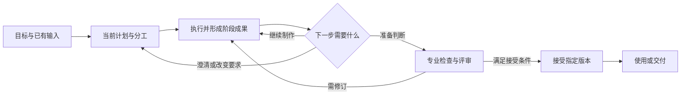
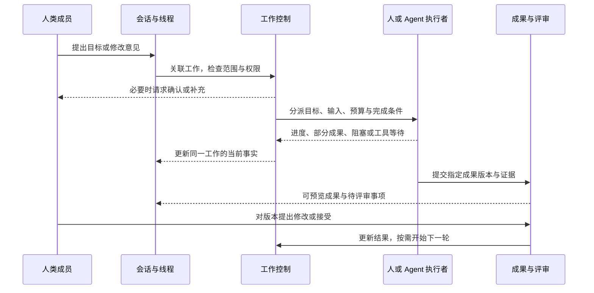
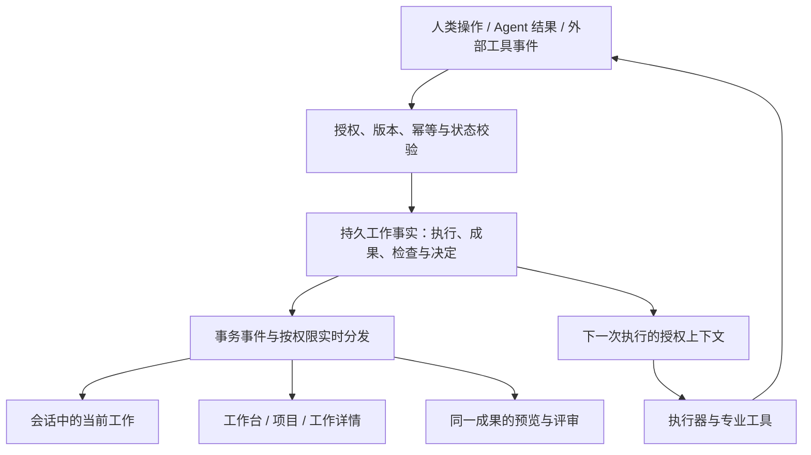
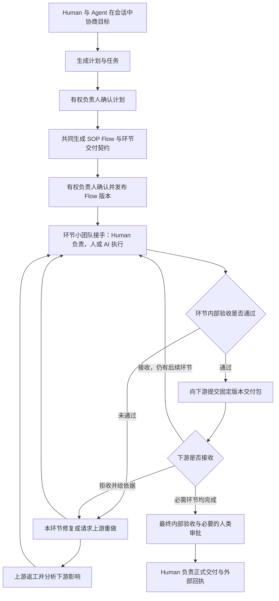
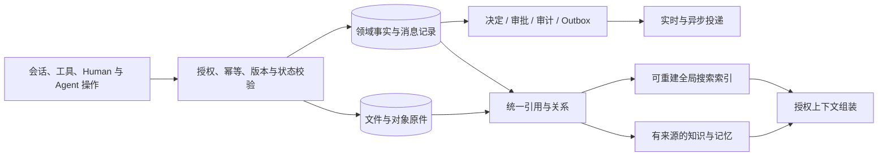

# Myrmidon — PRD_FINAL 完整产品需求文档

> 人与 Agent 在会话中确定目标、计划与 SOP，由 Human 负责的环节小团队协同执行，经内部验收、固定版本交接和必要人工审批，持续推进到可使用、可追溯的结果。

**版本：4.1 导航与租户确认基线｜日期：2026-10-13｜状态：产品设计与需求完整登记，未宣称功能实现。**

本文件整合原 PRD v3.0、REQUIREMENTS v1.3 与用户后续明确方向。原文保留供历史对照，后续产品需求维护以本文件为入口。所有有效能力保留，合并重复描述只合并事实与入口；冲突修订见 T2。尚未确认的产品政策仍明确标为提案 / 待冻结，不因命名 FINAL 被擅自批准。

## 阅读与使用规则

| 部分 | 内容与用途 | 入口 |
|---|---|---|
| P · 产品定义 | 用户价值、工作旅程、业务包、人机责任、专业反馈、知识、UI 与规范路由；保留原 PRD 的完整产品叙述 | [P0](#p0) 至 [P14](#p14)、[PA](#pa)、[PB](#pb) |
| R · 完整需求 | 原 291 条 REQ 逐条保留；覆盖原始 24 组要求、连接器、实时设施和 27 个验收场景 | [R0](#r0) 至 [R28](#r28) |
| S · 细化闭环 | 补齐原文分散能力、专业管理、状态与权限、升级和运行边界；新增可验收条目 | [S0](#s0) 至 [S9](#s9) |
| T · 覆盖与取舍 | 来源映射、冲突处置、待冻结决策和两轮实际文档评审 | [T0](#t0) 至 [T4](#t4) |

- P 解释用户如何工作，R 给出完整能力与逐项验收，S 补充可执行边界，三者描述同一套产品，不创建平行实现。正文中冲突已直接修订，不能只读旧文档覆盖本文件。
- 原 PRD 的 AC-01–18 改为 **JNY-01–18**；原清单 **AC-01–27** 保持编号；新增场景使用 **EXT-01 起**。场景编号不等于需求 ID，也不代表测试已运行。
- 用户明确要求与已确认方向为硬约束；候选技术、实现参数与未授权政策仍需在相应实施阶段冻结。分期是依赖与资源计划，不从完整范围删除功能，不沿用旧 MVP / v1.1 / v2 标签缩减范围。
- 当前工作区方向：`apps/backend-api`（Go）、`apps/frontend-web/apps/web`（Bun/Turbo 工作区中的单一 Web）、`apps/frontend-app`（Tauri 共享 Web 打包壳）、`apps/runner/cmd/runner`（纯 Go CLI / daemon 入口）。现有初始化不等于执行、移动端与协作功能已开发。
- 产品品牌、域名、CLI 发行名由部署配置决定；Myrmidon 是此文档的产品称谓，不要求在代码写死。

---

本文回答：谁会使用、每个人如何参与、通用流程如何适配不同业务、人和 Agent 如何协作、执行如何反馈，以及如何保留完整功能而减少重复页面。产品定位与能力范围沿用用户提出的通用方向；未经用户确认的具体产品取舍仍标记为可评审提案，不代表已实现或已批准开工。

| 阅读问题 | 位置 |
|---|---|
| 谁会用，为什么用，不同人看什么 | [P1 用户与价值](#p-users) · [P2 用户视角](#p-perspectives) |
| 一件工作如何完整完成 | [P3 核心工作单元](#p-work) · [P4 工作旅程](#p-journey) |
| 同一流程如何兼容不同行业 | [P5 通用流程](#p-process) · [P6 业务适配](#p-business) |
| 人和 Agent 如何内部协作 | [P7 责任与协作](#p-teamwork) |
| 会话、执行、实时反馈和预览如何联动 | [P8 会话与执行](#p-execution) · [P9 实时成果](#p-feedback) |
| 文件、知识和记忆起什么作用 | [P10 工作连续性](#p-context) |
| 如何减少页面与路由冗余，保持功能完整 | [P11 信息架构](#p-navigation) · [P12 路由与功能归属](#p-routes) |
| 先做什么，怎样证明有效 | [P13 范围与验证](#p-validation) · [P14 验收](#p-acceptance) |

## P0. 本版的产品决策摘要

1. **以一件有明确结果的工作组织产品。** 项目容纳长期协作，会话容纳交流，执行记录实际行动，成果承载最终价值。四者关联，但不互相替代。
2. **面向承担结果责任的人。** OPC 经营者、项目负责人、专业成员、评审者和客户围绕同一工作，以不同职责参与；不为每种身份建设独立产品。
3. **流程通用到“推进与判断”，专业到“怎么做、怎么验”。** 软件测试、小说编辑和视频审片不使用相同专业步骤，但都可以有要求、负责人、成果版本、反馈与接受。
4. **人和 Agent 都可执行，责任与权限必须明确。** 系统承担安排、跟踪、交接与有界修复，人决定目标、关键取舍和必须人工确认的事项。
5. **同一工作可从多个位置进入，但只有一份业务事实和一个规范对象地址。** 频道、待办、成果预览显示同一对象的不同上下文，不产生第二份任务或审批。
6. **简单来自减少用户维护工作。** 系统自动组织能够确定的信息；在影响结果或权限的分歧处提问。高级能力按需展开，不能以隐藏功能代替产品整合。

此前的 UI、数据库和模块清单降为实现资料。既有治理约束、专业能力与工程规格继续保留；本版重新编排章节，旧 PRD 章节号不得直接当作本版引用，衔接见 PA / PB。

---

## P1. 谁会用，为什么会把工作交给它

### P1.1 用户正在承担的隐性工作

用户使用多个 AI 和专业工具时，经常同时担任需求解释者、任务分派者、资料搬运者、进度追踪者和最终检查者。模型即使能产出内容，也不会自动保证这些环节连续：上一个决定有没有传给下一个执行者、别人改了哪一版、阻塞由谁处理、交付是否真的满足要求。

Myrmidon 应减少这部分协调与监督劳动，让用户把精力留给目标、专业判断和必要决定。**如果用户仍要在多个 Agent 之间复制背景、反复催办、手工拼接结果，那么即使所有功能都在一个页面里，产品也没有成立。**

### P1.2 优先适用的用户与工作

| 用户 | 常见工作 | 使用触发点 | 希望获得的改变 |
|---|---|---|---|
| OPC 经营者 / 独立创作者 | 产品资料、内容、图片、网站、小型交付 | 同时使用多个工具，工作持续几天，经常需要返工 | 一个人可以推动多种专业工作，不必逐个盯住 AI |
| 小团队负责人 | 项目交付、活动、产品迭代、内容生产 | 人和 AI 并行，交接和评审成为瓶颈 | 清楚谁负责、卡在哪里，只处理真正需要自己的问题 |
| 专业成员 | 产品、设计、开发、运营、剪辑、编辑 | 接到的任务缺背景，成果反复被要求修改 | 带着完整依据开始工作，用熟悉的工具提交可接续成果 |
| 评审者 / 业务决策者 | 方案选择、品牌审核、产品验收 | 需要看很多过程信息，却仍不知道该判断什么 | 直接看到指定版本、要求、变化与待决定事项 |
| 外部客户 / 合作方 | 提需求、澄清、审稿、验收 | 沟通与文件分散，承诺和版本不清 | 在明确范围内参与，知道交给自己的是什么 |
| 团队所有者 / 管理员 | 配置工具、控制费用、维护授权 | Agent 数量与调用成本增长、资料权限复杂 | 设置持续有效的边界，按异常管理，无需介入每一步 |

首轮适合招募经常处理**多步骤、多版本、需要交接或评审**工作的 OPC 与小团队。行业范围可以广，但使用问题应集中。以上是目标用户假设，尚不是已通过访谈证实的市场事实。

### P1.3 用户为什么不继续使用原来的组合

| 现有工作方式 | 继续适合什么 | Myrmidon 必须额外证明的价值 |
|---|---|---|
| 单模型对话 | 一次性问答、快速草稿 | 跨天、换人、换模型后仍能接续，不必重讲背景 |
| 项目管理工具 + IM | 人员协作、跟踪与讨论 | 可以实际调用执行能力，把计划推进到成果，并把反馈带回执行 |
| Agent CLI / 自动化脚本 | 单专业执行、成熟固定流程 | 将执行与需求、其他角色、评审和交付持续关联 |
| 文档 / 网盘 / 知识库 | 保存与检索资料 | 当前工作自动使用正确版本，来源变更能影响相关工作 |
| 专业设计 / 剪辑 / 开发工具 | 深度专业制作 | 专业工具产出的成果能被别人理解、评审与接续 |

对于只想问一个问题、做一次无需建立正式任务的生成（消息仍按永久保存与合法治理例外处理），Myrmidon 不应强迫建立项目和团队。对于复杂专业编辑，继续使用专业软件更合适。产品价值取决于持续工作中的实际节省，不依赖宣称替代所有工具。

---

## P2. 同一系统，不同人的工作视角

### P2.1 每个人进入系统后首先需要知道什么

| 视角 | 第一眼需要回答 | 日常动作 | 默认不占据注意力的信息 |
|---|---|---|---|
| OPC / 创作者 | 我的工作推进到哪，哪里需要我的判断 | 提目标、补资料、挑方案、修改、接受 | 组织层级、编制、复杂报表 |
| 负责人 | 哪项结果有风险，谁被阻塞，哪些决定必须由我做 | 定要求、调分工、处理例外、确认交付 | 每个工具调用与完整运行日志 |
| 执行成员 | 我负责什么，依据哪版要求，接下来交给谁 | 接受分派、工作、提交成果、说明未验证项 | 无关项目与管理配置 |
| 评审者 | 我要判断哪一版，依据什么，有什么变化 | 看成果、比差异、逐项反馈、接受或退回 | 全部频道历史与底层 Agent 调试信息 |
| 客户 / 外部成员 | 哪些事项等我确认，当前可看成果是哪版 | 澄清、签认、反馈、验收 | 内部任务、成本、候选争论、Agent 内部过程 |
| 管理员 | 授权、费用、执行资源是否异常 | 配置边界、轮换凭据、处理异常、查看审计 | 无授权的私人内容；他人的日常业务决定 |
| Agent | 目标、输入、权限、预算、完成条件是什么 | 接任务、执行、报告事实、请求帮助、交接 | 未授权频道、其他人的私人资料 |

这些是同一数据上的筛选与权限投影。一个人可以在工作 A 是执行者，在工作 B 是评审者，在项目 C 是负责人。身份切换不创建第二份任务，也不要求进入另一套应用。

### P2.2 三种规模下的使用方式

**个人：**用户发起工作，自己同时承担目标提出者和最终接受者。AI 负责可授权的执行与检查。默认只呈现自己的工作、会话、成果和待处理事项；个人自评如实标识，要求独立评审的工作不能被悄悄降级。

**内部团队：**多人对同一工作承担不同角色。系统增加分派、交接、依赖与共享，不改变原工作身份。个人资料仍然私有，团队成员资格不意味着自动看到每个人的所有会话与记忆。

**外部协作：**客户加入授权项目的共享范围。与团队使用同一份需求确认、成果和验收对象，但只获得允许的字段与记录。内部讨论不因邀请客户而整体公开，不另建甲方门户。

### P2.3 成长路径

OPC 可先独立使用，再邀请设计师共同完成一项工作，再邀请客户审核选定成果。每次增加的是参与者、责任与共享范围；不要求迁移项目、重建知识或转换到另一套团队产品。

正式工作必须有明确归属。建议首次形成可跟踪工作时由系统建立私人工作集合，工程上可复用受限项目实体；用户不必先手动建立业务项目。把工作分享给团队时明确选择要共享的工作和资料，不把整个私人集合改成公开。

### P2.4 同一项目中，每个人实际怎样走

| 人的视角 | 一条完整使用路径 | 完成后谁接着做 |
|---|---|---|
| OPC | 描述目标 → 补必要资料 → 工作中看阶段成果 → 对指定版本反馈 → 接受并使用 | 本人开始下一项工作，系统复用已确认上下文 |
| 负责人 | 待处理发现范围分歧 → 查看要求差异与影响 → 决定范围 → 看到分工和依赖继续推进 | 协调者与执行者接续，不要求负责人逐个转述 |
| 专业成员 | 我的任务接下工作 → 查看输入与完成条件 → 用专业工具制作 → 提交成果和未验证项 | 指定检查者或评审者收到真实待办 |
| 评审者 | 待评审直接打开指定版本 → 查看要求与变化 → 定位问题或接受 | 执行者得到具体修改范围，或负责人可组织交付 |
| 客户 | 通知进入共享成果 → 查看说明 → 提出批注、确认变更或验收 | 内部负责人处理反馈；客户不需要进入内部工作项 |
| 管理员 | 发现工具额度或授权异常 → 查看影响范围 → 调整许可或资源 | 受影响工作按政策恢复，业务决定仍由对应负责人负责 |

每条路径都有明确输入、动作、结果和接收者。系统只要求用户处理自己这一段责任，并持续显示下一步的归属。

---

## P3. 产品围绕什么组织：一件需要完成的工作

### P3.1 核心工作单元

“做一套新品发布资料”“完成小说下一章”“修复支付失败”都是工作。它们可以短至一次修改，也可以长至多个阶段。**工作有目标、有结果、有负责人；任务是其内部可分派步骤。**

工程上沿用 WorkItem 的父子关系，不因为产品用语“工作 / 任务”再建两套领域记录。项目组织一组长期相关的工作；频道承载这些工作的交流；一次执行只是完成某个步骤的一次尝试。

一项工作最少需要回答：

| 问题 | 产品应保存的信息 | 谁提供 |
|---|---|---|
| 为什么做 | 目标、使用场景、接收者 | 用户表达，系统整理 |
| 要交什么 | 成果类型、数量、必要格式 | 用户意图 + 专业默认值 |
| 怎么才算可以 | 必须满足的条件、评审方式与接受者 | 负责人确认，专业人员补充 |
| 能做到什么程度 | 范围、期限、预算、工具权限 | 用户与团队政策 |
| 谁负责推进 | 结果负责人、执行分工、当前等待谁 | 系统建议，授权范围内生效 |
| 现在是什么情况 | 当前阶段、有效版本、已知问题、下一动作 | 根据真实工作记录维护 |

这些信息不等于六张必填表。系统从请求、项目规则和已有资料提取，只在缺失信息会影响下一步时询问。未确定的内容显式标为假设，不能伪装成用户要求。

### P3.2 工作的四个组成部分

工作保持稳定身份；执行可以更换，讨论可以分线程，成果可以修订。用户回来时系统首先恢复这件工作，而不是要求用户猜该找哪一次聊天或哪一个 Agent。

### P3.3 产品承诺与责任边界

平台负责保留要求、组织被授权的行动、追踪依赖、组织评审、暴露问题、保存成果与交接上下文。负责人决定目的、不能自动裁定的取舍与必须由人确认的承诺。

产品可以承诺“按约定检查和评审后交付某版运营方案”，不能承诺“方案一定提高营收”。内容被接受、发布成功和业务效果达成是三个不同事实。运营指标、读者反馈等需要观察期，后续结果可以发起新的工作。

---

## P4. 用一件真实工作贯穿所有角色

以“为新品准备一套发布资料”为说明案例：包含一份产品介绍、一组主视觉，若需要再关联落地页实现。这里的业务情节用于设计推演，不是已完成的客户项目。

| 时刻 | 人在做什么 | Agent 与系统承担什么 | 留下的工作事实 |
|---|---|---|---|
| 1. 提出目标 | 经营者描述受众、用途、时间，提供现有产品资料 | 提取已知要求，只追问影响开工的缺口，例如品牌资料与最终接受者 | 工作目标、资料来源、假设与待确认项 |
| 2. 对齐结果 | 负责人确认成果、要求与计划，再确认由计划生成的 SOP 及环节交付契约；简单工作可明确一次确认两者 | 提出成果清单、最小计划和 SOP 草案；说明能力缺口、预算、不确定性与上下游交接 | 经确认的要求、计划版本、SOP 版本、预算、分工和交付契约 |
| 3. 并行制作 | 文案成员或文案 Agent 写介绍；图片 Agent 出候选；设计师可直接用自己的工具 | 给不同执行者提供各自必要资料，管理依赖，收集实际产物 | 各步骤状态、成果版本与执行记录 |
| 4. 选择方向 | 品牌负责人在候选上给出“保留 B 的构图、改色彩” | 把意见关联到 B 的版本，形成明确修改范围；不删除 A/C | 选型决定、局部反馈与新一轮输入 |
| 5. 处理中途变化 | 经营者决定调整目标受众 | 指出介绍文案、主视觉及落地页哪些内容受到影响，提出代价与新计划 | 新要求版本、受影响工作、继续 / 暂停决定 |
| 6. 内部接受 | 指定评审者判断文案、视觉与必要的功能质量 | 运行尺寸、格式、链接或软件测试等检查；汇总未决问题 | 要求逐项结论、有效证据与接受人 |
| 7. 外部确认 | 若有客户，向其共享选定版本；客户反馈或验收 | 仅展示共享内容，追踪回执；不暴露内部候选争论与成本 | 固定交付清单、反馈或验收回执 |
| 8. 接续使用 | 经营者稍后做同系列第二套资料 | 复用已确认品牌规则与可用成果，明确哪些资料已经变化 | 新工作、复用来源、未重复解释的背景 |

对于 OPC，第 1、2、4、6 步可能都是本人；系统不模拟不存在的部门。对于团队，它们由不同成员完成。没有客户时第 7 步不适用，不制造外部验收。

本例里真正需要减少的是负责人搬运资料、反复转述反馈、找正确版本、催办和核对的次数。发了多少消息、开了几个 Agent、画了多完整的流程图，都不能代替这个结果。

---

## P5. 通用流程究竟如何设计

### P5.1 通用的是六种推进责任

| 通用环节 | 必须解决的问题 | 产生的结果 | 可以怎样简化 |
|---|---|---|---|
| 理解 | 目标与约束是否足够开始 | 可执行的要求与必要假设 | 明确的小修改直接复用已有要求 |
| 组织 | 谁做、先后关系、投入上限是什么 | 最小计划、责任与权限 | 单人单步骤无需展示分派流程 |
| 制作 | 实际工作有没有发生、产出了什么 | 执行记录、阶段成果、阻塞 | 人可在专业工具中直接完成，Agent 不是必经角色 |
| 检验 | 结果符合哪些要求，还有哪些不确定 | 客观检查与专业评审 | 按业务适用，不强制所有工作跑软件测试 |
| 接受 | 谁有权决定这一版足够好 | 固定版本的接受 / 修改决定 | 个人低风险工作可本人接受，标明自评 |
| 使用与延续 | 交给谁、用在哪、下次如何接着做 | 交付或使用记录、可复用上下文 | 无外部接收人不要求客户回执 |

这是每件工作需要有答案的六类问题，不是必须走六页、点击六次批准的固定向导。系统可以自动完成明确的低风险环节；专业工作可以迭代、并行或从中间开始。

任何步骤都可能因资料、权限或依赖进入等待；恢复后从受影响位置继续。图中的执行可以展开成顺序、并行或候选分支，决定权与停止条件仍由同一套规则约束。

### P5.2 工作状态不等于专业步骤

产品对人呈现统一工作状态：**待开始、进行中、等待、待验收、待交接、已完成、已取消**。成果另记“草稿、提交评审、已接受”，执行与外部交付状态独立；内部接受不等于下游接收或整个工作完成。等待必须带原因和责任人，例如“等待你选择图片方向”“等待素材授权”“等待上游接口”，不能只显示暂停。

专业步骤由业务定义，例如“分镜”“粗剪”“调色”，或“分析”“编码”“回归”。工作处于“进行中”时，内部可以同时发生多个步骤。已有工程状态与 L1–L4 继续保留，具体映射需在规格同步时确认；本版不直接替换 API 枚举。P5 的图为责任概览，完整确认与交接闭环以 R2、S4 为准。

每个非终态工作都必须能够回答：**当前谁在推进、下一动作是什么、是否在等待、怎样解除等待。** 进度百分比无法回答这些问题时，优先显示事实与里程碑。

### P5.3 如何生成和调整流程

流程按四类信息组合：用户要的结果、已有输入、专业工作包、团队规则。AI 可以提出步骤与分派；计划及 SOP 各有独立版本和确认记录，可一次操作明确确认二者。系统检查确认、依赖、能力、预算和权限后执行。

- **首次生成：**只生成足以得到当前结果的计划；缺乏关键能力时先说明缺口，不展示虚假的可执行方案。
- **执行中：**可以细化不改变已确认范围的步骤；超预算、改目标、删验收条件、改变外部承诺必须进入相应决定。
- **收到反馈：**判断是同一要求下的修订，还是需求变化；前者局部重做，后者形成要求差异与影响评估。
- **修改上游：**沿依赖标记受影响成果与评审，通知实际责任人；不把全部工作从头重跑。
- **进入循环：**有明确退出条件和轮次 / 时间 / 成本上限；无法收敛时把备选方案与问题交给负责人。

流程规则的优先级由系统约束：平台授权与不可绕过的限制 → 已确认的项目要求与团队政策 → 专业默认流程 → Agent 建议。矛盾不能通过“取最后一条提示词”解决。

### P5.4 六种必须兼容的工作形态

| 工作形态 | 例子 | 通用机制怎样适配 |
|---|---|---|
| 一步完成 | 改一句介绍、调一张图 | 最小契约、一次执行、结果预览；需要的检查与接受仍有记录 |
| 顺序接力 | 研究 → 写稿 → 编辑 | 下游读取上游已交接版本；上游变化提示受影响步骤 |
| 并行协作 | 文案与视觉同时制作 | 明确共同基线与独立输出，汇合时检查一致性 |
| 探索与选择 | 三种创意方向、两个技术方案 | 候选并存，选择形成决定；探索失败不冒充交付失败 |
| 接手已有工作 | 导入半成品小说、已有代码或设计 | 登记来源和已知状态，从缺失步骤开始，不伪造前序已验证记录 |
| 长期或周期工作 | 连载、每周运营复盘 | 每章 / 每期有自己的结果与接受，长期目标持续存在；周期调度纳入完整范围，按实施依赖建设 |

动态表单只收集下一步确实需要的信息，已有信息预填并标出处。流程可被专业用户查看与调整，但普通用户不必学习流程语言；可视化编辑属于高级入口，不能是开始工作的前提。

---

## P6. 怎么兼容不同业务，又不失去专业性

### P6.1 每个业务改变的是什么

| 业务 | 专业推进方式示例 | 关键成果 | 可以自动检查 | 必须保留的人类判断 |
|---|---|---|---|---|
| 运营 | 目标与口径 → 活动方案 → 配置 → 观察 → 复盘 | 方案、配置、数据报告 | 配置、数据时窗、计算与链接 | 策略取舍、品牌风险、是否继续投入 |
| 产品 | 问题研究 → 场景与方案 → 原型 → 需求确认 | PRD、旅程、原型、验收条件 | 完整性、冲突、引用与可追踪性 | 用户价值、范围与优先级 |
| UI / UX | 用户流程 → 结构 → 视觉 → 交互验证 | 设计稿、组件、原型 | 尺寸、部分规范与可访问性 | 体验、美感、品牌与可用性判断 |
| 软件 | 分析 → 实现 → 独立验证 → 修复 → 评审 | 代码、构建、测试、发布说明 | 编译、测试、静态检查、部署检查 | 产品接受、架构取舍与必要发布授权 |
| 视频 / 音频 | 脚本 → 素材 → 粗剪 → 精修 → 审片 | 素材、工程、成片、字幕、音轨 | 时长、编码、分辨率、声道等 | 节奏、叙事、审美、授权与内容判断 |
| 广告 | 受众与主张 → 概念 → 候选 → 渠道适配 | 文案、分镜、图像、投放素材 | 字数、尺寸、渠道格式 | 创意、说服力、品牌及法律要求 |
| 图片 | 简报 → 候选 → 选版 → 局部修改 → 导出 | 原图、变体、源文件、导出件 | 尺寸、格式、部分一致性检测 | 构图、视觉方向、是否符合意图 |
| 写作 / 小说 | 研究或设定 → 大纲 → 章节 → 编辑 → 修订 | 引用、人物、世界观、章节、正文 | 来源、结构、部分连续性检查 | 文风、叙事、人物与创作意图 |

这些步骤是起点，不是行业固定流程。“只修订第三章”不要求重建世界观，“只导出已有视频”不要求重新写脚本。

### P6.2 专业工作包的产品职责

一个工作包必须让系统知道：这类工作需要哪些输入、通常怎么推进、要交什么、用什么工具、怎么查看和反馈、如何判断可接受。它是一组可复用的专业做法，可以和其他工作包组合。

团队规则进一步确定品牌、代码规范、审批人、预算与工作习惯。项目可以固定版本，避免工作做到一半因为模板更新而改变验收要求。更换工作包不自动获得工具权限，也不能删除历史结果。

例如发布资料可以组合写作与图片能力；小说可以只使用写作能力；软件项目继续保留云效对齐、缺陷、测试与流水线等深度能力。这些能力在相关工作出现，不要求其他职业看懂软件术语。

### P6.3 通用性必须通过什么检验

增加一个视频包，应主要增加视频输入、工具、成果格式、查看与审片规则，而不是重新实现成员、频道、工作分派、版本和交付。不同专业的人仍能在同一项目内把成果交给对方。

内核若无法表达真实业务关系，应记录场景并做最小扩展；不能为了宣称通用，把所有规则塞进无结构备注。通用性是扩展成本与实际可用性，不是支持的行业名称数量。

---

## P7. Agent + Human 如何内部协作

### P7.1 一件工作中的责任关系

| 角色 | 对什么负责 | 能否由 Agent 承担 |
|---|---|---|
| 结果负责人 | 目标、资源、关键取舍、最终兜底 | 每项正式工作保留人类负责人；日常协调可委托 |
| 协调者 | 拆解、分派、跟踪依赖、整理问题与交接 | 可以；主管 Agent 在授权范围内承担 |
| 执行者 | 产出指定成果、报告事实与未验证项 | 可以是人、Agent，或二者接力 |
| 检查 / 评审者 | 检查要求，指出问题，给出专业判断 | 可由工具、Agent 或人承担，按要求选择 |
| 接受 / 承诺者 | 决定接受指定版本、确认范围和对外承诺 | 低风险中间环节接受可明确委托，仍有有效内部检查与 Human 负责人；最终交付及既有人工必经动作不可委托 Agent 放行 |

同一个人可以兼任多个角色；Agent 不可裁决自己的产出。主管 Agent 分派了工作，不等于拥有最终接受权。人类独立创作并自评时如实标记；需要独立评审的项目必须满足其规则。

### P7.2 分工不等于把任务扔给 Agent

一次分派应携带工作目标、固定要求、输入版本、输出约定、可用工具、预算、接收者与完成条件。执行者接受后才成为“已接手”；消息已读不是接手。

系统区分“已安排但尚未开始”“已经在做”“需要协助”“准备交接”。负责人不需要靠追问聊天来确认状态。执行者不可用时给出可替代人选与影响，授权范围内改派，其余请负责人决定。

默认选择满足要求的最简单执行方式。一个 Agent 能完成时无需凑齐主管、执行、审查等多个会话；需要不同能力、独立检查或并行探索时再分工。多 Agent 的额外成本必须能解释。

### P7.3 人和 Agent 之间的五种协作

| 协作方式 | 工作如何交接 | 系统必须处理什么 |
|---|---|---|
| 人提出，Agent 完成 | 人确认目标和边界，Agent 执行并交回成果 | 进度、例外、版本与验收，不靠人持续提示 |
| Agent 起草，人加工 | 人接管明确版本继续编辑 | 保留作者、基线和变更；暂停同一位置的竞争写入 |
| 人完成，Agent 检查 | 人提交专业工具成果，Agent 按要求检查 | 不要求成果一定由 Agent 生成；未知能力如实说明 |
| 多人 / 多 Agent 并行 | 各自在独立输出或隔离分支工作 | 共同基线、依赖、汇合与冲突，不静默覆盖 |
| 人中途接管或换执行者 | 固定当前状态、部分成果与未完成动作 | 可接续交接包、权限重新核验、外部副作用核实 |

交接包至少包含：已经做了什么、有效成果版本、依据哪些决定、哪些尚未验证、下一步、阻塞、剩余预算和可用资料。换模型不迁移隐藏推理或假设能无损恢复原生会话。

### P7.4 哪些事自动做，哪些事找人

| 情况 | 默认行为 |
|---|---|
| 授权范围内检索、起草、检查、局部修复 | 自动推进并留记录，避免重复索取同一授权 |
| 需要在多个有效方案中选择，但已有明确选择规则 | 按规则选择并说明依据；没有规则则提交比较与建议 |
| 输入缺失且影响当前步骤 | 只向能回答的人问必要问题，其他独立工作继续 |
| 要改目标、删必需要求、增加承诺或超出预算 | 给出差异、代价与建议，等待有权人决定 |
| 正式对外交付、合同 / 范围承诺、生产访问授权 | 保留人工决定，不委托 Agent 自行放行 |
| 执行故障或检查失败 | 可恢复且无不确定副作用时有限恢复；否则暂停相关步骤并报告 |
| 内容涉及审美、风格、创作意图 | 由指定评审者决定，AI 提供建议与可检查事实 |

已确认的混编分派默认提案、自动策略、委托范围、职责分离与升级约束继续有效。管理员配置不替代业务责任人决定，模型“认为安全”不授予权限。

### P7.5 分歧、返工与停线

- **质量问题：**在原要求下修改，保留被拒版本与具体反馈。
- **范围变化：**先确认新要求与影响，不偷偷增加工作或继续按旧版验收。
- **意见冲突：**保留不同意见，由指定决定者解决；Agent 不凭发言先后自行选边。
- **并发修改：**检查所读版本，发现他人已改动时要求合并或重新读取。
- **无法收敛：**到预算或轮次上限时暂停，提交已尝试方案和下一建议；软件包沿用内部质量轮次与正式返工的不同计数。
- **停线：**有权暂停者或既有停线规则暂停相关下游；安全依赖不满足时不能用其他步骤“完成了”掩盖问题。

内部返工不必每轮通知负责人，但必须可追溯。需要人决定时，通知应附问题、影响、建议、可选动作和已取得成果，不只发一句“执行失败”。

---

## P8. 会话、频道与执行怎样组织

### P8.1 四种关系必须分清

| 概念 | 用户为什么需要 | 与工作的关系 |
|---|---|---|
| 会话中心 | 找到当前交流、Agent 交互和待回应事项 | 统一进入位置，不是一种新的业务对象 |
| 频道 / 私信 | 确定与谁持续沟通，以及谁有权读取 | 一个频道可讨论多项工作；私信不因关联工作自动共享 |
| 线程 | 围绕一个议题保持上下文，避免消息串扰 | 可关联工作、成果或决定；不是每个线程都要建任务 |
| 执行会话 | 给具体执行补充输入、查看工具行动、处理授权 | 连接一次执行；同一工作可有多次尝试，原记录保留 |

**会话不会因为一个执行完成而消失，执行也不会因为关闭会话页面而停止。** 长期频道不绑定单一模型。真正执行时选择适合的 Agent / 模型与工具，换执行者仍能回到原工作讨论。

### P8.2 从一句话到一次行动

在频道中说“这里的标题太长”，可能只是意见；说“请把当前标题缩到 12 字内”是行动请求。系统结合对象、权限和上下文判断：可直接答复、创建修订草案、或提出工作分派。

对于明确且已有授权的操作，执行并回写关联工作；对范围不清或影响正式要求的操作，先展示拟采取的行动。讨论转工作保留来源消息版本，重复操作定位已有工作，不重复创建。确认要求、接受成果和批准工具通过真实对象命令完成，不能把普通“好的”自动当成所有后续动作的授权。

### P8.3 谁会被唤醒，谁能看到什么

@指定成员、明确分派和被订阅事件可以唤醒 Agent。普通频道消息不会触发所有 Agent；Agent 回复也不会无限互相触发。协调者可以汇总，但原作者、分工与证据可展开查看。

人 ↔ 人私信默认只有参与者可见。人 ↔ Agent 会话需显示该 Agent 的负责人与审计访问政策；不能把团队托管 Agent 误呈现为绝对私密。私人内容转为团队工作前预览将共享的资料，不能默认搬运整段历史。

共享频道由人显式创建，外部成员标记常驻。内部频道不能因增加一名客户而默认公开全历史；向外分享选择过的消息 / 成果并检查附件权限。对外 Agent 回复默认起草，已授权的事实答复可发送，承诺类由人确认。

### P8.4 会话中的完整工作循环

频道中的工作摘要、工作详情中的进展、待办中的审批读取同一状态。任何入口处理后，其他入口同步更新；旧审批不能批准后来生成的新版本。

### P8.5 不把所有过程变成聊天噪音

会话默认展示目标、计划变化、阶段成果、阻塞、待决定和最终结果。工具调用、Agent 互相传递的执行事件按步骤聚合，可展开追查；不连续刷屏淹没人的意见。

未读与待处理分开：读过消息不代表接下任务；静音普通频道不删除预算停线或必须处理的决定。任务与审批有明确处理者、结果和过期规则，不把所有关注事项都做成一条新的通知。

---

## P9. 执行中的实时反馈与成果预览

### P9.1 用户应该持续知道的四件事

**正在做什么、已经得到什么、为什么等待、是否需要我行动。** 反馈必须来自实际执行事件或工作事实，不能用模型一直输出文字制造“仍在工作”的感觉。

| 实际情况 | 用户得到的反馈 | 用户可以做什么 |
|---|---|---|
| 正在规划 | 正在确认的步骤、已有假设、缺失条件 | 补资料、修正目标 |
| 已派发未开始 | 等待的执行者 / 资源、排队原因 | 改派、取消；有依据时才显示预计时间 |
| 正在执行 | 当前步骤、最近有效事件、已完成的可计数部分 | 查看过程、补充意见、请求暂停 |
| 产生阶段成果 | 可查看的具体内容、草稿标记、对应步骤 | 预览、比较、针对内容反馈 |
| 等待授权 / 输入 | 需要谁决定、动作范围、拒绝影响 | 允许、拒绝、回答或转交 |
| 没有新进展 | 最近更新时间、心跳 / 连接状态、已知原因 | 检查、恢复、接管，不能误显示持续正常 |
| 执行完成 | 产出了什么、检查情况、未验证项 | 进入评审，不能直接显示“已接受” |
| 中断 / 失败 | 已保存成果、失败位置、副作用是否明确 | 继续、换执行者、保留部分结果或终止 |

只有总量确知时才显示比例，例如“已生成 2/3 个候选”。模型工作量不确定时显示阶段与事实，不捏造 87% 或完成时间。

### P9.2 同一成果的三个状态

| 状态 | 用途 | 反馈怎样绑定 |
|---|---|---|
| **实时工作稿** | 看正在形成的文档、图片候选、运行中的网页或媒体代理 | 批注时固定当前内容快照 / 修订号；不把意见绑定到不断变化的“最新内容” |
| **提交评审版** | 判断一次具体提交是否可接受 | 固定版本和输入要求，检查与批注都指向此版本 |
| **已接受 / 交付版** | 真正使用、分享或交付 | 保持不可变引用；后续修改产生新版本 |

实时预览不能冒充已接受成果；屏幕能显示网页不等于测试通过。外部成员仅看明确开放的版本或经授权的实时预览，内部生成过程不自动外发。

### P9.3 不同成果怎样实时查看

| 工作 | 预览行为 | 用户反馈如何回到执行 |
|---|---|---|
| 文档 / 小说 | 按段落或章节增量更新，不强行滚走正在阅读的位置 | 引用具体段落与版本，形成修改要求 |
| 图片 / 设计 | 候选准备好后出现；支持并排与区域定位 | 选择候选、指定区域和期望，保留其他候选 |
| 软件 | 显示变更、检查状态；支持时提供隔离运行预览 | 反馈关联提交、界面区域或复现步骤 |
| 视频 / 音频 | 后台处理，先给可用代理与字幕；无片段时显示真实处理阶段 | 时间点 / 时间段反馈，明确针对的片段版本 |
| 数据报告 | 展示当前数据时窗、已完成计算、结果与来源 | 反馈关联指标口径或具体图表 / 数据行 |

格式不支持时提供下载或外部专业工具打开，并明确限制。平台组织专业工具的工作，不用粗糙的内嵌编辑器替代所有专业软件。

### P9.4 运行中修改指令，不能装作立刻生效

一般补充先进入待处理输入，在执行器可接收的安全边界应用，并显示“已收到 / 已应用 / 无法应用”。改变目标或撤回权限时先暂停受影响步骤，确认新范围后继续。

用户接管编辑前明确写入所有权；Agent 不再同时改同一文件或版本。恢复时比较人工改动与原基线，把实际新版本交还执行者。不能在聊天里说“已调整”，后台却仍按旧要求输出。

### P9.5 断线、重复与跨设备

执行、成果、检查和决定先成为持久记录，再向有权客户端推送事件。客户端按对象版本 / 事件序号更新；重连补取遗漏记录并去重，不靠重播全部聊天恢复状态。

关闭页面、切换频道或换设备不终止后台工作。取消和停止是显式命令，收到回执前显示“停止中”；外部动作结果未知时显示“待核实”，不自动重放。权限撤回后停止后续读取、推送和工具操作；已发送给外部模型的信息不能声称被远程收回。

实时事件通常只更新当前可见对象和必要计数，历史消息增量加载，预览按需加载。状态反馈目标沿用在线 P95 ≤1 秒，模型响应和转码时间另计；这是未来测试门槛，不是现有原型的实测结论。

---

## P10. 文件、知识与记忆如何让工作持续

### P10.1 用户真正需要的连续性

“下次还能找到”“换人不用从头解释”“正式要求不会被旧对话覆盖”“个人内容不会误传给团队”，才是知识基础设施的产品价值。文件库、检索和记忆在后台分工，用户围绕当前工作使用资料，不需要先管理一套 RAG 系统。

| 内容 | 应该放在哪里 | 在工作中怎样使用 |
|---|---|---|
| 原始文件与成果 | 文件资产与成果版本 | 直接引用、预览、比较、交付，不强制全部转成文本 |
| 品牌规范、研究资料、SOP、人物设定 | 带来源的知识 | 检索相关片段，给出原件与版本 |
| 偏好、确认过的经验、纠错 | 可治理记忆 | 在适用范围内辅助选择，不覆写硬要求 |
| 当前状态、正式要求与决定 | 工作领域记录 | 直接恢复事实，不能由聊天摘要替代 |
| 仓库、外部文档与专业工具资料 | 连接器与固定来源引用 | 实时读取或受控同步，显示新鲜度与权限 |

### P10.2 自动组装，用户能够核对

每次分派按当前目标、执行角色、阶段、预算与权限选择资料。输入包保留来源、版本、选择理由、缺失项与截断；用户可以查看“这次用了什么”。必需要求不能因上下文预算不足被静默丢弃。

有冲突时优先识别适用范围与确认状态：旧偏好不自动覆盖新确认的品牌要求，小说的试写设定不自动成为正式世界观。无法判断的冲突交给负责人，不用模型自信程度替代确认。

换模型、换人或换机器时沿用工作事实和版本化交接包；模型内部私有状态不构成平台的唯一记忆。

### P10.3 个人与团队的共享边界

作用域为个人、当前工作、项目、团队，以及组织级政策。共享动作明确“哪些资料、给谁、用于什么”；引用文件不等于有权读取，Agent 不因在团队名册中就获得所有内容。

检索前、组装前和工具读取时执行授权；搜索摘要、通知、缓存、预览与导出遵守同样边界。外部源权限与平台权限取交集，不能先把敏感材料交给模型再要求它别说出来。

### P10.4 沉淀与纠错

任务完成后保存成果、决定与证据；只把适合复用的材料纳入知识，稳定偏好与经过验证的经验才成为记忆。推断先作为候选，规则型记忆继续要求人审。

用户可以查看、修订、禁用和删除自己的记忆。来源更新、删除或撤权时，新检索和上下文停止使用旧内容，关联摘要与缓存失效；必要审计与备份保留政策另行明确，不能承诺无法做到的即时彻底删除。

无需以独立向量数据库作为首版前提。基础检索先满足真实资料查找和引用，效果证明有必要时再增加语义检索；存储、解析与三方言实现仍遵循现有工程底座。

---

## P11. 页面怎样少而够用

### P11.1 先按工作意图组织，再决定页面

保留既有 **工作台、会话、协作、团队、治理** 五个一级职责区。普通成员主要使用前三个，其他区域按权限与需要出现；没有必要让每个用户每天进入机器、工具与策略管理。

| 区域 | 唯一主要职责 | 不重复承担 |
|---|---|---|
| 工作台 | 找到我现在要处理或继续的工作 | 不复制项目详情、执行器与指标事实；跨项目大盘属于此处视图 |
| 会话 | 交流、Agent 交互、处理执行中的输入 | 不再复制任务数据库、成果版本与审批状态 |
| 协作 | 组织当前项目的工作、要求、成果与交付 | 不再放跳往会话区的频道二级菜单 |
| 团队 | 管理可复用成员、资源、知识、工具与方法 | 不复制每个项目自己的任务清单 |
| 治理 | 设置权限、预算、连接与审计边界 | 不介入每项业务工作的日常执行 |

顶部项目选择器决定具体协作范围，详情以对象真实所属项目为准；跨项目视图必须显示当前组织 / 项目范围，切换筛选不迁移对象。工作台同时提供组织、团队与跨项目汇总视图，包含进度、预算、负载、风险、告警和待审批；只汇总授权项目。无需另建重复的项目组合菜单，点开仍是原对象。

### P11.2 日常工作只需要三种空间

**处理空间：工作台。** 默认显示待我处理和继续工作；我的任务、待审事项、阻塞、最近成果是视图与筛选。同一任务不能同时出现为“我的工作”“我的任务”“待办任务”三套独立记录。通知显示事件，待处理项显示尚未完成的责任，二者通过同一对象关联。

**交流空间：会话。** 当前频道或执行交互为主，需要看成果时展开同一成果查看器，需要看线程时切换上下文。没有成果就不预留空白预览栏。用户不必在“Agent 聊天”“执行会话”“频道工作台”三个页面之间往返。

**工作空间：项目与工作详情。** 项目回答整体结果、分工和风险；工作详情回答这一件工作的要求、计划、成果、评审和活动。列表、看板、阶段图是同一集合的视图。需要集中评审时给同一工作集合加“待评审”筛选和评审布局，不建设第二份评审任务系统。

这是三种使用意图，不是把所有能力塞进三条 URL。成果有独立版本和分享需求，工具、成员与治理有独立权限和生命周期，仍然保留必要的详情与管理入口。

### P11.3 对象详情与上下文面板使用同一套能力

在会话内打开成果，可以预览、比较、批注和接受；全屏打开同一成果，动作、权限与状态不变。面板不是功能缩水版，也不是复制实现。

推荐工作布局：左侧当前区域导航，中间当前讨论或工作，右侧按需显示成果 / 线程 / 执行详情。右侧一次突出一个主对象，可切换，不连开多层抽屉。长篇编辑、设计和视频需要空间时全宽打开，返回保留原会话位置与草稿。

手机按“当前内容 → 详情 → 返回”逐层进入，具备相同关键能力；返回恢复滚动、选定版本与输入状态。鼠标悬停、拖拽与快捷键不能成为唯一操作方式。

### P11.4 不同角色看到的差异

- OPC 工作台突出个人当前工作；高级配置按需进入，不要求填组织和流程表。
- 执行成员默认过滤自己负责的工作；负责人可切换到项目进展，二者使用相同工作列表能力。
- 评审者从待处理进入指定成果版本，已有要求、差异与检查自动带上，无需自己找聊天记录。
- 客户使用相同对象的外部投影，只见共享要求、成果、变更与验收；不另建客户门户或复制路由树。
- 管理员在治理中配置长期规则，在具体工作中查看该规则的适用结果；不在多个页面重复维护权限。

---

## P12. 路由与功能归属：一对象一主地址，多处引用

### P12.1 路由原则

1. **独立身份、独立权限或可单独交接的对象，才需要独立详情地址。** 展示方式、角色、打开来源不是新对象。
2. **列表 / 看板 / 评审布局 / 状态筛选使用查询状态。** 不为相同集合的每个视图注册一套页面。
3. **对象只有一个规范主地址。** 会话内预览属于当前会话的嵌入状态；“打开详情 / 复制对象链接”总是指向原对象。
4. **不建角色专用路由。** 同一地址按服务端权限返回不同投影；隐藏菜单不能代替鉴权。
5. **高级设置集中维护，业务现场提供同一操作的快捷入口。** 快捷操作不创建第二份配置记录。
6. **浏览器前进、返回、刷新和分享可恢复上下文。** 业务对象与持久筛选进入 URL，滚动位置、草稿等按用户与对象保存；密钥和正文不放 URL。

以下是待同步的产品路由方案，前缀统一为 `/t/:tenantID`。尽量沿用已有对象地址；表中合并尚未修改现有规格或原型。

### P12.2 规范地址与页面职责

| 地址 / 路由族 | 保存的使用意图 | 视图参数或对象上下文 |
|---|---|---|
| `/overview` | 个人工作台及授权跨项目大盘；外部成员为授权待办投影 | `view=attention/assigned/recent/portfolio`；按组织、团队、项目、责任、状态与时间筛选 |
| `/chat` | 唯一会话中心，包含频道、私信与执行交互 | `channel_id` 或 `execution_id` 选择主会话；`thread_id` 定位线程 |
| `/p/:projectID` | 当前项目概览与目标结果 | 项目级进展、风险与下一决定；不复制任务详情 |
| `/p/:projectID/work-items` | 当前项目工作集合 | `view=list/board/review`；专业类型与状态为筛选 |
| `/p/:projectID/work-items/:workItemID` | 一件工作的唯一详情 | `tab=brief/plan/results/review/activity`；执行记录作为当前工作上下文 |
| `/p/:projectID/artifacts/:artifactID` | 成果的唯一详情 | `version` 指定不可变版本，`compare` 比较；编辑、预览和批注复用同一对象 |
| `/p/:projectID/deliveries` 与 `/p/:projectID/deliveries/:deliveryID` | 交付集合与固定交付包 | 同一交付对象的内部管理 / 外部验收投影 |
| `/knowledge` | 可访问资料的统一查找与管理入口 | `scope`、`project_id`、`kind=files/knowledge/memory`；统一入口不合并底层生命周期 |
| `/members`、`/agents/:agentID`、`/machines`、`/tools`、`/templates` | 有独立生命周期的团队能力 | 对象详情、版本和授权；不再另建“AI 团队”“Agent 中心”副本 |
| `/goals`、`/reports`、项目专业资源路由 | 独立目标 / 报告与专业工作 | 真实目标树、周期报告、测试用例等保留；不等于任务的重复视图 |
| `/governance/policy`、`/governance/audit` 与必要设置路由 | 授权、预算、审计、连接与个人偏好 | 注册明确的资源与权限；不使用无限兜底页面掩盖信息架构 |

要求、确认单、变更、外部问题反馈等拥有独立签认或生命周期的对象继续保留规范地址，在工作与项目中关联使用；不能为了减少 URL 数量，把它们降为普通聊天消息。

个人工作使用 P2.3 的私人归属，同样进入工作对象地址；没有复制 `/personal/work` 和 `/team/work` 两套详情。直接访问对象时查真实归属与授权；没有权限时不泄露对象名称、历史或计数。

### P12.3 会话上下文的准确寻址

频道和私信都以 `channel_id` 标识；执行交互沿用 `/chat?execution_id=:executionID`。二者作为主会话选择器互斥，避免当前到底在与谁交流不明确。

在频道中打开某个执行或成果，可用 `panel=execution/artifact`、`target_id`、必要的 `version` 表达嵌入上下文；这些参数不另注册对象路由，也不创建副本。打开执行主会话时使用规范 `execution_id` 地址，打开成果详情时使用规范成果地址。

深链接包含稳定对象与版本，不包含权限令牌；仍要服务端鉴权。线程跨频道、成果不在可访问范围、查询参数冲突时明确处理，不偷偷打开另一个项目。逐 token、滚动和自动刷新不堆积浏览器历史；用户主动打开对象或切换工作才形成可返回的导航步骤。

### P12.4 明确合并哪些冗余

| 原有 / 易出现的重复 | 合并后的归属 | 保留的能力 |
|---|---|---|
| 总览、我的任务、我的裁决各一套聚合页 | `/overview` 的对应视图；原 `/my-tasks`、`/inbox` 为待退休入口 | 筛选、集中处理、快捷键、未完成责任、通知入口 |
| 客户待办与内部待办两套页面实现 | 同一工作台的授权投影 | 客户签认、确认变更与验收 |
| 独立执行 session 页、Agent 聊天页、会话页 | `/chat` 的不同真实会话对象 | 工具授权、输入、停止、继续、附件、历史 |
| 任务列表、缺陷列表、待评审列表各复制工作系统 | 同一 WorkItem 集合按类型 / 状态 / 布局展示 | 缺陷专属字段、结构化评审、分派、依赖 |
| 专业流水线列表与通用执行列表复制运行状态 | 工作计划 / 执行记录的专业视图 | 节点结果、日志、失败恢复、外部 CI 关联；独立 CI 运行仍保留身份 |
| 文件预览、项目产物、交付产物三套查看器 | 同一成果 / 文件查看能力，多处引用固定版本 | 批注、差异、导出、候选对比、交付版本 |
| 项目频道菜单与会话频道重复导航 | 频道统一进入会话；工作中保留对象讨论引用 | 所有频道与线程，不增加跨区侧栏菜单 |
| 执行页、聊天卡、评审页各保存一份审批 | 同一 Decision / 工具授权对象 | 当前权限、版本校验、理由、审计和处理结果 |
| 个人知识、团队知识、Agent 记忆分别复制管理系统 | 统一资料入口，按作用域和内容类型显示对应治理动作 | 来源、版本、检索、记忆审核与删除权限 |
| 项目模板、流程模板、AI 起草各自保存流程 | 同一版本化 WorkflowDef / 工作包 | 可视化、AI 草案、比较、发布与实例追踪 |

旧原型未作为生产路由发布；后续同步时逐项改入口、深链接、菜单与测试，再移除退休 UI 路由，不新增 alias / 重定向维持两套入口。领域 API 与对象身份不因 UI 合并而自动改名。若未来涉及已发布客户端，兼容迁移需另作评审。

### P12.5 功能完整性不能靠页面数量证明

| 能力 | 日常使用位置 | 完整管理 / 深度操作位置 |
|---|---|---|
| 目标、计划、分派、依赖 | 工作详情与项目进展 | 目标树、专业计划、团队分派规则 |
| 频道、私信、线程、@提及 | 会话中心 | 同一会话的成员与共享设置 |
| 执行、工具批准、恢复与接管 | 会话或工作上下文 | 同一执行的日志、机器与适配器详情 |
| 实时预览、版本、候选、批注 | 会话内成果查看器 | 同一成果全宽详情与专业工具 |
| 客观检查、主观评审、接受 | 待处理视图 / 工作评审 | 要求映射、原始证据、检查历史与审计 |
| 文件、知识、记忆、外部资料 | 当前工作引用与检索 | 统一资料入口，连接器配置归治理 |
| 对外需求、变更、交付、回执 | 共享会话与项目对象 | 同一对象的签认、版本和发送记录 |
| Agent、主管编排、Heavy、扩编 | 当前工作按需启用 | Agent 档案、编制、预算、模型与工具授权 |
| 软件测试、缺陷、云效与 CI | 软件工作包的工作视图 | 独立用例、测试计划、外部运行与专业配置 |
| 视频、小说、设计等专业能力 | 当前成果与专业步骤 | 对应编辑器、时间线、章节树或设计工具 |
| 目标、日报周报、复盘、工时 | 我的工作与项目 | 已批准的目标 / 报告能力，按阶段实施 |
| 权限、费用、审计、通知 | 当前动作的说明与异常提醒 | 治理与个人设置 |

“完整管理”不必都常驻菜单，必须从相关对象可发现、可深链接、可搜索。只有独立工作意图、生命周期或编辑复杂度足够时才建立专门页面；不能把所有深度功能藏进不可发现的设置抽屉。

---

## P13. 先验证产品价值，再扩展覆盖

### P13.1 首轮验证什么

首轮面向 OPC 与小团队，以文档 / 写作、软件、创意图片三种不同工作检验同一工作内核。软件团队试点基础继续保留，其他场景补充不同执行与评审机制；不把一套演示换三个名称当成三类业务已经支持。

| 验证工作 | 最小完整结果 | 验证的产品假设 |
|---|---|---|
| 文档 / 写作 | 资料输入、起草、反馈、换模型接续、修订与接受 | 背景不必反复解释，主观意见能落实到实际版本 |
| 软件 | 明确要求、编码、独立验证、修复、接受与交付 | 执行可靠、证据可信，负责人不用逐步盯住 Agent |
| 创意图片 | 真实生成候选、选版、区域反馈、修改与导出 | 非文本成果与主观选择能使用相同协作机制 |

至少一条工作由多人接力，至少一条由 OPC 独立完成；外部成员与私人资料隔离单独验证。现有原型只能验证理解与操作路径，不能替代真实模型执行、权限与持久化测试。

### P13.2 交付顺序与完整能力的关系

| 阶段 | 能够完成什么 | 进入下一阶段的依据 |
|---|---|---|
| 共同闭环 | 人提出目标，在一处跟进真实执行、成果、反馈与接受；具备基本频道协作和上下文 | 单项工作实际完成，换设备与中断可恢复，用户不再手工搬运关键状态 |
| 三类业务检验 | 文档、软件、图片都完成真实工作；人和 Agent 可以交接 | 共用核心对象、责任与状态；差异由专业能力承载 |
| 团队规模与专业深度 | 更复杂工作包、长期记忆治理、专业工具、目标报告、Heavy 与主管扩编 | 用户有重复需求，收益覆盖额外成本与管理负担 |
| 高级自动化与治理 | 周期触发、更多连接器、组织政策与大规模执行 | 权限、成本、恢复和质量闭环可控 |

具体发布范围与资源排期仍需产品负责人冻结。既有功能按 PB 映射保留在规划中，页面合并不改变其业务能力；本版不凭页面数量给工期，不继续套用旧软件版八周估算。

### P13.3 怎样判断系统真的减少工作

试点前记录用户原本完成同类工作的方式；试点中按专业类型与难度匹配比较，保留失败、返工和未完成样本。至少观察连续真实工作，不能用第一次演示的新鲜感证明持续价值。

| 判断 | 记录什么 | 不能用什么替代 |
|---|---|---|
| 结果是否可用 | 谁接受了哪版、实际用于什么、未解决问题 | Agent 声称完成、界面显示成功 |
| 监督是否减少 | 人工澄清、催办、搬运资料、整理反馈与评审所用时间 | 消息数少了但人在线下做更多工作 |
| 交接是否顺畅 | 接手后补问次数、恢复上下文耗时、错误沿用旧要求的次数 | 生成一份长摘要就算交接成功 |
| 协作是否清楚 | 成员能否说出自己的责任、当前版本、下一动作与决定者 | 只完成导航点击测试 |
| 页面合并是否有效 | 完成典型工作要切换的上下文、找错对象与返回丢失情况 | URL 或菜单数量更少 |
| 代价是否合理 | 总执行成本、失败和候选成本、人工投入、订阅或部署负担 | 只计成功的那一次模型调用 |
| 是否持续选择它 | 第二、第三次真实工作是否主动使用，哪些仍回到原工具完成 | 注册数、Agent 数量、演示满意度 |

质量不能因减少监督而下降。若任务能完成但人仍持续搬运背景、安排接力和找版本，应修正工作组织机制；若只在一种业务有效，应修正专业适配边界；不能用新增管理页面掩盖这些问题。

### P13.4 采用与付费假设

OPC 通常由使用者本人决定采用；小团队可能由负责人推动、所有者承担费用，专业成员能否低成本加入决定采用能否持续。初次使用应允许带现有资料和工具完成一件工作，再逐步增加共享与治理，不要求先迁移整个团队。

付费意愿需要验证“节省的协调与监督 + 稳定交付价值”是否高于平台、模型与管理成本。模型凭据、按量费用和预算必须透明。席位 / 空间 / 用量的具体定价尚未确认，本版不把某种商业模式写成已经成立的事实。

---

## P14. 按用户工作验收

以下是未来实现的验收场景。本轮文档只检验设计覆盖与一致性，不声称产品已经运行通过。

| 编号 | 用户与工作场景 | 必须观察到的结果 |
|---|---|---|
| JNY-01 | OPC 第一次提交一份待改文稿 | 不先配置组织、机器或流程；收到可用修订，原稿保留，接受者明确 |
| JNY-02 | 同一工作由负责人、设计师、开发者和客户参与 | 各自能找到责任与待处理内容；内部状态唯一，外部投影不泄露内部资料 |
| JNY-03 | 文案、图片、软件使用不同专业步骤 | 共用工作、版本、反馈与接受；软件保留严格检查，主观质量由指定人判断 |
| JNY-04 | 导入半成品小说，只要求改第三章 | 从实际缺失步骤开始；不强制重走创作全流程，也不伪造前序接受记录 |
| JNY-05 | Agent 草稿交给人修改，再换模型继续 | 无并发覆盖；明确新基线、人工改动和未完事项；原执行与版本可追溯 |
| JNY-06 | 两个人同时决定，或拿旧版本批准 | 服务端识别重复与版本冲突；不能把旧审批用于新成果 |
| JNY-07 | 频道中提出意见、@Agent 并转为工作 | 只唤醒必要参与者；行动符合授权；重复转换不建重复任务；已读不代表接受分派 |
| JNY-08 | 执行长时间运行并不断产生结果 | 用户知道当前步骤、最近有效事件、阶段成果与等待原因；不显示伪造进度 |
| JNY-09 | 在实时预览中批注，随后内容发生变化 | 意见固定到当时修订 / 快照；新版本能追查处理情况，不错误漂移 |
| JNY-10 | 运行中补充要求、撤销工具权限或接管 | 显示已收到 / 已应用 / 等待暂停等真实状态；后续执行符合新边界 |
| JNY-11 | 断网、关闭页面、换设备、重复事件 | 执行继续；恢复正确位置和事实；消息、任务与外部动作不重复 |
| JNY-12 | 共享选定成果给客户，再移除其访问 | 客户只见共享范围；搜索、通知、附件与后续实时推送同步收回权限 |
| JNY-13 | 私人资料用于工作、记忆被修正或删除 | 共享清单明确；无权 Agent 无法检索；新上下文不再使用失效内容 |
| JNY-14 | 由通知、会话、项目分别打开同一工作与成果 | 规范对象地址一致，权限与版本一致，处理结果同步，浏览器返回可恢复来源 |
| JNY-15 | 从工作台连续处理任务、评审、工具批准和交付 | 不必进入多套重复页面；全部已登记待处理类型仍有入口与动作 |
| JNY-16 | 手机使用、长会话、大项目与专业成果 | 核心动作完整，输入和阅读位置不丢，按需加载；键盘与触控均可完成 |
| JNY-17 | 预算或返工达到上限，外部动作状态不确定 | 停止不合规继续执行，保留部分成果；负责人收到可行动建议；不自动重放 |
| JNY-18 | 部分成果接受、部分拒绝，稍后再次交付 | 每项绑定明确版本与回执；接受部分保留，拒绝部分进入修订，不误标整包完成 |

产品验收还需要现场让不同角色解释：自己负责什么、现在看到哪一版、谁在做下一步、哪里需要自己决定。若用户只能靠培训记住一堆页面名，信息架构仍需修改。

---

## PA. 产品逻辑与工程衔接

### PA.1 最小稳定内核

| 产品事实 | 已有或需补齐的领域语义 |
|---|---|
| 为什么做、必须满足什么 | Goal、版本化 Requirement |
| 谁负责、如何推进 | WorkItem、Assignment、依赖、预算与状态 |
| 做过什么、怎么接续 | Execution、执行交互、事件、交接与 ContextSnapshot |
| 产出了什么、哪版有效 | Artifact / ArtifactVersion、来源与派生关系 |
| 为什么接受 | Claim、Evidence、Verification、Review、Decision |
| 与谁讨论 | Channel、Message、Thread、对象引用与成员范围 |
| 交给谁、是否被接受 | Delivery、Acceptance、部分接受与变更 |
| 什么可以复用 | File、Knowledge、Memory、Connector 与作用域 |

Review 是专业判断，Decision 是有权决定；文件不是所有成果的唯一形态，消息不是任务真相，模型不是 Agent 身份，机器不是所有执行的必要条件。人、API 型执行器和本机 runtime 均可贡献成果。

模型适配能力必须显式声明，例如流式、图片输入、工具暂停、恢复和成本统计。能力不足时更换合适执行器或交给人；不能静默切到更贵模型、扩大数据发送范围，或把不支持的恢复伪装为成功。

### PA.2 保留的完成与治理约束

- L1 提交声明、L2 必需检查通过、L3 有权接受、L4 外部验收分开记录。没有外部接收人时 L4 不适用；公开发布仍是独立授权动作。
- 软件沿用平台独立验证、冻结验收、测试 Agent 与跨模型产品验收要求；其他专业包按自身要求配置检查与人类判断。
- FAILED / INCONCLUSIVE、未检查、证据缺失或过期的必需门禁不得被人工批准绕过。误检可申请独立复核，记录理由、必要重新认证、方法、证据和审计；保留原结论，取得符合当前标准的新有效通过结果后才可交付。权限与冻结验收完整性始终不可覆盖。
- Agent 不自审自产；正式交付、合同 / 范围承诺与生产访问授权保留人工；主管扩编受人给定的编制、角色、期限和预算限制。
- 关键命令幂等，认领有租约，写入校验所见版本；不确定副作用不得自动重放；关闭页面不影响运行。
- 预算达到 80% 通知、100% 停止新派发并按策略安全暂停；软件内部质量轮次默认 5、正式质量返工达到 3 次升级属于不同计数，其他专业规则需明确上限。
- 复用底座 IAM、文件、审计、授权、三方言及前端组件；不增加品牌硬编码；产品 UI 合并不意味着修改领域 API。
- Web 为独立入口，Tauri Windows / macOS / Linux / iOS / Android 全部纳入客户端范围；App 只打包并适配共享 Web，不另建业务 UI。专业工具与 CLI 通过统一工作与授权边界接入；沿用 Go 模块化单体、异步 Worker、纯 Go runner 与可替换适配器。

### PA.3 真实状态怎样到达用户

客户端显示是同一事实的投影。列表、消息摘要、通知和预览不各自维护一份完成状态；内容大文件按引用读取，实时事件传递必要变更，避免广播整段私密正文。

### PA.4 易用性与工程规模底线

服务端在授权范围内过滤、稳定排序和游标分页，计数 / 聚合也不得包含未授权对象；长频道按锚点增量，列表虚拟化、看板按列加载，长媒体使用代理或按需读取。切换对象取消过期请求，旧响应不得覆盖新对象；加载失败、空态、只读、过期和离线均有明确反馈。

已有规模与性能门槛保留：10 万工作项 / 消息、千节点图、100 并发；首批 API P95 ≤500ms、首屏 P95 ≤2s、在线状态 P95 ≤1s。它们必须在明确环境实测；模型延迟、转码与解析独立统计。国际化沿用 zh-CN / en-US / ms-MY，支持 375 / 768 / 1024 / 1440，文本对比、焦点、44px 触控与减少动态效果按既有要求验收。

## PB. 本次调整怎样落到既有资产

### PB.1 需要同步的差异

| 变化 | 需同步的位置 | 是否已完成实现 |
|---|---|---|
| OPC、内部团队与对外交付共享工作内核 | 00 / 01 / 07 / 08，个人归属与角色投影 | 否 |
| 通用推进规则 + 专业步骤，主观评审 | 02 / 03 / 11；软件质量要求保留 | 否 |
| 成果版本、Review、来源与上下文成为明确关系 | 00 / 02 / 03 / 06 / 07 | 否 |
| 人与 Agent 交接、真实反馈、运行中变更 | 03 / 04 / 05 / 08 / 09 | 否 |
| 工作台与重复列表合并、规范路由与统一查看器 | 00 / 05 / 08 / 09 / 原型与相关模块页面契约 | 否 |
| 个人 / 工作 / 项目 / 团队知识边界，托管 Agent 会话透明政策 | 00 / 03 / 05 / 06 / 08 | 否 |
| 三类真实工作及协调成本验证 | 试点评估、商业验证与本版验收场景 | 否 |

本版替代上一版按页面与模块展开的产品主线。旧规格的工程细节在未冲突处继续有效；冲突部分先统一再开发，不能把本 PRD 的提案视作 schema 或授权政策已经变更。

### PB.2 保留能力的规格索引

| 文档 | 继续承担的内容 |
|---|---|
| [00 · 共享契约](myrmidon/specs/00-conventions.md) | 模块、枚举、接口、事件、权限与统一约束 |
| [01 · 需求与外部协作](myrmidon/specs/01-intake-portal.md) | 来源、确认单、需求变更与外部投影；沿用文件名，不恢复门户 |
| [02 · 工作与评审](myrmidon/specs/02-work-review.md) | 工作、分派、接受、返工与评审 |
| [03 · 执行与证据](myrmidon/specs/03-execution-evidence.md) | 执行会话、质量门、证据、远程预览与接管 |
| [04 · 机器与运行时](myrmidon/specs/04-machines-runtime.md) | 设备接入、执行槽、服务器 / 集群池、隧道与能力 |
| [05 · Agent 与协作](myrmidon/specs/05-agents-orchestration.md) | 生命周期、主管派单、Heavy、编制自建、频道与私信 |
| [06 · 知识与记忆](myrmidon/specs/06-knowledge-memory.md) | 来源、三方言检索、混合检索与记忆治理 |
| [07 · 项目与交付](myrmidon/specs/07-projects-delivery.md) | 项目、预算、交付与回执 |
| [08 · 治理](myrmidon/specs/08-governance.md) | 委托、升级、待处理、审计、权限投影 |
| [09 · 平台能力](myrmidon/specs/09-platform-capabilities.md) | 队列、outbox、SSE、文件、通知、幂等 |
| [10 · 目标与报告](myrmidon/specs/10-goals-reports.md) | 目标树、周期计划、日周月季年报告、核对与复盘 |
| [11 · 专业模板](myrmidon/specs/11-domain-templates.md) | 软件、视频、小说、团队任务的专业能力与流程 |
| [12 · 云效集成](myrmidon/specs/12-yunxiao-alignment.md) | 软件专业工作、Codeup / Flow 与外部证据 |
| [现有原型](myrmidon/prototype.html) | 既有演示；尚未按本版更新，不能用于证明新版已完成 |
| [试点评估](myrmidon/pilot-evaluation-plan.md) · [商业验证](myrmidon/commercial-validation-plan.md) | 既有试点基线，需补充本版用户与价值验证 |
| [ADR](../ADR.md) | 历史决策与本次变更；不直接沿用旧 PRD 章节号 |

### PB.3 实施前需冻结的具体选择

推荐先以真实用户走通 P4 的工作旅程，再冻结以下选择：首发资源和范围、个人工作归属、团队托管 Agent 的可见政策、共享历史范围、数据保留与删除、模型与工具供应、发布和付费动作授权，以及 P12 的路由合并表。

产品负责人确认行为与优先级，工程负责人完成状态、接口、数据及迁移评审。本次仅产出整合文档与连续性记录；本文件不代表工程规格、原型、应用代码或数据库已经同步。

---

## R0. 读法、范围与本次明确变化

### R0.1 条目规则

- `REQ-领域-编号` 是稳定需求编号。每条说明必须提供的能力、关键业务规则及可观察的验收结果。
- 表内条目均纳入完整范围；实施顺序另行估算，不将复杂功能自动降为“不做”。
- **用户指定**：通用业务、人机协作、云端全局状态、Tauri、React Flow、永久消息、轻量高性能、分布式执行、frp 式访问和交付内部门禁。
- **已选技术方向**：Slack 式会话采用现有 Go collab 领域 + 业务数据库 + Centrifugo 实时通信；当前最小部署不引入 Matrix 或 NATS，保留按需接入 NATS 的能力边界（R26.3）。选型不代表已实现或通过性能验收。
- **技术建议**：frp 的集成方式、存储分层、监控栈等；其他候选组件不视为已完成选型或兼容验证。
- **需验证**：各 runtime 的具体项目、版本、协议能力，Tauri 各平台插件能力、跨平台服务安装、资源预算和规模测试。
- 原输入第 16 项“确认后跳报”按“确认后上报”理解；第 4 项虽后置，仍按原编号对应。

### R0.2 覆盖旧方案的决定

| 本轮明确要求 | 对旧文档的调整 |
|---|---|
| 一个工作台汇总多个项目 | 覆盖旧“不提供跨项目汇总大盘”的限制；仅汇总有权访问的项目 |
| 团队支持组织架构树 | 增加组织 / 部门 / 团队与汇报关系；项目协作关系可跨部门 |
| Web + Tauri 全平台 | 覆盖旧“桌面端可选、移动端只做响应式”的范围；明确 Web、桌面、移动客户端 |
| 消息永久保管 | 消息正文、修订和关联附件以长期保存为默认，不通过普通 TTL 清理；合法删除与保全例外独立治理 |
| 所有交付先内部验收通过 | 不允许用旧版人工覆盖直接把未通过内部必需门禁的成果交付；误检通过复核解决，原结果保留 |
| 环节小团队执行、验收、上下游交接 | 成为 SOP 的核心业务模型，每个环节明确人类负责人、共同执行者、接收方与交付契约 |
| 定时、报告、运行监控、服务器与服务告警 | 全部纳入完整需求，按明确规则定时或事件触发 |
| Matrix / Centrifugo / NATS | 选 Centrifugo 承担客户端实时通信，Go collab 保存频道与消息事实；当前不部署 Matrix / NATS，区分未来 NATS broker 与 JetStream consumer 的不同能力 |
| 接入外部聊天应用 | 纳入 WhatsApp、Telegram、微信 / 企业微信、Slack 连接器；逐平台声明通知、双向消息及群聊同步能力，复用内部会话与授权体系 |

### R0.3 快速导航

| 问题 | 章节 |
|---|---|
| 谁用、从什么视角使用 | [R1](#r-users) |
| 完整流程与上下游交接 | [R2](#r-workflow) · [R6](#r-sop) · [R7](#r-teams) |
| 协作会话与执行会话 | [R8](#r-chat) · [R10](#r-execution) |
| 云端汇总、远程预览、终端 | [R9](#r-cloud) · [R12](#r-preview) |
| 组织、OKR、计划与报告 | R3–R5、R18 |
| Token、定时、AI 监控、服务器告警 | R14–R15、R19–R20 |
| 永久记录、搜索、知识与记忆 | [R21](#r-records) · R22 |
| runtime、模型协议与远程配置 | [R23](#r-runtimes) |
| 全平台、少页面少路由、技术选型 | R24–R26 |
| 逐项验收与原始要求映射 | R27–R28 |

---

## R1. 用户与工作视角

| 用户 | 核心责任 | 主要看到什么 | 主要动作 |
|---|---|---|---|
| OPC / 一人公司经营者 | 自己的目标、投入与最终结果 | 多项工作的状态、Agent、小团队、成果与待决定事项 | 描述目标、确认计划 / Flow、选方案、接受、交付 |
| 组织 / 团队管理者 | 跨项目资源、目标、风险与人员 | 授权范围内的组织树、OKR、大盘、预算、健康与异常 | 调整资源、处理升级、审核目标计划与报告 |
| 项目负责人 | 项目整体推进与最终兜底 | 项目 Flow、各环节团队、依赖、交付、风险 | 确认范围、计划与 SOP，指定负责人，处理例外 |
| 环节人类负责人 | 当前环节质量、交接与退回处理 | 本环节输入、执行者、版本、检查、下游要求 | 接手、组织验收、决定重做、交接下游 |
| 专业执行者 Human | 具体制作与专业判断 | 自己的计划任务、协作会话、成果与专业工具 | 接任务、制作、接管 AI、提交证据与成果 |
| Agent 执行者 | 授权范围内实际执行 | 工作契约、资料、工具、预算、收件箱 | 规划草案、执行、提交、修复、交接 |
| 协调 / 监督 Agent | 有界调度、进度核对、发现异常 | 授权范围的目标、计划、事件与依赖 | 提醒、建议分派、发起澄清、整理报告 |
| 验收 / 审核者 | 对指定版本作专业判断或授权决定 | 要求、版本差异、证据、待审批事项 | 检查、批准、拒绝、退回并说明依据 |
| 客户 / 外部成员 | 外部要求、反馈与验收 | 共享频道、开放的成果、确认单、交付回执 | 提需求、确认变更、批注、接受或拒收 |
| 平台 / 运维管理员 | 节点、服务、凭据、运行健康 | 服务器、daemon、服务指标、告警与审计 | 配置、维护、处理告警、撤销资源访问 |

同一人可承担多个角色，角色随项目 / 环节变化。OPC 使用同一机制，可由本人承担多个环节的责任；不能虚构独立评审。Agent 的业务角色、runtime、模型与运行节点是不同概念。

---

## R2. 产品主流程

| 编号 | 需求与业务规则 | 验收结果 |
|---|---|---|
| REQ-CORE-001 | 从自然语言、文件、已有项目或频道讨论发起工作；先识别目标、接收者、结果、范围和约束 | 用户不必先搭流程；不确定信息被标记，必要缺口才阻塞 |
| REQ-CORE-002 | 计划与 SOP 分别有草稿、确认、版本和责任人；计划定义要做什么，SOP 定义如何协作执行与交接 | 无未确认的范围被静默用于正式运行；两类确认有独立记录，可在一次确认操作中明确同时完成 |
| REQ-CORE-003 | 工作、子任务、Flow 环节、执行、成果、会话相互关联；工作 / 任务沿用同一工作项体系 | 不出现一份聊天任务、一份画布任务、一份执行任务互相冲突 |
| REQ-CORE-004 | 每个正式运行环节由一个明确的人类负责人负责，支持多 Human、多 Agent 共同执行 | 任意环节均能查到负责人、参与者、下一动作与接收者 |
| REQ-CORE-005 | 环节完成包含执行产物、内部验收和下游接收；最终环节由最终接受者承接 | 工具成功退出或发送消息不能直接标记交接完成 |
| REQ-CORE-006 | 退回必须绑定输入 / 输出版本、未满足条款、期望和归属环节；支持本环节重做与退回上游 | 下游发现输入问题可以精准退回，保留原交付与拒收证据 |
| REQ-CORE-007 | 上游返工要计算受影响下游；暂停依赖旧结果的步骤，保留无关步骤，重新验证失效成果 | 旧输入不会继续被当作当前有效结果，不全流程无差别重跑 |
| REQ-CORE-008 | 工作状态区分待开始、进行中、等待、待验收、待交接、已完成、取消；工程映射统一制定 | 所有等待均有原因、处理者和解除条件，所有完成有对应依据 |
| REQ-CORE-009 | 简单任务允许单环节 Flow，复用团队已确认 SOP；具体计划和执行范围仍须符合确认规则 | OPC 不必重复设计流程；短任务仍有明确要求、责任与验收 |
| REQ-CORE-010 | 最终交付必须满足当前要求和所有必需环节门禁，责任人确认指定版本 | 任一必需验收未通过、过期或缺失时，系统拒绝正式交付 |

通用的是目标、责任、依赖、验收与交接。软件的编码测试、小说的编辑修订、视频的粗剪审片由专业工作包定义，不能强迫所有业务使用相同制作步骤。

## R3. 组织架构、账号与项目团队

| 编号 | 需求与业务规则 | 验收结果 |
|---|---|---|
| REQ-ORG-001 | 支持组织 → 部门 / 团队 → 子团队的组织树，维护负责人、成员、上下级与有效期 | 可浏览和调整层级；不能形成循环；历史归属可追溯 |
| REQ-ORG-002 | 组织管理关系与项目协作关系分离；成员可跨部门加入多个项目 | 项目分派不改变正式汇报关系，跨项目汇总不会重复计算同一成员 |
| REQ-ORG-003 | Human 通过电子邮件或已有账号邀请加入组织 / 项目，邀请含角色、范围、有效期与撤销 | 接受邀请后权限准确生效，重复接受幂等，过期或撤销邀请不可用 |
| REQ-ORG-004 | 区分内部成员与外部成员；外部账号使用同应用和共享对象投影 | 客户无法通过 API、搜索、消息、附件或通知读取内部资料 |
| REQ-ORG-005 | Agent 是可分派、可 @、可审计的服务账号，标明人类负责人、角色与来源 | Agent 不能冒充 Human；模型进程不自动成为团队成员 |
| REQ-ORG-006 | 支持混编、AI 主执行和人工主执行模式；OPC 可采用一人多 Agent | 各模式共用项目与工作事实；AI 主执行仍有人类责任人和必要审批 |
| REQ-ORG-007 | 基于组织、项目、环节、对象与动作授权；管理树位置不自动授予私人内容访问 | 越权负例通过；管理者汇总受授权范围约束 |
| REQ-ORG-008 | 离职、退役、调岗、邀请撤回触发任务交接和凭据 / 会话撤销 | 不留下无负责人工作，变更后后续访问及时受限 |
| REQ-ORG-009 | Agent 创建、主管扩编、收编、退役保留编制、预算、期限、父子关系与审批 | 子 Agent 不超出授权，主管失效时有接管或退役流程 |
| REQ-ORG-010 | 复用现有租户、身份、实体和成员模型；组织树不得隐式打通租户隔离 | 多组织账号切换明确，旧 Team / Tenant 映射经迁移评审后实施 |

## R4. OKR 管理与审核

| 编号 | 需求与业务规则 | 验收结果 |
|---|---|---|
| REQ-OKR-001 | 支持组织、团队、项目、Human、Agent 的 Objective 与 Key Result，以及年 / 季 / 月等周期 | 目标有所有者、周期、状态、关联关系和可追溯版本 |
| REQ-OKR-002 | 目标自上而下拆解，支持跨项目贡献与多对多对齐；避免同一成果重复计分 | 上级能看到贡献来源和未对齐目标，汇总口径可解释 |
| REQ-OKR-003 | KR 定义基线、目标值、单位、方向、计算方式、数据来源、更新时间与证据要求 | 同一指标不同周期可复核；不能只凭任务勾选计算业务效果 |
| REQ-OKR-004 | 支持 AI 起草、成员提交、主管审核、退回修改、发布、变更和期末复核 | 每次审批对应固定版本，修改后失效审批重新处理 |
| REQ-OKR-005 | Agent 可更新授权范围内的事实数据与进展草案，不自行确认自己的 OKR 或人类承诺 | 审核者与权限来源明确，正式目标调整有决定记录 |
| REQ-OKR-006 | 自动关联计划、任务、交付、报告；手工进度必须有说明和可选佐证 | 从 KR 可下钻到贡献工作，数值与记录可核对 |
| REQ-OKR-007 | 识别偏离、无计划支撑、数据过期、无负责人和临期风险，触发提醒与复盘 | 提醒给到责任人和适当上级，缺数据不显示为达成 |
| REQ-OKR-008 | 支持期末自评、上级审核与结转；业务目标达成和交付物接受分开记录 | 没有观察期数据时，运营目标不能因方案交付而自动达成 |

## R5. 计划生成、拆解、跟进与提醒

| 编号 | 需求与业务规则 | 验收结果 |
|---|---|---|
| REQ-PLAN-001 | Human 与 Agent 在会话中生成项目、阶段与个人计划，关联目标、要求、期限和已有资源 | 草案能解释每项任务的目的、来源与依赖 |
| REQ-PLAN-002 | 支持日、周、月、季、年计划及里程碑拆解，关联预计投入、预算与成果 | 下级计划与上级要求可核对，重复任务可识别 |
| REQ-PLAN-003 | 计划任务支持多执行者但有唯一结果负责人；指定接收方和完成标准 | 不出现多人都以为对方负责的无人接手状态 |
| REQ-PLAN-004 | 计划先确认再进入正式 SOP / 派发；已有授权的模板可简化重复确认 | 确认清楚显示计划版本、适用范围与授权条件 |
| REQ-PLAN-005 | 系统按实际执行、成果、依赖和验收维护进展，Human 可补充事实并注明来源 | 已读、发言活跃或 Agent 自报不自动等于任务完成 |
| REQ-PLAN-006 | 识别逾期、长期无进展、资源冲突、上游延期和等待过久；支持提醒、催办、升级 | 提醒包含问题、影响、当前责任人和下一动作 |
| REQ-PLAN-007 | 重规划给出范围、时间、成本、受影响环节与人员的差异，经所需确认后生效 | 不在后台静默删除任务、延长承诺或改验收标准 |
| REQ-PLAN-008 | 支持计划取消、暂停、结转、替代和版本比较；保留原承诺和未完成原因 | 报告能解释为什么延期 / 变更，而不是只显示最新计划 |
| REQ-PLAN-009 | 进度汇总按明确权重和事实计算，阻塞 / 不确定单列；能定位到具体工作 | 项目大盘数字与明细一致，不用未确认估算冒充实际进度 |

## R6. React Flow、无限画布与动态 SOP

### R6.1 流程能力清单

| 编号 | 需求与业务规则 | 验收结果 |
|---|---|---|
| REQ-FLOW-001 | 使用 React Flow 展示与编辑 SOP；支持拖动、缩放、平移、自动布局、框选、搜索定位和小地图 | 大流程可快速定位节点，无需手工拖完整张图 |
| REQ-FLOW-002 | 支持无限画布工作空间、分组、注释、子流程与折叠；可见区域与子流程按需加载 | “无限”指导航空间，不承诺无限内存；千节点目标按实际环境测试 |
| REQ-FLOW-003 | AI 可由已确认计划和业务包生成 Flow 草案；Human 与 Agent 可协作修改并比较差异 | 草案先验证结构与契约，授权发布后才可运行 |
| REQ-FLOW-004 | WorkflowDef 是唯一流程定义；画布、列表、JSON、AI 草案与运行实例引用同一版本 | 编辑任一视图不会形成不一致流程副本 |
| REQ-FLOW-005 | 节点支持制作、检查、人工审批、条件分支、并行、汇合、等待、交接与有界循环 | 每类节点有明确输入、输出、推进条件和失败处理 |
| REQ-FLOW-006 | 边定义依赖、输入 / 输出映射、版本、可选条件和交接要求；检查缺输入、不可达和循环错误 | 不能发布结构无效、必经验收可被绕开的 Flow |
| REQ-FLOW-007 | 每个业务环节绑定 Human 负责的小团队，默认支持 AI 执行，可有多 Agent、多 Human；人工主执行同样有效 | 节点能看到负责人、分工、成果、状态和下游接收人 |
| REQ-FLOW-008 | 支持顺序、并行、候选比较、局部返工、上游退回、人工接管和中途接入已有成果 | 无需从空白重复执行已有工作；已有结果缺验证时如实标明 |
| REQ-FLOW-009 | 运行实例锁定 Flow / 工作包版本；动态改流程以补丁展示影响，经过相应审批 | 已执行节点和旧记录不被新模板覆盖，变更有生效边界 |
| REQ-FLOW-010 | 循环有次数、时间、成本与退出条件；超限必须升级，不可无限自动重做 | 无法收敛时暂停受影响工作，保留已尝试方案 |
| REQ-FLOW-011 | 支持多人编辑、乐观并发或锁定编辑，防止覆盖；AI 补丁和人工编辑同样校验版本 | 两人同时编辑产生可解释冲突，不丢失已发布版本 |
| REQ-FLOW-012 | 支持模板保存、版本发布、回滚、导入导出、团队规则叠加和跨业务组合 | 复用模板不复制运行状态；回滚不撤销已产生的外部副作用 |
| REQ-FLOW-013 | 画布中可下钻环节详情、执行、审批、成果与日志；复用规范对象详情 | 不额外复制一套画布任务、画布审批、画布文件系统 |
| REQ-FLOW-014 | 提供列表和键盘可操作替代；移动端可查看、确认、批注与执行关键控制 | 不因触屏或无鼠标而无法处理必需流程动作 |

### R6.2 每个环节必须定义的交付契约

| 契约项 | 必须明确的内容 |
|---|---|
| 环节目的 | 支撑哪个目标、计划和要求，范围内 / 外是什么 |
| 上游输入 | 来源节点、成果类型、固定版本、必需 / 可选、就绪条件 |
| 负责小团队 | 唯一 Human 负责人、共同执行者、检查者、授权决定者 |
| 执行方式 | 可用工具、runtime、模型、节点能力、环境与工作空间 |
| 输出成果 | 类型、数量、格式、元数据、源文件 / 导出文件、必要证据 |
| 内部验收 | 编号要求、检查方法、指定主观评审者、独立性条件 |
| 下游交接 | 接收节点 / 人、交付清单、接收标准、回执与超时升级 |
| 重做策略 | 本环节修复 / 上游退回、反馈格式、依赖失效与停止边界 |
| 资源限制 | 时间、预算、Token、并发、循环上限和升级规则 |
| 完成条件 | 内部验收通过、所需审批生效、固定输出被指定接收方接收 |

### R6.3 不同业务的适配

| 业务 | 可用专业环节 | 核心交付与验收 |
|---|---|---|
| 软件 | 需求、架构、编码、测试、代码评审、产品验收 | 固定提交、构建、报告；平台验证与专业判断 |
| 产品 / 设计 | 研究、用户流程、原型、视觉、交互验证 | PRD、设计版本、组件、原型；场景与品牌 / 体验审核 |
| 视频 / 音频 | 脚本、分镜、素材、粗剪、精修、审片 | 工程、成片、字幕、音轨；规格检测与人工审片 |
| 写作 / 小说 | 研究 / 设定、大纲、章节、编辑、修订 | 引用、人物、世界观、正文；连续性与作者意图 |
| 创意图片 / 广告 | 简报、概念、候选、选版、修改、渠道适配 | 源图、变体、文案、分镜；规格与创意 / 品牌判断 |
| 运营 | 目标口径、方案、配置、执行、观察、复盘 | 活动、配置、指标与报告；数据事实及策略判断 |

上述是可组合专业能力。简单改稿可以只运行一个小环节，运营效果需要观察期，不能由“方案文件已生成”推断业务目标达成。

## R7. 环节小团队与多 Human、多 Agent 协作

| 编号 | 需求与业务规则 | 验收结果 |
|---|---|---|
| REQ-TEAM-001 | 每个环节配置 Human 负责人、协调者、多个执行者、检查者和下游接收者 | 任意时刻有明确负责人与交接对象；Agent 不承担无人兜底的最终责任 |
| REQ-TEAM-002 | 支持任务拆分、共同执行、接力、候选并行与成果合并；定义 ALL / ANY / 指定汇合等完成条件 | 多执行者的部分成功不被误算为整体完成 |
| REQ-TEAM-003 | 人与 Agent 接受分派后明确认领，防重复领取；可拒绝接手并说明原因 | 已发送或已读消息不等于已接手，租约过期能恢复分派 |
| REQ-TEAM-004 | 主管 Agent 根据能力、权限、负载和成本提出分派；在已授自动策略内执行 | 每次分派可解释，主管不能自行扩大权限或批准自产结果 |
| REQ-TEAM-005 | 多写入者采用独立工作区 / 分支或明确写入所有权，合并前校验基线 | 不同 Agent 或 Human 不会静默覆盖同一成果 |
| REQ-TEAM-006 | 接管时停止竞争写入，保存部分成果与外部动作状态；继续时重新建立基线 | 人工修改不会被恢复的 Agent 按旧上下文覆盖 |
| REQ-TEAM-007 | 下游接收固定成果包，可接受、拒收或逐项接收；拒收引用具体不满足项 | 来源环节收到可执行反馈，下游不能直接改上游已接受版本 |
| REQ-TEAM-008 | 上游返工形成新的执行 / 成果版本；重新交接前重验受影响条件 | 旧意见、旧版与旧接收记录可回看，新版不继承过期通过结果 |
| REQ-TEAM-009 | 跨环节分歧按指定 Human 决定者升级，涉及需求变化另走变更审批 | Agent 不根据最后一条聊天消息擅自选择相互冲突的要求 |
| REQ-TEAM-010 | 多模型比较保留各候选、证据与成本，合成后仍走正式验收 | Heavy 不绕过预算与质量门，不把多数模型投票当事实正确 |
| REQ-TEAM-011 | 交接包包含目标、计划、成果版本、决定、未验证项、未决动作和剩余预算 | 换 Human、模型、runtime 或机器可接续；不依赖隐藏推理迁移 |

## R8. 会话频道、私聊与角色化上下文

### R8.1 三种主要会话形态

| 形态 | 中间内容 | 右侧上下文 | 谁使用 |
|---|---|---|---|
| 管理 / 项目协作频道 | 人和 Agent 协商目标、计划、SOP、进展、风险与决定 | 当前组织 / 项目范围的 Human、Agent、任务、计划、进度、预算与健康摘要，可下钻规范详情 | 管理者、项目负责人、协调 Agent、参与成员 |
| 执行者协作群聊 / 私聊 | 分工、澄清、求助、交接、评审意见 | 相关工作、成员、输入输出与待处理事项 | Human、Agent、环节小团队 |
| 执行过程记录 / 对话 | 当前执行步骤、工具行动、输入、授权、日志与反馈 | 当前任务实时预览、成果版本、检查结果、必要文件 / 终端 | 执行者、负责人、授权观察者 |

管理与执行视角由当前会话目的决定，同一用户可切换。管理右栏的“全局”指有权范围，不意味着把组织所有私聊和文件交给所有人。点击摘要下钻同一对象详情，不复制一套管理页面。

### R8.2 会话需求

| 编号 | 需求与业务规则 | 验收结果 |
|---|---|---|
| REQ-CHAT-001 | 提供类似 Slack 的组织 / 项目 / 环节频道、共享频道、群聊、Human↔Human、Human↔Agent 与授权 Agent 协作 | 频道有明确成员、主题、范围与生命周期 |
| REQ-CHAT-002 | 支持线程、@提及、回复、附件、引用、反应、置顶、未读、搜索和通知偏好 | 能从消息定位工作 / 成果 / 审批，反向也能找到原讨论 |
| REQ-CHAT-003 | 支持文本、图片、文件、音视频资料；语音输入 / 转写标明来源与转写状态 | 解析失败仍能访问授权原件，转写不冒充原始事实 |
| REQ-CHAT-004 | 会话中生成并确认计划、任务、SOP、修改与审批，关联真实对象和固定版本 | 同一消息重复转换不会产生重复工作；普通“好的”不能授权不明确动作 |
| REQ-CHAT-005 | 明确唤醒对象、触发原因、回复链和循环上限，系统事件默认不广播唤醒全部 Agent | 不发生 Agent 互相回复无限循环，费用可归属 |
| REQ-CHAT-006 | 永久保存消息、编辑版本、引用和必要附件；撤回展示墓碑，历史依权限与审计政策读取 | 重启、节点离线、客户端卸载后历史仍可恢复；普通归档不删除记录 |
| REQ-CHAT-007 | 人类消息、Agent 消息、系统事件和代登记行为明确标识；显示发送、落库、失败与重试状态 | 未持久化消息不显示为已可靠送达，重试不重复 |
| REQ-CHAT-008 | 协作事件和工具输出按步骤折叠，关键成果、阻塞和待审批持续可见 | 长日志不淹没人的意见，能展开完整过程 |
| REQ-CHAT-009 | 私聊、共享历史、附件、搜索与摘要统一鉴权；托管 Agent 会话显示管理员 / 负责人可见政策 | 不把企业托管 Agent 私聊误呈现为绝对私密 |
| REQ-CHAT-010 | 新增外部成员前明确其可见历史与附件，优先创建明确共享范围 | 内部全历史不会因邀请客户自动公开 |
| REQ-CHAT-011 | 会话在线状态、正在输入、已读与任务接手是不同信号 | 在线不被当作正在工作，已读不被当作接受任务或审批 |
| REQ-CHAT-012 | 会话引用可入知识 / 记忆，保留来源和权限；普通讨论不自动升级为团队正式结论 | 自动记忆可纠错，正式决定仍来自有权确认的业务记录 |
| REQ-CHAT-013 | 支持断线补拉、游标、稳定排序、跨端未读同步，长历史按锚点增量加载 | 不全量加载永久消息，重复或乱序事件不会造成历史错乱 |
| REQ-CHAT-014 | 明确同一事件在频道、待办、通知与右栏的归属，处理结果共用一份事实 | 某处批准后其他入口立即更新，不产生多份审批 |

### R8.3 外部聊天应用连接器

支持后续接入 WhatsApp、Telegram、微信 / 企业微信、Slack 等外部聊天应用。通过独立连接器调用各平台正式 API / webhook，映射到 collab 会话与消息；连接器不依赖 Centrifugo broker 的选型，也不要求部署 Matrix。当前登记需求与边界，不宣称已实现。

| 编号 | 需求与业务规则 | 验收结果 |
|---|---|---|
| REQ-CHAT-015 | 每个连接器声明单向通知、双向消息、群 / 私聊、线程、附件、编辑撤回、回执及历史导入的实际能力 | 依据平台 API、账号权限与版本展示能力；不支持的操作明确提示，不能以通知 webhook 冒充完整聊天同步 |
| REQ-CHAT-016 | 外部工作区、频道、用户与内部租户、会话、成员建立显式授权映射 | 不按同名自动合并身份；外部回复不能未经身份绑定和权限校验批准任务或读取内部历史 |
| REQ-CHAT-017 | 外部事件验签、幂等入库；保存来源平台、账号、会话、消息 ID、方向和回复映射 | 平台重试不产生重复消息；跨平台回声及 Agent 循环不会重复转发；凭据不进入消息正文 |
| REQ-CHAT-018 | 外发有投递记录、限流、重试与失败状态；入站正文和必要附件按授权范围归档 | 区分本地已存、平台已接收、已送达和已读；无法取得的旧历史或编辑事件不承诺完整保存 |
| REQ-CHAT-019 | 项目管理员控制绑定、转发方向、共享范围、暂停和撤销；内部消息对外分享重新校验权限 | 连接外部群不会自动导出内部私信、任务秘密或全量历史，撤销后停止后续传输 |

接入方向：Slack 使用应用授权 + Events API / Web API；Telegram 使用 Bot API，并尊重群内隐私模式与机器人可见范围；WhatsApp 使用 Business Platform Cloud API，其群聊等能力依实际账号资格和接口限制验证；微信按公众号 / 服务号、微信客服、企业微信分别声明能力，企业微信群消息推送接口本身不证明可接收群消息。普通个人微信的任意私聊 / 群聊同步尚未建立官方接口依据，不承诺通过上述接口实现。

来源：[Slack Events API](https://docs.slack.dev/apis/events-api/)、[Telegram Bot FAQ](https://core.telegram.org/bots/faq)、[WhatsApp Business Platform](https://developers.facebook.com/docs/whatsapp/cloud-api/overview)、[企业微信群消息推送](https://developer.work.weixin.qq.com/document/path/91770)、[微信接收消息](https://developers.weixin.qq.com/doc/offiaccount/Message_Management/Receiving_standard_messages.html)。

## R9. 云端全局状态与跨项目汇总工作台

| 编号 | 需求与业务规则 | 验收结果 |
|---|---|---|
| REQ-CLOUD-001 | 云端保存组织、项目、计划、Flow、任务、执行、成果、消息、审批、费用与监控的权威状态 | 浏览器、App 或执行节点关闭不会导致平台忘记工作 |
| REQ-CLOUD-002 | 同一工作台汇总多个授权项目，展示目标、里程碑、Flow 进度、负载、阻塞、预算、告警和待审批 | 每项汇总可下钻到原项目 / 对象，统计无重复、无越权 |
| REQ-CLOUD-003 | 管理者按组织 / 部门 / 团队 / 项目 / 时间查看，执行者默认“与我有关” | 人和 Agent 共享状态体系，角色差异由权限与过滤实现 |
| REQ-CLOUD-004 | 显示状态来源、最近上报、已确认版本和新鲜度，区分在线、离线、失联与未知 | 长时间无心跳不继续显示正常执行，旧数据有明确标记 |
| REQ-CLOUD-005 | 通过服务端授权订阅实时更新；客户端按版本与事件序号处理乱序和重连 | 多设备显示同一事实，旧响应不能覆盖新状态 |
| REQ-CLOUD-006 | 节点离线时保留已知状态和待核实动作，未授权离线副作用不得继续执行 | 恢复连接后对账，不把本地自报当作云端已批准 |
| REQ-CLOUD-007 | 云端命令持久化、带期限、目标版本和幂等键；执行节点报告收到、开始与结果 | 过期指令不能在节点恢复后突然执行；重复下发不重复副作用 |
| REQ-CLOUD-008 | 支持项目总览与跨项目大盘共存；全局大盘可进入管理协作上下文 | 不为大盘另建独立任务、通知、成果和审批系统 |
| REQ-CLOUD-009 | 云端重启 / 故障切换后恢复持久工作、调度与审批；分区时选择一致性安全边界 | 不出现两个调度者同时拥有同一写执行或同一交接决定 |

## R10. 执行过程、反馈与接续

| 编号 | 需求与业务规则 | 验收结果 |
|---|---|---|
| REQ-EXEC-001 | 一次执行绑定工作、环节、参与者、输入版本、上下文快照、runtime / 模型、节点和预算 | 能回答谁在什么环境依据什么做了什么 |
| REQ-EXEC-002 | 执行会话支持多轮对话、工具记录、输入、附件、工具授权、暂停、停止、继续和接管 | 不需要进入第二个独立 session 系统处理同一次执行 |
| REQ-EXEC-003 | 反馈来自真实事件：排队、启动、阶段进度、输出、等待、心跳、错误和结果 | 不用持续打字冒充正在执行，不虚构百分比与剩余时间 |
| REQ-EXEC-004 | 普通运行补充在安全边界应用，区分已收到、待应用、已应用与无法应用 | Agent 回复“已修改”不能替代实际应用回执 |
| REQ-EXEC-005 | 同一执行产生的部分成果及时登记，工作稿、提交版、接受版明确区分 | 用户可查看阶段结果，中断不会丢失已保存成果 |
| REQ-EXEC-006 | 关闭页面、换设备不影响后台执行；取消是显式命令并有完成回执 | 停止中不显示为已停止，结果未知时明确待核实 |
| REQ-EXEC-007 | runtime 支持时原生恢复；不支持时用交接包新建关联执行，明确恢复方式 | 不声称可迁移隐藏推理或跨 runtime 无损恢复原生会话 |
| REQ-EXEC-008 | 失败分为环境故障、质量问题、缺资料、权限拒绝和范围变化 | 正确选择重试、返工、阻塞或审批，不一律重跑 |
| REQ-EXEC-009 | 未启动的安全操作可有限重试；已启动且副作用不确定必须核实或补偿 | 断线后不会重复发信、发布、扣费或创建外部资源 |
| REQ-EXEC-010 | 记录进程退出、实际成果、检查与业务完成的不同状态 | 执行成功不自动成为环节验收或正式交付成功 |
| REQ-EXEC-011 | 执行目录、工具和网络按任务隔离，只有所需临时凭据 | 执行器不能读取控制面管理员密钥或无关工作区 |
| REQ-EXEC-012 | 支持人工观察执行与专业工具接续，人类制作的成果也可进入相同验证闭环 | 任务不要求必须由 AI 从头制作，作者与操作来源正确 |

## R11. 分布式节点、Daemon 与 CLI Service

### R11.1 节点与服务生命周期

| 编号 | 需求与业务规则 | 验收结果 |
|---|---|---|
| REQ-NODE-001 | 执行器分布在多个服务器与个人电脑，支持 macOS、Linux、Windows，登记节点身份与负责人 | 按 OS、runtime、模型、工具、硬件与网络能力选择节点 |
| REQ-NODE-002 | 提供单命令安装 daemon / CLI / 系统服务，安装可重复执行，包与二进制有版本和完整性验证 | 安装中断可恢复，不重复注册多个后台服务 |
| REQ-NODE-003 | 提供 install、uninstall、start、stop、restart、status、logs、doctor、update、auth login/logout | 各命令有清楚返回码和输出，可由自动化脚本调用 |
| REQ-NODE-004 | macOS 使用 launchd、Linux 使用 systemd 或受支持的用户服务、Windows 使用 SCM 服务 | 重启登录或主机启动后的行为明确；权限不足有可执行提示 |
| REQ-NODE-005 | 支持令牌登录与设备码登录；首次注册凭据换取节点专属、可轮换和撤销凭据 | 安装包不内置共享密钥，注销后节点不能继续接收任务 |
| REQ-NODE-006 | CLI 支持自动化安全输入令牌，优先标准输入 / 系统凭据存储；兼容参数模式需避免回显与日志收集 | 令牌不出现在常规日志、任务消息、安装记录或进程诊断上传中 |
| REQ-NODE-007 | 节点主动向云端建立出站连接，提供心跳、能力发现、运行槽、活动执行与版本 | 家用电脑不需开放入站端口；在线与能力变化及时同步 |
| REQ-NODE-008 | 支持任务租约、排空、维护、停机、失联重连与吊销；同一工作目录限制竞争写入 | 云端知道哪些任务可重派，旧节点回归不能凭过期租约写入 |
| REQ-NODE-009 | 节点支持安全自更新和兼容检查，运行中任务先排空或明确接续；失败可回滚 | 不因升级默默终止任务、丢失日志或破坏模型配置 |
| REQ-NODE-010 | 支持受控服务器 / 集群池，按任务隔离目录或临时环境；资源配额与清理策略可配置 | 临时执行结束后资源被回收，失败清理有可见告警 |
| REQ-NODE-011 | 节点离线期间本地缓冲有界，记录待上传事件 / 成果；限额、断电和磁盘不足处理明确 | 数据丢失风险显式报告，不无限占满用户磁盘 |
| REQ-NODE-012 | 用户能停用或卸载节点；stop 停止接新任务并执行规定的优雅关闭，强制停止单独显式操作 | 停机影响和未完成工作可见，残留服务、隧道和凭据可清点 |

### R11.2 CLI 产品契约

命令名称与 npm 包名在发行时确定，须保持品牌可配置；本清单不宣称已有可安装软件包。用户提出的 `npx daemon@cli_name install` 表达“一条命令安装”的体验，实际 npm 语法为 `npx <包名>@<版本> install`。

| 操作 | 待实现命令形态 | 行为 |
|---|---|---|
| 原生一键安装 | 官方签名安装器 / Shell 或 PowerShell 安装入口；二进制支持 `<cli_name> install` | 无需 Node/npm，检测 OS / 架构，下载并验证版本、签名 / 哈希，注册系统服务，报告登录步骤；正式发行时提供可执行的真实地址和命令 |
| 可选 npm 入口 | `npx <daemon-package>@<version> install` | 仅面向已有 Node/npm 用户的安装便利入口；安装同一 Go 二进制，不维持 Node 包装服务 |
| 令牌登录 | `<cli_name> auth login --server <url> --token-stdin` | 从标准输入读取引导令牌，绑定节点并安全保存换取凭据 |
| 参数兼容 | `<cli_name> auth login --server <url> --token=<token>` | 满足受控自动化兼容；文档说明命令历史 / 进程参数可见性，推荐上面的输入方式 |
| 设备码登录 | `<cli_name> auth login --server <url>` | 交互确认所属组织与节点权限 |
| 服务控制 | `<cli_name> start`、`stop`、`restart`、`status` | 返回本地服务、云端连接、活跃执行与隧道状态 |
| 诊断维护 | `<cli_name> logs`、`doctor`、`update`、`uninstall` | 脱敏诊断、升级与可核对的卸载清理 |

`<…>` 为发行前的参数占位说明，不是要求现在执行的命令。npm 可以只是分发入口，常驻 daemon 不应为包装层维持额外 Node.js 进程；实际 runtime 若依赖 Node.js，则如实列出该独立依赖。

## R12. 云端远程预览、文件与终端

### R12.1 frp 式访问与生命周期

| 编号 | 需求与业务规则 | 验收结果 |
|---|---|---|
| REQ-PREVIEW-001 | 使用 frp 式反向隧道，通过节点出站连接将当前执行的本地服务映射到受控云端预览入口 | 不要求节点开放入站端口；云端可在授权后访问本地服务 |
| REQ-PREVIEW-002 | 自动分配不可预测的随机子域名，统一 DNS / TLS 管理，绑定租户、项目、执行、服务与期限 | 地址不可作为唯一访问凭证，其他租户无法通过猜测或复制地址访问 |
| REQ-PREVIEW-003 | 预览域与控制台使用隔离来源，按实例隔离；控制台身份 Cookie 不透传给不可信预览应用 | Agent 生成网页无法读取控制台凭据，嵌入受浏览器安全策略约束 |
| REQ-PREVIEW-004 | 支持 Web 和 API，含必要 HTTP、WebSocket、SSE、Range、请求体与响应流 | 热更新、流式 API 和媒体读取可工作；超时与限额明确 |
| REQ-PREVIEW-005 | 服务登记验证端口归属、执行工作区和实际进程，只转发被授权的本地服务 | 无法借预览转发主机管理接口、数据库或任意内网地址 |
| REQ-PREVIEW-006 | 记录申请、配置、启动、健康、可用、排空、释放、失败状态，所有操作幂等 | 不出现云端显示已释放但实际代理仍开放的未被发现状态 |
| REQ-PREVIEW-007 | 采用租约、心跳、TTL、空闲回收和最长存活；执行结束、撤权、节点失联触发释放 | 异常退出后扫描器可发现孤儿代理并清理，过期地址无法访问 |
| REQ-PREVIEW-008 | 清理涵盖隧道代理、节点子进程、监听端口、临时文件、凭据、域名映射 / 租约 | 清理失败有重试与告警，不能只删除数据库记录 |
| REQ-PREVIEW-009 | 定期核对云端登记与 frp 服务端、节点实际状态，检查连接、端口、健康、TLS 和资源泄漏 | 人工制造断连 / 崩溃后可检测、关闭并告警，无长期残留可访问服务 |
| REQ-PREVIEW-010 | 支持评审指定版本的隔离预览，实时工作稿与已提交版本明确区分 | 审核者看到的版本与审批目标一致，不能用实时最新结果替代旧版证据 |
| REQ-PREVIEW-011 | 外部分享需指定收件范围、只读能力、期限和人类授权，可撤销并审计 | 不把正式外部分享当作默认开放的随机 URL |
| REQ-PREVIEW-012 | 预览数量、并发、连接、带宽和流量有配额，配额异常可定位项目 / 执行 | 关闭预览不会误关闭无关执行；超限行为清楚可恢复 |

生命周期建议：申请 → 分配子域与限权凭据 → 节点启动 / 绑定服务 → 健康检查 → 对授权用户开放 → 持续续租 → 停止与撤权 → 核对实际关闭 → 回收资源。域名复用时旧凭据不得访问新实例。

### R12.2 远程文件与实时 Terminal

| 编号 | 需求与业务规则 | 验收结果 |
|---|---|---|
| REQ-REMOTE-001 | 支持执行工作区远程文件树、查看、搜索、下载与版本差异；敏感文件按策略遮蔽 | 路径穿越、符号链接、Windows 路径别名不能逃逸授权工作区 |
| REQ-REMOTE-002 | 文件上传 / 编辑 / 删除须独立权限、版本校验和必要接管，署名真实操作人 | 不与 Agent 竞争覆盖，文件变化可回溯到工作和执行 |
| REQ-REMOTE-003 | 使用 xterm.js 提供实时终端界面；终端后端由节点创建 PTY，Windows 使用受支持的 ConPTY | 在目标 macOS、Linux、Windows 上分别验证编码、尺寸、信号与进程清理 |
| REQ-REMOTE-004 | 区分只读终端观察和可交互控制；多人观察可以并行，交互写入实行明确控制权 | 两人不会混输命令；申请接管、释放控制可见 |
| REQ-REMOTE-005 | 交互终端仅授权 Human，独立权限、必要重新认证、空闲超时和审计；个人电脑默认关闭 | 不能把群聊工具权限当远程 Shell 权限，撤权后输入停止 |
| REQ-REMOTE-006 | 终端有起止、重连、断开、输出回放与敏感信息处理；禁止无边界暴露主机 Shell | 未能脱敏的原始记录依敏感权限保存，不进入公共搜索或模型上下文 |
| REQ-REMOTE-007 | 执行输出、终端控制和 frp Web 预览可复用连接基础设施但具有独立授权与限额 | 能访问网页不代表能看文件或操作终端；终端关闭不影响其他合法预览 |
| REQ-REMOTE-008 | 移动客户端可观察与经授权操作远程节点，输入辅助、断线与后台状态清楚 | 手机是远程客户端，不承诺在 iOS / Android 沙箱运行通用本机 daemon |

xterm.js 只负责终端渲染，frp 只负责转发能力；跨平台 Shell、PTY、权限和清理由 daemon 实现，不能仅凭接入两个前端组件宣称远程终端已完成。

## R13. 代码仓库变更监控与通知

| 编号 | 需求与业务规则 | 验收结果 |
|---|---|---|
| REQ-REPO-001 | 项目连接一个或多个授权仓库，登记平台、仓库、分支、路径与负责团队 | 只读取被授权仓库，连接器失效和权限变更可见 |
| REQ-REPO-002 | 监控 push、commit、PR / MR、review、merge、tag / release、CI 结果等提供商支持的事件 | 每条事件有提供商 ID、时间、固定提交与原始来源链接 |
| REQ-REPO-003 | 优先受验签 webhook，提供增量轮询补偿；事件去重、乱序处理、丢失对账 | 重发不重复通知 / 建任务，停机后能补齐漏掉的变化 |
| REQ-REPO-004 | 按项目、分支、路径、事件与严重度配置通知到群、私信、待办或邮件 | 相关人收到可行动摘要，不用每次提交广播全组织 |
| REQ-REPO-005 | 关联变更到目标、任务、Flow、执行和证据；无法自动关联时保留未归属事件 | 代码与任务进展可互相定位，但提交存在不等于任务完成 |
| REQ-REPO-006 | 固定 commit / 构建输入；新提交、force push、分支删除或 CI 重跑使相关旧检查标记适用性变化 | 旧绿色 CI 不自动批准新代码，历史提交证据仍可追踪 |
| REQ-REPO-007 | 可按授权策略触发代码检查、生成摘要、建立待处理项或启动指定 SOP | 外部 webhook 不绕过预算、流程确认、写权限与审批 |
| REQ-REPO-008 | AI 解释变更与影响时引用实际 diff / 文件，披露未读范围和失败来源 | 不把摘要推断当代码事实，敏感源码不进入无权群聊 |
| REQ-REPO-009 | 连接器权限撤销、同步失败、速率限制、仓库迁移进入异常与恢复流程 | 监控缺口有提示，不把失联误认为“没有变更” |

## R14. Token 用量、成本监控与自动调节

| 编号 | 需求与业务规则 | 验收结果 |
|---|---|---|
| REQ-COST-001 | 按组织、项目、计划、Flow 环节、任务、Human 发起者、Agent、模型、执行统计用量和费用 | 从全局费用能下钻到调用与业务来源，不能重复汇总共享事件 |
| REQ-COST-002 | 区分输入、输出、缓存、供应商独立报告的推理 Token 与其他计费单位 | 防止供应商已含推理 Token 时二次累计；图片 / 视频费用不伪装成 Token |
| REQ-COST-003 | 保存供应商实际值、估算值、未知值、价格版本、币种、时间和对账状态 | 未上报不计零，不将不同模型 Token 数量直接当等价成本 |
| REQ-COST-004 | 支持组织 / 项目 / Agent / 任务预算、每日 / 周期上限与并发限制，执行前预留、完成后结算 | 并行调用不同时读到相同余额而全部超发，失败和候选成本均计入 |
| REQ-COST-005 | 达到软阈值通知，硬阈值停止新调用并在安全边界暂停；进行中调用按可取消性处理 | 不承诺撤销供应商已发生费用；用量延迟与可能尾差可见 |
| REQ-COST-006 | 自动调节可缩短无关上下文、使用缓存 / 摘要、限制候选数量、调整并发与输出上限 | 保留硬要求、来源和必要证据；不通过丢失验收条件节省费用 |
| REQ-COST-007 | 在允许模型集合内，按任务能力、风险、质量要求与预算路由；允许策略性降档或升级 | 不改变供应商数据边界、不突破最大费用；无满足条件模型时暂停并说明 |
| REQ-COST-008 | 原生执行中的换模型能力由适配器声明；不支持时在边界新建关联执行 | 不破坏未完成工具调用，不声称 mid-turn 无损切换 |
| REQ-COST-009 | 展示每次自动调节的触发原因、原配置、新配置、预计影响和实际节省 / 质量结果 | 用户能追溯或关闭策略，调整不掩盖质量下降 |
| REQ-COST-010 | 提供成本趋势、异常检测、Top 消耗、预算预测与每个已接受成果的总成本 | 总成本包含失败、重做、并行候选和人工监督的已知投入 |
| REQ-COST-011 | 用量与账单对账修正追加记录，保留原估算和差异；不能改掉历史计量 | 供应商晚到数据可修正报表，结算过程可审计 |

80% 提醒、100% 停止新派发沿用现有默认方向，具体阈值可配置。自动调节须在用户授予的成本、模型和数据策略内；它不拥有修改工作质量标准的权限。

## R15. 定时任务与自动触发

| 编号 | 需求与业务规则 | 验收结果 |
|---|---|---|
| REQ-SCHED-001 | 支持一次性、固定间隔、日历 / Cron 和事件触发；可关联任务、SOP、报告、检查与通知 | 每次触发有独立运行记录与关联对象 |
| REQ-SCHED-002 | 保存时区、夏令时规则、起止、节假日 / 工作日策略、负责人和授权来源 | 下次执行时间可预览，不因客户端所在时区意外变化 |
| REQ-SCHED-003 | 明确错过触发的跳过 / 合并补跑 / 有界逐次补跑，以及并发、排队和互斥策略 | 服务恢复不产生无界补跑，不重叠写同一成果 |
| REQ-SCHED-004 | 调度状态持久化，带幂等触发键、租约与故障转移；区分调度投递与实际执行 | 多调度实例不重复制造业务副作用，不依赖进程内计时器保存唯一状态 |
| REQ-SCHED-005 | 每次运行重新检查有效权限、预算、资料版本、节点能力和必要审批 | 旧定时配置不能在权限被撤销后继续操作 |
| REQ-SCHED-006 | 支持暂停、恢复、修改、终止、手动运行、历史与失败重试 | 修改只影响明确的后续运行，已运行记录不覆盖 |
| REQ-SCHED-007 | 连续失败、超时、预算不足、长期未运行触发告警与自动停用策略 | 停用有原因与负责人，不能无声失效 |
| REQ-SCHED-008 | 定时执行仍受内部验收与人工决定约束；生成草稿和正式提交 / 发布分开 | 周报或审稿定时完成不等于人类已确认或成果已获准交付 |

## R16. 内部验收、周期检测与最终交付

| 编号 | 需求与业务规则 | 验收结果 |
|---|---|---|
| REQ-QA-001 | 每个环节开工前确定编号要求、检查方式、输入 / 输出、指定评审者和完成条件 | 不能在失败后由执行者悄悄降低验收标准 |
| REQ-QA-002 | 所有环节交接和最终交付前，当前版本的必需内部验收全部通过 | FAILED、INCONCLUSIVE、未执行、证据缺失或过期均不能直接交付 |
| REQ-QA-003 | 区分确定性检查、AI 辅助判断和 Human 专业判断；主观要求必须有适当评审方法 | 小说文风、创意与审美不被一组技术测试或单个模型分数替代 |
| REQ-QA-004 | 软件保留独立重跑、冻结验收、测试 Agent、跨模型产品验收与工具校准要求 | 执行者日志不能冒充平台测试，篡改冻结验收不能人工覆盖放行 |
| REQ-QA-005 | 视频检查规格、素材 / 工程完整性、声画与人工审片；小说检查设定 / 连续性与编辑判断 | 所有报告关联准确版本、输入材料、工具和评审人 |
| REQ-QA-006 | 支持定期、里程碑、提交、上游变化、交付前触发检查和评审 | 后台周期检查覆盖仍在进行的工作，结果回流任务与群通知 |
| REQ-QA-007 | 相同版本的可复用检查结果按验证器 / 配置 / 输入版本缓存，失效后重检 | 不重复无限烧 Token，也不把旧检查套到新成果 |
| REQ-QA-008 | 失败进入本环节修复或上游退回，反馈明确位置、期望、实际与阻塞范围 | 下一轮带入原反馈，所有轮次保留，达到上限升级给 Human |
| REQ-QA-009 | 误检可申请复核；新复核结论保留理由、方法、授权与旧结论，不直接篡改失败结果 | 最终仍有满足当前标准的有效通过证据，不能靠“批准”掩盖缺验证 |
| REQ-QA-010 | 检查者与执行者遵守职责分离；适用的例外需明确规则，不能把自评标成独立评审 | 能审计产出者、检查者、接受者和依据 |
| REQ-QA-011 | 最终交付打包固定成果版本、源文件 / 导出件、证据、要求映射、局限与使用说明 | 下载 / 分享 / 发布对象就是审批目标版本，部分接受逐项记录 |
| REQ-QA-012 | 对外交付和必要发布由 Human 负责并批准，客户回执区分接受、部分接受、拒收 | 内部通过、Human 批准、发送成功、外部验收是不同事实 |
| REQ-QA-013 | 已交付后发现问题，保留原包、定位影响、发起修复 / 变更与重新验收 | 不能修改历史交付文件让已交付事实消失 |

## R17. 人类审批、裁决与自动决策记录

| 编号 | 需求与业务规则 | 验收结果 |
|---|---|---|
| REQ-APP-001 | 审批覆盖目标 / OKR、计划、SOP 发布 / 变更、必要分派、工具与生产权限、预算例外、验收争议、正式交付 | 全部类型进入统一待处理体系，按业务对象显示条件和权限 |
| REQ-APP-002 | 审批流支持顺序、并行、指定角色、ALL / ANY / 法定人数策略，明确超时、代理和升级 | 审批规则有版本，不因人员变动或群成员变化而静默改变 |
| REQ-APP-003 | 每项审批绑定对象版本、请求人、审批人、授权来源、理由、证据、时限和结果 | 旧卡片不能批准新版本，同一幂等请求不重复决定 |
| REQ-APP-004 | 同一审批可在会话、工作台、Flow、成果详情处理，执行相同服务端校验 | 任一入口处理后全部状态同步，无多份审批副本 |
| REQ-APP-005 | 支持批准、拒绝、退回补充、撤回、过期和重新提交；拒绝 / 退回包含具体原因 | 超时只提醒或升级，不能默认代表同意 |
| REQ-APP-006 | 人类责任人与 Agent 委托明确；Agent 不批准自产、不给自己授权、不确认人类报告 | 违反职责分离或委托已撤销的决定被拒绝 |
| REQ-APP-007 | 关键外部副作用、正式交付、合同 / 范围承诺、生产访问授权保留 Human 关口 | 自动流程和定时任务不能绕过这些关口 |
| REQ-APP-008 | 低风险自动决定依据预先确认策略，记录系统 / Agent 主体、策略版本、输入事实和理由 | 每次自动分派、重试、模型切换与状态决定均可解释 |
| REQ-APP-009 | 讨论中的意见或推断可自动提取为决定草案，有权确认后成为业务决定 | 不是所有聊天句子都被当作已生效命令；未确认状态清楚 |
| REQ-APP-010 | 审批前重新核验版本、权限、验收与预算，必要动作重新认证；撤权即时阻止后续动作 | 通过前端伪造卡片或旧权限缓存无法批准 |
| REQ-APP-011 | 审批流与内部验收相互独立，审批同意不能替代未通过的必需技术 / 专业门禁 | 任意 UI 或 API 均不能“跳过内部验收直接交付” |
| REQ-APP-012 | 一键人工接管可暂停自治、撤销相关委托、指定负责人并保留恢复方案 | 进行中的高风险动作状态可核实，不假装所有外部调用可瞬时撤销 |

## R18. 日报、周报、月报、季报、年报

| 编号 | 需求与业务规则 | 验收结果 |
|---|---|---|
| REQ-REPORT-001 | Agent 自动生成日 / 周 / 月 / 季 / 年报，支持成员、环节、项目、团队、组织层级 | 每份报告有周期、时区、归属、版本和来源 |
| REQ-REPORT-002 | Human 可由 AI 生成草稿，但必须本人确认后上报；Agent 报告可按策略自动提交，仍由指定 Human 审核 | AI 不冒充人提交，人未确认的报告明确为草稿 |
| REQ-REPORT-003 | 报告包含完成工作、未完成与原因、风险阻塞、成本质量、复盘和下期计划 | 每项“完成”可链接真实接受记录，不能用发言或自报补齐 |
| REQ-REPORT-004 | 时间上日→周→月→季→年、组织上成员→项目 / 团队→组织汇总；避免多重归属重复计数 | 汇总可下钻原记录，跨时区和跨周期边界一致 |
| REQ-REPORT-005 | 提交前核对计划、OKR、工作状态、验收和下级报告；阻断错误禁止提交，非阻断缺失显式标记 | “未核对 / 未确认 / 待佐证”随上报传递，不被上层摘要抹掉 |
| REQ-REPORT-006 | 主管可确认、退回和评论，逾期提醒与升级，历史修订可比较 | Agent 不能替主管确认；退回后重新核对再提交 |
| REQ-REPORT-007 | 并列展示系统事实和作者主观判断；明显冲突要求解释与纠偏 | 系统落后却写“全部正常”的报告不能无依据通过 |
| REQ-REPORT-008 | 从确认的复盘提出改进任务、SOP 调整或经验记忆，分别走对应确认 | 报告摘要不会直接修改流程或写入永久规则 |

## R19. AI 运行监督、跟进与提醒

| 编号 | 需求与业务规则 | 验收结果 |
|---|---|---|
| REQ-WATCH-001 | 监督 Agent 在授权范围观察 Human / Agent 的目标、计划、任务、Flow、进展、成本和交接 | 监督依据业务事件，不通过键盘、摄像头或在线时长推断个人绩效 |
| REQ-WATCH-002 | 结合确定性规则与 AI 分析识别延期、卡住、进度冲突、循环返工、交接失败、预算风险和无人负责 | 告警标注事实、推断、置信局限和来源，不把猜测写成违规事实 |
| REQ-WATCH-003 | 检测跨环节影响，提示哪个上游问题将影响哪些下游与里程碑 | 风险通知能下钻依赖与具体工作，避免泛泛“项目有风险” |
| REQ-WATCH-004 | 在群、私信、工作台和适用推送中提醒，包含责任人、影响、推荐动作与处理期限 | 提醒可认领、解决、延后或升级，处理状态全端一致 |
| REQ-WATCH-005 | 提醒去重、聚合、节流、严重级别和静默窗口，关键停线使用独立升级规则 | 不无限 @全员；同一根因不产生大量重复待办 |
| REQ-WATCH-006 | 监督 Agent 可提出重规划、调人、改模型和重新检查建议；自动处理必须有明确策略授权 | 不自行改人类承诺、验收标准或批准自己的建议 |
| REQ-WATCH-007 | 监测监督机制自身的心跳、积压、漏检窗口和调用预算 | 监督 Agent 停机不会被误认为全局无问题 |
| REQ-WATCH-008 | 人可纠正误报、说明例外，形成可审核规则改进；保留原风险记录与反馈 | 后续减少同类误报，历史不会被删除以美化监控效果 |

## R20. 服务器监控、服务健康与群内告警

| 编号 | 需求与业务规则 | 验收结果 |
|---|---|---|
| REQ-HEALTH-001 | 监控节点 CPU、内存、磁盘容量 / IO、网络、进程、运行槽和可选 GPU 指标 | 指标带主机、时间、采集状态；不支持的指标显示未知而非零 |
| REQ-HEALTH-002 | 监控 daemon、模型 / 工具适配器、预览 / frp、队列、调度器、API、数据库、存储和索引作业健康 | 能区分主机在线、进程存活、服务就绪和业务可用 |
| REQ-HEALTH-003 | 支持受控 HTTP / TCP / 进程探测、延迟、错误率、超时、依赖状态、TLS 证书到期和存储风险 | 探测目标经过授权白名单，不把健康检查变成任意内网扫描 |
| REQ-HEALTH-004 | 节点主动上报与云端探测结合，设置窗口、阈值、连续失败与恢复条件 | 短抖动不会不停触发告警，长期失联能可靠发现 |
| REQ-HEALTH-005 | 告警按组织 / 项目 / 服务路由到指定协作群，必要时 @责任人、App 推送或邮件 | 群内能看告警级别、对象、现象、影响、发生时间和详情入口 |
| REQ-HEALTH-006 | 告警有唯一身份与触发、确认、处理中、恢复、关闭记录；支持指派和升级 | 群内认领与监控记录一致，重复投递不创建重复事故 |
| REQ-HEALTH-007 | 支持聚合、去重、抑制、维护窗口、分级升级与恢复通知，保留被抑制记录 | 主机故障不会同时刷出大量同源服务告警，恢复可追溯 |
| REQ-HEALTH-008 | 告警关联正在执行的任务、Flow、预览和项目；可创建处置工作 | 负责人知道服务器异常实际影响什么，而非只看到机器名 |
| REQ-HEALTH-009 | 仅对预先允许的低风险动作自动修复；重启、杀进程、释放资源按授权及副作用规则执行 | 告警本身不自动授予修改生产服务的权限 |
| REQ-HEALTH-010 | 监控采集、保留、聚合与采样可配置，采集开销单独计量 | 不为监控占满执行节点资源，不把永久聊天要求扩大为永久高频原始指标 |
| REQ-HEALTH-011 | 告警投递失败持久重试，频道不可用时按策略使用后备通知渠道 | 通知故障本身可被发现；审批 / 事故记录不依赖群消息唯一保存 |
| REQ-HEALTH-012 | 使用已授权真实信息生成 AI 故障摘要和建议，保留原始指标 / 日志链接并脱敏 | AI 建议可审核，不凭摘要直接关闭未恢复事故 |

---

## R21. 全部持久化、可追溯与全局搜索

### R21.1 存储分工建议

**保留各类信息的权威记录，通过统一对象引用、事件和搜索索引关联。** 业务状态、聊天正文、二进制文件与推断记忆有不同生命周期，不能只存到一张万能记录表或一套知识库。

| 层次 | 保存内容 | 是否权威来源 | 保留 / 重建方式 |
|---|---|---|---|
| 领域关系记录 | 组织、目标、计划、Flow、工作、执行、消息、审批、决定、交付、报告、告警元数据 | 是；各模块拥有自己的数据与约束 | 持久化、版本、事务、备份与明确迁移 |
| 文件 / 对象存储 | 附件、图片、视频、音频、源文件、构建、报告大正文、日志归档 | 是，和元数据 / 哈希共同构成原件 | 按内容类型分层保存，永久消息附件保持可恢复 |
| 审计与领域事件 | 谁在何时以什么权限改变了什么、自动决定、事件传播与因果 | 审计历史为事实；事件不替代全部领域状态 | 追加记录、完整性校验；outbox 确保状态变化可投递 |
| 关联目录 | 对象 ID、类型、所属范围、来源、父子 / 依赖 / 引用、版本与访问入口 | 关联来源可验证；派生部分可重建 | 不复制所有正文，不取代各领域授权 |
| 全局搜索索引 | 消息 / 文件提取 / 工作 / 审批 / 决定 / 报告的可检索投影 | 否 | 可重建、显示索引水位、更新和撤权传播 |
| 知识与记忆 | 可复用材料、摘要、偏好、经验及其来源引用和确认状态 | 来源记录是事实，派生判断不是事实替代品 | 可修订、失效、纠错；保留推断与确认区分 |
| 实时 / 消息基础设施 | 客户端推送、节点指令、异步事件与临时 presence | 否；不能成为消息永久保管的唯一存储 | 可配置投递保留 / 重放；从权威记录补拉 |

### R21.2 持久化与搜索需求

| 编号 | 需求与业务规则 | 验收结果 |
|---|---|---|
| REQ-DATA-001 | 消息、决定、审批、操作、执行、交接、报告与相关材料均持久化并关联主体、时间、对象、版本和来源 | 任一交付可追溯需求、讨论、执行、验收与批准，不依赖客户端缓存 |
| REQ-DATA-002 | 消息默认永久保存，支持分区 / 冷归档；附件与引用保持完整性，普通用户归档不物理删除 | 多年前的授权消息和附件仍可恢复，迁移与备份不丢关联 |
| REQ-DATA-003 | 所有已生效决策自动记账：Human 决策、策略自动决定、Agent 获授权决定均保留理由与证据 | 可以回答“谁决定、依据什么、影响哪版、授权来自哪里” |
| REQ-DATA-004 | 原始消息修订、撤回、审批撤销和决定被取代以追加历史表达；明确当前有效版本 | 追溯可见原结论与新结论，搜索默认结果不误推旧决定 |
| REQ-DATA-005 | 关键状态、审批与审计具有一致的事务边界；大文件采用可核对的上传 / 登记协议 | 不把未持久化或缺文件的成果标为可交付，有孤儿对象核对清理 |
| REQ-DATA-006 | 全局搜索覆盖消息、线程、目标、计划、任务、Flow、成果、文件内容、决定、审批、报告与授权日志 / 告警 | 支持按对象类型、主体、项目、时间、状态和版本筛选，并跳到原位置 |
| REQ-DATA-007 | 关键词与结构化检索为基础，语义搜索可增强；结果显示来源、命中位置、新鲜度与版本 | 不用模型回答取代搜索原件；索引过期可见 |
| REQ-DATA-008 | 索引、搜索摘要、计数、缓存、导出、附件与引用逐层遵守租户 / 对象权限 | 无权用户不能通过标题、数量、片段或向量命中推断私密内容 |
| REQ-DATA-009 | 撤权优先阻止读取，随后处理索引 / 缓存；搜索点击重新鉴权 | 即使索引尚未刷新也不能继续读到撤权内容 |
| REQ-DATA-010 | 提供增量索引、失败重试、重建、水位、源一致性校验和损坏告警 | 搜索服务重建不破坏业务记录；无索引时明确降级范围 |
| REQ-DATA-011 | 提供按权限导出工作证据包、消息历史、文件清单和决定 / 审批记录，含稳定引用与校验信息 | 导出不泄露其他项目，离开平台仍可理解关键交付历史 |
| REQ-DATA-012 | 备份、异地或隔离副本、恢复演练、存储容量预测和保留政策可管理 | “永久”有可持续存储和恢复机制，磁盘满前告警，不能静默删除旧消息 |
| REQ-DATA-013 | 法律要求、误传秘密和有效删除请求作为独立治理流程，明确保留、遮蔽与清除范围 | 不把永久保存当作无需治理；不保留明文密钥用于全局搜索 |
| REQ-DATA-014 | 原始高频指标、缓存与可重建索引可按各自政策压缩 / 清理，永久保存范围明确 | 不将全部临时遥测无限留存，也不误删永久消息和关键决定 |
| REQ-DATA-015 | 全文解析、OCR、字幕 / 转写与专业格式提取异步处理，保留原件及提取版本 | 解析失败不丢文件，提取文字可追溯到页码、时间段或段落 |

永久记录的最终保存期限例外、组织管理员访问边界和外部提供商数据政策需在上线前冻结。默认永久保存是本次明确要求，不能由后台自动“记忆压缩”删除原始消息。

## R22. 自动记忆、知识库与上下文

| 编号 | 需求与业务规则 | 验收结果 |
|---|---|---|
| REQ-KNOW-001 | 内置文件资产、知识、记忆和外部连接能力，支持个人、工作、项目、团队和组织范围 | 不同范围共享机制但权限独立，个人不会因入团队自动公开 |
| REQ-KNOW-002 | 自动从消息、确认决定、接受成果、复盘与纠错提取知识 / 记忆候选 | 每项有来源、版本、适用范围、提取主体与时间 |
| REQ-KNOW-003 | 区分偏好、工作状态、事实 / 决策引用与经验；状态从真实领域记录恢复 | 聊天摘要不能覆盖当前任务状态或已确认基线 |
| REQ-KNOW-004 | 自动提取可配置；规则型 / 高影响记忆需审核，未经证实的推断不得成为团队事实 | 可看候选、确认、冲突、失效和修订历史 |
| REQ-KNOW-005 | 用户 / 有权管理员可纠正、禁用、删除派生记忆；原消息保留按独立政策处理 | 纠正后新执行不再使用错误记忆，原讨论仍可追溯 |
| REQ-KNOW-006 | 来源更新、被取代、撤权或删除时传播失效，处理派生摘要、索引和缓存 | 过期决定不会持续作为有效约束注入 |
| REQ-KNOW-007 | Context Builder 按目标、阶段、角色、权限、模型能力和 Token 预算选择资料 | 硬约束、必需要求与关键来源不被静默裁剪 |
| REQ-KNOW-008 | 每次执行保存上下文来源清单、版本、组装器版本、选择理由、缺失与截断信息 | 能检查“这次 Agent 看到了什么”，快照本身也受权限保护 |
| REQ-KNOW-009 | 支持混合检索、相关性排序、去重与受控摘要；外部文档中的指令不得升级系统权限 | 资料中的恶意指令不能改工具白名单或审批政策 |
| REQ-KNOW-010 | 连接器声明源系统、权限、同步方式、版本与健康；读取和写回分开授权 | 连接成功不代表可发信、发布、删除或改仓库 |
| REQ-KNOW-011 | 跨 Agent、模型与专业工具复用可迁移工作事实；交接只共享获授权资料 | 不形成各 Agent 无法互通的知识孤岛，也不全员共享私密上下文 |
| REQ-KNOW-012 | 小说人物 / 世界观、品牌规范、产品约束、架构决策与运营口径使用同一来源治理 | 专业内容能复用但不丢失自己的版本、有效范围与确认状态 |

## R23. 多 runtime、模型 API 与远程配置

### R23.1 目标兼容矩阵

下表是必须纳入的适配目标，不是已验证支持清单。名称可能对应不同项目或分支，接入前必须冻结官方来源、具体版本、许可证和可自动化接口，不能只凭名称推断能力。

| runtime / 协议目标 | 接入方向 | 必须核实的差异 |
|---|---|---|
| Codex CLI | CLI / 结构化事件适配 | 非交互运行、工具授权、恢复、模型配置、用量与输出格式 |
| Claude Code | CLI / 结构化事件适配 | 权限模式、工具事件、会话恢复、配置隔离与用量 |
| OpenCode | 所选版本的 CLI / 服务接口 | 服务模式、事件、模型提供商、工作区与恢复 |
| dsh | 对应项目的适配器 | 先明确仓库与版本，验证启动、事件、授权、停止与结果能力 |
| OpenClaw | 对应版本的运行接口 / 网关适配 | Agent / 工具 / 会话边界、身份、事件与授权集成 |
| Hermes | 对应 Agent 项目与版本适配 | 先明确具体实现，验证执行、记忆、工具与恢复接口 |
| OpenAI 兼容模型 API | 直接模型适配，按实际支持选择 Chat Completions / Responses 等接口 | 流式、工具、图片、结构化输出、取消、错误与 Usage；不能假设全部兼容 |
| Anthropic 兼容 API | Messages 类协议适配 | 内容块、流事件、工具使用、缓存 / 用量与错误语义 |
| 其他主流模型 / 专业生成 API | 注册能力明确的提供商适配器 | 文本、图像、音视频能力、异步作业、回调、成本与内容来源 |

原输入“openapi”在模型调用语境中按“OpenAI 兼容 API”理解；OpenAPI 是接口描述规范，可用于平台 API / 工具契约描述，不是同一种模型推理协议。

### R23.2 适配与配置需求

| 编号 | 需求与业务规则 | 验收结果 |
|---|---|---|
| REQ-RUNTIME-001 | Agent 身份与 runtime、模型、节点解耦，同一团队可混用 CLI 与直接 API | 改模型或节点不改变 Agent 身份、工作和审计历史 |
| REQ-RUNTIME-002 | 统一适配器定义启动、事件、等待、工具授权、取消、结果、部分成果、错误和用量 | 各适配器通过同类契约测试，不把终端文本猜测冒充强协议保证 |
| REQ-RUNTIME-003 | 发布能力清单，区分支持、受限、不支持、未经验证；调度按必要能力匹配 | 不支持视觉、暂停或恢复时不能伪装完成这些能力 |
| REQ-RUNTIME-004 | 同一请求保留平台 ID、供应商 ID、模型版本、配置版本、工具版本和关联链 | 执行、Usage、告警与成果可关联，重复回调幂等 |
| REQ-RUNTIME-005 | 提供类似 cc-switch 的模型配置档案：提供商、协议、Base URL、模型别名、参数、凭据引用、作用域 | 能预览各 runtime 实际需要的配置与差异 |
| REQ-RUNTIME-006 | 远程下发配置由授权管理者或策略发起，绑定目标节点 / Agent / 工作区、版本和有效期 | 节点确认接收、校验、应用或失败，云端显示期望与实际状态 |
| REQ-RUNTIME-007 | 配置原子更新、保留备份、连通性检查和失败回滚；支持灰度与批量结果 | 部分节点失败不显示全量成功，配置损坏可恢复 |
| REQ-RUNTIME-008 | 默认使用执行级配置 / 环境与本地代理，不覆盖用户个人全局配置；全局写入须明确授权 | 多 Agent 使用不同模型配置时互不干扰，退出可清理临时配置 |
| REQ-RUNTIME-009 | 凭据优先保存在云端秘密服务 / 安全代理，节点拿短期受限能力；必须直连时按独立策略安全分发 | Key 不写入普通消息、知识库、可搜索日志与配置 diff |
| REQ-RUNTIME-010 | 新配置默认用于后续执行；运行中切换依能力和安全边界处理，必要时新建关联执行 | 未完成工具调用、旧会话和成本归属不丢失 |
| REQ-RUNTIME-011 | 模型探测、连通性测试、Token 测算标记测试用途并计费归属 | 测试不会意外读取项目全部私密上下文 |
| REQ-RUNTIME-012 | 支持每 runtime 的版本兼容矩阵、升级告警与隔离回退，保留有差异的错误和授权语义 | 统一协议不抹掉真实限制，升级后自动执行契约回归 |
| REQ-RUNTIME-013 | 团队工具目录管理 Skills、MCP 与专业工具版本、内容哈希、授予范围和操作 Schema | 工具变更可审计，资料中的指令不能自动安装工具或扩大能力 |

## R24. Tauri、Web、手机 App 与全平台

| 编号 | 需求与业务规则 | 验收结果 |
|---|---|---|
| REQ-CLIENT-001 | Web 和 Tauri 客户端共用产品对象、API、权限与实时协议；目标包含 Windows、macOS、Linux、iOS、Android | 不是六套业务实现，功能和对象状态可跨端接续 |
| REQ-CLIENT-002 | 前端业务层共用，原生能力通过明确适配层接入；Web 不依赖 Tauri API 才能工作 | 浏览器可完成核心工作，原生功能有能力检测与可用替代 |
| REQ-CLIENT-003 | 移动端支持协作、计划 / Flow 确认、审批、任务跟进、预览、批注、告警处理与远程节点操作 | 小屏能完成核心闭环；复杂画布编辑提供适合触屏的方式与列表替代 |
| REQ-CLIENT-004 | 桌面端支持通知、深链接、文件选择 / 拖放与经授权本地能力，安装升级有签名与版本策略 | 不因桌面壳绕过云端权限或把本机文件全盘暴露给 Agent |
| REQ-CLIENT-005 | 使用系统安全存储保护会话和凭据，支持撤销设备、退出、重新认证与身份切换 | 丢失设备可撤销，切账号不会显示前一账号缓存资料 |
| REQ-CLIENT-006 | 前台使用实时连接，移动后台按 OS 能力使用推送和恢复同步；不依赖永久后台 WebSocket | App 被系统挂起后仍能获适用提醒，重新进入可补齐状态 |
| REQ-CLIENT-007 | 跨端同步未读、待处理和工作状态；本地草稿 / 上传重试按用户与对象隔离 | 重复操作幂等，不把离线未确认的高风险命令自动重放 |
| REQ-CLIENT-008 | 深链接打开同一对象 / 固定版本，外部链接、Web 与 App 导航遵守相同授权 | 通知进入准确工作与审批，不跳到无上下文首页 |
| REQ-CLIENT-009 | 明确平台能力矩阵、最低系统版本、WebView / 插件要求、更新与分发方式 | 逐平台构建和真实设备测试；不能仅 Web 页面可打开就称全平台完成 |
| REQ-CLIENT-010 | 桌面 / 手机客户端与执行 daemon 分离；移动端主要远程操作执行节点 | 手机关闭不会停止云端工作，不承诺手机安装任意 CLI runtime |
| REQ-CLIENT-011 | 支持国际化、键盘、读屏、触控、减少动画、响应式及长内容阅读 | 关键操作不依赖鼠标悬停和拖拽；正文、状态、错误可理解 |
| REQ-CLIENT-012 | 缓存只作加速，明确离线范围与失效；敏感资料下载 / 缓存遵守策略 | 云端撤权后停止后续读取与同步，不能声称已导出文件可远程自动收回 |

Tauri 作为用户指定客户端方向，利用系统 WebView 与原生层；跨平台插件、后台运行、终端体验和商店分发需分别验证，不推定完全相同。Web 仍是独立交付目标。

## R25. 页面、路由与功能完整性

| 编号 | 需求与业务规则 | 验收结果 |
|---|---|---|
| REQ-UX-001 | 工作台汇总多个项目与“与我有关”，协作区管理具体项目，会话区统一沟通与执行交互 | 用户明确当前范围，全局不会改变具体对象归属 |
| REQ-UX-002 | 管理会话右栏是授权全局摘要，执行会话右栏是当前任务预览，可展开同一规范详情 | 不是两套人 / Agent / 任务 / 成果管理系统 |
| REQ-UX-003 | 列表、看板、Flow、评审布局共用工作事实；用过滤与视图状态切换 | 缺陷、待审任务不重复建实体，专属字段与深度操作仍保留 |
| REQ-UX-004 | 一个对象有一个规范详情地址；会话 / 通知 / 画布中的面板是同对象的嵌入上下文 | 复制对象链接始终到原对象，版本与权限一致 |
| REQ-UX-005 | 执行交互统一到会话，保留执行身份、历史、工具权限与关联工作 | 不再有“Agent 聊天”“独立 session”“执行控制台”三个重复实现 |
| REQ-UX-006 | 文件、图片、文档、代码、视频、小说复用成果查看 / 版本 / 批注机制，专业编辑仍用合适工具 | 会话内查看与全宽详情具有相同权限和关键动作 |
| REQ-UX-007 | 所有审批 / 告警 / 交接在统一待处理体系聚合，专业页面提供同一动作的快捷入口 | 一处处理全部更新，没有状态不同步的多个收件箱 |
| REQ-UX-008 | 目标、报告、交付包、确认单等独立生命周期对象保留详情；高级能力按需展开可搜索 | 减少重复页面不删除专业功能或把完整能力藏成不可发现项 |
| REQ-UX-009 | 浏览器与 App 返回恢复筛选、阅读位置、选中版本和未提交草稿；跳转显示所属范围 | 切项目 / 会话不把旧输入发到新对象，旧响应不覆盖新视图 |
| REQ-UX-010 | 客户与内部成员使用同路由权限投影，管理者与执行者使用同对象的角色视角 | 无独立门户副本，权限必须由服务端保障 |
| REQ-UX-011 | 新路由仅在独立对象、权限或编辑意图确有需要时注册；废弃路由统一迁移入口与测试 | 不用 alias 持续维护重复导航；发布后的兼容需专门评审 |
| REQ-UX-012 | 页面清单附能力去向，包括高级报告、工具、主管编排、远程终端、治理与专业工作包 | 任一被合并页面的原能力有新的明确入口和验收路径 |

日常一级职责保留工作台、会话、协作、团队、治理；组织全局大盘进入工作台视图，团队 / 组织结构进入团队管理，服务器与服务进入资源 / 健康管理。不得因为新增功能再复制同职责的“控制中心”“AI 中心”“项目大屏”。

## R26. 轻量、高性能的技术约束与方案

### R26.1 用户约束与选型依据

| 编号 | 需求与业务规则 | 验收结果 |
|---|---|---|
| REQ-NFR-001 | 核心新增技术不得依赖 JVM / Java 类重型常驻栈；优先复用现有 Go 后端和轻量独立进程 | 部署清单、常驻内存、空闲 CPU、启动时间可核查 |
| REQ-NFR-002 | “轻量”按真实占用与负载衡量，不能只依据语言名；模型推理、渲染与第三方 runtime 单独核算 | 报告区分控制面开销和业务执行成本 |
| REQ-NFR-003 | 核心模块化单体、独立 daemon / Worker；按连接和吞吐需要增加中间件，不先拆大量服务 | 最小部署可以完整跑核心链路，扩容边界与故障域明确 |
| REQ-NFR-004 | 数据库兼容既有三方言约束，生产推荐 PostgreSQL；高级索引按部署能力启用 | 不因向量搜索使所有部署强制引入独立集群 |
| REQ-NFR-005 | 状态 / 审批事务、outbox、幂等、租约、重连和备份恢复作为基础保证 | 不宣称跨供应商副作用可由消息总线自动提供 exactly-once |
| REQ-NFR-006 | 复用已有分页、授权与模块边界；搜索投影和关联目录不成为中央万能业务表 | 模块事实归属清楚，全局索引可重建 |
| REQ-NFR-007 | 大消息历史、媒体、Flow 与多项目聚合按服务端过滤、增量、分页、虚拟化和缓存处理 | 不全量拉取后前端隐藏；撤权与缓存一致性可测 |
| REQ-NFR-008 | 检查依赖许可证、维护状态、供应链、平台支持与升级路径，锁定具体版本 | 未确认身份的 runtime 和未测插件不能列为已支持 |
| REQ-NFR-009 | 租户、个人、项目、对象权限贯穿消息、搜索、模型、文件、终端、预览、导出与监控 | 越权负向用例全部通过，秘密不进入可搜索正文 |
| REQ-NFR-010 | 运行日志、指标和 trace 关联到工作 / 环节 / 执行，按需要开启深度采集与脱敏 | 可定位故障且不无限记录敏感正文或把观测本身变成资源负担 |
| REQ-NFR-011 | 云端故障、节点断网、磁盘不足、队列积压、索引失败、隧道失联均有恢复演练 | 异常不会导致假完成、重复外部动作、长期暴露服务或静默丢消息 |
| REQ-NFR-012 | 原型、模拟运行、适配器集成、平台端到端、生产规模测试分别记录 | 截图、页面可点与小样本通过不被称为生产验收完成 |

### R26.2 各组件的职责与建议

| 职责 | 建议方向 | 选择边界 |
|---|---|---|
| 云端业务控制 | 现有 Go 模块化后端 | 保存工作与权限事实，不新增 Java 业务服务 |
| 分布式 daemon | 纯 Go runner，按平台调用系统服务与原生进程能力 | 独立二进制，无必需 Node 桥接服务；原生安装必须可用，npm 仅为可选入口；第三方 runtime / MCP / Skill 自身的依赖分别声明 |
| Web / 客户端 | frontend-web 内单一 React Web 应用 + frontend-app Tauri 打包壳 | 保留 Bun/Turbo monorepo；sys / ops / ai 是应用内模块方向，非三套独立 Web；响应式 UI 共用，原生插件逐平台验证 |
| SOP 编辑 | React Flow | 表达版本化 WorkflowDef，不作为唯一调度器或数据库 |
| 关系事实 | PostgreSQL 为推荐生产部署，兼容既有 MySQL / SQLite 约束 | 私有部署差异通过能力声明，不悄悄改变语义 |
| 二进制与归档 | 可替换文件 / S3 兼容对象存储 | 复用 files；容量、长期成本、备份和许可证需评估 |
| 客户端实时 | Centrifugo，Web / Tauri 共享客户端集成 | 负责连接、订阅、实时推送、presence 与短时恢复；永久历史由业务数据库保存 |
| 服务间 / 节点异步 | 本次不引入 NATS / JetStream；优先复用既有作业能力，持久事件投递采用事务 outbox | 节点调度与聊天推送分别建模；后续只有明确的独立消息总线需求及验证证据才新增组件 |
| Slack 式协作 | 本平台 Go collab 领域 + 业务数据库 + 现有文件存储 + Centrifugo | 复用账号、租户、权限及审计；频道、私信、线程、未读、提及、附件和搜索由业务层实现；不部署 Matrix |
| 反向隧道 | frp 集成或等价受控转发 | 必须补业务授权、租约、实际资源回收与隔离预览，不裸露 frps 管理能力 |
| 远程终端 | xterm.js + daemon PTY / Windows ConPTY | 前端渲染、传输、主机 Shell 各自职责清楚 |
| 全局检索 | 先使用数据库结构化 / 全文索引，规模需要时评估轻量搜索服务 | 无 JVM 的候选如 Rust 系搜索服务仍须实测和许可证审核；不是默认增加依赖 |
| 服务器与服务监控 | 复用现有 metrics，按需使用 Prometheus / Alertmanager 类 Go 组件 | 指标采集、告警与业务通知分工，避免重复建设全套监控平台 |
| 定时与报告 | 持久调度记录 + 现有作业能力 / 选定事件设施 | 定时器和消息投递都不替代审批、预算与业务幂等 |

### R26.3 会话通信选型：Centrifugo + 现有 Go 业务层

| 项目 | 解决什么 | 不提供什么 |
|---|---|---|
| Matrix | 标准聊天协议、房间与客户端互操作，可涉及联邦 / 加密 | 不自动解决平台任务、权限投影、审批和成果交接 |
| Centrifugo | Web / App 客户端实时订阅、广播、连接与 presence 能力 | 不是完整聊天业务系统，也不是消息永久档案 |
| NATS / JetStream | 服务 / 节点事件、命令与按配置持久投递 | 不是 Slack UI，不是业务数据库或所有内容的永久知识库 |

**决定：采用 Centrifugo；本次不引入 Matrix、NATS / JetStream。** 当前需要与项目、任务、审批、Human / Agent 身份紧密关联的自有协作功能，没有 Matrix 客户端互通或联邦要求。Centrifugo 作为唯一新增的聊天实时服务，不作为完整聊天业务系统。

- 发送消息经过 Go API 的成员与对象权限校验，在同一数据库事务写入消息及 outbox；提交后投递到 Centrifugo。投递失败可重试，客户端按消息 / 事件 ID 去重、按频道顺序核对遗漏，不承诺传输恰好一次。
- collab 保存频道、成员、消息、线程、修订、阅读位置及附件引用，复用现有 files / 对象存储、权限和审计。永久历史、搜索与知识提取读取这些权威记录。
- Centrifugo 承担实时订阅、广播、在线状态、输入提示和短时断线恢复。恢复失败或长期离线后按业务游标经鉴权 API 补取记录，不能把其有界历史缓存当作永久消息库。
- 订阅由后端鉴权，移除成员 / 撤权时同步撤销订阅访问；在线状态只代表连接状态，不等于 Agent 正在执行任务。
- 初始单实例可使用内存 engine；多实例部署采用 Redis engine 共享广播、presence 与恢复窗口，复用合适的现有 Redis 部署。内存历史丢失时回业务数据库补取。实际容量、延迟与可用性仍须压测和恢复验证。
- 手机应用后台通知另接系统推送通道；WebSocket 不承诺在移动系统后台常驻。任务派发与节点执行协议不因此强制使用 Centrifugo。

依据：[Centrifugo 定位](https://centrifugal.dev/docs/getting-started/introduction)、[历史与恢复边界](https://centrifugal.dev/docs/server/history_and_recovery)、[NATS JetStream 职责](https://docs.nats.io/nats-concepts/jetstream)。

当前不引入 Matrix 或端到端加密聊天协议；服务端按权限处理消息用于搜索、自动记忆和 Agent 协作，不宣称服务器无法读取正文。传输与存储保护沿用平台安全要求。

**NATS 兼容性说明：** 不部署 NATS 是当前最小部署选择，不是 Centrifugo 不支持 NATS。官方提供两种不同的集成：

- `broker.type = nats`：Core NATS 承担节点间 PUB/SUB，至多一次投递；该 broker 不支持 Centrifugo 的 publication history / recovery，也不通过 JetStream 实现这些功能，presence 需要单独的管理器。
- `consumers[].type = nats_jetstream`：从已有 JetStream 流消费事件，再执行 Centrifugo 发布等操作。它是异步事件入口，不是上述 broker 的替代实现；多实例消费不能假定保持业务消息顺序。

未来若调度或其他服务已明确需要 JetStream，可以复用 consumer 接入 Centrifugo，保持聊天的 Redis engine 和业务数据库边界。仅为接入外部聊天应用无需增加 NATS。

来源：[Centrifugo engines / NATS broker](https://centrifugal.dev/docs/server/engines)、[JetStream consumer](https://centrifugal.dev/docs/server/consumers)。

### R26.4 性能验收基线

| 场景 | 基线 / 要求 | 证明方式 |
|---|---|---|
| 控制面首屏 | 沿用 P95 ≤2 秒目标 | 冻结硬件、网络、数据与并发后测量 |
| 授权后的首批列表 API | 沿用 P95 ≤500ms 目标 | 包含权限过滤、稳定排序与分页 |
| 在线状态和待处理更新 | 沿用 P95 ≤1 秒目标 | 事件提交到授权客户端可见，模型生成延迟另计 |
| 大规模基础场景 | 至少既有 10 万工作项 / 消息、千节点图、100 并发基线 | SQL 计划、API、前端帧率和资源占用；永久消息另测冷归档恢复 |
| daemon 空闲占用 | 建议预算：不含第三方 runtime，常态 RSS ≤100MiB、平均 CPU ≤1% | 在每个目标 OS 的明确参考机实测后冻结，不作为已达到事实 |
| 中间件选择 | 比较最小部署与候选组合的内存、CPU、启动、吞吐、磁盘写入与运维步骤 | 无收益的重复常驻组件不加入默认部署 |
| 媒体与模型 | 按图片、视频、Token / 秒、解析量分别报告延迟与费用 | 不与普通列表请求混报，也不隐藏 GPU / 模型成本 |
| 故障恢复 | 明确并冻结 RPO / RTO、最大重连与清理窗口 | 节点、服务、数据库、对象存储与隧道分别演练 |

容量、文件上限、存储费用、保留例外及 RPO / RTO 的具体数值须在参考部署上估算并批准；不凭产品清单捏造已实测性能。

## R27. 综合验收场景与实施依赖

### R27.1 端到端验收

| 编号 | 场景 | 必须通过的结果 |
|---|---|---|
| AC-01 | 多 Human 与多 Agent 从协作频道生成计划、确认、生成 SOP、发布 | 版本与权限正确，实际运行使用已确认定义，所有步骤可追溯 |
| AC-02 | 一个环节由两个 Agent 和一个 Human 配合执行 | 唯一人类负责人、分工与写入权明确，部分结果不误算全部完成 |
| AC-03 | 下游因输入不合格退回上游 | 固定退回版本与依据，受影响下游暂停，上游新版本重验后重新交接 |
| AC-04 | 文档、图片、软件三类业务使用同一协作内核 | 专业步骤和验收不同，工作、版本、审批、上下文与交接一致 |
| AC-05 | 小说 / 视频定时检测与交付前评审 | 每次检查对应当时版本，主观判断有负责人，新版不得继承过期通过结果 |
| AC-06 | OKR 拆到成员计划，报告逐级汇总 | 进度有佐证、不重复计分，Human 报告未经本人确认不能上报 |
| AC-07 | 三台不同 OS 节点安装、认证、接任务、重启、升级与卸载 | 命令与服务行为可验证，权限及执行记录保留，无失控残留进程 |
| AC-08 | 自动分配域名预览 Web / API，节点突然崩溃或撤权 | 未授权不能访问；租约失效关闭代理；恢复扫描清理资源并发告警 |
| AC-09 | 跨平台浏览文件与实时终端接管 | 工作区隔离、PTY / ConPTY、单写控制、审计、超时和撤权全部通过 |
| AC-10 | 管理者看到多项目全局，执行者看当前任务预览 | 范围清楚，摘要下钻原对象，实时状态一致，没有另一套任务副本 |
| AC-11 | 仓库 webhook 重复、乱序、漏发和 force push | 事件正确对账、通知去重，证据绑定提交，新版本须重验 |
| AC-12 | 多 Agent 并发接近预算上限 | 预留与结算防超发，自动调节可解释，必要要求和质量门未被削弱 |
| AC-13 | 调度器重启、DST 切换、错过周期 | 按策略补跑且有界，命令不重复产生外部副作用 |
| AC-14 | daemon 失联、磁盘不足、API 故障与隧道泄漏 | 群内告警可认领、升级、解决与恢复，关联受影响项目 |
| AC-15 | 服务重启、客户端重装、归档恢复、索引全量重建 | 消息 / 决定 / 审批 / 文件仍可追溯，索引不是唯一原件 |
| AC-16 | 私聊资料、外部客户、组织树和跨项目搜索 | 所有读取与计数遵守权限，撤权后缓存和实时订阅不能继续泄露 |
| AC-17 | 自动记忆误提取并被人纠正 | 新上下文不再使用错误条目，原消息与纠正记录仍可追溯 |
| AC-18 | 六类 runtime 目标与直接 API 分别接入 | 每个冻结版本通过能力、授权、事件、停止、错误、成本与成果契约测试 |
| AC-19 | 远程批量下发模型配置，部分节点失败 | 可见期望 / 实际版本，成功与失败准确，回滚不破坏个人配置和在跑任务 |
| AC-20 | Web、桌面与手机接续同一审批和执行 | 深链接、未读、版本和权限一致，重复点击只产生一次业务决定 |
| AC-21 | 必需内部验收失败，Human 或 Agent 尝试直接交付 | 所有入口拒绝放行；复核或修复产生有效通过后才能进入正式批准 |
| AC-22 | 任一审批 / 自动决定 / 模型调节被要求解释 | 能查主体、授权、输入、版本、理由、结果、影响与来源 |
| AC-23 | 页面合并后完成高级业务 | OKR、报告、主管扩编、Heavy、工具、终端、专业检查等有明确入口，功能不丢失 |
| AC-24 | 轻量部署与高负载验证 | 记录实际常驻资源、延迟、恢复和存储成本；不依赖 Java / JVM 新核心组件 |
| AC-25 | 外部聊天连接器接收、回复、重复回调、断网重试与平台限流 | 每个接入平台按能力矩阵验证；消息保留来源与身份映射，重试不重复，双向转发不形成回声循环，不将已接收误报为已读 |
| AC-26 | 外部群绑定内部频道后修改共享范围、撤销权限或移除连接器 | 未授权历史、私信和附件不外泄；外部回复不能绕过审批权限；撤销后停止后续转发，已有记录按既定保留政策可追溯 |
| AC-27 | Centrifugo 重启、恢复窗口过期及后续可选 NATS 接入 | 当前部署从业务数据库补取缺失消息，永久记录不丢；若启用 NATS broker，明确不支持内置历史恢复；若启用 JetStream consumer，验证重投去重和乱序处理，不宣称二者能力等价 |

### R27.2 实施依赖顺序

| 先后关系 | 原因 |
|---|---|
| 身份 / 组织 / 授权、工作与永久记录先于全局搜索和监控 | 先有可信事实与边界，派生视图才能正确 |
| 计划 / 任务与环节交付契约先于 Flow 执行 | 画布节点必须对应真实工作与验收，不只是连线 |
| 分布式 daemon、执行协议与节点授权先于远程预览 / 文件 / 终端 | 远程能力必须绑定受控执行与生命周期 |
| 内部验收、审批和交接先于获授权的自动执行与发布操作 | 发布保留必要 Human 关口，自动化不能跳过完成条件和人类责任 |
| 持久调度、幂等与预算先于大规模定时检测和自动报告 | 避免重复执行、成本失控和假提交 |
| 标准事件、权限投影先于实时大盘、AI 监督与群告警 | 多种客户端必须看到同一事实 |
| 统一对象与规范路由先于多端扩展 | Web / Tauri 共享同一产品语义，避免各端复制业务 |

以上是实现依赖，不是删除或延期批准；具体人力、发布日期和阶段范围另行估算。既有框架能力先复用，不先替换全部底座。

## R28. 原始要求逐项覆盖

| 原编号 | 原要求摘要 | 本清单位置 / 编号 |
|---|---|---|
| 1 | 代码仓库变化与通知 | R13 · REQ-REPO-001 至 REQ-REPO-009 |
| 2 | OKR 管理与审核 | R4 · REQ-OKR-001 至 REQ-OKR-008 |
| 3 | 计划拆解生成、跟进、提醒 | R5 · REQ-PLAN-001 至 REQ-PLAN-009 |
| 4 | Slack 式会话，管理 / 协作 / 执行视角，永久消息与记忆，Matrix / Centrifugo / NATS | R8、R21–R22、R26.3 · REQ-CHAT、REQ-DATA、REQ-KNOW |
| 5 | 云端全局状态 | R9 · REQ-CLOUD-001 至 REQ-CLOUD-009 |
| 6 | 云端远程预览 | R12 · REQ-PREVIEW |
| 7 | Token 用量监控与自动调节 | R14 · REQ-COST-001 至 REQ-COST-011 |
| 8 | 定时任务 | R15 · REQ-SCHED-001 至 REQ-SCHED-008 |
| 9 | React Flow、无限画布、动态 SOP | R6 · REQ-FLOW-001 至 REQ-FLOW-014 |
| 10 | 手机 App、Web、全平台 Tauri | R24 · REQ-CLIENT-001 至 REQ-CLIENT-012 |
| 11 | 一个工作台汇总多项目 | R9、R25 · REQ-CLOUD-002、REQ-CLOUD-008、REQ-UX-001 |
| 12 | 多 Human、多 Agent | R3、R7 · REQ-ORG、REQ-TEAM |
| 13 | 内部验收、人类兜底、必要审批 | R16–R17 · REQ-QA、REQ-APP |
| 14 | 分布式 daemon、一键安装、CLI 控制与邀请 | R3、R11 · REQ-ORG-003、REQ-NODE |
| 15 | frp 式随机域名、健康清理、Web / API、文件、跨平台 xterm | R12 · REQ-PREVIEW、REQ-REMOTE |
| 16 | 自动日周月季年报，Human 确认上报 | R18 · REQ-REPORT-001 至 REQ-REPORT-008 |
| 17 | AI 监督全部授权工作与实时提醒 | R19 · REQ-WATCH-001 至 REQ-WATCH-008 |
| 18 | 定期检测代码、视频、小说状态与评审 | R15–R16 · REQ-SCHED、REQ-QA-005 至 REQ-QA-008 |
| 19 | 所有决定、消息、审批、材料持久化、追溯与全局搜索 | R17、R21–R22 · REQ-APP-008、REQ-DATA、REQ-KNOW |
| 20 | 六类 runtime、主流模型 API、远程 cc-switch 式配置 | R23 · REQ-RUNTIME-001 至 REQ-RUNTIME-013 |
| 21 | 轻量、高性能、不采用 Java 类重型技术 | R26 · REQ-NFR、选型与资源验收 |
| 22 | 组织树，SOP 上下游交付物，多执行者 | R3、R6.2、R7 · REQ-ORG-001、REQ-FLOW-007、REQ-TEAM |
| 23 | 服务器 / 服务健康监控与群告警 | R20 · REQ-HEALTH-001 至 REQ-HEALTH-012 |
| 24 | 会话→计划确认→SOP 确认→环节小团队→验收交接或上游重做→全部完成 | R2、R6–R7、R16–R17 · REQ-CORE、REQ-FLOW、REQ-TEAM、REQ-QA、REQ-APP |

后续明确补充对应如下：

| 补充要求 | 本清单位置 / 编号 |
|---|---|
| WhatsApp、Telegram、微信 / 企业微信、Slack 等聊天应用接入 | R8.3 · REQ-CHAT-015 至 REQ-CHAT-019；AC-25、AC-26 |
| 只采用必要的 Slack 式聊天技术栈，保留 Centrifugo 与 NATS 集成边界 | R26.2–26.3；AC-27 |

### R28.1 原材料保留能力

| 原有能力 | 继续归属 |
|---|---|
| 文件、图片、视频、语音、现有项目作为输入 | R2、R8、R21–R22 |
| 外部成员共享频道、确认单、需求变更与验收 | R3、R8、R16–R17、R25；已有确认单 / 变更独立生命周期继续保留 |
| 动态表单与必要澄清 | R2 工作契约、R5 计划、R6 环节输入；表单仅收集必要信息，不授予权限 |
| 需求版本、证据、固定成果、质量返工与变更 | R2、R6–R7、R16–R17、R21 |
| 主管 Agent 派单、Heavy、扩编、退役与接管 | R3、R7、R10、R17 |
| 团队工具、Skills、MCP 与模型目录 | R23；权限、版本、配置与操作清单继续保留 |
| 目标、工时、周期报告与指标核对 | R4–R5、R18；工时作为工作记录与报告佐证保留，不自动变成薪酬考核 |
| 云效 / Codeup / Flow 与软件专业能力 | R6 软件包、R13 仓库与 CI；保留 [专业集成规格](myrmidon/specs/12-yunxiao-alignment.md) |
| 字体主题、品牌配置、国际化、可访问性 | 复用既有设计系统与底座；本清单不重新发明视觉主题 |
| API / 邮件来源、Webhook、消息桥接与实验网关 | 作为受控连接器 / 操作能力保留，受 R15、R17、R22–R23 约束；不默认启用外部副作用 |
| 事务、审计、事件、状态恢复与大数据性能 | R9–R10、R21、R26 |

### R28.2 文档与决策关系

本文件是整合后的产品需求入口；P 部分保留产品旅程，R 部分保留编号需求，S 部分补足遗漏与跨域执行规则。原 [PRD](PRD.md) 与 [需求清单](REQUIREMENTS.md) 保留作为来源基线；旧 [00 共享契约](myrmidon/specs/00-conventions.md) 及各模块规格保留未冲突的工程定义。涉及组织树、跨项目大盘、永久记录、Tauri、严格验收、SOP 交接与实时设施的差异须同步后才进入实现。

本轮明确范围与 Centrifugo 会话通信选型记录到 [ADR](../ADR.md)。其他候选组件、runtime 身份 / 版本、保留例外、各端能力、性能与发布日期的具体选择仍需验证；不影响此处完整登记所有 24 组需求。

---

## S0. 补充条目的性质与术语

以下条目把 P 中已有但原 R 未逐条验收的能力，以及用户已明确的运行约束细化为可追踪需求，不新增独立商业产品。原 291 个 REQ ID 保持稳定；新增使用 `REQ-DETAIL-*`、`REQ-PRO-*`、`REQ-OPS-*`。本节中的产品状态是语义契约，具体 API 枚举与迁移仍由工程规格冻结。

| 术语 | 精确定义 | 不等同于 |
|---|---|---|
| Human 负责人 | 对一项正式工作 / 环节结果负责的唯一人类主体；可有经记录的替代者 | 所有群成员、执行进程、组织层级自动赋权 |
| Agent | 有身份、负责人、角色、预算、授权与历史的执行或协作主体 | 某个模型名、某次 CLI 进程 |
| Runtime | 承载 Agent 执行、工具调用或会话的程序 / 服务 | 模型协议、调度器、组织账号 |
| Runner | 安装在服务器 / 个人电脑的 Go 执行节点程序；CLI 管理常驻 daemon 与执行生命周期 | 必须包含模型、必须安装 Node、手机原生执行器 |
| 计划 | 目标、工作拆解、责任、资源、期限与预期结果 | 可直接运行的画布 |
| SOP 定义 / 实例 | 版本化协作与交接契约 / 某次锁定版本的实际运行 | 布局坐标、聊天中的建议步骤 |
| Review / Decision | 针对版本的专业判断 / 有授权主体作出的业务决定 | 模型打分 / 普通同意表情 |
| ArtifactVersion | 可固定引用、比较、检查和交付的成果修订 | 随时变化的本地目录或“最新版”URL |
| 交接 / 交付 / 发布 | 上下游接收成果 / 向最终接收者移交 / 在外部环境实际生效 | 内部检查通过、文件已上传、工具退出 0 |
| 永久记录 / 记忆 | 按永久默认与治理例外保留的原始事实 / 有来源可纠错的派生知识 | 无限保存所有瞬时遥测 / 永不更新的模型摘要 |

## S1. 个人起步、专业反馈与共享细节

| 编号 | 需求与业务规则 | 验收结果 / 来源 |
|---|---|---|
| REQ-DETAIL-001 | 简单问答或一次草稿不强迫用户建组织、团队、机器、SOP；形成正式工作时必须有私人归属、负责人和必要契约。自动私人集合是推荐方案，实体复用与建立时机待冻结 | 新用户可提交现成文稿开始；正式任务不出现无归属；消息遵循永久保存。P1.3、P2.3、JNY-01 |
| REQ-DETAIL-002 | 个人转团队 / 外部共享前预览选定消息、文件、成果版本、依赖引用、接收者与访问范围；发现未授权依赖时提示补授权或排除 | 未选私聊历史不共享；附件按实际权限读取；不把个人集合整体公开。P2.3、P8.3 |
| REQ-DETAIL-003 | 动态澄清表单预填已知值和来源 / 版本，只要求影响下一步的缺项；推断与已确认信息区别展示，修改同步到关联草稿 | 不重复问已确定信息；已确认基线变化进入变更确认，表单本身不授予工具权限。P3.1、P5.4 |
| REQ-DETAIL-004 | 实时预览新增批注时固定可恢复快照 / 修订与定位信息；无法稳定捕获时明确要求固定版本再批注 | 内容变化后原批注不漂移；新版本标记待处理、已处理、仍存在或待人工重定位，并可回看原位置。P9.2、JNY-09 |
| REQ-DETAIL-005 | 图片 / 设计支持候选并排、局部区域标注、选择依据与指定区域修改；保留落选候选、来源、成本和新旧关系 | “保留 B 构图、修改颜色”关联 B 的固定版本 / 区域；选 B 不删除 A/C。P4、P9.3 |
| REQ-DETAIL-006 | 视频 / 音频反馈绑定媒体版本、时间点 / 时间区间、适用音轨 / 字幕；代理与原件保存映射 | 转码或剪辑后不会把旧时间码直接当成新版本位置；无可靠映射时要求重定位。P9.3 |
| REQ-DETAIL-007 | 文档 / 小说按章节或段落增量呈现，保留阅读锚点；批注引用版本与片段，人工修订记录作者和基线 | 新内容到达不会强制滚走读者；接管后 Agent 不覆盖人工改动。P9.3、P9.4 |
| REQ-DETAIL-008 | 报告批注关联数据时窗、来源版本、指标口径、图表 / 数据行及筛选条件 | 数据刷新不改变被评审快照；指标定义变化后显示原反馈适用性。P9.3、R4、R18 |
| REQ-DETAIL-009 | 对外 Agent 消息默认草稿；仅在明确授权范围自动发送事实性答复，范围 / 合同 / 价格等承诺须 Human 确认 | 自动回复展示主体与依据；超出授权转待处理，不把外部消息或群管理员身份当作平台授权。P8.3、R8.3、R17 |
| REQ-DETAIL-010 | 自动分派默认选择满足要求的最简单执行方式；新增主管、多候选、跨模型协作说明能力、独立性或并行收益与成本 | 一步工作不强凑 Agent 编制；适用的独立检查仍必须完成。P7.2、R7 |
| REQ-DETAIL-011 | 软件内部修复轮次默认 5 与正式质量返工达到 3 次升级分别计数、配置并展示；环境重试、质量返工、需求变更不混计 | 换 Agent / 节点不清零业务返工计数；新范围单独记录与原工作的关联；其他专业包冻结自己的上限。PA.2、R6、R16 |
| REQ-DETAIL-012 | 无外部接收人时 L4 标为不适用并记录原因；L2 必需内部检查与 L3 有权接受继续成立；公开发布独立授权 | 个人小说修订可内部接受结束；未有客户不能伪造外部回执，不能省略内部验收。PA.2 |

### S1.1 可发现的使用入口

个人工作从工作台 / 会话发起，正式工作在同一 WorkItem 详情接续；共享预览从消息、成果及工作共享动作进入。批注能力属于同一成果查看器：会话右栏、全宽详情和移动阅读视图共用版本与处理记录。动态表单内嵌于当前澄清或工作草稿，不成为额外审批系统。配置与轮次从相关工作 / 专业包的限制说明下钻，不能藏在运行日志里才看得到。

## S2. 原有专业能力的完整落地约束

### S2.1 工时与报告佐证

| 编号 | 需求与业务规则 | 验收结果 / 来源 |
|---|---|---|
| REQ-PRO-001 | 保留 Human 工时记录：主体、日期 / 时区、时长、工作类别、项目 / 工作关联、说明、草稿 / 提交 / 审核 / 退回 / 更正历史；有权代理登记标记实际作者 | 本人或获授权者登记，项目审核按既有角色政策执行；退回有原因，更正不覆盖已审核原记录。R28.1、既有目标报告规格 |
| REQ-PRO-002 | Human 工时、Agent 墙钟运行时长、实际模型 / 工具耗时、Token 与费用分列；汇总按唯一来源与分摊口径去重 | 并行 3 个 Agent 运行 1 小时不会自动写为 Human 工作 3 小时；跨项目分摊不重复计算；不自动生成薪酬或绩效结论。P12.5、R18、R28.1 |
| REQ-PRO-003 | 工时支持作为周期报告 / KR 证据引用，记录核对状态、缺失和冲突；报告确认不等同于每条工时已审核 | 汇总能下钻来源；未审核记录仍标明状态，不能由 AI 报告替 Human 确认。R4、R18 |

### S2.2 软件专业管理与测试资产

| 编号 | 需求与业务规则 | 验收结果 / 来源 |
|---|---|---|
| REQ-PRO-004 | 软件需求、任务、缺陷复用 WorkItem，保留类型字段、严重度 / 优先级、复现步骤、期望 / 实际、环境、影响版本、负责人、关联提交、验证与关闭依据 | 缺陷不是无结构消息；修复提交不自动关闭缺陷，验证失败重开并保留历史。P6.2、P12.4、R28.1 |
| REQ-PRO-005 | 保留迭代、里程碑、发布与工作关联；支持范围基线、目标日期、依赖、准入 / 准出条件和变更记录，专业状态迁移校验必需字段和责任 | 调整迭代不抹去原承诺；发布集合引用固定工作 / 成果版本；发布完成不伪造业务指标达成。P6.2、R5、云效集成能力 |
| REQ-PRO-006 | 独立测试用例保存版本、要求引用、前置、输入、步骤、期望、类型 / 优先级与负责人；用例可复用但不能修改已执行快照 | 一个用例的多次执行仍可区分版本与环境；被删除 / 修改的当前用例不破坏旧报告。P12.5 |
| REQ-PRO-007 | 测试计划保存范围、用例固定版本、目标提交 / 构建、环境、分派、执行窗口、完成条件；变更追加版本并明确未执行与重验范围 | 改计划不能让失败项从旧报告消失；未执行、跳过、阻塞与通过分别统计。P12.5、R16 |
| REQ-PRO-008 | 测试执行与报告保存实际结果、证据、运行主体、工具版本、时间、日志和失败关联缺陷；区分 Human 手测、Agent 自测、平台独立验证 | 同一绿色标识不能混淆证据来源；测试证据失效会阻止对应必需门禁，而非仅改展示颜色。R16、PA.2 |
| REQ-PRO-009 | 软件要求确认 / 评审支持结构化意见、固定版本、分歧与变更影响；冻结验收与平台独立重跑、测试 Agent、跨模型产品验收继续保留 | 执行者改测试、删条件不能获得放行；复核保留原失败及新有效证据。P6、P12、R16 |
| REQ-PRO-010 | 云效 / Codeup / Flow / Testhub 等专业集成保留明确外部 ID、来源系统、仓库 / 提交 / 构建、测试对象和工作映射；按具体 API 能力核实导入与写回 | 来源只读与写回分别授权；重复同步幂等，失败和部分导入可见；外部 CI 成功不替代平台要求映射与独立验证。P6.2、PB.2、R13、R28.1 |

### S2.3 专业工作包与入口

| 编号 | 需求与业务规则 | 验收结果 / 来源 |
|---|---|---|
| REQ-PRO-011 | 工作包版本至少声明输入与必需程度、步骤 / 输入输出契约、工具能力、成果格式、专业预览与批注、客观验证器、主观评审准则 / 人员、预算与返工上限 | 软件、视频、小说不能只换模板标题；每类包实际提供可制作、可反馈、可检验的路径。P6、R6.3 |
| REQ-PRO-012 | 运营包保留指标口径 / 时窗与观察期；产品包保留研究依据 / 场景 / 原型；UI 包保留组件 / 品牌 / 交互反馈；广告包保留渠道规格 / 受众 / 素材授权 | 方案接受与业务效果分别记录；跨包组合共享版本、权限和交接，不复刻团队 / 消息 / 任务系统。P6.1 |
| REQ-PRO-013 | 小说包保留人物、世界观、大纲、章节及连续性；音视频包保留素材、工程、字幕、音轨、代理和审片；图片包保留候选、局部修改与导出 | 可导入半成品从缺失环节继续；不伪造前序通过，固定版本反馈可回流到专业制作。P6.1、P9.3 |
| REQ-PRO-014 | API、邮件、webhook、消息桥接与实验网关保留为受控来源 / 操作连接器，声明协议、权限、配额、能力、来源和健康；默认不启用写出副作用 | 接收到邮件不等于可替用户发信；导入材料遵循来源权限，试验通道不绕过正常验收与数据隔离。R28.1 |

工时从“我的工作 / 报告”进入；测试用例、测试计划、测试报告有独立生命周期和可深链接详情，置于项目软件专业资源；缺陷是工作集合的类型筛选，不能额外创建第二套任务。外部 CI / 云效运行保留独立来源身份，详情与相关执行、工作、证据互相引用。工程规格同步时注册准确资源与权限，不以 P12 的路由族替代必需的专业详情设计。

## S3. Runner、runtime、MCP / Skills 与稳定升级

### S3.1 运行职责与兼容边界

| 编号 | 需求与业务规则 | 验收结果 / 来源 |
|---|---|---|
| REQ-OPS-001 | Runner 的 CLI 与 daemon 采用纯 Go，同一发行物提供服务管理；不建设必需的 Go + Node 常驻桥接双栈 | 在没有 Node/npm 的干净 macOS / Linux / Windows 环境安装、登录、启停并执行直接模型 API 任务；选择外部工具后才引入其独立依赖。用户后续方向、R11 |
| REQ-OPS-002 | 原生签名安装 / 升级路径必须独立可用；npm / npx 仅可选分发。安装 / 注册服务与启动任务分离，认证失败不能显示节点可执行 | 安装幂等，权限不足说明系统级 / 用户级支持；卸载核对服务、凭据、worker、隧道与保留资料。R11.2 |
| REQ-OPS-003 | Go 直接调用模型 SDK 或 HTTP；SDK 缺功能可按官方协议补足，但协议直连只提供模型能力，Agent 工具循环、预算、权限与结果归档由平台执行层负责 | 不把一次模型响应宣称完整 Agent；支持矩阵按流式、工具、媒体、取消、Usage 与错误验证。R23 |
| REQ-OPS-004 | 原生 CLI / 服务协议适配与 SDK 分别登记能力，不能假定等价；结构化事件优先，终端文本仅作为明确受限适配 | Codex 可评估 app-server JSON-RPC 作为交互入口、exec JSON 作为非交互入口；Claude 非交互结构化模式须验证可用控制能力；缺少运行中审批 / 恢复即显示限制，不绕过权限模拟成功。R23 |
| REQ-OPS-005 | MCP、Skills、专业工具声明来源、版本 / 哈希、依赖、授权范围、输入输出与操作能力；按工具实际协议运行，Skill 内容不能自动取得进程权限 | 需要 Node / Python 的外部工具显示单独依赖；无对应依赖时给安装 / 替代建议而非启动失败后循环重试。R23、R22 |
| REQ-OPS-006 | 进程生命周期覆盖启动失败、事件解析失败、stdin 等待、输出阻塞、取消、子进程回收、退出码与结果对账；外部 runtime 升级与 Runner 升级分开 | 一次 CLI 异常不会拖死 daemon；停止命令有回执，无法确认外部动作时标未知并核实。R10、R11 |
| REQ-OPS-007 | 保活由 launchd / systemd 或支持的用户服务 / Windows SCM 承担；daemon 提供就绪、心跳、崩溃与诊断状态，异常重启避免快速循环占满资源 | OS 重启后按安装策略恢复；进程存在但云端未连接或无法接任务不能显示健康可用。R11、R20 |
| REQ-OPS-008 | 升级前验证包、配置与协议兼容，节点进入排空、不接新任务；运行完成或到明确可接续边界才切换，失败有回滚与原因 | 活跃任务未完成时不能默默杀进程升级；部分升级、排空超时和回滚结果全局可见。R11 |
| REQ-OPS-009 | 若承诺“活跃任务不中断升级”，worker / 原生 runtime 生命周期必须独立于控制 daemon，具备持久事件 / 检查点、所有权交接与版本兼容；不具备能力的任务等待完成再升级 | 注入控制 daemon 退出与新版本启动，原任务不断开、不重复写、日志不丢；不支持的 OS / runtime 明示为排空升级。用户稳定与不停服方向、R11 |
| REQ-OPS-010 | 云端与节点滚动升级维持协议兼容窗口，先升级可兼容组件再收敛；状态 / 数据迁移有备份与回退边界 | 旧新节点并存时租约与命令语义一致；不可逆迁移不能声称只回滚二进制即可恢复。R9、R11、R26 |

协议来源用于工程验证，不是已完成兼容证明：[Codex app-server](https://developers.openai.com/codex/app-server/)、[Codex 非交互](https://developers.openai.com/codex/noninteractive/)、[Claude 非交互](https://code.claude.com/docs/en/headless)、[Claude Agent SDK](https://platform.claude.com/docs/en/agent-sdk/overview)。实际接入冻结版本、许可证、账号认证和自动化能力；dsh / Hermes 仍须明确具体项目。

### S3.2 三种“不中断”的不同验收

| 层次 | 对用户的承诺 | 必要机制 / 失败时行为 |
|---|---|---|
| 云端业务可用 | 滚动维护期间仍可读持久状态、处理许可动作；允许短暂实时重连 | 兼容部署、数据库迁移顺序、重连补拉；超出已测条件不承诺零停机 |
| 节点平滑升级 | 活跃任务先结束，节点排空后切换，其余节点继续服务 | 排空与调度转移；资源不足可排队，不用复制有副作用任务掩盖等待 |
| 活跃任务连续 | 指定支持的运行方式中，控制 daemon 替换时 worker 继续且所有权唯一 | 独立生命周期、fencing / 租约交接、持久日志和协议兼容；未验证组合回到排空策略 |

不停服不能等同于“不重启服务”，也不能把系统服务管理器自动重启当作任务恢复。Runner 不承诺迁移供应商隐藏会话；接续方式始终遵循 REQ-EXEC-007。

## S4. 统一状态、版本与端到端推进规则

### S4.1 事实拥有者与状态边界

| 对象 | 必须持久的事实 | 允许推进的条件 | 异常处理 |
|---|---|---|---|
| 计划 / SOP | 草稿、版本、确认主体、适用范围、依赖 / 交付契约、当前生效版本 | 两类确认均可核查；一次操作可明确同时确认 | 新草稿不覆盖运行基线；修改影响先展示再批准 |
| 工作 / 环节 | 负责人、输入输出、待开始 / 进行中 / 等待 / 待验收 / 待交接 / 已完成 / 已取消、等待原因与下一动作 | 依赖和许可就绪才启动；当前门禁通过才待交接；指定接收者接收后才完成 | 返工标记依赖失效；取消保留部分成果和未知动作；不存在通过聊天直接改完成 |
| 分派 | 被分派者、接受 / 拒绝、租约、写入所有权、有效期 | 明确认领且具有效授权 | 过期旧执行不能再提交写入；必要时由人接管，保留重派原因 |
| 执行 | 输入快照、尝试、节点 / runtime / 模型、排队 / 运行 / 等待 / 停止中 / 成功 / 失败 / 中断、实际退出和副作用状态 | 事件与成果可核实，不靠纯文本“完成” | 进程成功仅代表执行事实；断线结果未知不得自动重放 |
| 成果 | 稳定 ID、不可变版本 / 哈希、作者、来源、草稿 / 提交 / 接受标记 | 上传原件及登记完整，版本与要求一致 | 缺文件 / 上传未完成不能交付；修改必须新版本 |
| 检查 / 评审 | 要求版本、成果版本、验证器 / 方法 / 配置、主体、证据、通过 / 失败 / 不确定 / 未执行 | 全部必需条件有当前有效通过 | 撤权、输入或标准变化使适用性重新判断；复核追加记录，不覆盖原结论 |
| 审批 / 决定 | 请求、版本、权限依据、参与者、规则、理由、结果、时限 | 服务端校验目标版本与当前授权；并发只形成一个有效决定 | 过期 / 撤回 / 被取代保留记录；旧卡片不能批准新对象版本 |
| 交接 / 交付 | 固定清单、输出 / 输入版本、发送、逐项回执、接受 / 拒收原因 | 门禁与必要批准有效，接收者明确 | 已发送、已送达、已读不是验收；部分接受逐项处理 |
| 发布 | 目标环境、批准版本、执行动作、供应商回执、实际生效状态 | 独立授权与验证；正式对外动作保留 Human 关口 | 超时标未知并对账；不能当作失败直接重复发布 |

### S4.2 运行不变量

1. **版本锁定：**计划、SOP、要求、输入、输出、工具 / 检查规则、审批目标形成一次执行与验收的可追溯版本组。模板升级只影响新实例，运行中采用须经过变更影响确认。
2. **双重确认：**计划确认回答“做什么”，SOP 发布回答“谁如何做与交接”。简单任务可用已批准单环节模板，一次确认可明确覆盖两个版本；不能因简化界面丢失任何一类记录。
3. **责任唯一、执行可多：**每个正式工作 / 环节保留唯一 Human 负责人，执行者可为多个 Human / Agent 或人工主执行；离职 / 吊销导致接管待办与相关派发暂停，不能以没有接班人阻止安全撤权。
4. **有界运行：**无界循环不可发布。并行汇合的 ALL / ANY / 指定结果策略预先定义；ANY 只影响可选候选，不能跳过任一必需质量门。未选候选停止 / 继续按预算和已授权策略执行，仍保留费用与成果。
5. **交接真实性：**下游接收针对固定包，不针对动态目录。最终节点由最终接受者接收；对整项工作，“已完成”还须满足该工作契约中适用的交付 / 回执要求。内部完成与外部待验收分别显示。
6. **局部返工：**按依赖定位失效范围，暂停会消耗旧输入的动作；已生成下游成果标记待重验，不删除。无关分支继续；上游新版本通过后，下游明确采用新输入并重验相关条件。
7. **取消可核对：**取消撤销未开始的授权，向运行者请求停止并关闭相应预览；外部已完成副作用走独立补偿 / 撤回流程，不能以数据库取消状态假装消失。
8. **发送不代表生效：**云端命令、配置下发、停止、转发和审批均有各自回执；前端区分待提交、已落库、已下发、已应用、失败 / 未知，不用乐观 UI 伪造终态。
9. **预算不可绕过：**派发预留资源，实际费用结算并追加晚到调整；用量未知采用已批准的保守预算策略，不能记为零后持续调用；策略参数待冻结。
10. **唯一事实：**频道卡片、看板、画布、管理右栏、报告与告警仅引用领域记录；事务提交后经 outbox 推送，去重与补拉恢复正确状态。

### S4.3 关键失败路径与可观察结果

| 注入情况 | 系统动作 | 用户必须看见 | 绝不允许 |
|---|---|---|---|
| 两人同时审批，或同时发布 SOP | 校验所见版本与决定幂等；冲突重新读取 | 哪个决定生效、当前版本、可否重新提交 | 静默覆盖或两个互相冲突的有效决定 |
| 节点失联后旧进程回归 | 云端核对租约 / 所有权；禁止过期提交；核查外部动作 | 最后可信状态、重派 / 核实结果 | 旧新节点竞争写同一成果 |
| 本地磁盘不足 / 事件缓冲已满 | 停止进一步扩大损失，受限暂停；告警与核对已保存记录 | 哪些已上传、哪些待恢复、是否可能缺失 | 无限重试写满磁盘或显示历史完整 |
| 上传完成但业务事务失败 | 暂存对象对账，重新登记或按策略清理 | 成果未就绪与恢复状态 | 缺业务引用的文件被当成正式交付 |
| 业务事务成功但实时服务失败 | outbox 持久重试；客户端经权威 API 补取 | 事实已保存、实时延迟 | 撤销真实业务结果或重复创建消息 |
| 内部必需检查失败而 Human 点批准 | 拒绝交付，给失败条款 / 证据与复核入口 | 失败依据、可修复 / 复核路径 | override 直接放行 |
| 远程配置一半节点应用失败 | 逐节点记录期望 / 实际，失败回滚并提示范围 | 成功 / 失败 / 待应用明细 | 以批量按钮成功当全体已生效 |
| 模型调用超时但可能已计费 / 已执行工具 | 核对供应商请求 ID 和动作记录，再确定接续方式 | 未知结果、预留 / 对账费用、负责人 | 无条件整段重跑 |
| 预览节点死亡 / 隧道孤儿 | 云端先阻断访问，租约过期，扫描核对实际代理并回收 | 预览不可用、清理进度与失败告警 | 只删 DB 状态但代理永久外露 |
| 上游交付被退回，部分下游已经接受 | 保留旧接受记录，标明新影响和重新验收需求 | 哪些仍有效、哪些不能继续交付 | 整包显示已完成或删除既有回执 |

## S5. 权限、永久记录与外部协作闭环

### S5.1 同一授权贯穿所有出口

| 入口 / 出口 | 每次动作的必需检查 | 撤权后的行为 |
|---|---|---|
| API、深链接、右栏与跨项目统计 | 当前主体、租户、对象归属、动作、字段投影；计数也遵守授权 | 停止后续读取；页面显示不可访问，不泄露标题 / 人员 / 数量 |
| Centrifugo 订阅 / 缓存 / 长连接 | 频道成员、对象授权、连接有效期与可见事件 | 撤订阅 / 断开相关通道；补拉重新鉴权，不依赖短期缓存泄露旧正文 |
| 文件、预览、远程浏览与终端 | 独立动作权限、工作区边界、版本、有效期；终端额外控制权与 Human 身份 | 撤销访问和后续输入，释放关联资源；已下载文件不能承诺远程回收 |
| 搜索与知识 / Context Builder | 平台与外部源权限取交集，摘要 / 命中计数 / 片段同样校验 | 先阻断读取，再异步失效索引和派生上下文；旧快照也受权限保护 |
| 外部聊天 / 邮件与模型发送 | 接收方、具体选定材料、用途、数据出境 / 供应商策略和发送授权 | 停止未来传输；平台已发送内容按对方能力尝试撤回，不能保证完全收回 |
| 报告、导出与交付包 | 对每个固定引用验证当前权限与允许分享范围，记录导出 / 发送主体 | 取消未执行任务；已导出材料留下可追溯记录与真实限制 |

批注、共享与外部回复只是操作入口，不能绕过当前对象权限。组织上下级不自动获得私人记录读取权；团队托管 Agent 的可见政策须在使用前说明。审批代理只在有期限 / 范围的有效委托内工作，不能以“我是管理员”替业务负责人作所有决定。

### S5.2 消息、归档、删除与记忆的区分

永久默认覆盖消息正文、修订、必要附件及核心决定 / 审批关联；普通归档只改变存储位置与呈现，不删除原件。备份恢复必须能恢复对象引用与版本，不能只恢复文件而丢掉审批依据。冷归档检索可显示恢复中及预期等待；恢复时间、容量与服务等级在部署验收前冻结。

撤回消息在日常视图显示墓碑，原始内容只按授权审计政策读取；永久不意味着所有参与者永远可读旧修订。法律删除、误传秘密、保全与备份清除属于独立治理案件，记录批准者、范围、执行状态、保全冲突与例外依据。删除内容后可保留合法的最小审计标识，不能用此名义保存被要求清除的秘密正文。具体保留例外与法定政策仍需组织确认。

知识 / 记忆可以纠错、禁用或删除，不影响原消息按独立政策保留；更正后新上下文停止引用错误条目。正式决定只能来自已确认业务记录，旧消息摘要、Agent 经验和高置信模型回答均不能覆盖。跨版本跟踪来源，避免删除派生条目后又从旧缓存自动注入同一错误。

### S5.3 外部聊天交互的动作边界

外部平台事件先验签、保存来源和幂等映射，再按实际权限创建内部消息 / 草稿。绑定外部账号不自动获得项目角色，平台群管理员身份不等同于内部审批人；外部审批入口必须解析到已绑定主体并完成与内部相同的版本、权限与必要重新认证，能力不足则引导到受权页面确认。

外发重新检查收件范围与附件权限，使用发送记录追踪本地落库、外部接收、可获得的投递与阅读回执。网络超时结果未知时先查询或按平台幂等能力核对，不盲目重复发送。外部不支持历史 / 编辑回调时标记可保存范围，不能声称平台拥有从未收到的历史。

移动推送和外部通知的预览内容也受共享政策约束；点击后的实际动作重新鉴权。暂停连接器停止新传输，不删除已经落库的记录；恢复时从有效游标核对并避免跨平台回声与 Agent 循环。

## S6. 交付完整性与实施准入

### S6.1 需求到验收的追踪链

每个实现任务引用本文件 REQ / JNY / AC / EXT 编号，进一步关联工程规格、API / 事件 / 数据契约、UI 入口、自动测试与人工场景。要求变更以版本差异和决策记录维护，不重新分配旧 ID 给另一项功能。一个需求可能需要多条测试，一个场景也可能覆盖多个需求，覆盖矩阵不能只计 ID 数量而不核对语义。

进入某模块开发前，必须明确：事实拥有者、状态迁移、权限及负例、错误 / 幂等 / 并发、与现有模块的事件和接口、历史数据兼容、异常恢复、观测与验收证据。本 PRD 不替代工程规格，也不授权一次性重写全部底座。

### S6.2 发布证明材料

| 类别 | 必须形成的证据 | 不可替代它的材料 |
|---|---|---|
| 产品闭环 | 文档、软件、图片真实任务；至少一条 OPC、一条多人接力，含返工与最后接受 | 原型截图、假 Agent 事件、演示数据 |
| 核心一致性 | 并发审批、版本变化、失联与重派、持久恢复、外部副作用未知处理 | 单机正常路径或纯 UI 提示 |
| 权限 | 租户 / 个人 / 外部成员负例，搜索计数、缓存、推送、附件、模型、终端与导出 | 隐藏菜单、前端按钮禁用 |
| runtime | 每个冻结版本、平台、认证方式的契约结果；能力限制与外部依赖 | CLI 能启动、SDK 能 import |
| 全平台 | Web 与五个原生平台构建、签名 / 分发、真实设备关键场景、后台恢复 | 仅 macOS 编译成功或网页自适应 |
| 资源与恢复 | R26.4 的参考机 / 网络 / 数据 / 并发、P95、RSS / CPU、RPO / RTO、隧道回收与备份恢复 | 语言选择、组件官网峰值或未注明条件的数字 |
| 用户价值 | 人工协调耗时、接力补问、版本错误、全部失败与候选费用、反复真实使用 | 模型数量、页面数量、注册或演示满意度 |

产品价值验证保持 P13 的假设状态；本次没有新增定价、计费套餐或绩效考核功能。既有三方言、品牌配置、主题、zh-CN / en-US / ms-MY、375 / 768 / 1024 / 1440 响应式、键盘 / 读屏与 44px 触控目标全部保留。

## S7. 补充验收场景

以下为未来产品测试规格，本次只评审其设计完整性。

| 编号 | 给定 / 操作 | 必须观察到的结果 | 覆盖 |
|---|---|---|---|
| EXT-01 | 新用户不建业务项目，先问答，再提交正式改稿 | 问答可进行且消息保留；正式工作有私人归属、要求和负责人；不强迫配机器 / 组织 | REQ-DETAIL-001、003 |
| EXT-02 | 选两条私聊与一版成果分享给团队，其中一个附件无权分享 | 显示确切共享清单与权限缺口，拒绝未授权部分；其他历史仍私有 | REQ-DETAIL-002、REQ-DATA-008 |
| EXT-03 | 对持续变化的图片 / 文稿批注，随后生成新版 | 固定原快照、原定位和作者；新版本可追查处理情况，定位失败如实显示 | REQ-DETAIL-004、005、007 |
| EXT-04 | 视频代理剪辑后处理旧时间段意见；报表数据刷新后处理旧图表意见 | 原媒体 / 数据快照与来源可还原；不把旧定位直接套新版 | REQ-DETAIL-006、008 |
| EXT-05 | 外部客户问进度后提出价格和交付日期承诺 | 事实回复依授权发送；承诺进入 Human 草稿确认；对外材料重新鉴权 | REQ-DETAIL-009、REQ-CHAT-016 |
| EXT-06 | 单 Agent 任务需要独立验证，同时到达内部修复 / 正式返工阈值 | 必需检查不减少，两个计数分别升级；换 Agent 不清零 | REQ-DETAIL-010、011、REQ-QA-004 |
| EXT-07 | 个人成果无客户，经内部检查和本人接受后准备公开发布 | L4 有依据标不适用；发布仍需要单独授权，不继承默认公开权 | REQ-DETAIL-012、REQ-APP-007 |
| EXT-08 | Human 工时退回更正，三个 Agent 并行；报告跨两项目汇总 | 原记录保留，实际作者正确，人类与 Agent 时间分列，不重复汇总或自动算薪酬 | REQ-PRO-001–003 |
| EXT-09 | 测试计划执行一半后用例改版，并修复一个缺陷 | 已执行结果保留原版本；新计划明确重验；失败 / 未执行分列，缺陷需验证才能关闭 | REQ-PRO-004、006–009 |
| EXT-10 | 同一 Codeup / Flow / Testhub 事件重复导入，随后仓库改提交 | 来源映射去重、权限有效，证据固定旧提交；新提交重验，不将外部 CI 当平台独立验证 | REQ-PRO-005、010 |
| EXT-11 | 小说、视频、运营、设计分别使用工作包并跨包交接 | 有专业输入、实际工具、反馈和验收；半成品可接续，数据效果不由文件生成替代 | REQ-PRO-011–013 |
| EXT-12 | 邮件 / API 来源带操作指令，导入后要求对外写回 | 输入作为材料且保留来源；未授权写回被阻止，实验通道不豁免门禁 | REQ-PRO-014 |
| EXT-13 | 无 Node 的三种 OS 原生安装 Runner，调用直接模型 API，再选择依赖 Node 的 MCP | 核心安装 / 执行成功；外部依赖单独提示与授权，不偷装第二个常驻桥接服务 | REQ-OPS-001–005 |
| EXT-14 | CLI runtime 输出畸形事件、阻塞、崩溃或取消时残留子进程 | daemon 仍健康；错误归属准确、子进程受控、部分成果保留，未知副作用待核实 | REQ-OPS-006、007 |
| EXT-15 | 长任务运行时升级 Runner，分别测试排空和具备连续能力的 worker | 排空不杀任务；连续模式控制进程切换后单一所有权、日志连续；失败可回滚或清楚阻塞 | REQ-OPS-008、009 |
| EXT-16 | 云端滚动升级时新旧节点并存，旧版本不兼容新的配置 | 按矩阵拒绝不兼容操作，实际配置准确；不可逆迁移标明回滚限制 | REQ-OPS-010、REQ-RUNTIME-007 |
| EXT-17 | 上游返工与下游部分接收并发，负责人离职 | 保留接受事实，受影响输出标失效 / 待重验；安全撤权立即生效，接管待办明确 | S4、REQ-CORE-007、REQ-ORG-008 |
| EXT-18 | 频道撤权后索引尚未刷新，旧 App 离线草稿恢复发送 | 搜索、计数和补拉不泄密；旧高风险动作不自动重放；草稿重新鉴权 | S5、REQ-DATA-009、REQ-CLIENT-007 |
| EXT-19 | 两名评审者从会话和画布同时批准，其中一个绑定旧成果版 | 仅有效版本决定生效；界面说明冲突，所有视图同步同一记录 | S4、REQ-APP-003、004 |
| EXT-20 | 冷归档恢复后执行合法秘密清除，相关记忆与索引仍在 | 原件按政策恢复；治理流程明确保全例外 / 清除范围；后续上下文不再用失效正文 | S5、REQ-DATA-012、013、REQ-KNOW-006 |

## S8. 实施前需冻结的具体参数与责任

“待冻结”表示该需求保留，参数尚无可靠依据；不得借此省略功能，也不得擅自把推荐值写成用户已批准政策。

| 编号 | 未冻结项 | 推荐方向 / 已有边界 | 负责确认与证据 |
|---|---|---|---|
| OPEN-01 | 首发范围、资源、日期与验证人群 | 按 R27.2 依赖和 P13 三类真实任务排期；所有 REQ 保留完整范围 | 产品负责人 / 工程负责人，资源估算与试点计划 |
| OPEN-02 | 私人归属实体与建立时机 | 推荐首次正式工作自动创建私人集合，复用受限项目；不先强迫手工建项目 | 产品与 IAM / 工作模块评审，OPC 到团队转换场景 |
| OPEN-03 | 团队托管 Agent 可见性、共享历史与管理员访问 | 显式政策、默认最小范围；管理树不自动授权私聊 | 组织负责人 / 权限设计评审，披露文案与越权测试 |
| OPEN-04 | 永久记录合法例外、保全、备份清除与冷归档恢复 SLA | 永久默认不可被普通 TTL 或摘要压缩替代；治理案件逐项追踪 | 组织数据政策负责人，保留表、恢复与清除演练 |
| OPEN-05 | dsh / Hermes 对应项目、各 runtime 版本与供应商能力 | 固定官方来源 / 许可证 / 协议，不按同名推断；能力不足显式限制 | 适配器负责人，目标矩阵与契约测试 |
| OPEN-06 | 各平台最低版本、Tauri 插件、推送 / 签名 / 商店分发 | Web 独立、App 共享 UI；桌面 daemon 与手机远程客户端分离 | 客户端负责人，真机构建与行为记录 |
| OPEN-07 | CLI 发行名、下载源、签名、系统 / 用户服务及 worker 交接协议 | 原生无 Node 安装必须存在；runner 为仓库 / 开发名称，发行品牌配置化 | 运维 / Runner 负责人，三 OS 安装及两类升级演练 |
| OPEN-08 | frp 具体集成、参考部署、限额、TTL、最大清理窗口 | 随机域不替代授权；先阻断访问再核对实际资源释放 | 运行基础设施负责人，孤儿隧道故障注入 |
| OPEN-09 | CPU / RSS、文件容量、数据规模、并发与 RPO / RTO | 沿用 R26.4 目标，明确参考机 / 网络；daemon 100MiB / 1% 仍为建议预算 | 工程 / 运维，压测、恢复与成本报告 |
| OPEN-10 | 未知用量预留、模型切换策略、第三方价格与预算尾差 | 不静默超预算、不改变数据边界或削弱验收；阈值可配置 | 财务 / 资源授权负责人，并发预算与账单对账测试 |
| OPEN-11 | 外部聊天各平台账号资格、权限与功能矩阵 | Go 官方 API / webhook；微信细分产品；nats 非连接器前提 | 连接器负责人，真实授权账号的能力与限制记录 |
| OPEN-12 | 页面注册、状态枚举、工程 API / schema 与迁移 | P12 为产品路由方案，S4 为语义；先同步共享规格，再逐模块实施 | 产品 / 工程共同评审，规范对象与兼容迁移表 |
| OPEN-13 | 专业检查器、主观评审准则、代理与审批策略 | 不弱化内部必需门禁；软件两类轮次保留，其他领域冻结自己的限制 | 专业负责人 / 项目负责人，真实成果验收样例 |
| OPEN-14 | 公开发布、付费动作授权与商业模式 | 发布保留 Human 关口；具体席位 / 空间 / 用量定价未确认 | 产品 / 组织负责人，授权政策与商业验证 |

---

## S9. 用户确认补充：稳定侧栏与租户 / 项目实例

本节为 2026-10-13 用户明确修正，优先约束 P11 / P12 与 R25 的导航实现。原规范对象地址用于详情深链接和外部打开，不要求每次左侧菜单点击都导航到该地址。左侧菜单只切换当前区域内的内容面板，保持 URL、顶部栏目、外壳与菜单滚动 / 展开状态；禁止通过更换左侧菜单把用户跳转到另一区域。顶部主导航才负责栏目切换；详情链接仍可显式打开规范对象地址。

用户已确认：**一个租户下可以有多个独立项目实例，支持当前租户内的多项目汇总。项目实例不等于租户，也不意味着每个项目单独部署整套平台。** 实例自己的工作、SOP、执行、成果与项目成员范围有明确归属；跨实例复用通过授权和引用，不能混写。跨租户不得混合汇总。

| ID | 需求 | 验收 |
|---|---|---|
| REQ-UX-013 | 左侧区域菜单、频道列表与项目实例选择在当前工作区原位切换内容，不执行路由跳转；保留侧栏位置、滚动、展开与顶部当前栏目 | 点击侧栏前后 URL / history 不变，侧栏 DOM 与顶部栏目稳定；目标面板更新，选中态正确，键盘可用；需要复制对象时使用明确的详情深链接 |
| REQ-ORG-011 | 租户创建、通过邀请加入和租户切换统一放在左上角 Logo 右侧；租户下管理多个项目实例并支持租户内汇总 | 已加入租户可切换，创建后初始空白；无效 / 过期邀请不加入；切换不带入另一租户的项目、消息、草稿、审批或搜索结果；项目实例选择不代替租户切换 |

| ID | 场景 | 验收 |
|---|---|---|
| EXT-21 | 从工作台侧栏依次切换我的工作、OKR、报告，再在会话左栏切换频道 | 无 URL / history 跳转、无顶部栏目误切、无外壳重挂载；菜单与选中状态稳定，消息草稿保留 |
| EXT-22 | 在 Logo 右侧创建租户，建立项目实例，切回原租户，再用有效 / 无效邀请加入另一租户 | 每个租户只显示自身资料与实例；汇总不跨租户，切回恢复原资料，无效邀请无副作用，加入权限由邀请与服务端核验 |

### S9.1 排期日历

项目计划与个人任务使用同一工作项的排期字段，不创建第二套日历任务。入口位于现有工作列表 / 看板旁；项目页进入该项目的日历，全局工作页查看当前租户的授权实例。默认按日排期，日界线与全天日期以工作区时区解释；精确到小时的工时容量、节假日、资源超配和外部日历同步留作明确后续细化，不把日期重叠误判为真实冲突。

| ID | 需求 | 验收 |
|---|---|---|
| REQ-PLAN-010 | 提供项目计划与个人任务的月 / 周排期日历，按项目范围与 Human / Agent 查看，展示跨日任务、项目截止与未排期工作；起止日期调整记录理由、作者、旧新值与版本 | 日历、工作详情、项目与成员筛选共用事实；结束不早于开始，无效日期不保存；并发旧版本更新拒绝；清空周期回到未排期；手机用同周期议程呈现，租户隔离与原位侧栏约束不变 |

| ID | 场景 | 验收 |
|---|---|---|
| EXT-23 | 查看某项目月历，切周历与个人排期，调整任务起止日期，再在详情查看并移回未排期 | 同一任务同步更新，跨日和跨月边界正确，项目截止可见，未排期不丢失；错误日期与过期更新不落库，变更历史可追溯，原内部质量门不受日期编辑绕过 |

### S9.2 视角菜单、工作流编辑器与多标签预览

**视角菜单：** 全部项目管理只属于租户视角的工作台。选定一个实例后，工作台显示该实例概览；协作区只保留当前范围的工作、工作流、交付与专业协作功能，不再重复全部项目或实例概览。租户查看项目详情仍可打开该实例规范地址；实例选择不等于把用户跳转到另一顶部栏目。

**术语：** 用户界面统一称“工作流”，不称“SOP 画布”。SOP 仍是业务流程规范概念，与已发布工作流定义、执行实例对应；原文术语保留用于来源追踪，不要求暴露给用户。

| ID | 需求 | 验收 |
|---|---|---|
| REQ-FLOW-015 | 工作流提供类似 n8n 的节点编排体验：节点库、画布连线、节点参数与输入输出映射、右侧查看 / 编辑面板、复制删除、配置检查与节点调试；触发、AI、工具、人工审批、检查、条件、汇合、等待、连接与数据节点有对应配置 | 已发布定义只读，编辑进入独立草案；删除同步处理连线，检查错误定位节点；未连接、缺负责人 / 输入输出契约 / 必需配置不可发布；模拟测试与真实执行证据明确区分，不绕过 Human 和质量门 |
| REQ-PREVIEW-013 | 任务实时预览支持多个可切换标签，同类可多开，Web / API / 文件 / 终端 / 文稿等按适配能力展示；可新增关闭、显示连接状态、保留各标签交互状态，预览绑定任务、执行与权限范围 | 切换标签不重置输入与阅读位置；切换任务不串预览；失联保留状态并可恢复；关闭释放当前观察引用，实际服务租约 / 终端按引用与回收规则管理，不以关 UI 冒充资源释放；手机提供可操作的横向标签栏 |

| ID | 场景 | 验收 |
|---|---|---|
| EXT-24 | 打开实例工作流，添加节点、编辑参数、复制、删除、连接、检查及发布 | 右侧显示当前节点对应配置与输入输出，错误定位到节点；未连接节点阻止发布；旧执行版本不被覆盖；调试示例不产生正式验收记录 |
| EXT-25 | 在任务执行会话中同时打开两个 Web、一个 API、文件和终端预览，切换、断线、恢复与关闭 | 每个标签状态独立且当前任务范围明确；关闭当前标签选择合理剩余项，全部关闭可重新添加；不会访问其他任务内容，资源释放和断线回收有独立证据 |

用户追加的视觉约束：完整复用 `docs/myrmidon/prototype.html` 的六套主题配色、表面、圆角、阴影与现有明暗定义；补充主题须明示。滚动条、下拉、弹窗、输入与校验提示统一使用共享组件和主题变量，兼顾键盘、焦点、触控和高对比模式；禁止保留未样式化的浏览器默认提示弹框。左侧已有项目实例选择器，下方不再重复项目列表。

补充两轮复核：第一轮核对最新用户确认与已有原始多项目汇总要求，无能力删除；第二轮检查路由 / 栏目稳定和租户数据切换边界，明确对象深链接与原位面板的区别，并补入 EXT-21 / EXT-22。原型的本地数据分离不能替代服务端租户鉴权。

---

## T0. 来源、覆盖口径与文档权威

本次以两份文件的完整工作区内容为来源，不从旧 Git HEAD 抽取较早版本，也不把被用户删除的其他文档重新恢复。原始 24 项及后续对话决定已在 R28 和 T2 对应；原工程规格通过 PB.2 保留索引，未冲突定义继续有效。未把所有工程规格全文复制成产品要求，避免将旧 schema、旧授权或 MVP 阶段标签误当新产品决定。

| 来源 | 版本 / 行数 | SHA-256 | 本文件承接 |
|---|---|---|---|
| [PRD.md](PRD.md) | v3.0 / 814 行 | `badca621a38689064e24d2ff5aa4f989489ee371b8248475a0085c15c5ccb1f4` | P0–P14、PA / PB；原 AC 改为 JNY；补细节进入 S |
| [REQUIREMENTS.md](REQUIREMENTS.md) | v1.3 / 843 行 | `8e8832d740dd0ea47f98f52e535c86935adba13ce6a49e0a2e0f27d5c24d994b` | R0–R28；291 个 REQ 与 27 个 AC 全保留；仅对冲突 / 遗漏就地修订 |
| 用户后续明确方向 | 当前对话：共享 Web、纯 Go Runner、原生安装、稳定升级、外部聊天与 Centrifugo/NATS 边界 | 非文件来源，不伪造哈希 | R11、R23–R26、S3、T2 |

来源文件头的旧标题、版本标记、口号与“最新入口”提示合并为本文件标题和阅读规则，不作为重复规范保留。原产品定位、原始要求映射、专业能力、价值验证及待确认事项均在正文保留。正文作解释与编号细则的必要重叠属于不同阅读层次，不产生重复实现任务。

## T1. 逐章与逐类覆盖

| 原 PRD 章节 | 整合后 | 与原清单 / 补充细则的关系 |
|---|---|---|
| 0 产品决定 | [P0](#p0) | R0、S0 定义统一范围与身份 |
| 1 用户与价值 | [P1](#p1) | R1、REQ-DETAIL-001 个人轻量起步；P13 价值验证 |
| 2 用户视角 | [P2](#p2) | R3、R9、S1 私人归属与共享 |
| 3 核心工作单元 | [P3](#p3) | R2、S4 唯一工作事实与契约 |
| 4 工作旅程 | [P4](#p4) | R2、R6、R16–R17；补齐 SOP 独立确认 |
| 5 通用流程 | [P5](#p5) | R5–R7、S4 状态 / 版本 / 交接 |
| 6 业务适配 | [P6](#p6) | R6.3、S2 专业包与测试资产 |
| 7 责任与协作 | [P7](#p7) | R3、R7、R17；S1 两类返工计数 |
| 8 会话与执行 | [P8](#p8) | R8、R10、S1 共享预览与对外草稿 |
| 9 实时成果 | [P9](#p9) | R10、R12、S1 固定批注与媒体 / 数据定位 |
| 10 工作连续性 | [P10](#p10) | R21–R23、S5 权限 / 记忆 / 原件 |
| 11 信息架构 | [P11](#p11) | R9、R25；统一跨项目大盘职责 |
| 12 路由与功能归属 | [P12](#p12) | R25、S2 专业入口；保留全部路由族与合并能力表 |
| 13 范围与验证 | [P13](#p13) | R27.2、S6；价值、采用与付费假设继续保留 |
| 14 验收场景 | [P14](#p14) | JNY-01–18 全保留，原 AC-01–18 一一对应 |
| 附录 A 工程衔接 | [PA](#pa) | R16–R17、R24–R26、S4；冲突规则就地更新 |
| 附录 B 资产衔接 | [PB](#pb) | 保留全部既有规格、原型与验证文档索引；待冻结事项细化至 S8 |

原清单章节按 **0→R0、1→R1、2→R2、3→R3、4→R4、5→R5、6→R6、7→R7、8→R8、9→R9、10→R10、11→R11、12→R12、13→R13、14→R14、15→R15、16→R16、17→R17、18→R18、19→R19、20→R20、21→R21、22→R22、23→R23、24→R24、25→R25、26→R26、27→R27、28→R28** 全量承接；原子章节和表格随所属章节保留。R28 的 24 项原始要求映射与外部聊天、Centrifugo/NATS 补充映射继续保留。

| 原需求族 | 保留条数 | 位置 |
|---|---|---|
| REQ-CORE | 10 / 10 | [R2](#r2) |
| REQ-ORG | 10 / 10 | [R3](#r3) |
| REQ-OKR | 8 / 8 | [R4](#r4) |
| REQ-PLAN | 9 / 9 | [R5](#r5) |
| REQ-FLOW | 14 / 14 | [R6](#r6) |
| REQ-TEAM | 11 / 11 | [R7](#r7) |
| REQ-CHAT | 19 / 19 | [R8](#r8) |
| REQ-CLOUD | 9 / 9 | [R9](#r9) |
| REQ-EXEC | 12 / 12 | [R10](#r10) |
| REQ-NODE | 12 / 12 | [R11](#r11) |
| REQ-PREVIEW | 12 / 12 | [R12](#r12) |
| REQ-REMOTE | 8 / 8 | [R12](#r12) |
| REQ-REPO | 9 / 9 | [R13](#r13) |
| REQ-COST | 11 / 11 | [R14](#r14) |
| REQ-SCHED | 8 / 8 | [R15](#r15) |
| REQ-QA | 13 / 13 | [R16](#r16) |
| REQ-APP | 12 / 12 | [R17](#r17) |
| REQ-REPORT | 8 / 8 | [R18](#r18) |
| REQ-WATCH | 8 / 8 | [R19](#r19) |
| REQ-HEALTH | 12 / 12 | [R20](#r20) |
| REQ-DATA | 15 / 15 | [R21](#r21) |
| REQ-KNOW | 12 / 12 | [R22](#r22) |
| REQ-RUNTIME | 13 / 13 | [R23](#r23) |
| REQ-CLIENT | 12 / 12 | [R24](#r24) |
| REQ-UX | 12 / 12 | [R25](#r25) |
| REQ-NFR | 12 / 12 | [R26](#r26) |
| 合计 | **291 / 291** | 无原始需求 ID 被删除或重分配 |

新增 **41 条**细化需求：REQ-DETAIL 12 条、REQ-PRO 14 条、REQ-OPS 10 条，以及用户确认的 REQ-UX-013、REQ-ORG-011、REQ-PLAN-010、REQ-FLOW-015、REQ-PREVIEW-013；总计 **332 条唯一 REQ**。验收总计 **70 个场景**：18 JNY + 27 AC + 25 EXT。

## T2. 合并、修订与冲突取舍账本

| 取舍 | 来源及冲突 | 最终处理 | 理由 / 保留能力 |
|---|---|---|---|
| DEC-01 | PRD PA.2 允许人工覆盖 FAILED / INCONCLUSIVE；用户要求内部验收先通过 | P、R、S 统一禁止绕过必需门禁；允许有证据的独立复核 | 修复 / 复核、新结论、旧结果、理由、必要重新认证与审计保留；仅删除直接放行路径 |
| DEC-02 | 旧桌面可选 / 移动仅响应式 vs Web + Tauri 全平台 | Web、三桌面、两手机平台全部纳入 | App 只打包共享 Web，插件 / 真机能力另验，不缩减平台范围 |
| DEC-03 | 旧当前项目限制 vs 多项目汇总大盘 | 工作台增加跨项目视图，具体项目与规范对象地址不变 | 保留少菜单目标，不创建第二套任务或大盘业务事实 |
| DEC-04 | “一次不需保存的生成” vs 消息永久保存 | 解释为无需创建正式任务，消息仍永久默认 | 轻量起步保留；不新增未经确认的临时聊天模式 |
| DEC-05 | 旧后续组织 / 调度阶段描述 vs 完整体范围 | 组织、调度、专业治理全部登记；阶段只表示依赖顺序 | 不取消功能，不捏造发布时间或资源承诺 |
| DEC-06 | PRD 六态省略交接 vs R2 七类工作状态 | 统一工作状态，成果接受、执行结果、交付回执分别记录 | 旧“已接受”含义归成果 / Decision，不能直接代替完成；不直接改工程 API 枚举 |
| DEC-07 | PRD 旅程 / 概览只强调最小计划 | 旅程显式记录计划与 SOP 分别确认；概览关联完整闭环 | 可一次确认两个明确版本，不强迫两个页面 |
| DEC-08 | AI 执行小团队口号 vs 人工主执行 / 专业接管 | Human 负责，Human / Agent 均可制作，AI 主执行为重要模式 | 人工专业工具与人类成果不被排除，质量门不变 |
| DEC-09 | 两份 AC-01–18 名称碰撞 | PRD AC 改为 JNY；清单 AC 保持；补充 EXT | 45 个原场景内容保留，不用同一 ID 指不同测试 |
| DEC-10 | 只列 npx 安装，Go 仅建议 vs 纯 Go 与不装 Node 的方向 | Go Runner 固定，原生安装必需，npx 可选 | 仍支持外部 runtime / MCP / Skill 自身依赖；不建设强制 Node 桥 |
| DEC-11 | “启动 CLI”容易被误认与 SDK 等价 | 按接口逐项声明能力，分别验证协议与 SDK | 原生 CLI、Codex app-server、非交互 JSON、直接模型 API 都保留，不虚构无损恢复 |
| DEC-12 | 稳定保活 / 不停服容易被等同于替换二进制 | 分云端可用、节点排空、活跃 worker 连续三类验收 | 用户升级诉求保留；兼容窗口与所有权交接不具备时如实排空 |
| DEC-13 | Matrix / Centrifugo / NATS 多候选与未来外部聊天 | 当前采用 Go collab + DB / files + Centrifugo；不部署 Matrix / NATS | 保留外部平台连接器和 NATS 两种可选集成边界；不等同于不支持未来接入 |
| DEC-14 | 所有材料一张表 / 全进知识库 | 领域事实、文件、审计、关联、搜索、记忆各司其职 | 永久原件与全局可追溯均保留；派生记忆不替代事实 |
| DEC-15 | 内部接受委托 / “全自治发布”可能绕过 Human | 委托限符合政策的中间接受；最终交付和必要发布保留人类 | 自动执行、低风险决定与自动报告保留；Human 报告仍本人确认上报 |
| DEC-16 | 工时、独立测试、专业 UI 仅在索引提及 | S1 / S2 补成条目与验收，不只依赖链接 | 不增加薪酬、全新门户或通用专业编辑器 |
| DEC-17 | 私人实体、托管可见、保留例外、性能参数尚未获确认 | 作为 S8 明确待冻结项；保留推荐方向 | FINAL 表示完整整合，不伪称未知选择已被批准 |
| DEC-19 | 侧栏规范地址误用成跨页跳转 | S9 明确原位面板，规范地址保留为对象深链接 | 采用用户最新明确要求，顶部栏目与左栏稳定 |
| DEC-20 | 租户与项目实例易混为一级 | S9 明确租户下多个实例、租户内汇总，租户入口在 Logo 右侧 | 用户已确认；租户间隔离，实例无需独立部署 |
| DEC-18 | 三份文件同时称“最新” | 本文件为整合入口，原两份原样保留为带哈希来源 | 原文不删、不重写；后续维护本文件，旧规格仅未冲突处有效 |

除了上述明确的重复元信息与冲突规则，没有删除任何原始需求族、专业业务、原验收场景或用户要求。未经批准的旧工程默认不因整合自动升级为新产品政策。

## T3. 第一轮评审 — 来源完整性与一致性

**执行日期：2026-10-13。方式：直接逐章对照原始文件与整合稿，并执行编号、非空行、锚点与本地引用核对；非多人独立审计。**

| 发现 | 修正位置 | 复核结果 |
|---|---|---|
| 两份验收编号重名，会导致实现引用错误 | 阅读规则、P14、R27、S7 | JNY / AC / EXT 分域，原 45 场景全部保留，无重复定义 |
| 旧质量人工覆盖、可选桌面、跨项目限制、非保存生成与最新要求冲突 | PA.2、P1、P11–P12、R0、T2 | 有效正文就地改写，不靠末尾免责声明掩盖冲突 |
| PRD 主旅程未明确 SOP 版本确认 | P4、P5.2–P5.3、R2、S4 | 计划与 SOP 有独立确认事实，简单场景仍可一次确认 |
| 工作状态省略“待交接”，AI 口号易排除人工模式 | P5.2、R2 图、REQ-FLOW-007、S4 | 工作 / 成果 / 执行 / 交付状态分开；人工主执行保持有效 |
| Go 只为建议，安装表只给 npx | R11.2、R26.2、S3 | 原生无 Node 安装必需，外部依赖单列；共享 Web 结构明确 |
| 原文分散的专业反馈、工时、测试与包能力难以单独验收 | S1–S2、S7 | 36 条细化需求和 20 个新增场景覆盖遗漏及运行边界 |
| 整合后章节范围 / 锚点可能歧义 | P / R 显式锚点、T1、阅读规则 | 分域编号，范围两端带前缀；本地引用可定位 |

**结果：文档覆盖评审通过。** 两份原文件字节与基线一致；原 PRD 经列明修订后的 578 条非空行、原清单经列明修订后的 719 条非空行均在最终正文中保留。该检查证明内容未在组装时遗漏；语义冲突由本轮人工检查及 T2 的取舍说明解决，不能只凭行数或 ID 数量认定产品已实现。

## T4. 第二轮评审 — 业务闭环、权限与失败路径

**执行日期：2026-10-13。方式：在第一轮修订基础上，以未来用户动作和失败注入逐项推演，复核相应要求与验收是否闭环。**

| 场景 / 风险 | 本轮检查与修正 | 覆盖依据 |
|---|---|---|
| OPC 一步工作或人工主制作，被强迫建立组织与 Agent 编制 | 私人归属与简单任务保留；自动建集合仍标提案；无外部接收人只免 L4 | JNY-01、04，EXT-01、07，S1 |
| 会话到计划 / SOP、多人执行、上游退回、下游部分接收 | 输入输出固定版本、受影响依赖重验、唯一 Human 负责人；ANY 不能绕过必需检查 | AC-01–04、21，JNY-18，EXT-17，S4 |
| 中间接受可委托被误用为最终交付授权 | P7.1 明确只限合规中间接受；最终交付与必要发布仍 Human，内部门禁不可覆盖 | REQ-APP-007、011，EXT-07，T2 DEC-15 |
| 两人 / 两端用旧卡片审批，执行成功误认为工作完成 | S4 分开执行、检查、决定、交接、发布；服务端版本校验与幂等，回执不可混用 | JNY-06、AC-20–22、EXT-19 |
| 跨项目统计与翻页泄露无权内容 | PA.4 明确服务端授权范围内过滤 / 分页 / 聚合；P11 明确范围切换不迁移对象 | REQ-DATA-008、REQ-CLOUD-002、S5 |
| 私聊转团队、外部群绑定、撤权时索引和推送滞后 | 共享清单预览、外部身份绑定、读取先撤权、推送撤订阅；已发内容不作虚假收回承诺 | JNY-12–13、AC-16、25–26、EXT-02、05、18 |
| 媒体批注随实时内容变化、报告数据刷新 | 固定快照与定位，代理 / 原件映射，失配须重定位；不会自动漂移 | JNY-09、EXT-03–04、REQ-DETAIL-004–008 |
| 升级时 daemon 重启杀死任务或重复接管 | S3 区分排空和连续 worker、单一所有权、兼容 / 回滚边界，未支持组合不宣称不中断 | AC-07、18–19、EXT-13–16 |
| 节点失联、未知外部动作、磁盘满与隧道残留 | S4.3 明确核实 / 暂停 / 对账 / 清理，过期租约不能恢复写入 | AC-08–09、14，JNY-11、17，R10–R12 |
| 并发预算、自动降档、定时补跑与人类报告 | 不减要求、不放宽数据边界；持久幂等调度；Human 报告本人确认；工时与 Agent 时长分开 | AC-06、12–13、22，EXT-08，R14–R18 |
| 永久档案与删除治理矛盾，摘要替代事实 | 默认永久 + 独立治理例外；源权限与派生失效；恢复 / 清除能力待实际演练 | AC-15、17，EXT-20，S5 |
| “页面少”导致高级专业能力无入口或无法深链接 | P12 保留路由族与能力去向；S2 补工时 / 测试资产专业入口，R25 要求一对象一主地址 | JNY-14–16、AC-23、EXT-09–12 |

**结果：文档闭环评审通过。** 本轮发现的中间接受授权歧义、聚合过滤次序和跨项目范围表达已修正；其余推演具有要求、责任、状态、异常处理和验收落点。S8 的参数 / 政策仍为已登记实施前置项，不冒充已经确认。

**最终核对口径：** 332 条唯一 REQ（原 291 + 新增 41）；70 个场景（原 18 JNY + 原 27 AC + 新增 25 EXT）；来源未改、原有效内容覆盖、章节锚点 / 本地引用有效、无遗留空白占位正文。文档检查和两次设计评审不等于应用功能、性能、安全或全平台已验收；实现必须按 S6 取得真实证据。
