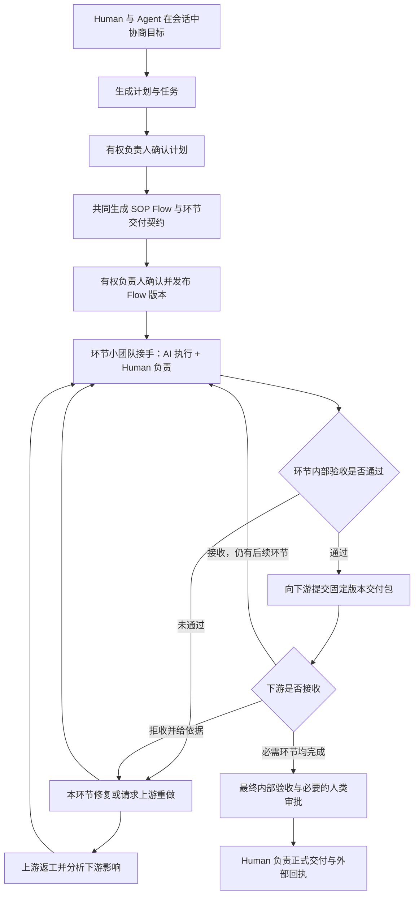
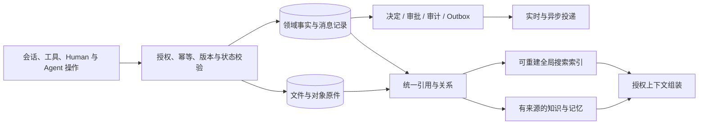

# Myrmidon 完整产品需求清单

> **人与 Agent 在会话中共同确定计划和 SOP；每个环节由 AI 执行、人类负责的小团队推进，经过内部验收后交给下游，必要时退回上游重做，最终形成由人负责的交付。**

版本：1.3｜日期：2026-10-13｜性质：完整需求基线与技术方案建议｜状态：待规格细化与实现，未宣称开发完成。

本清单合并本轮 **1–24 项要求及后续外部聊天接入、实时通信选型补充**、[PRD](PRD.md) 和既有 [模块规格](myrmidon/specs/00-conventions.md)。它是需求清单，不按页面数量组织，也不因分期删除已要求的功能。

## 0. 读法、范围与本次明确变化

### 0.1 条目规则

- `REQ-领域-编号` 是稳定需求编号。每条说明必须提供的能力、关键业务规则及可观察的验收结果。
- 表内条目均纳入完整范围；实施顺序另行估算，不将复杂功能自动降为“不做”。
- **用户指定**：通用业务、人机协作、云端全局状态、Tauri、React Flow、永久消息、轻量高性能、分布式执行、frp 式访问和交付内部门禁。
- **已选技术方向**：Slack 式会话采用现有 Go collab 领域 + 业务数据库 + Centrifugo 实时通信；当前最小部署不引入 Matrix 或 NATS，保留按需接入 NATS 的能力边界（§26.3）。选型不代表已实现或通过性能验收。
- **技术建议**：frp 的集成方式、存储分层、监控栈等；其他候选组件不视为已完成选型或兼容验证。
- **需验证**：各 runtime 的具体项目、版本、协议能力，Tauri 各平台插件能力、跨平台服务安装、资源预算和规模测试。
- 原输入第 16 项“确认后跳报”按“确认后上报”理解；第 4 项虽后置，仍按原编号对应。

### 0.2 覆盖旧方案的决定

| 本轮明确要求 | 对旧文档的调整 |
|---|---|
| 一个工作台汇总多个项目 | 覆盖旧“不提供跨项目汇总大盘”的限制；仅汇总有权访问的项目 |
| 团队支持组织架构树 | 增加组织 / 部门 / 团队与汇报关系；项目协作关系可跨部门 |
| Web + Tauri 全平台 | 覆盖旧“桌面端可选、移动端只做响应式”的范围；明确 Web、桌面、移动客户端 |
| 消息永久保管 | 消息正文、修订和关联附件以长期保存为默认，不通过普通 TTL 清理；合法删除与保全例外独立治理 |
| 所有交付先内部验收通过 | 不允许用旧版人工覆盖直接把未通过内部必需门禁的成果交付；误检通过复核解决，原结果保留 |
| 环节小团队执行、验收、上下游交接 | 成为 SOP 的核心业务模型，每个环节明确人类负责人、共同执行者、接收方与交付契约 |
| 定时、报告、运行监控、服务器与服务告警 | 全部纳入完整需求，按明确规则定时或事件触发 |
| Matrix / Centrifugo / NATS | 选 Centrifugo 承担客户端实时通信，Go collab 保存频道与消息事实；当前不部署 Matrix / NATS，区分未来 NATS broker 与 JetStream consumer 的不同能力 |
| 接入外部聊天应用 | 纳入 WhatsApp、Telegram、微信 / 企业微信、Slack 连接器；逐平台声明通知、双向消息及群聊同步能力，复用内部会话与授权体系 |

### 0.3 快速导航

| 问题 | 章节 |
|---|---|
| 谁用、从什么视角使用 | [§1](#users) |
| 完整流程与上下游交接 | [§2](#workflow) · [§6](#sop) · [§7](#teams) |
| 协作会话与执行会话 | [§8](#chat) · [§10](#execution) |
| 云端汇总、远程预览、终端 | [§9](#cloud) · [§12](#preview) |
| 组织、OKR、计划与报告 | §3–5、§18 |
| Token、定时、AI 监控、服务器告警 | §14–15、§19–20 |
| 永久记录、搜索、知识与记忆 | [§21](#records) · §22 |
| runtime、模型协议与远程配置 | [§23](#runtimes) |
| 全平台、少页面少路由、技术选型 | §24–26 |
| 逐项验收与原始要求映射 | §27–28 |

---

## 1. 用户与工作视角

| 用户 | 核心责任 | 主要看到什么 | 主要动作 |
|---|---|---|---|
| OPC / 一人公司经营者 | 自己的目标、投入与最终结果 | 多项工作的状态、Agent、小团队、成果与待决定事项 | 描述目标、确认计划 / Flow、选方案、接受、交付 |
| 组织 / 团队管理者 | 跨项目资源、目标、风险与人员 | 授权范围内的组织树、OKR、大盘、预算、健康与异常 | 调整资源、处理升级、审核目标计划与报告 |
| 项目负责人 | 项目整体推进与最终兜底 | 项目 Flow、各环节团队、依赖、交付、风险 | 确认范围、计划与 SOP，指定负责人，处理例外 |
| 环节人类负责人 | 当前环节质量、交接与退回处理 | 本环节输入、执行者、版本、检查、下游要求 | 接手、组织验收、决定重做、交接下游 |
| 专业执行者 Human | 具体制作与专业判断 | 自己的计划任务、协作会话、成果与专业工具 | 接任务、制作、接管 AI、提交证据与成果 |
| Agent 执行者 | 授权范围内实际执行 | 工作契约、资料、工具、预算、收件箱 | 规划草案、执行、提交、修复、交接 |
| 协调 / 监督 Agent | 有界调度、进度核对、发现异常 | 授权范围的目标、计划、事件与依赖 | 提醒、建议分派、发起澄清、整理报告 |
| 验收 / 审核者 | 对指定版本作专业判断或授权决定 | 要求、版本差异、证据、待审批事项 | 检查、批准、拒绝、退回并说明依据 |
| 客户 / 外部成员 | 外部要求、反馈与验收 | 共享频道、开放的成果、确认单、交付回执 | 提需求、确认变更、批注、接受或拒收 |
| 平台 / 运维管理员 | 节点、服务、凭据、运行健康 | 服务器、daemon、服务指标、告警与审计 | 配置、维护、处理告警、撤销资源访问 |

同一人可承担多个角色，角色随项目 / 环节变化。OPC 使用同一机制，可由本人承担多个环节的责任；不能虚构独立评审。Agent 的业务角色、runtime、模型与运行节点是不同概念。

---

## 2. 产品主流程

| 编号 | 需求与业务规则 | 验收结果 |
|---|---|---|
| REQ-CORE-001 | 从自然语言、文件、已有项目或频道讨论发起工作；先识别目标、接收者、结果、范围和约束 | 用户不必先搭流程；不确定信息被标记，必要缺口才阻塞 |
| REQ-CORE-002 | 计划与 SOP 分别有草稿、确认、版本和责任人；计划定义要做什么，SOP 定义如何协作执行与交接 | 无未确认的范围被静默用于正式运行；两类确认有独立记录，可在一次确认操作中明确同时完成 |
| REQ-CORE-003 | 工作、子任务、Flow 环节、执行、成果、会话相互关联；工作 / 任务沿用同一工作项体系 | 不出现一份聊天任务、一份画布任务、一份执行任务互相冲突 |
| REQ-CORE-004 | 每个正式运行环节由一个明确的人类负责人负责，支持多 Human、多 Agent 共同执行 | 任意环节均能查到负责人、参与者、下一动作与接收者 |
| REQ-CORE-005 | 环节完成包含执行产物、内部验收和下游接收；最终环节由最终接受者承接 | 工具成功退出或发送消息不能直接标记交接完成 |
| REQ-CORE-006 | 退回必须绑定输入 / 输出版本、未满足条款、期望和归属环节；支持本环节重做与退回上游 | 下游发现输入问题可以精准退回，保留原交付与拒收证据 |
| REQ-CORE-007 | 上游返工要计算受影响下游；暂停依赖旧结果的步骤，保留无关步骤，重新验证失效成果 | 旧输入不会继续被当作当前有效结果，不全流程无差别重跑 |
| REQ-CORE-008 | 工作状态区分待开始、进行中、等待、待验收、待交接、已完成、取消；工程映射统一制定 | 所有等待均有原因、处理者和解除条件，所有完成有对应依据 |
| REQ-CORE-009 | 简单任务允许单环节 Flow，复用团队已确认 SOP；具体计划和执行范围仍须符合确认规则 | OPC 不必重复设计流程；短任务仍有明确要求、责任与验收 |
| REQ-CORE-010 | 最终交付必须满足当前要求和所有必需环节门禁，责任人确认指定版本 | 任一必需验收未通过、过期或缺失时，系统拒绝正式交付 |

通用的是目标、责任、依赖、验收与交接。软件的编码测试、小说的编辑修订、视频的粗剪审片由专业工作包定义，不能强迫所有业务使用相同制作步骤。

## 3. 组织架构、账号与项目团队

| 编号 | 需求与业务规则 | 验收结果 |
|---|---|---|
| REQ-ORG-001 | 支持组织 → 部门 / 团队 → 子团队的组织树，维护负责人、成员、上下级与有效期 | 可浏览和调整层级；不能形成循环；历史归属可追溯 |
| REQ-ORG-002 | 组织管理关系与项目协作关系分离；成员可跨部门加入多个项目 | 项目分派不改变正式汇报关系，跨项目汇总不会重复计算同一成员 |
| REQ-ORG-003 | Human 通过电子邮件或已有账号邀请加入组织 / 项目，邀请含角色、范围、有效期与撤销 | 接受邀请后权限准确生效，重复接受幂等，过期或撤销邀请不可用 |
| REQ-ORG-004 | 区分内部成员与外部成员；外部账号使用同应用和共享对象投影 | 客户无法通过 API、搜索、消息、附件或通知读取内部资料 |
| REQ-ORG-005 | Agent 是可分派、可 @、可审计的服务账号，标明人类负责人、角色与来源 | Agent 不能冒充 Human；模型进程不自动成为团队成员 |
| REQ-ORG-006 | 支持混编、AI 主执行和人工主执行模式；OPC 可采用一人多 Agent | 各模式共用项目与工作事实；AI 主执行仍有人类责任人和必要审批 |
| REQ-ORG-007 | 基于组织、项目、环节、对象与动作授权；管理树位置不自动授予私人内容访问 | 越权负例通过；管理者汇总受授权范围约束 |
| REQ-ORG-008 | 离职、退役、调岗、邀请撤回触发任务交接和凭据 / 会话撤销 | 不留下无负责人工作，变更后后续访问及时受限 |
| REQ-ORG-009 | Agent 创建、主管扩编、收编、退役保留编制、预算、期限、父子关系与审批 | 子 Agent 不超出授权，主管失效时有接管或退役流程 |
| REQ-ORG-010 | 复用现有租户、身份、实体和成员模型；组织树不得隐式打通租户隔离 | 多组织账号切换明确，旧 Team / Tenant 映射经迁移评审后实施 |

## 4. OKR 管理与审核

| 编号 | 需求与业务规则 | 验收结果 |
|---|---|---|
| REQ-OKR-001 | 支持组织、团队、项目、Human、Agent 的 Objective 与 Key Result，以及年 / 季 / 月等周期 | 目标有所有者、周期、状态、关联关系和可追溯版本 |
| REQ-OKR-002 | 目标自上而下拆解，支持跨项目贡献与多对多对齐；避免同一成果重复计分 | 上级能看到贡献来源和未对齐目标，汇总口径可解释 |
| REQ-OKR-003 | KR 定义基线、目标值、单位、方向、计算方式、数据来源、更新时间与证据要求 | 同一指标不同周期可复核；不能只凭任务勾选计算业务效果 |
| REQ-OKR-004 | 支持 AI 起草、成员提交、主管审核、退回修改、发布、变更和期末复核 | 每次审批对应固定版本，修改后失效审批重新处理 |
| REQ-OKR-005 | Agent 可更新授权范围内的事实数据与进展草案，不自行确认自己的 OKR 或人类承诺 | 审核者与权限来源明确，正式目标调整有决定记录 |
| REQ-OKR-006 | 自动关联计划、任务、交付、报告；手工进度必须有说明和可选佐证 | 从 KR 可下钻到贡献工作，数值与记录可核对 |
| REQ-OKR-007 | 识别偏离、无计划支撑、数据过期、无负责人和临期风险，触发提醒与复盘 | 提醒给到责任人和适当上级，缺数据不显示为达成 |
| REQ-OKR-008 | 支持期末自评、上级审核与结转；业务目标达成和交付物接受分开记录 | 没有观察期数据时，运营目标不能因方案交付而自动达成 |

## 5. 计划生成、拆解、跟进与提醒

| 编号 | 需求与业务规则 | 验收结果 |
|---|---|---|
| REQ-PLAN-001 | Human 与 Agent 在会话中生成项目、阶段与个人计划，关联目标、要求、期限和已有资源 | 草案能解释每项任务的目的、来源与依赖 |
| REQ-PLAN-002 | 支持日、周、月、季、年计划及里程碑拆解，关联预计投入、预算与成果 | 下级计划与上级要求可核对，重复任务可识别 |
| REQ-PLAN-003 | 计划任务支持多执行者但有唯一结果负责人；指定接收方和完成标准 | 不出现多人都以为对方负责的无人接手状态 |
| REQ-PLAN-004 | 计划先确认再进入正式 SOP / 派发；已有授权的模板可简化重复确认 | 确认清楚显示计划版本、适用范围与授权条件 |
| REQ-PLAN-005 | 系统按实际执行、成果、依赖和验收维护进展，Human 可补充事实并注明来源 | 已读、发言活跃或 Agent 自报不自动等于任务完成 |
| REQ-PLAN-006 | 识别逾期、长期无进展、资源冲突、上游延期和等待过久；支持提醒、催办、升级 | 提醒包含问题、影响、当前责任人和下一动作 |
| REQ-PLAN-007 | 重规划给出范围、时间、成本、受影响环节与人员的差异，经所需确认后生效 | 不在后台静默删除任务、延长承诺或改验收标准 |
| REQ-PLAN-008 | 支持计划取消、暂停、结转、替代和版本比较；保留原承诺和未完成原因 | 报告能解释为什么延期 / 变更，而不是只显示最新计划 |
| REQ-PLAN-009 | 进度汇总按明确权重和事实计算，阻塞 / 不确定单列；能定位到具体工作 | 项目大盘数字与明细一致，不用未确认估算冒充实际进度 |

## 6. React Flow、无限画布与动态 SOP

### 6.1 流程能力清单

| 编号 | 需求与业务规则 | 验收结果 |
|---|---|---|
| REQ-FLOW-001 | 使用 React Flow 展示与编辑 SOP；支持拖动、缩放、平移、自动布局、框选、搜索定位和小地图 | 大流程可快速定位节点，无需手工拖完整张图 |
| REQ-FLOW-002 | 支持无限画布工作空间、分组、注释、子流程与折叠；可见区域与子流程按需加载 | “无限”指导航空间，不承诺无限内存；千节点目标按实际环境测试 |
| REQ-FLOW-003 | AI 可由已确认计划和业务包生成 Flow 草案；Human 与 Agent 可协作修改并比较差异 | 草案先验证结构与契约，授权发布后才可运行 |
| REQ-FLOW-004 | WorkflowDef 是唯一流程定义；画布、列表、JSON、AI 草案与运行实例引用同一版本 | 编辑任一视图不会形成不一致流程副本 |
| REQ-FLOW-005 | 节点支持制作、检查、人工审批、条件分支、并行、汇合、等待、交接与有界循环 | 每类节点有明确输入、输出、推进条件和失败处理 |
| REQ-FLOW-006 | 边定义依赖、输入 / 输出映射、版本、可选条件和交接要求；检查缺输入、不可达和循环错误 | 不能发布结构无效、必经验收可被绕开的 Flow |
| REQ-FLOW-007 | 每个业务环节绑定 AI 执行 + Human 负责的小团队，可有多 Agent、多 Human | 节点能看到负责人、分工、成果、状态和下游接收人 |
| REQ-FLOW-008 | 支持顺序、并行、候选比较、局部返工、上游退回、人工接管和中途接入已有成果 | 无需从空白重复执行已有工作；已有结果缺验证时如实标明 |
| REQ-FLOW-009 | 运行实例锁定 Flow / 工作包版本；动态改流程以补丁展示影响，经过相应审批 | 已执行节点和旧记录不被新模板覆盖，变更有生效边界 |
| REQ-FLOW-010 | 循环有次数、时间、成本与退出条件；超限必须升级，不可无限自动重做 | 无法收敛时暂停受影响工作，保留已尝试方案 |
| REQ-FLOW-011 | 支持多人编辑、乐观并发或锁定编辑，防止覆盖；AI 补丁和人工编辑同样校验版本 | 两人同时编辑产生可解释冲突，不丢失已发布版本 |
| REQ-FLOW-012 | 支持模板保存、版本发布、回滚、导入导出、团队规则叠加和跨业务组合 | 复用模板不复制运行状态；回滚不撤销已产生的外部副作用 |
| REQ-FLOW-013 | 画布中可下钻环节详情、执行、审批、成果与日志；复用规范对象详情 | 不额外复制一套画布任务、画布审批、画布文件系统 |
| REQ-FLOW-014 | 提供列表和键盘可操作替代；移动端可查看、确认、批注与执行关键控制 | 不因触屏或无鼠标而无法处理必需流程动作 |

### 6.2 每个环节必须定义的交付契约

| 契约项 | 必须明确的内容 |
|---|---|
| 环节目的 | 支撑哪个目标、计划和要求，范围内 / 外是什么 |
| 上游输入 | 来源节点、成果类型、固定版本、必需 / 可选、就绪条件 |
| 负责小团队 | 唯一 Human 负责人、共同执行者、检查者、授权决定者 |
| 执行方式 | 可用工具、runtime、模型、节点能力、环境与工作空间 |
| 输出成果 | 类型、数量、格式、元数据、源文件 / 导出文件、必要证据 |
| 内部验收 | 编号要求、检查方法、指定主观评审者、独立性条件 |
| 下游交接 | 接收节点 / 人、交付清单、接收标准、回执与超时升级 |
| 重做策略 | 本环节修复 / 上游退回、反馈格式、依赖失效与停止边界 |
| 资源限制 | 时间、预算、Token、并发、循环上限和升级规则 |
| 完成条件 | 内部验收通过、所需审批生效、固定输出被指定接收方接收 |

### 6.3 不同业务的适配

| 业务 | 可用专业环节 | 核心交付与验收 |
|---|---|---|
| 软件 | 需求、架构、编码、测试、代码评审、产品验收 | 固定提交、构建、报告；平台验证与专业判断 |
| 产品 / 设计 | 研究、用户流程、原型、视觉、交互验证 | PRD、设计版本、组件、原型；场景与品牌 / 体验审核 |
| 视频 / 音频 | 脚本、分镜、素材、粗剪、精修、审片 | 工程、成片、字幕、音轨；规格检测与人工审片 |
| 写作 / 小说 | 研究 / 设定、大纲、章节、编辑、修订 | 引用、人物、世界观、正文；连续性与作者意图 |
| 创意图片 / 广告 | 简报、概念、候选、选版、修改、渠道适配 | 源图、变体、文案、分镜；规格与创意 / 品牌判断 |
| 运营 | 目标口径、方案、配置、执行、观察、复盘 | 活动、配置、指标与报告；数据事实及策略判断 |

上述是可组合专业能力。简单改稿可以只运行一个小环节，运营效果需要观察期，不能由“方案文件已生成”推断业务目标达成。

## 7. 环节小团队与多 Human、多 Agent 协作

| 编号 | 需求与业务规则 | 验收结果 |
|---|---|---|
| REQ-TEAM-001 | 每个环节配置 Human 负责人、协调者、多个执行者、检查者和下游接收者 | 任意时刻有明确负责人与交接对象；Agent 不承担无人兜底的最终责任 |
| REQ-TEAM-002 | 支持任务拆分、共同执行、接力、候选并行与成果合并；定义 ALL / ANY / 指定汇合等完成条件 | 多执行者的部分成功不被误算为整体完成 |
| REQ-TEAM-003 | 人与 Agent 接受分派后明确认领，防重复领取；可拒绝接手并说明原因 | 已发送或已读消息不等于已接手，租约过期能恢复分派 |
| REQ-TEAM-004 | 主管 Agent 根据能力、权限、负载和成本提出分派；在已授自动策略内执行 | 每次分派可解释，主管不能自行扩大权限或批准自产结果 |
| REQ-TEAM-005 | 多写入者采用独立工作区 / 分支或明确写入所有权，合并前校验基线 | 不同 Agent 或 Human 不会静默覆盖同一成果 |
| REQ-TEAM-006 | 接管时停止竞争写入，保存部分成果与外部动作状态；继续时重新建立基线 | 人工修改不会被恢复的 Agent 按旧上下文覆盖 |
| REQ-TEAM-007 | 下游接收固定成果包，可接受、拒收或逐项接收；拒收引用具体不满足项 | 来源环节收到可执行反馈，下游不能直接改上游已接受版本 |
| REQ-TEAM-008 | 上游返工形成新的执行 / 成果版本；重新交接前重验受影响条件 | 旧意见、旧版与旧接收记录可回看，新版不继承过期通过结果 |
| REQ-TEAM-009 | 跨环节分歧按指定 Human 决定者升级，涉及需求变化另走变更审批 | Agent 不根据最后一条聊天消息擅自选择相互冲突的要求 |
| REQ-TEAM-010 | 多模型比较保留各候选、证据与成本，合成后仍走正式验收 | Heavy 不绕过预算与质量门，不把多数模型投票当事实正确 |
| REQ-TEAM-011 | 交接包包含目标、计划、成果版本、决定、未验证项、未决动作和剩余预算 | 换 Human、模型、runtime 或机器可接续；不依赖隐藏推理迁移 |

## 8. 会话频道、私聊与角色化上下文

### 8.1 三种主要会话形态

| 形态 | 中间内容 | 右侧上下文 | 谁使用 |
|---|---|---|---|
| 管理 / 项目协作频道 | 人和 Agent 协商目标、计划、SOP、进展、风险与决定 | 当前组织 / 项目范围的 Human、Agent、任务、计划、进度、预算与健康摘要，可下钻规范详情 | 管理者、项目负责人、协调 Agent、参与成员 |
| 执行者协作群聊 / 私聊 | 分工、澄清、求助、交接、评审意见 | 相关工作、成员、输入输出与待处理事项 | Human、Agent、环节小团队 |
| 执行过程记录 / 对话 | 当前执行步骤、工具行动、输入、授权、日志与反馈 | 当前任务实时预览、成果版本、检查结果、必要文件 / 终端 | 执行者、负责人、授权观察者 |

管理与执行视角由当前会话目的决定，同一用户可切换。管理右栏的“全局”指有权范围，不意味着把组织所有私聊和文件交给所有人。点击摘要下钻同一对象详情，不复制一套管理页面。

### 8.2 会话需求

| 编号 | 需求与业务规则 | 验收结果 |
|---|---|---|
| REQ-CHAT-001 | 提供类似 Slack 的组织 / 项目 / 环节频道、共享频道、群聊、Human↔Human、Human↔Agent 与授权 Agent 协作 | 频道有明确成员、主题、范围与生命周期 |
| REQ-CHAT-002 | 支持线程、@提及、回复、附件、引用、反应、置顶、未读、搜索和通知偏好 | 能从消息定位工作 / 成果 / 审批，反向也能找到原讨论 |
| REQ-CHAT-003 | 支持文本、图片、文件、音视频资料；语音输入 / 转写标明来源与转写状态 | 解析失败仍能访问授权原件，转写不冒充原始事实 |
| REQ-CHAT-004 | 会话中生成并确认计划、任务、SOP、修改与审批，关联真实对象和固定版本 | 同一消息重复转换不会产生重复工作；普通“好的”不能授权不明确动作 |
| REQ-CHAT-005 | 明确唤醒对象、触发原因、回复链和循环上限，系统事件默认不广播唤醒全部 Agent | 不发生 Agent 互相回复无限循环，费用可归属 |
| REQ-CHAT-006 | 永久保存消息、编辑版本、引用和必要附件；撤回展示墓碑，历史依权限与审计政策读取 | 重启、节点离线、客户端卸载后历史仍可恢复；普通归档不删除记录 |
| REQ-CHAT-007 | 人类消息、Agent 消息、系统事件和代登记行为明确标识；显示发送、落库、失败与重试状态 | 未持久化消息不显示为已可靠送达，重试不重复 |
| REQ-CHAT-008 | 协作事件和工具输出按步骤折叠，关键成果、阻塞和待审批持续可见 | 长日志不淹没人的意见，能展开完整过程 |
| REQ-CHAT-009 | 私聊、共享历史、附件、搜索与摘要统一鉴权；托管 Agent 会话显示管理员 / 负责人可见政策 | 不把企业托管 Agent 私聊误呈现为绝对私密 |
| REQ-CHAT-010 | 新增外部成员前明确其可见历史与附件，优先创建明确共享范围 | 内部全历史不会因邀请客户自动公开 |
| REQ-CHAT-011 | 会话在线状态、正在输入、已读与任务接手是不同信号 | 在线不被当作正在工作，已读不被当作接受任务或审批 |
| REQ-CHAT-012 | 会话引用可入知识 / 记忆，保留来源和权限；普通讨论不自动升级为团队正式结论 | 自动记忆可纠错，正式决定仍来自有权确认的业务记录 |
| REQ-CHAT-013 | 支持断线补拉、游标、稳定排序、跨端未读同步，长历史按锚点增量加载 | 不全量加载永久消息，重复或乱序事件不会造成历史错乱 |
| REQ-CHAT-014 | 明确同一事件在频道、待办、通知与右栏的归属，处理结果共用一份事实 | 某处批准后其他入口立即更新，不产生多份审批 |

### 8.3 外部聊天应用连接器

支持后续接入 WhatsApp、Telegram、微信 / 企业微信、Slack 等外部聊天应用。通过独立连接器调用各平台正式 API / webhook，映射到 collab 会话与消息；连接器不依赖 Centrifugo broker 的选型，也不要求部署 Matrix。当前登记需求与边界，不宣称已实现。

| 编号 | 需求与业务规则 | 验收结果 |
|---|---|---|
| REQ-CHAT-015 | 每个连接器声明单向通知、双向消息、群 / 私聊、线程、附件、编辑撤回、回执及历史导入的实际能力 | 依据平台 API、账号权限与版本展示能力；不支持的操作明确提示，不能以通知 webhook 冒充完整聊天同步 |
| REQ-CHAT-016 | 外部工作区、频道、用户与内部租户、会话、成员建立显式授权映射 | 不按同名自动合并身份；外部回复不能未经身份绑定和权限校验批准任务或读取内部历史 |
| REQ-CHAT-017 | 外部事件验签、幂等入库；保存来源平台、账号、会话、消息 ID、方向和回复映射 | 平台重试不产生重复消息；跨平台回声及 Agent 循环不会重复转发；凭据不进入消息正文 |
| REQ-CHAT-018 | 外发有投递记录、限流、重试与失败状态；入站正文和必要附件按授权范围归档 | 区分本地已存、平台已接收、已送达和已读；无法取得的旧历史或编辑事件不承诺完整保存 |
| REQ-CHAT-019 | 项目管理员控制绑定、转发方向、共享范围、暂停和撤销；内部消息对外分享重新校验权限 | 连接外部群不会自动导出内部私信、任务秘密或全量历史，撤销后停止后续传输 |

接入方向：Slack 使用应用授权 + Events API / Web API；Telegram 使用 Bot API，并尊重群内隐私模式与机器人可见范围；WhatsApp 使用 Business Platform Cloud API，其群聊等能力依实际账号资格和接口限制验证；微信按公众号 / 服务号、微信客服、企业微信分别声明能力，企业微信群消息推送接口本身不证明可接收群消息。普通个人微信的任意私聊 / 群聊同步尚未建立官方接口依据，不承诺通过上述接口实现。

来源：[Slack Events API](https://docs.slack.dev/apis/events-api/)、[Telegram Bot FAQ](https://core.telegram.org/bots/faq)、[WhatsApp Business Platform](https://developers.facebook.com/docs/whatsapp/cloud-api/overview)、[企业微信群消息推送](https://developer.work.weixin.qq.com/document/path/91770)、[微信接收消息](https://developers.weixin.qq.com/doc/offiaccount/Message_Management/Receiving_standard_messages.html)。

## 9. 云端全局状态与跨项目汇总工作台

| 编号 | 需求与业务规则 | 验收结果 |
|---|---|---|
| REQ-CLOUD-001 | 云端保存组织、项目、计划、Flow、任务、执行、成果、消息、审批、费用与监控的权威状态 | 浏览器、App 或执行节点关闭不会导致平台忘记工作 |
| REQ-CLOUD-002 | 同一工作台汇总多个授权项目，展示目标、里程碑、Flow 进度、负载、阻塞、预算、告警和待审批 | 每项汇总可下钻到原项目 / 对象，统计无重复、无越权 |
| REQ-CLOUD-003 | 管理者按组织 / 部门 / 团队 / 项目 / 时间查看，执行者默认“与我有关” | 人和 Agent 共享状态体系，角色差异由权限与过滤实现 |
| REQ-CLOUD-004 | 显示状态来源、最近上报、已确认版本和新鲜度，区分在线、离线、失联与未知 | 长时间无心跳不继续显示正常执行，旧数据有明确标记 |
| REQ-CLOUD-005 | 通过服务端授权订阅实时更新；客户端按版本与事件序号处理乱序和重连 | 多设备显示同一事实，旧响应不能覆盖新状态 |
| REQ-CLOUD-006 | 节点离线时保留已知状态和待核实动作，未授权离线副作用不得继续执行 | 恢复连接后对账，不把本地自报当作云端已批准 |
| REQ-CLOUD-007 | 云端命令持久化、带期限、目标版本和幂等键；执行节点报告收到、开始与结果 | 过期指令不能在节点恢复后突然执行；重复下发不重复副作用 |
| REQ-CLOUD-008 | 支持项目总览与跨项目大盘共存；全局大盘可进入管理协作上下文 | 不为大盘另建独立任务、通知、成果和审批系统 |
| REQ-CLOUD-009 | 云端重启 / 故障切换后恢复持久工作、调度与审批；分区时选择一致性安全边界 | 不出现两个调度者同时拥有同一写执行或同一交接决定 |

## 10. 执行过程、反馈与接续

| 编号 | 需求与业务规则 | 验收结果 |
|---|---|---|
| REQ-EXEC-001 | 一次执行绑定工作、环节、参与者、输入版本、上下文快照、runtime / 模型、节点和预算 | 能回答谁在什么环境依据什么做了什么 |
| REQ-EXEC-002 | 执行会话支持多轮对话、工具记录、输入、附件、工具授权、暂停、停止、继续和接管 | 不需要进入第二个独立 session 系统处理同一次执行 |
| REQ-EXEC-003 | 反馈来自真实事件：排队、启动、阶段进度、输出、等待、心跳、错误和结果 | 不用持续打字冒充正在执行，不虚构百分比与剩余时间 |
| REQ-EXEC-004 | 普通运行补充在安全边界应用，区分已收到、待应用、已应用与无法应用 | Agent 回复“已修改”不能替代实际应用回执 |
| REQ-EXEC-005 | 同一执行产生的部分成果及时登记，工作稿、提交版、接受版明确区分 | 用户可查看阶段结果，中断不会丢失已保存成果 |
| REQ-EXEC-006 | 关闭页面、换设备不影响后台执行；取消是显式命令并有完成回执 | 停止中不显示为已停止，结果未知时明确待核实 |
| REQ-EXEC-007 | runtime 支持时原生恢复；不支持时用交接包新建关联执行，明确恢复方式 | 不声称可迁移隐藏推理或跨 runtime 无损恢复原生会话 |
| REQ-EXEC-008 | 失败分为环境故障、质量问题、缺资料、权限拒绝和范围变化 | 正确选择重试、返工、阻塞或审批，不一律重跑 |
| REQ-EXEC-009 | 未启动的安全操作可有限重试；已启动且副作用不确定必须核实或补偿 | 断线后不会重复发信、发布、扣费或创建外部资源 |
| REQ-EXEC-010 | 记录进程退出、实际成果、检查与业务完成的不同状态 | 执行成功不自动成为环节验收或正式交付成功 |
| REQ-EXEC-011 | 执行目录、工具和网络按任务隔离，只有所需临时凭据 | 执行器不能读取控制面管理员密钥或无关工作区 |
| REQ-EXEC-012 | 支持人工观察执行与专业工具接续，人类制作的成果也可进入相同验证闭环 | 任务不要求必须由 AI 从头制作，作者与操作来源正确 |

## 11. 分布式节点、Daemon 与 CLI Service

### 11.1 节点与服务生命周期

| 编号 | 需求与业务规则 | 验收结果 |
|---|---|---|
| REQ-NODE-001 | 执行器分布在多个服务器与个人电脑，支持 macOS、Linux、Windows，登记节点身份与负责人 | 按 OS、runtime、模型、工具、硬件与网络能力选择节点 |
| REQ-NODE-002 | 提供单命令安装 daemon / CLI / 系统服务，安装可重复执行，包与二进制有版本和完整性验证 | 安装中断可恢复，不重复注册多个后台服务 |
| REQ-NODE-003 | 提供 install、uninstall、start、stop、restart、status、logs、doctor、update、auth login/logout | 各命令有清楚返回码和输出，可由自动化脚本调用 |
| REQ-NODE-004 | macOS 使用 launchd、Linux 使用 systemd 或受支持的用户服务、Windows 使用 SCM 服务 | 重启登录或主机启动后的行为明确；权限不足有可执行提示 |
| REQ-NODE-005 | 支持令牌登录与设备码登录；首次注册凭据换取节点专属、可轮换和撤销凭据 | 安装包不内置共享密钥，注销后节点不能继续接收任务 |
| REQ-NODE-006 | CLI 支持自动化安全输入令牌，优先标准输入 / 系统凭据存储；兼容参数模式需避免回显与日志收集 | 令牌不出现在常规日志、任务消息、安装记录或进程诊断上传中 |
| REQ-NODE-007 | 节点主动向云端建立出站连接，提供心跳、能力发现、运行槽、活动执行与版本 | 家用电脑不需开放入站端口；在线与能力变化及时同步 |
| REQ-NODE-008 | 支持任务租约、排空、维护、停机、失联重连与吊销；同一工作目录限制竞争写入 | 云端知道哪些任务可重派，旧节点回归不能凭过期租约写入 |
| REQ-NODE-009 | 节点支持安全自更新和兼容检查，运行中任务先排空或明确接续；失败可回滚 | 不因升级默默终止任务、丢失日志或破坏模型配置 |
| REQ-NODE-010 | 支持受控服务器 / 集群池，按任务隔离目录或临时环境；资源配额与清理策略可配置 | 临时执行结束后资源被回收，失败清理有可见告警 |
| REQ-NODE-011 | 节点离线期间本地缓冲有界，记录待上传事件 / 成果；限额、断电和磁盘不足处理明确 | 数据丢失风险显式报告，不无限占满用户磁盘 |
| REQ-NODE-012 | 用户能停用或卸载节点；stop 停止接新任务并执行规定的优雅关闭，强制停止单独显式操作 | 停机影响和未完成工作可见，残留服务、隧道和凭据可清点 |

### 11.2 CLI 产品契约

命令名称与 npm 包名在发行时确定，须保持品牌可配置；本清单不宣称已有可安装软件包。用户提出的 `npx daemon@cli_name install` 表达“一条命令安装”的体验，实际 npm 语法为 `npx <包名>@<版本> install`。

| 操作 | 待实现命令形态 | 行为 |
|---|---|---|
| 一键安装 | `npx <daemon-package>@<version> install` | 检测 OS / 架构，下载校验二进制，安装服务，报告后续登录步骤 |
| 令牌登录 | `<cli_name> auth login --server <url> --token-stdin` | 从标准输入读取引导令牌，绑定节点并安全保存换取凭据 |
| 参数兼容 | `<cli_name> auth login --server <url> --token=<token>` | 满足受控自动化兼容；文档说明命令历史 / 进程参数可见性，推荐上面的输入方式 |
| 设备码登录 | `<cli_name> auth login --server <url>` | 交互确认所属组织与节点权限 |
| 服务控制 | `<cli_name> start`、`stop`、`restart`、`status` | 返回本地服务、云端连接、活跃执行与隧道状态 |
| 诊断维护 | `<cli_name> logs`、`doctor`、`update`、`uninstall` | 脱敏诊断、升级与可核对的卸载清理 |

`<…>` 为发行前的参数占位说明，不是要求现在执行的命令。npm 可以只是分发入口，常驻 daemon 不应为包装层维持额外 Node.js 进程；实际 runtime 若依赖 Node.js，则如实列出该独立依赖。

## 12. 云端远程预览、文件与终端

### 12.1 frp 式访问与生命周期

| 编号 | 需求与业务规则 | 验收结果 |
|---|---|---|
| REQ-PREVIEW-001 | 使用 frp 式反向隧道，通过节点出站连接将当前执行的本地服务映射到受控云端预览入口 | 不要求节点开放入站端口；云端可在授权后访问本地服务 |
| REQ-PREVIEW-002 | 自动分配不可预测的随机子域名，统一 DNS / TLS 管理，绑定租户、项目、执行、服务与期限 | 地址不可作为唯一访问凭证，其他租户无法通过猜测或复制地址访问 |
| REQ-PREVIEW-003 | 预览域与控制台使用隔离来源，按实例隔离；控制台身份 Cookie 不透传给不可信预览应用 | Agent 生成网页无法读取控制台凭据，嵌入受浏览器安全策略约束 |
| REQ-PREVIEW-004 | 支持 Web 和 API，含必要 HTTP、WebSocket、SSE、Range、请求体与响应流 | 热更新、流式 API 和媒体读取可工作；超时与限额明确 |
| REQ-PREVIEW-005 | 服务登记验证端口归属、执行工作区和实际进程，只转发被授权的本地服务 | 无法借预览转发主机管理接口、数据库或任意内网地址 |
| REQ-PREVIEW-006 | 记录申请、配置、启动、健康、可用、排空、释放、失败状态，所有操作幂等 | 不出现云端显示已释放但实际代理仍开放的未被发现状态 |
| REQ-PREVIEW-007 | 采用租约、心跳、TTL、空闲回收和最长存活；执行结束、撤权、节点失联触发释放 | 异常退出后扫描器可发现孤儿代理并清理，过期地址无法访问 |
| REQ-PREVIEW-008 | 清理涵盖隧道代理、节点子进程、监听端口、临时文件、凭据、域名映射 / 租约 | 清理失败有重试与告警，不能只删除数据库记录 |
| REQ-PREVIEW-009 | 定期核对云端登记与 frp 服务端、节点实际状态，检查连接、端口、健康、TLS 和资源泄漏 | 人工制造断连 / 崩溃后可检测、关闭并告警，无长期残留可访问服务 |
| REQ-PREVIEW-010 | 支持评审指定版本的隔离预览，实时工作稿与已提交版本明确区分 | 审核者看到的版本与审批目标一致，不能用实时最新结果替代旧版证据 |
| REQ-PREVIEW-011 | 外部分享需指定收件范围、只读能力、期限和人类授权，可撤销并审计 | 不把正式外部分享当作默认开放的随机 URL |
| REQ-PREVIEW-012 | 预览数量、并发、连接、带宽和流量有配额，配额异常可定位项目 / 执行 | 关闭预览不会误关闭无关执行；超限行为清楚可恢复 |

生命周期建议：申请 → 分配子域与限权凭据 → 节点启动 / 绑定服务 → 健康检查 → 对授权用户开放 → 持续续租 → 停止与撤权 → 核对实际关闭 → 回收资源。域名复用时旧凭据不得访问新实例。

### 12.2 远程文件与实时 Terminal

| 编号 | 需求与业务规则 | 验收结果 |
|---|---|---|
| REQ-REMOTE-001 | 支持执行工作区远程文件树、查看、搜索、下载与版本差异；敏感文件按策略遮蔽 | 路径穿越、符号链接、Windows 路径别名不能逃逸授权工作区 |
| REQ-REMOTE-002 | 文件上传 / 编辑 / 删除须独立权限、版本校验和必要接管，署名真实操作人 | 不与 Agent 竞争覆盖，文件变化可回溯到工作和执行 |
| REQ-REMOTE-003 | 使用 xterm.js 提供实时终端界面；终端后端由节点创建 PTY，Windows 使用受支持的 ConPTY | 在目标 macOS、Linux、Windows 上分别验证编码、尺寸、信号与进程清理 |
| REQ-REMOTE-004 | 区分只读终端观察和可交互控制；多人观察可以并行，交互写入实行明确控制权 | 两人不会混输命令；申请接管、释放控制可见 |
| REQ-REMOTE-005 | 交互终端仅授权 Human，独立权限、必要重新认证、空闲超时和审计；个人电脑默认关闭 | 不能把群聊工具权限当远程 Shell 权限，撤权后输入停止 |
| REQ-REMOTE-006 | 终端有起止、重连、断开、输出回放与敏感信息处理；禁止无边界暴露主机 Shell | 未能脱敏的原始记录依敏感权限保存，不进入公共搜索或模型上下文 |
| REQ-REMOTE-007 | 执行输出、终端控制和 frp Web 预览可复用连接基础设施但具有独立授权与限额 | 能访问网页不代表能看文件或操作终端；终端关闭不影响其他合法预览 |
| REQ-REMOTE-008 | 移动客户端可观察与经授权操作远程节点，输入辅助、断线与后台状态清楚 | 手机是远程客户端，不承诺在 iOS / Android 沙箱运行通用本机 daemon |

xterm.js 只负责终端渲染，frp 只负责转发能力；跨平台 Shell、PTY、权限和清理由 daemon 实现，不能仅凭接入两个前端组件宣称远程终端已完成。

## 13. 代码仓库变更监控与通知

| 编号 | 需求与业务规则 | 验收结果 |
|---|---|---|
| REQ-REPO-001 | 项目连接一个或多个授权仓库，登记平台、仓库、分支、路径与负责团队 | 只读取被授权仓库，连接器失效和权限变更可见 |
| REQ-REPO-002 | 监控 push、commit、PR / MR、review、merge、tag / release、CI 结果等提供商支持的事件 | 每条事件有提供商 ID、时间、固定提交与原始来源链接 |
| REQ-REPO-003 | 优先受验签 webhook，提供增量轮询补偿；事件去重、乱序处理、丢失对账 | 重发不重复通知 / 建任务，停机后能补齐漏掉的变化 |
| REQ-REPO-004 | 按项目、分支、路径、事件与严重度配置通知到群、私信、待办或邮件 | 相关人收到可行动摘要，不用每次提交广播全组织 |
| REQ-REPO-005 | 关联变更到目标、任务、Flow、执行和证据；无法自动关联时保留未归属事件 | 代码与任务进展可互相定位，但提交存在不等于任务完成 |
| REQ-REPO-006 | 固定 commit / 构建输入；新提交、force push、分支删除或 CI 重跑使相关旧检查标记适用性变化 | 旧绿色 CI 不自动批准新代码，历史提交证据仍可追踪 |
| REQ-REPO-007 | 可按授权策略触发代码检查、生成摘要、建立待处理项或启动指定 SOP | 外部 webhook 不绕过预算、流程确认、写权限与审批 |
| REQ-REPO-008 | AI 解释变更与影响时引用实际 diff / 文件，披露未读范围和失败来源 | 不把摘要推断当代码事实，敏感源码不进入无权群聊 |
| REQ-REPO-009 | 连接器权限撤销、同步失败、速率限制、仓库迁移进入异常与恢复流程 | 监控缺口有提示，不把失联误认为“没有变更” |

## 14. Token 用量、成本监控与自动调节

| 编号 | 需求与业务规则 | 验收结果 |
|---|---|---|
| REQ-COST-001 | 按组织、项目、计划、Flow 环节、任务、Human 发起者、Agent、模型、执行统计用量和费用 | 从全局费用能下钻到调用与业务来源，不能重复汇总共享事件 |
| REQ-COST-002 | 区分输入、输出、缓存、供应商独立报告的推理 Token 与其他计费单位 | 防止供应商已含推理 Token 时二次累计；图片 / 视频费用不伪装成 Token |
| REQ-COST-003 | 保存供应商实际值、估算值、未知值、价格版本、币种、时间和对账状态 | 未上报不计零，不将不同模型 Token 数量直接当等价成本 |
| REQ-COST-004 | 支持组织 / 项目 / Agent / 任务预算、每日 / 周期上限与并发限制，执行前预留、完成后结算 | 并行调用不同时读到相同余额而全部超发，失败和候选成本均计入 |
| REQ-COST-005 | 达到软阈值通知，硬阈值停止新调用并在安全边界暂停；进行中调用按可取消性处理 | 不承诺撤销供应商已发生费用；用量延迟与可能尾差可见 |
| REQ-COST-006 | 自动调节可缩短无关上下文、使用缓存 / 摘要、限制候选数量、调整并发与输出上限 | 保留硬要求、来源和必要证据；不通过丢失验收条件节省费用 |
| REQ-COST-007 | 在允许模型集合内，按任务能力、风险、质量要求与预算路由；允许策略性降档或升级 | 不改变供应商数据边界、不突破最大费用；无满足条件模型时暂停并说明 |
| REQ-COST-008 | 原生执行中的换模型能力由适配器声明；不支持时在边界新建关联执行 | 不破坏未完成工具调用，不声称 mid-turn 无损切换 |
| REQ-COST-009 | 展示每次自动调节的触发原因、原配置、新配置、预计影响和实际节省 / 质量结果 | 用户能追溯或关闭策略，调整不掩盖质量下降 |
| REQ-COST-010 | 提供成本趋势、异常检测、Top 消耗、预算预测与每个已接受成果的总成本 | 总成本包含失败、重做、并行候选和人工监督的已知投入 |
| REQ-COST-011 | 用量与账单对账修正追加记录，保留原估算和差异；不能改掉历史计量 | 供应商晚到数据可修正报表，结算过程可审计 |

80% 提醒、100% 停止新派发沿用现有默认方向，具体阈值可配置。自动调节须在用户授予的成本、模型和数据策略内；它不拥有修改工作质量标准的权限。

## 15. 定时任务与自动触发

| 编号 | 需求与业务规则 | 验收结果 |
|---|---|---|
| REQ-SCHED-001 | 支持一次性、固定间隔、日历 / Cron 和事件触发；可关联任务、SOP、报告、检查与通知 | 每次触发有独立运行记录与关联对象 |
| REQ-SCHED-002 | 保存时区、夏令时规则、起止、节假日 / 工作日策略、负责人和授权来源 | 下次执行时间可预览，不因客户端所在时区意外变化 |
| REQ-SCHED-003 | 明确错过触发的跳过 / 合并补跑 / 有界逐次补跑，以及并发、排队和互斥策略 | 服务恢复不产生无界补跑，不重叠写同一成果 |
| REQ-SCHED-004 | 调度状态持久化，带幂等触发键、租约与故障转移；区分调度投递与实际执行 | 多调度实例不重复制造业务副作用，不依赖进程内计时器保存唯一状态 |
| REQ-SCHED-005 | 每次运行重新检查有效权限、预算、资料版本、节点能力和必要审批 | 旧定时配置不能在权限被撤销后继续操作 |
| REQ-SCHED-006 | 支持暂停、恢复、修改、终止、手动运行、历史与失败重试 | 修改只影响明确的后续运行，已运行记录不覆盖 |
| REQ-SCHED-007 | 连续失败、超时、预算不足、长期未运行触发告警与自动停用策略 | 停用有原因与负责人，不能无声失效 |
| REQ-SCHED-008 | 定时执行仍受内部验收与人工决定约束；生成草稿和正式提交 / 发布分开 | 周报或审稿定时完成不等于人类已确认或成果已获准交付 |

## 16. 内部验收、周期检测与最终交付

| 编号 | 需求与业务规则 | 验收结果 |
|---|---|---|
| REQ-QA-001 | 每个环节开工前确定编号要求、检查方式、输入 / 输出、指定评审者和完成条件 | 不能在失败后由执行者悄悄降低验收标准 |
| REQ-QA-002 | 所有环节交接和最终交付前，当前版本的必需内部验收全部通过 | FAILED、INCONCLUSIVE、未执行、证据缺失或过期均不能直接交付 |
| REQ-QA-003 | 区分确定性检查、AI 辅助判断和 Human 专业判断；主观要求必须有适当评审方法 | 小说文风、创意与审美不被一组技术测试或单个模型分数替代 |
| REQ-QA-004 | 软件保留独立重跑、冻结验收、测试 Agent、跨模型产品验收与工具校准要求 | 执行者日志不能冒充平台测试，篡改冻结验收不能人工覆盖放行 |
| REQ-QA-005 | 视频检查规格、素材 / 工程完整性、声画与人工审片；小说检查设定 / 连续性与编辑判断 | 所有报告关联准确版本、输入材料、工具和评审人 |
| REQ-QA-006 | 支持定期、里程碑、提交、上游变化、交付前触发检查和评审 | 后台周期检查覆盖仍在进行的工作，结果回流任务与群通知 |
| REQ-QA-007 | 相同版本的可复用检查结果按验证器 / 配置 / 输入版本缓存，失效后重检 | 不重复无限烧 Token，也不把旧检查套到新成果 |
| REQ-QA-008 | 失败进入本环节修复或上游退回，反馈明确位置、期望、实际与阻塞范围 | 下一轮带入原反馈，所有轮次保留，达到上限升级给 Human |
| REQ-QA-009 | 误检可申请复核；新复核结论保留理由、方法、授权与旧结论，不直接篡改失败结果 | 最终仍有满足当前标准的有效通过证据，不能靠“批准”掩盖缺验证 |
| REQ-QA-010 | 检查者与执行者遵守职责分离；适用的例外需明确规则，不能把自评标成独立评审 | 能审计产出者、检查者、接受者和依据 |
| REQ-QA-011 | 最终交付打包固定成果版本、源文件 / 导出件、证据、要求映射、局限与使用说明 | 下载 / 分享 / 发布对象就是审批目标版本，部分接受逐项记录 |
| REQ-QA-012 | 对外交付和必要发布由 Human 负责并批准，客户回执区分接受、部分接受、拒收 | 内部通过、Human 批准、发送成功、外部验收是不同事实 |
| REQ-QA-013 | 已交付后发现问题，保留原包、定位影响、发起修复 / 变更与重新验收 | 不能修改历史交付文件让已交付事实消失 |

## 17. 人类审批、裁决与自动决策记录

| 编号 | 需求与业务规则 | 验收结果 |
|---|---|---|
| REQ-APP-001 | 审批覆盖目标 / OKR、计划、SOP 发布 / 变更、必要分派、工具与生产权限、预算例外、验收争议、正式交付 | 全部类型进入统一待处理体系，按业务对象显示条件和权限 |
| REQ-APP-002 | 审批流支持顺序、并行、指定角色、ALL / ANY / 法定人数策略，明确超时、代理和升级 | 审批规则有版本，不因人员变动或群成员变化而静默改变 |
| REQ-APP-003 | 每项审批绑定对象版本、请求人、审批人、授权来源、理由、证据、时限和结果 | 旧卡片不能批准新版本，同一幂等请求不重复决定 |
| REQ-APP-004 | 同一审批可在会话、工作台、Flow、成果详情处理，执行相同服务端校验 | 任一入口处理后全部状态同步，无多份审批副本 |
| REQ-APP-005 | 支持批准、拒绝、退回补充、撤回、过期和重新提交；拒绝 / 退回包含具体原因 | 超时只提醒或升级，不能默认代表同意 |
| REQ-APP-006 | 人类责任人与 Agent 委托明确；Agent 不批准自产、不给自己授权、不确认人类报告 | 违反职责分离或委托已撤销的决定被拒绝 |
| REQ-APP-007 | 关键外部副作用、正式交付、合同 / 范围承诺、生产访问授权保留 Human 关口 | 自动流程和定时任务不能绕过这些关口 |
| REQ-APP-008 | 低风险自动决定依据预先确认策略，记录系统 / Agent 主体、策略版本、输入事实和理由 | 每次自动分派、重试、模型切换与状态决定均可解释 |
| REQ-APP-009 | 讨论中的意见或推断可自动提取为决定草案，有权确认后成为业务决定 | 不是所有聊天句子都被当作已生效命令；未确认状态清楚 |
| REQ-APP-010 | 审批前重新核验版本、权限、验收与预算，必要动作重新认证；撤权即时阻止后续动作 | 通过前端伪造卡片或旧权限缓存无法批准 |
| REQ-APP-011 | 审批流与内部验收相互独立，审批同意不能替代未通过的必需技术 / 专业门禁 | 任意 UI 或 API 均不能“跳过内部验收直接交付” |
| REQ-APP-012 | 一键人工接管可暂停自治、撤销相关委托、指定负责人并保留恢复方案 | 进行中的高风险动作状态可核实，不假装所有外部调用可瞬时撤销 |

## 18. 日报、周报、月报、季报、年报

| 编号 | 需求与业务规则 | 验收结果 |
|---|---|---|
| REQ-REPORT-001 | Agent 自动生成日 / 周 / 月 / 季 / 年报，支持成员、环节、项目、团队、组织层级 | 每份报告有周期、时区、归属、版本和来源 |
| REQ-REPORT-002 | Human 可由 AI 生成草稿，但必须本人确认后上报；Agent 报告可按策略自动提交，仍由指定 Human 审核 | AI 不冒充人提交，人未确认的报告明确为草稿 |
| REQ-REPORT-003 | 报告包含完成工作、未完成与原因、风险阻塞、成本质量、复盘和下期计划 | 每项“完成”可链接真实接受记录，不能用发言或自报补齐 |
| REQ-REPORT-004 | 时间上日→周→月→季→年、组织上成员→项目 / 团队→组织汇总；避免多重归属重复计数 | 汇总可下钻原记录，跨时区和跨周期边界一致 |
| REQ-REPORT-005 | 提交前核对计划、OKR、工作状态、验收和下级报告；阻断错误禁止提交，非阻断缺失显式标记 | “未核对 / 未确认 / 待佐证”随上报传递，不被上层摘要抹掉 |
| REQ-REPORT-006 | 主管可确认、退回和评论，逾期提醒与升级，历史修订可比较 | Agent 不能替主管确认；退回后重新核对再提交 |
| REQ-REPORT-007 | 并列展示系统事实和作者主观判断；明显冲突要求解释与纠偏 | 系统落后却写“全部正常”的报告不能无依据通过 |
| REQ-REPORT-008 | 从确认的复盘提出改进任务、SOP 调整或经验记忆，分别走对应确认 | 报告摘要不会直接修改流程或写入永久规则 |

## 19. AI 运行监督、跟进与提醒

| 编号 | 需求与业务规则 | 验收结果 |
|---|---|---|
| REQ-WATCH-001 | 监督 Agent 在授权范围观察 Human / Agent 的目标、计划、任务、Flow、进展、成本和交接 | 监督依据业务事件，不通过键盘、摄像头或在线时长推断个人绩效 |
| REQ-WATCH-002 | 结合确定性规则与 AI 分析识别延期、卡住、进度冲突、循环返工、交接失败、预算风险和无人负责 | 告警标注事实、推断、置信局限和来源，不把猜测写成违规事实 |
| REQ-WATCH-003 | 检测跨环节影响，提示哪个上游问题将影响哪些下游与里程碑 | 风险通知能下钻依赖与具体工作，避免泛泛“项目有风险” |
| REQ-WATCH-004 | 在群、私信、工作台和适用推送中提醒，包含责任人、影响、推荐动作与处理期限 | 提醒可认领、解决、延后或升级，处理状态全端一致 |
| REQ-WATCH-005 | 提醒去重、聚合、节流、严重级别和静默窗口，关键停线使用独立升级规则 | 不无限 @全员；同一根因不产生大量重复待办 |
| REQ-WATCH-006 | 监督 Agent 可提出重规划、调人、改模型和重新检查建议；自动处理必须有明确策略授权 | 不自行改人类承诺、验收标准或批准自己的建议 |
| REQ-WATCH-007 | 监测监督机制自身的心跳、积压、漏检窗口和调用预算 | 监督 Agent 停机不会被误认为全局无问题 |
| REQ-WATCH-008 | 人可纠正误报、说明例外，形成可审核规则改进；保留原风险记录与反馈 | 后续减少同类误报，历史不会被删除以美化监控效果 |

## 20. 服务器监控、服务健康与群内告警

| 编号 | 需求与业务规则 | 验收结果 |
|---|---|---|
| REQ-HEALTH-001 | 监控节点 CPU、内存、磁盘容量 / IO、网络、进程、运行槽和可选 GPU 指标 | 指标带主机、时间、采集状态；不支持的指标显示未知而非零 |
| REQ-HEALTH-002 | 监控 daemon、模型 / 工具适配器、预览 / frp、队列、调度器、API、数据库、存储和索引作业健康 | 能区分主机在线、进程存活、服务就绪和业务可用 |
| REQ-HEALTH-003 | 支持受控 HTTP / TCP / 进程探测、延迟、错误率、超时、依赖状态、TLS 证书到期和存储风险 | 探测目标经过授权白名单，不把健康检查变成任意内网扫描 |
| REQ-HEALTH-004 | 节点主动上报与云端探测结合，设置窗口、阈值、连续失败与恢复条件 | 短抖动不会不停触发告警，长期失联能可靠发现 |
| REQ-HEALTH-005 | 告警按组织 / 项目 / 服务路由到指定协作群，必要时 @责任人、App 推送或邮件 | 群内能看告警级别、对象、现象、影响、发生时间和详情入口 |
| REQ-HEALTH-006 | 告警有唯一身份与触发、确认、处理中、恢复、关闭记录；支持指派和升级 | 群内认领与监控记录一致，重复投递不创建重复事故 |
| REQ-HEALTH-007 | 支持聚合、去重、抑制、维护窗口、分级升级与恢复通知，保留被抑制记录 | 主机故障不会同时刷出大量同源服务告警，恢复可追溯 |
| REQ-HEALTH-008 | 告警关联正在执行的任务、Flow、预览和项目；可创建处置工作 | 负责人知道服务器异常实际影响什么，而非只看到机器名 |
| REQ-HEALTH-009 | 仅对预先允许的低风险动作自动修复；重启、杀进程、释放资源按授权及副作用规则执行 | 告警本身不自动授予修改生产服务的权限 |
| REQ-HEALTH-010 | 监控采集、保留、聚合与采样可配置，采集开销单独计量 | 不为监控占满执行节点资源，不把永久聊天要求扩大为永久高频原始指标 |
| REQ-HEALTH-011 | 告警投递失败持久重试，频道不可用时按策略使用后备通知渠道 | 通知故障本身可被发现；审批 / 事故记录不依赖群消息唯一保存 |
| REQ-HEALTH-012 | 使用已授权真实信息生成 AI 故障摘要和建议，保留原始指标 / 日志链接并脱敏 | AI 建议可审核，不凭摘要直接关闭未恢复事故 |

---

## 21. 全部持久化、可追溯与全局搜索

### 21.1 存储分工建议

**保留各类信息的权威记录，通过统一对象引用、事件和搜索索引关联。** 业务状态、聊天正文、二进制文件与推断记忆有不同生命周期，不能只存到一张万能记录表或一套知识库。

| 层次 | 保存内容 | 是否权威来源 | 保留 / 重建方式 |
|---|---|---|---|
| 领域关系记录 | 组织、目标、计划、Flow、工作、执行、消息、审批、决定、交付、报告、告警元数据 | 是；各模块拥有自己的数据与约束 | 持久化、版本、事务、备份与明确迁移 |
| 文件 / 对象存储 | 附件、图片、视频、音频、源文件、构建、报告大正文、日志归档 | 是，和元数据 / 哈希共同构成原件 | 按内容类型分层保存，永久消息附件保持可恢复 |
| 审计与领域事件 | 谁在何时以什么权限改变了什么、自动决定、事件传播与因果 | 审计历史为事实；事件不替代全部领域状态 | 追加记录、完整性校验；outbox 确保状态变化可投递 |
| 关联目录 | 对象 ID、类型、所属范围、来源、父子 / 依赖 / 引用、版本与访问入口 | 关联来源可验证；派生部分可重建 | 不复制所有正文，不取代各领域授权 |
| 全局搜索索引 | 消息 / 文件提取 / 工作 / 审批 / 决定 / 报告的可检索投影 | 否 | 可重建、显示索引水位、更新和撤权传播 |
| 知识与记忆 | 可复用材料、摘要、偏好、经验及其来源引用和确认状态 | 来源记录是事实，派生判断不是事实替代品 | 可修订、失效、纠错；保留推断与确认区分 |
| 实时 / 消息基础设施 | 客户端推送、节点指令、异步事件与临时 presence | 否；不能成为消息永久保管的唯一存储 | 可配置投递保留 / 重放；从权威记录补拉 |

### 21.2 持久化与搜索需求

| 编号 | 需求与业务规则 | 验收结果 |
|---|---|---|
| REQ-DATA-001 | 消息、决定、审批、操作、执行、交接、报告与相关材料均持久化并关联主体、时间、对象、版本和来源 | 任一交付可追溯需求、讨论、执行、验收与批准，不依赖客户端缓存 |
| REQ-DATA-002 | 消息默认永久保存，支持分区 / 冷归档；附件与引用保持完整性，普通用户归档不物理删除 | 多年前的授权消息和附件仍可恢复，迁移与备份不丢关联 |
| REQ-DATA-003 | 所有已生效决策自动记账：Human 决策、策略自动决定、Agent 获授权决定均保留理由与证据 | 可以回答“谁决定、依据什么、影响哪版、授权来自哪里” |
| REQ-DATA-004 | 原始消息修订、撤回、审批撤销和决定被取代以追加历史表达；明确当前有效版本 | 追溯可见原结论与新结论，搜索默认结果不误推旧决定 |
| REQ-DATA-005 | 关键状态、审批与审计具有一致的事务边界；大文件采用可核对的上传 / 登记协议 | 不把未持久化或缺文件的成果标为可交付，有孤儿对象核对清理 |
| REQ-DATA-006 | 全局搜索覆盖消息、线程、目标、计划、任务、Flow、成果、文件内容、决定、审批、报告与授权日志 / 告警 | 支持按对象类型、主体、项目、时间、状态和版本筛选，并跳到原位置 |
| REQ-DATA-007 | 关键词与结构化检索为基础，语义搜索可增强；结果显示来源、命中位置、新鲜度与版本 | 不用模型回答取代搜索原件；索引过期可见 |
| REQ-DATA-008 | 索引、搜索摘要、计数、缓存、导出、附件与引用逐层遵守租户 / 对象权限 | 无权用户不能通过标题、数量、片段或向量命中推断私密内容 |
| REQ-DATA-009 | 撤权优先阻止读取，随后处理索引 / 缓存；搜索点击重新鉴权 | 即使索引尚未刷新也不能继续读到撤权内容 |
| REQ-DATA-010 | 提供增量索引、失败重试、重建、水位、源一致性校验和损坏告警 | 搜索服务重建不破坏业务记录；无索引时明确降级范围 |
| REQ-DATA-011 | 提供按权限导出工作证据包、消息历史、文件清单和决定 / 审批记录，含稳定引用与校验信息 | 导出不泄露其他项目，离开平台仍可理解关键交付历史 |
| REQ-DATA-012 | 备份、异地或隔离副本、恢复演练、存储容量预测和保留政策可管理 | “永久”有可持续存储和恢复机制，磁盘满前告警，不能静默删除旧消息 |
| REQ-DATA-013 | 法律要求、误传秘密和有效删除请求作为独立治理流程，明确保留、遮蔽与清除范围 | 不把永久保存当作无需治理；不保留明文密钥用于全局搜索 |
| REQ-DATA-014 | 原始高频指标、缓存与可重建索引可按各自政策压缩 / 清理，永久保存范围明确 | 不将全部临时遥测无限留存，也不误删永久消息和关键决定 |
| REQ-DATA-015 | 全文解析、OCR、字幕 / 转写与专业格式提取异步处理，保留原件及提取版本 | 解析失败不丢文件，提取文字可追溯到页码、时间段或段落 |

永久记录的最终保存期限例外、组织管理员访问边界和外部提供商数据政策需在上线前冻结。默认永久保存是本次明确要求，不能由后台自动“记忆压缩”删除原始消息。

## 22. 自动记忆、知识库与上下文

| 编号 | 需求与业务规则 | 验收结果 |
|---|---|---|
| REQ-KNOW-001 | 内置文件资产、知识、记忆和外部连接能力，支持个人、工作、项目、团队和组织范围 | 不同范围共享机制但权限独立，个人不会因入团队自动公开 |
| REQ-KNOW-002 | 自动从消息、确认决定、接受成果、复盘与纠错提取知识 / 记忆候选 | 每项有来源、版本、适用范围、提取主体与时间 |
| REQ-KNOW-003 | 区分偏好、工作状态、事实 / 决策引用与经验；状态从真实领域记录恢复 | 聊天摘要不能覆盖当前任务状态或已确认基线 |
| REQ-KNOW-004 | 自动提取可配置；规则型 / 高影响记忆需审核，未经证实的推断不得成为团队事实 | 可看候选、确认、冲突、失效和修订历史 |
| REQ-KNOW-005 | 用户 / 有权管理员可纠正、禁用、删除派生记忆；原消息保留按独立政策处理 | 纠正后新执行不再使用错误记忆，原讨论仍可追溯 |
| REQ-KNOW-006 | 来源更新、被取代、撤权或删除时传播失效，处理派生摘要、索引和缓存 | 过期决定不会持续作为有效约束注入 |
| REQ-KNOW-007 | Context Builder 按目标、阶段、角色、权限、模型能力和 Token 预算选择资料 | 硬约束、必需要求与关键来源不被静默裁剪 |
| REQ-KNOW-008 | 每次执行保存上下文来源清单、版本、组装器版本、选择理由、缺失与截断信息 | 能检查“这次 Agent 看到了什么”，快照本身也受权限保护 |
| REQ-KNOW-009 | 支持混合检索、相关性排序、去重与受控摘要；外部文档中的指令不得升级系统权限 | 资料中的恶意指令不能改工具白名单或审批政策 |
| REQ-KNOW-010 | 连接器声明源系统、权限、同步方式、版本与健康；读取和写回分开授权 | 连接成功不代表可发信、发布、删除或改仓库 |
| REQ-KNOW-011 | 跨 Agent、模型与专业工具复用可迁移工作事实；交接只共享获授权资料 | 不形成各 Agent 无法互通的知识孤岛，也不全员共享私密上下文 |
| REQ-KNOW-012 | 小说人物 / 世界观、品牌规范、产品约束、架构决策与运营口径使用同一来源治理 | 专业内容能复用但不丢失自己的版本、有效范围与确认状态 |

## 23. 多 runtime、模型 API 与远程配置

### 23.1 目标兼容矩阵

下表是必须纳入的适配目标，不是已验证支持清单。名称可能对应不同项目或分支，接入前必须冻结官方来源、具体版本、许可证和可自动化接口，不能只凭名称推断能力。

| runtime / 协议目标 | 接入方向 | 必须核实的差异 |
|---|---|---|
| Codex CLI | CLI / 结构化事件适配 | 非交互运行、工具授权、恢复、模型配置、用量与输出格式 |
| Claude Code | CLI / 结构化事件适配 | 权限模式、工具事件、会话恢复、配置隔离与用量 |
| OpenCode | 所选版本的 CLI / 服务接口 | 服务模式、事件、模型提供商、工作区与恢复 |
| dsh | 对应项目的适配器 | 先明确仓库与版本，验证启动、事件、授权、停止与结果能力 |
| OpenClaw | 对应版本的运行接口 / 网关适配 | Agent / 工具 / 会话边界、身份、事件与授权集成 |
| Hermes | 对应 Agent 项目与版本适配 | 先明确具体实现，验证执行、记忆、工具与恢复接口 |
| OpenAI 兼容模型 API | 直接模型适配，按实际支持选择 Chat Completions / Responses 等接口 | 流式、工具、图片、结构化输出、取消、错误与 Usage；不能假设全部兼容 |
| Anthropic 兼容 API | Messages 类协议适配 | 内容块、流事件、工具使用、缓存 / 用量与错误语义 |
| 其他主流模型 / 专业生成 API | 注册能力明确的提供商适配器 | 文本、图像、音视频能力、异步作业、回调、成本与内容来源 |

原输入“openapi”在模型调用语境中按“OpenAI 兼容 API”理解；OpenAPI 是接口描述规范，可用于平台 API / 工具契约描述，不是同一种模型推理协议。

### 23.2 适配与配置需求

| 编号 | 需求与业务规则 | 验收结果 |
|---|---|---|
| REQ-RUNTIME-001 | Agent 身份与 runtime、模型、节点解耦，同一团队可混用 CLI 与直接 API | 改模型或节点不改变 Agent 身份、工作和审计历史 |
| REQ-RUNTIME-002 | 统一适配器定义启动、事件、等待、工具授权、取消、结果、部分成果、错误和用量 | 各适配器通过同类契约测试，不把终端文本猜测冒充强协议保证 |
| REQ-RUNTIME-003 | 发布能力清单，区分支持、受限、不支持、未经验证；调度按必要能力匹配 | 不支持视觉、暂停或恢复时不能伪装完成这些能力 |
| REQ-RUNTIME-004 | 同一请求保留平台 ID、供应商 ID、模型版本、配置版本、工具版本和关联链 | 执行、Usage、告警与成果可关联，重复回调幂等 |
| REQ-RUNTIME-005 | 复用 cc-switch / cc-switch-cli 的配置与切换能力，平台维护云配置档案与授权下发：提供商、协议、Base URL、模型别名、参数、凭据引用、作用域 | 能预览各 runtime 实际需要的配置与差异 |
| REQ-RUNTIME-006 | 远程下发配置由授权管理者或策略发起，绑定目标节点 / Agent / 工作区、版本和有效期 | 节点确认接收、校验、应用或失败，云端显示期望与实际状态 |
| REQ-RUNTIME-007 | 配置原子更新、保留备份、连通性检查和失败回滚；支持灰度与批量结果 | 部分节点失败不显示全量成功，配置损坏可恢复 |
| REQ-RUNTIME-008 | 默认使用执行级配置 / 环境与本地代理，不覆盖用户个人全局配置；全局写入须明确授权 | 多 Agent 使用不同模型配置时互不干扰，退出可清理临时配置 |
| REQ-RUNTIME-009 | 凭据优先保存在云端秘密服务 / 安全代理，节点拿短期受限能力；必须直连时按独立策略安全分发 | Key 不写入普通消息、知识库、可搜索日志与配置 diff |
| REQ-RUNTIME-010 | 新配置默认用于后续执行；运行中切换依能力和安全边界处理，必要时新建关联执行 | 未完成工具调用、旧会话和成本归属不丢失 |
| REQ-RUNTIME-011 | 模型探测、连通性测试、Token 测算标记测试用途并计费归属 | 测试不会意外读取项目全部私密上下文 |
| REQ-RUNTIME-012 | 支持每 runtime 的版本兼容矩阵、升级告警与隔离回退，保留有差异的错误和授权语义 | 统一协议不抹掉真实限制，升级后自动执行契约回归 |
| REQ-RUNTIME-013 | 团队工具目录管理 Skills、MCP 与专业工具版本、内容哈希、授予范围和操作 Schema | 工具变更可审计，资料中的指令不能自动安装工具或扩大能力 |

## 24. Tauri、Web、手机 App 与全平台

| 编号 | 需求与业务规则 | 验收结果 |
|---|---|---|
| REQ-CLIENT-001 | Web 和 Tauri 客户端共用产品对象、API、权限与实时协议；目标包含 Windows、macOS、Linux、iOS、Android | 不是六套业务实现，功能和对象状态可跨端接续 |
| REQ-CLIENT-002 | 前端业务层共用，原生能力通过明确适配层接入；Web 不依赖 Tauri API 才能工作 | 浏览器可完成核心工作，原生功能有能力检测与可用替代 |
| REQ-CLIENT-003 | 移动端支持协作、计划 / Flow 确认、审批、任务跟进、预览、批注、告警处理与远程节点操作 | 小屏能完成核心闭环；复杂画布编辑提供适合触屏的方式与列表替代 |
| REQ-CLIENT-004 | 桌面端支持通知、深链接、文件选择 / 拖放与经授权本地能力，安装升级有签名与版本策略 | 不因桌面壳绕过云端权限或把本机文件全盘暴露给 Agent |
| REQ-CLIENT-005 | 使用系统安全存储保护会话和凭据，支持撤销设备、退出、重新认证与身份切换 | 丢失设备可撤销，切账号不会显示前一账号缓存资料 |
| REQ-CLIENT-006 | 前台使用实时连接，移动后台按 OS 能力使用推送和恢复同步；不依赖永久后台 WebSocket | App 被系统挂起后仍能获适用提醒，重新进入可补齐状态 |
| REQ-CLIENT-007 | 跨端同步未读、待处理和工作状态；本地草稿 / 上传重试按用户与对象隔离 | 重复操作幂等，不把离线未确认的高风险命令自动重放 |
| REQ-CLIENT-008 | 深链接打开同一对象 / 固定版本，外部链接、Web 与 App 导航遵守相同授权 | 通知进入准确工作与审批，不跳到无上下文首页 |
| REQ-CLIENT-009 | 明确平台能力矩阵、最低系统版本、WebView / 插件要求、更新与分发方式 | 逐平台构建和真实设备测试；不能仅 Web 页面可打开就称全平台完成 |
| REQ-CLIENT-010 | 桌面 / 手机客户端与执行 daemon 分离；移动端主要远程操作执行节点 | 手机关闭不会停止云端工作，不承诺手机安装任意 CLI runtime |
| REQ-CLIENT-011 | 支持国际化、键盘、读屏、触控、减少动画、响应式及长内容阅读 | 关键操作不依赖鼠标悬停和拖拽；正文、状态、错误可理解 |
| REQ-CLIENT-012 | 缓存只作加速，明确离线范围与失效；敏感资料下载 / 缓存遵守策略 | 云端撤权后停止后续读取与同步，不能声称已导出文件可远程自动收回 |

Tauri 作为用户指定客户端方向，利用系统 WebView 与原生层；跨平台插件、后台运行、终端体验和商店分发需分别验证，不推定完全相同。Web 仍是独立交付目标。

## 25. 页面、路由与功能完整性

| 编号 | 需求与业务规则 | 验收结果 |
|---|---|---|
| REQ-UX-001 | 工作台汇总多个项目与“与我有关”，协作区管理具体项目，会话区统一沟通与执行交互 | 用户明确当前范围，全局不会改变具体对象归属 |
| REQ-UX-002 | 管理会话右栏是授权全局摘要，执行会话右栏是当前任务预览，可展开同一规范详情 | 不是两套人 / Agent / 任务 / 成果管理系统 |
| REQ-UX-003 | 列表、看板、Flow、评审布局共用工作事实；用过滤与视图状态切换 | 缺陷、待审任务不重复建实体，专属字段与深度操作仍保留 |
| REQ-UX-004 | 一个对象有一个规范详情地址；会话 / 通知 / 画布中的面板是同对象的嵌入上下文 | 复制对象链接始终到原对象，版本与权限一致 |
| REQ-UX-005 | 执行交互统一到会话，保留执行身份、历史、工具权限与关联工作 | 不再有“Agent 聊天”“独立 session”“执行控制台”三个重复实现 |
| REQ-UX-006 | 文件、图片、文档、代码、视频、小说复用成果查看 / 版本 / 批注机制，专业编辑仍用合适工具 | 会话内查看与全宽详情具有相同权限和关键动作 |
| REQ-UX-007 | 所有审批 / 告警 / 交接在统一待处理体系聚合，专业页面提供同一动作的快捷入口 | 一处处理全部更新，没有状态不同步的多个收件箱 |
| REQ-UX-008 | 目标、报告、交付包、确认单等独立生命周期对象保留详情；高级能力按需展开可搜索 | 减少重复页面不删除专业功能或把完整能力藏成不可发现项 |
| REQ-UX-009 | 浏览器与 App 返回恢复筛选、阅读位置、选中版本和未提交草稿；跳转显示所属范围 | 切项目 / 会话不把旧输入发到新对象，旧响应不覆盖新视图 |
| REQ-UX-010 | 客户与内部成员使用同路由权限投影，管理者与执行者使用同对象的角色视角 | 无独立门户副本，权限必须由服务端保障 |
| REQ-UX-011 | 新路由仅在独立对象、权限或编辑意图确有需要时注册；废弃路由统一迁移入口与测试 | 不用 alias 持续维护重复导航；发布后的兼容需专门评审 |
| REQ-UX-012 | 页面清单附能力去向，包括高级报告、工具、主管编排、远程终端、治理与专业工作包 | 任一被合并页面的原能力有新的明确入口和验收路径 |

日常一级职责保留工作台、会话、协作、团队、治理；组织全局大盘进入工作台视图，团队 / 组织结构进入团队管理，服务器与服务进入资源 / 健康管理。不得因为新增功能再复制同职责的“控制中心”“AI 中心”“项目大屏”。

## 26. 轻量、高性能的技术约束与方案

### 26.1 用户约束与选型依据

| 编号 | 需求与业务规则 | 验收结果 |
|---|---|---|
| REQ-NFR-001 | 核心新增技术不得依赖 JVM / Java 类重型常驻栈；优先复用现有 Go 后端和轻量独立进程 | 部署清单、常驻内存、空闲 CPU、启动时间可核查 |
| REQ-NFR-002 | “轻量”按真实占用与负载衡量，不能只依据语言名；模型推理、渲染与第三方 runtime 单独核算 | 报告区分控制面开销和业务执行成本 |
| REQ-NFR-003 | 核心模块化单体、独立 daemon / Worker；按连接和吞吐需要增加中间件，不先拆大量服务 | 最小部署可以完整跑核心链路，扩容边界与故障域明确 |
| REQ-NFR-004 | 数据库兼容既有三方言约束，生产推荐 PostgreSQL；高级索引按部署能力启用 | 不因向量搜索使所有部署强制引入独立集群 |
| REQ-NFR-005 | 状态 / 审批事务、outbox、幂等、租约、重连和备份恢复作为基础保证 | 不宣称跨供应商副作用可由消息总线自动提供 exactly-once |
| REQ-NFR-006 | 复用已有分页、授权与模块边界；搜索投影和关联目录不成为中央万能业务表 | 模块事实归属清楚，全局索引可重建 |
| REQ-NFR-007 | 大消息历史、媒体、Flow 与多项目聚合按服务端过滤、增量、分页、虚拟化和缓存处理 | 不全量拉取后前端隐藏；撤权与缓存一致性可测 |
| REQ-NFR-008 | 检查依赖许可证、维护状态、供应链、平台支持与升级路径，锁定具体版本 | 未确认身份的 runtime 和未测插件不能列为已支持 |
| REQ-NFR-009 | 租户、个人、项目、对象权限贯穿消息、搜索、模型、文件、终端、预览、导出与监控 | 越权负向用例全部通过，秘密不进入可搜索正文 |
| REQ-NFR-010 | 运行日志、指标和 trace 关联到工作 / 环节 / 执行，按需要开启深度采集与脱敏 | 可定位故障且不无限记录敏感正文或把观测本身变成资源负担 |
| REQ-NFR-011 | 云端故障、节点断网、磁盘不足、队列积压、索引失败、隧道失联均有恢复演练 | 异常不会导致假完成、重复外部动作、长期暴露服务或静默丢消息 |
| REQ-NFR-012 | 原型、模拟运行、适配器集成、平台端到端、生产规模测试分别记录 | 截图、页面可点与小样本通过不被称为生产验收完成 |

### 26.2 各组件的职责与建议

| 职责 | 建议方向 | 选择边界 |
|---|---|---|
| 云端业务控制 | 现有 Go 模块化后端 | 保存工作与权限事实，不新增 Java 业务服务 |
| 分布式 daemon | 优先 Go，可按平台能力使用必要原生组件 | 可分发独立二进制，npm 仅作安装包装；第三方 runtime 的依赖单独安装 |
| Web / 客户端 | React 共享业务层 + Tauri 原生壳 | Web 独立可用；Tauri 平台插件逐项验证 |
| SOP 编辑 | React Flow | 表达版本化 WorkflowDef，不作为唯一调度器或数据库 |
| 关系事实 | PostgreSQL 为推荐生产部署，兼容既有 MySQL / SQLite 约束 | 私有部署差异通过能力声明，不悄悄改变语义 |
| 二进制与归档 | 可替换文件 / S3 兼容对象存储 | 复用 files；容量、长期成本、备份和许可证需评估 |
| 客户端实时 | Centrifugo，Web / Tauri 共享客户端集成 | 负责连接、订阅、实时推送、presence 与短时恢复；永久历史由业务数据库保存 |
| 服务间 / 节点异步 | 本次不引入 NATS / JetStream；优先复用既有作业能力，持久事件投递采用事务 outbox | 节点调度与聊天推送分别建模；后续只有明确的独立消息总线需求及验证证据才新增组件 |
| Slack 式协作 | 本平台 Go collab 领域 + 业务数据库 + 现有文件存储 + Centrifugo | 复用账号、租户、权限及审计；频道、私信、线程、未读、提及、附件和搜索由业务层实现；不部署 Matrix |
| 反向隧道 | frp 集成或等价受控转发 | 必须补业务授权、租约、实际资源回收与隔离预览，不裸露 frps 管理能力 |
| 远程终端 | xterm.js + daemon PTY / Windows ConPTY | 前端渲染、传输、主机 Shell 各自职责清楚 |
| 全局检索 | 先使用数据库结构化 / 全文索引，规模需要时评估轻量搜索服务 | 无 JVM 的候选如 Rust 系搜索服务仍须实测和许可证审核；不是默认增加依赖 |
| 服务器与服务监控 | 复用现有 metrics，按需使用 Prometheus / Alertmanager 类 Go 组件 | 指标采集、告警与业务通知分工，避免重复建设全套监控平台 |
| 定时与报告 | 持久调度记录 + 现有作业能力 / 选定事件设施 | 定时器和消息投递都不替代审批、预算与业务幂等 |

### 26.3 会话通信选型：Centrifugo + 现有 Go 业务层

| 项目 | 解决什么 | 不提供什么 |
|---|---|---|
| Matrix | 标准聊天协议、房间与客户端互操作，可涉及联邦 / 加密 | 不自动解决平台任务、权限投影、审批和成果交接 |
| Centrifugo | Web / App 客户端实时订阅、广播、连接与 presence 能力 | 不是完整聊天业务系统，也不是消息永久档案 |
| NATS / JetStream | 服务 / 节点事件、命令与按配置持久投递 | 不是 Slack UI，不是业务数据库或所有内容的永久知识库 |

**决定：采用 Centrifugo；本次不引入 Matrix、NATS / JetStream。** 当前需要与项目、任务、审批、Human / Agent 身份紧密关联的自有协作功能，没有 Matrix 客户端互通或联邦要求。Centrifugo 作为唯一新增的聊天实时服务，不作为完整聊天业务系统。

- 发送消息经过 Go API 的成员与对象权限校验，在同一数据库事务写入消息及 outbox；提交后投递到 Centrifugo。投递失败可重试，客户端按消息 / 事件 ID 去重、按频道顺序核对遗漏，不承诺传输恰好一次。
- collab 保存频道、成员、消息、线程、修订、阅读位置及附件引用，复用现有 files / 对象存储、权限和审计。永久历史、搜索与知识提取读取这些权威记录。
- Centrifugo 承担实时订阅、广播、在线状态、输入提示和短时断线恢复。恢复失败或长期离线后按业务游标经鉴权 API 补取记录，不能把其有界历史缓存当作永久消息库。
- 订阅由后端鉴权，移除成员 / 撤权时同步撤销订阅访问；在线状态只代表连接状态，不等于 Agent 正在执行任务。
- 初始单实例可使用内存 engine；多实例部署采用 Redis engine 共享广播、presence 与恢复窗口，复用合适的现有 Redis 部署。内存历史丢失时回业务数据库补取。实际容量、延迟与可用性仍须压测和恢复验证。
- 手机应用后台通知另接系统推送通道；WebSocket 不承诺在移动系统后台常驻。任务派发与节点执行协议不因此强制使用 Centrifugo。

依据：[Centrifugo 定位](https://centrifugal.dev/docs/getting-started/introduction)、[历史与恢复边界](https://centrifugal.dev/docs/server/history_and_recovery)、[NATS JetStream 职责](https://docs.nats.io/nats-concepts/jetstream)。

当前不引入 Matrix 或端到端加密聊天协议；服务端按权限处理消息用于搜索、自动记忆和 Agent 协作，不宣称服务器无法读取正文。传输与存储保护沿用平台安全要求。

**NATS 兼容性说明：** 不部署 NATS 是当前最小部署选择，不是 Centrifugo 不支持 NATS。官方提供两种不同的集成：

- `broker.type = nats`：Core NATS 承担节点间 PUB/SUB，至多一次投递；该 broker 不支持 Centrifugo 的 publication history / recovery，也不通过 JetStream 实现这些功能，presence 需要单独的管理器。
- `consumers[].type = nats_jetstream`：从已有 JetStream 流消费事件，再执行 Centrifugo 发布等操作。它是异步事件入口，不是上述 broker 的替代实现；多实例消费不能假定保持业务消息顺序。

未来若调度或其他服务已明确需要 JetStream，可以复用 consumer 接入 Centrifugo，保持聊天的 Redis engine 和业务数据库边界。仅为接入外部聊天应用无需增加 NATS。

来源：[Centrifugo engines / NATS broker](https://centrifugal.dev/docs/server/engines)、[JetStream consumer](https://centrifugal.dev/docs/server/consumers)。

### 26.4 性能验收基线

| 场景 | 基线 / 要求 | 证明方式 |
|---|---|---|
| 控制面首屏 | 沿用 P95 ≤2 秒目标 | 冻结硬件、网络、数据与并发后测量 |
| 授权后的首批列表 API | 沿用 P95 ≤500ms 目标 | 包含权限过滤、稳定排序与分页 |
| 在线状态和待处理更新 | 沿用 P95 ≤1 秒目标 | 事件提交到授权客户端可见，模型生成延迟另计 |
| 大规模基础场景 | 至少既有 10 万工作项 / 消息、千节点图、100 并发基线 | SQL 计划、API、前端帧率和资源占用；永久消息另测冷归档恢复 |
| daemon 空闲占用 | 建议预算：不含第三方 runtime，常态 RSS ≤100MiB、平均 CPU ≤1% | 在每个目标 OS 的明确参考机实测后冻结，不作为已达到事实 |
| 中间件选择 | 比较最小部署与候选组合的内存、CPU、启动、吞吐、磁盘写入与运维步骤 | 无收益的重复常驻组件不加入默认部署 |
| 媒体与模型 | 按图片、视频、Token / 秒、解析量分别报告延迟与费用 | 不与普通列表请求混报，也不隐藏 GPU / 模型成本 |
| 故障恢复 | 明确并冻结 RPO / RTO、最大重连与清理窗口 | 节点、服务、数据库、对象存储与隧道分别演练 |

容量、文件上限、存储费用、保留例外及 RPO / RTO 的具体数值须在参考部署上估算并批准；不凭产品清单捏造已实测性能。

## 27. 综合验收场景与实施依赖

### 27.1 端到端验收

| 编号 | 场景 | 必须通过的结果 |
|---|---|---|
| AC-01 | 多 Human 与多 Agent 从协作频道生成计划、确认、生成 SOP、发布 | 版本与权限正确，实际运行使用已确认定义，所有步骤可追溯 |
| AC-02 | 一个环节由两个 Agent 和一个 Human 配合执行 | 唯一人类负责人、分工与写入权明确，部分结果不误算全部完成 |
| AC-03 | 下游因输入不合格退回上游 | 固定退回版本与依据，受影响下游暂停，上游新版本重验后重新交接 |
| AC-04 | 文档、图片、软件三类业务使用同一协作内核 | 专业步骤和验收不同，工作、版本、审批、上下文与交接一致 |
| AC-05 | 小说 / 视频定时检测与交付前评审 | 每次检查对应当时版本，主观判断有负责人，新版不得继承过期通过结果 |
| AC-06 | OKR 拆到成员计划，报告逐级汇总 | 进度有佐证、不重复计分，Human 报告未经本人确认不能上报 |
| AC-07 | 三台不同 OS 节点安装、认证、接任务、重启、升级与卸载 | 命令与服务行为可验证，权限及执行记录保留，无失控残留进程 |
| AC-08 | 自动分配域名预览 Web / API，节点突然崩溃或撤权 | 未授权不能访问；租约失效关闭代理；恢复扫描清理资源并发告警 |
| AC-09 | 跨平台浏览文件与实时终端接管 | 工作区隔离、PTY / ConPTY、单写控制、审计、超时和撤权全部通过 |
| AC-10 | 管理者看到多项目全局，执行者看当前任务预览 | 范围清楚，摘要下钻原对象，实时状态一致，没有另一套任务副本 |
| AC-11 | 仓库 webhook 重复、乱序、漏发和 force push | 事件正确对账、通知去重，证据绑定提交，新版本须重验 |
| AC-12 | 多 Agent 并发接近预算上限 | 预留与结算防超发，自动调节可解释，必要要求和质量门未被削弱 |
| AC-13 | 调度器重启、DST 切换、错过周期 | 按策略补跑且有界，命令不重复产生外部副作用 |
| AC-14 | daemon 失联、磁盘不足、API 故障与隧道泄漏 | 群内告警可认领、升级、解决与恢复，关联受影响项目 |
| AC-15 | 服务重启、客户端重装、归档恢复、索引全量重建 | 消息 / 决定 / 审批 / 文件仍可追溯，索引不是唯一原件 |
| AC-16 | 私聊资料、外部客户、组织树和跨项目搜索 | 所有读取与计数遵守权限，撤权后缓存和实时订阅不能继续泄露 |
| AC-17 | 自动记忆误提取并被人纠正 | 新上下文不再使用错误条目，原消息与纠正记录仍可追溯 |
| AC-18 | 六类 runtime 目标与直接 API 分别接入 | 每个冻结版本通过能力、授权、事件、停止、错误、成本与成果契约测试 |
| AC-19 | 远程批量下发模型配置，部分节点失败 | 可见期望 / 实际版本，成功与失败准确，回滚不破坏个人配置和在跑任务 |
| AC-20 | Web、桌面与手机接续同一审批和执行 | 深链接、未读、版本和权限一致，重复点击只产生一次业务决定 |
| AC-21 | 必需内部验收失败，Human 或 Agent 尝试直接交付 | 所有入口拒绝放行；复核或修复产生有效通过后才能进入正式批准 |
| AC-22 | 任一审批 / 自动决定 / 模型调节被要求解释 | 能查主体、授权、输入、版本、理由、结果、影响与来源 |
| AC-23 | 页面合并后完成高级业务 | OKR、报告、主管扩编、Heavy、工具、终端、专业检查等有明确入口，功能不丢失 |
| AC-24 | 轻量部署与高负载验证 | 记录实际常驻资源、延迟、恢复和存储成本；不依赖 Java / JVM 新核心组件 |
| AC-25 | 外部聊天连接器接收、回复、重复回调、断网重试与平台限流 | 每个接入平台按能力矩阵验证；消息保留来源与身份映射，重试不重复，双向转发不形成回声循环，不将已接收误报为已读 |
| AC-26 | 外部群绑定内部频道后修改共享范围、撤销权限或移除连接器 | 未授权历史、私信和附件不外泄；外部回复不能绕过审批权限；撤销后停止后续转发，已有记录按既定保留政策可追溯 |
| AC-27 | Centrifugo 重启、恢复窗口过期及后续可选 NATS 接入 | 当前部署从业务数据库补取缺失消息，永久记录不丢；若启用 NATS broker，明确不支持内置历史恢复；若启用 JetStream consumer，验证重投去重和乱序处理，不宣称二者能力等价 |

### 27.2 实施依赖顺序

| 先后关系 | 原因 |
|---|---|
| 身份 / 组织 / 授权、工作与永久记录先于全局搜索和监控 | 先有可信事实与边界，派生视图才能正确 |
| 计划 / 任务与环节交付契约先于 Flow 执行 | 画布节点必须对应真实工作与验收，不只是连线 |
| 分布式 daemon、执行协议与节点授权先于远程预览 / 文件 / 终端 | 远程能力必须绑定受控执行与生命周期 |
| 内部验收、审批和交接先于全自治发布 | 自动化不能跳过完成条件和人类责任 |
| 持久调度、幂等与预算先于大规模定时检测和自动报告 | 避免重复执行、成本失控和假提交 |
| 标准事件、权限投影先于实时大盘、AI 监督与群告警 | 多种客户端必须看到同一事实 |
| 统一对象与规范路由先于多端扩展 | Web / Tauri 共享同一产品语义，避免各端复制业务 |

以上是实现依赖，不是删除或延期批准；具体人力、发布日期和阶段范围另行估算。既有框架能力先复用，不先替换全部底座。

## 28. 原始要求逐项覆盖

| 原编号 | 原要求摘要 | 本清单位置 / 编号 |
|---|---|---|
| 1 | 代码仓库变化与通知 | §13 · REQ-REPO-001 至 REQ-REPO-009 |
| 2 | OKR 管理与审核 | §4 · REQ-OKR-001 至 REQ-OKR-008 |
| 3 | 计划拆解生成、跟进、提醒 | §5 · REQ-PLAN-001 至 REQ-PLAN-009 |
| 4 | Slack 式会话，管理 / 协作 / 执行视角，永久消息与记忆，Matrix / Centrifugo / NATS | §8、§21–22、§26.3 · REQ-CHAT、REQ-DATA、REQ-KNOW |
| 5 | 云端全局状态 | §9 · REQ-CLOUD-001 至 REQ-CLOUD-009 |
| 6 | 云端远程预览 | §12 · REQ-PREVIEW |
| 7 | Token 用量监控与自动调节 | §14 · REQ-COST-001 至 REQ-COST-011 |
| 8 | 定时任务 | §15 · REQ-SCHED-001 至 REQ-SCHED-008 |
| 9 | React Flow、无限画布、动态 SOP | §6 · REQ-FLOW-001 至 REQ-FLOW-014 |
| 10 | 手机 App、Web、全平台 Tauri | §24 · REQ-CLIENT-001 至 REQ-CLIENT-012 |
| 11 | 一个工作台汇总多项目 | §9、§25 · REQ-CLOUD-002、REQ-CLOUD-008、REQ-UX-001 |
| 12 | 多 Human、多 Agent | §3、§7 · REQ-ORG、REQ-TEAM |
| 13 | 内部验收、人类兜底、必要审批 | §16–17 · REQ-QA、REQ-APP |
| 14 | 分布式 daemon、一键安装、CLI 控制与邀请 | §3、§11 · REQ-ORG-003、REQ-NODE |
| 15 | frp 式随机域名、健康清理、Web / API、文件、跨平台 xterm | §12 · REQ-PREVIEW、REQ-REMOTE |
| 16 | 自动日周月季年报，Human 确认上报 | §18 · REQ-REPORT-001 至 REQ-REPORT-008 |
| 17 | AI 监督全部授权工作与实时提醒 | §19 · REQ-WATCH-001 至 REQ-WATCH-008 |
| 18 | 定期检测代码、视频、小说状态与评审 | §15–16 · REQ-SCHED、REQ-QA-005 至 REQ-QA-008 |
| 19 | 所有决定、消息、审批、材料持久化、追溯与全局搜索 | §17、§21–22 · REQ-APP-008、REQ-DATA、REQ-KNOW |
| 20 | 六类 runtime、主流模型 API、远程 cc-switch 式配置 | §23 · REQ-RUNTIME-001 至 REQ-RUNTIME-013 |
| 21 | 轻量、高性能、不采用 Java 类重型技术 | §26 · REQ-NFR、选型与资源验收 |
| 22 | 组织树，SOP 上下游交付物，多执行者 | §3、§6.2、§7 · REQ-ORG-001、REQ-FLOW-007、REQ-TEAM |
| 23 | 服务器 / 服务健康监控与群告警 | §20 · REQ-HEALTH-001 至 REQ-HEALTH-012 |
| 24 | 会话→计划确认→SOP 确认→环节小团队→验收交接或上游重做→全部完成 | §2、§6–7、§16–17 · REQ-CORE、REQ-FLOW、REQ-TEAM、REQ-QA、REQ-APP |

后续明确补充对应如下：

| 补充要求 | 本清单位置 / 编号 |
|---|---|
| WhatsApp、Telegram、微信 / 企业微信、Slack 等聊天应用接入 | §8.3 · REQ-CHAT-015 至 REQ-CHAT-019；AC-25、AC-26 |
| 只采用必要的 Slack 式聊天技术栈，保留 Centrifugo 与 NATS 集成边界 | §26.2–26.3；AC-27 |

### 28.1 原材料保留能力

| 原有能力 | 继续归属 |
|---|---|
| 文件、图片、视频、语音、现有项目作为输入 | §2、§8、§21–22 |
| 外部成员共享频道、确认单、需求变更与验收 | §3、§8、§16–17、§25；已有确认单 / 变更独立生命周期继续保留 |
| 动态表单与必要澄清 | §2 工作契约、§5 计划、§6 环节输入；表单仅收集必要信息，不授予权限 |
| 需求版本、证据、固定成果、质量返工与变更 | §2、§6–7、§16–17、§21 |
| 主管 Agent 派单、Heavy、扩编、退役与接管 | §3、§7、§10、§17 |
| 团队工具、Skills、MCP 与模型目录 | §23；权限、版本、配置与操作清单继续保留 |
| 目标、工时、周期报告与指标核对 | §4–5、§18；工时作为工作记录与报告佐证保留，不自动变成薪酬考核 |
| 云效 / Codeup / Flow 与软件专业能力 | §6 软件包、§13 仓库与 CI；保留 [专业集成规格](myrmidon/specs/12-yunxiao-alignment.md) |
| 字体主题、品牌配置、国际化、可访问性 | 复用既有设计系统与底座；本清单不重新发明视觉主题 |
| API / 邮件来源、Webhook、消息桥接与实验网关 | 作为受控连接器 / 操作能力保留，受 §15、§17、§22–23 约束；不默认启用外部副作用 |
| 事务、审计、事件、状态恢复与大数据性能 | §9–10、§21、§26 |

### 28.2 文档与决策关系

本清单是本轮新增与冲突需求的最新依据。旧 [PRD](PRD.md) 保留产品旅程说明，旧 [00 共享契约](myrmidon/specs/00-conventions.md) 及各模块规格保留未冲突的工程定义；涉及组织树、跨项目大盘、永久记录、Tauri、严格验收、SOP 交接与实时设施的差异须同步后才进入实现。

本轮明确范围与 Centrifugo 会话通信选型记录到 [ADR](../ADR.md)。其他候选组件、runtime 身份 / 版本、保留例外、各端能力、性能与发布日期的具体选择仍需验证；不影响此处完整登记所有 24 组需求。

## 29. 后续用户确认与最终 PRD 对齐（2026-10-14）

本清单的原始条款保留。后续用户确认的完整展开以 [PRD_FINAL.md · S9–S11](PRD_FINAL.md#s11-用户确认补充精确位置-url页面职责与广泛场景2026-10-14) 为准。新增需求不是删减旧范围，也不是已完成实现声明。

| 后续要求 | 最终 PRD 对应 |
|---|---|
| 左侧菜单原位切换并同步 URL；各菜单页面职责独立，重复则合并入口 | REQ-UX-013（按最新语义修订）、REQ-UX-014 |
| URL 精确到对象、菜单、tab、segment、嵌套滚动；复制 / 刷新 / 后退恢复 | REQ-UX-015、REQ-UX-016 |
| 会话引用当前页弹窗、新标签页任选，返回保留频道 / 线程 / 草稿 / 位置 | REQ-UX-017 |
| 成员目录与邀请记录的信息与生命周期明显区分，Human 与 Agent 名册分开 | S10.1、REQ-UX-018 |
| Slack 式紧凑频道搜索过滤，完整频道管理 | R8.2、REQ-CHAT-021 |
| 表情、富文本 / Markdown / code、图片、音视频、URL 卡片、Office / PDF 附件与放大预览 | REQ-CHAT-020 |
| 交付决定预览 tab，panel 可调宽、最大内容区、无无关底部按钮、Web / API / Swagger / 远程文件和仓库 | S9.2、REQ-DETAIL-015 |
| 兼容运营等非研发岗位、定性交付价值、跨行业流程和异常覆盖 | R4、S2.3、REQ-PRO-018、S11.1 |
| 项目归档与恢复、租户 / 项目 / 私人知识素材库、固定版本引用与授权 | R22、G01 / G02 验收映射；不复制新业务事实 |
| 项目阶段及个人 / Agent OKR共同维护、调整理由历史、内置规则与价值审查、非个人四象限 | R4、S10、G03 验收映射 |
| 当前已知问题修正后，用小项目真实产品流程模拟全链路并有界收尾 | S11.1；仅交互原型，真实服务能力明确标注待实现 |

原先“URL 永远不变”不再作为验收标准；保留稳定应用外壳与当前栏目，菜单 / tab / 滚动同步可恢复的 URL。以上全部写入文档并需要实际验证，文档收录不等于验收通过。

## 30. 确认变更后的同步与通知

需求变更经过流程确认后，复用既有变更和返工机制，形成固定确认、影响分析、关联修订、相关人员通知、应用回执与异常跟进闭环；同步 OKR / KR、周期计划、任务、工作流、排期及上下游风险，保留生效基线与全部理由版本。细则与验收见 [PRD_FINAL.md · S12](PRD_FINAL.md#s12-已确认需求变更的敏捷响应闭环2026-10-14) REQ-CHANGE-001..006。通知不等于批准或已应用，待审批与离线失败需明确。

## 31. owner 绩效考核

新增独立绩效考核页面，owner 配置适用主体、多个加减分细则 / 考核维度、报告模板与周 / 月 / 季 / 年多个周期；根据有版本和来源的协作进度、交付质量等事实生成分项评分报告。每周期最后一天 00:00 按明确时区触发，标注数据截止与最后一天尚未覆盖时段，一周期一逻辑报告，校准产生修订。规则 / 证据快照、缺失证据、Human复核及理由历史见 [PRD_FINAL.md · S13](PRD_FINAL.md#s13-租户-owner-绩效考核2026-10-14) REQ-PERF-001..008。

- 最新补充：主要页面必须有可点击面包屑，并与 URL、菜单、当前对象及 tab / segment 一致，见 PRD_FINAL REQ-UX-019。

## 32. 操作结果可理解与入口收敛

最新明确决定：去掉工时独立菜单，投入分析自动融入任务过程 / 成果和周期报告，Human按需校准确认；保留原记录与Human / Agent分统计。所有按钮 / 表单说明操作会生成什么、是否生效和下一步，检查其他菜单的重复职责、无来源新建与不闭环交互。细则见 PRD_FINAL S14 / REQ-UX-020..021、REQ-EFFORT-001..002。

## 33. 绩效视角与入口语义补充

对应 PRD_FINAL S15 / REQ-PERF-009..013、REQ-UX-022..025、REQ-FLOW-020..022：绩效周期倒序，租户/项目工作汇总无评分、Human/Agent工作与考核并列、按项目分组筛选；固定历史证据，未知不判零；工时融入任务与报告，无独立创建菜单；详情不接入新节点；访问范围在必要时沿用/一次确认；材料预览保留当前位置；协作及CI/CD使用React Flow，节点面板按业务类型配置并覆盖草稿到发布生命周期。本地模拟不得冒称真实服务。

## 34. 工作流场景化面板补充

对应 PRD_FINAL S16 / REQ-FLOW-023..028：协作交付、Git CI/CD 与业务自动化共用版本化React Flow；区分流程整体/节点设置，节点参数按业务分组，输入展示上游声明并可插入固定来源引用，部署复用上游制品。补齐构建资源与工具链、缓存/测试报告/扫描、部署目标与回滚、提示词/模型/工具、通知/子流程、错误与未知副作用策略。负责人/审批/检查/接收者选择稳定成员ID，同名不歧义。流程变量/凭据引用、并发和版本策略随定义保存，配置预览明确未真实执行；用户可看懂每个配置与操作的效果。

## 35. 统一工作流与会话使用入口

对应PRD_FINAL S17：项目内多个工作流，列表→定义草案/固定发布版本→关联任务与实际运行事实；任务明确绑定身份和版本。协作、构建、业务自动化统一，交接/返工属于流程步骤；仓库维护不是前提。会话内弹窗查看工作流、显式新标签页选择，确认任务后保留会话；项目=项目实例，租户“全部项目任务”、项目“本项目任务”。外部连接在共享频道管理中绑定使用，消息标来源，Human授权写回，模拟不冒称投递。菜单选中清晰，频道弹窗切tab尺寸稳定，深链保留位置。

## 36. 全列表管理配套

对应PRD_FINAL S18 / REQ-LIST-001..008：逐类补齐适用的新增、导入导出、搜索过滤、排序分页、手动/定时刷新，以及本地序号固定列、固定表头、右侧固定操作列。查询状态进入URL；刷新保留位置和编辑，不冒称真实服务。导入先校验预览后确认，走领域权限与业务流程；不可变自动事实不提供伪新增/导入。导出明确范围、数量、版本并保护权限。所有列表逐项验收，不用一张演示表格代替全量落实。

## 37. 协作对象与来源会话互联

对应PRD_FINAL S19 / REQ-COLLAB-029..031：Agent/系统在会话中讨论并生成的协作对象保留频道、线程、具体消息、创建主体及确认记录；会话↔对象双向查看，默认原位弹窗/侧面板，显式新标签页，保留定位/草稿并支持快捷操作。权限、固定版本与审批校验复用对象原流程，缺少或不可读来源不猜测。手动无会话来源不造关联。

## 38. 执行记录来源与受控交互

对应PRD_FINAL S20 / REQ-EXEC-012..014：Execution有独立执行编号与固定上下文；AUTONOMOUS系统启动已分派工作项，INTERACTIVE由Human绑定工作项/节点/runtime创建，ADHOC由Human在明确项目内开启且初始不绑定工作项。执行会话是Execution的交互视图，不是独立团队频道。协作会话用于讨论决策，执行记录用于过程、错误与成果预览；支持能力允许的明确补充要求/暂停请求及实际处理回执，不把聊天发送当成已被Agent采用。任务、各次运行、协作来源互相可追溯。原型仍本地模拟，无真实runner开发。

执行会话精确表达补充（PRD_FINAL S20.1）：会话绑定唯一 Execution ID，显示执行种类、状态、来源工作项及父执行；工作详情先列执行记录，再进入指定执行。重试/返工/并行记录不按任务合并。ADHOC明确未关联工作项及正式关联入口；输入动作按能力/状态表明发送指令、回应请求或申请授权，分别展示处理回执。所有原型文案写明对象、条件、结果和模拟边界，不使用模糊措辞掩盖未实现能力。

## 39. 产品术语总关系网

对应 PRD_FINAL S21 / REQ-MODEL-001..003：一张共享产品总关系网，以 relation-graph 生成独立 HTML；分类与上下游仅筛选同一数据。术语及连线提供准确语义与来源原文，合并同义项，区分对象/视图/动作/状态。检查孤立、连通分组及产品覆盖遗漏，不伪造线，也不把连通当成功能闭环。

补充 REQ-MODEL-004：分类保留直接跨类别上下游并标明筛选范围，区别当前视图孤立和总网孤立；提供原始/最终 PRD、需求清单及规格的章节引用核对。无直接引用表示待核对，有引用仅证明部分登记，不以引用数或全网连通宣称需求完整覆盖。

补充 REQ-MODEL-005：总网与待核对视图保留直接上下游，逐条需求声明保留来源证据与重复编号全部含义，不以引用数量证明完整覆盖。补齐工作流配置、OKR维护、绩效确认、归档处置及外部聊天回执的既定关系；对应 PRD_FINAL S21。

关系结构核对补充（REQ-MODEL-003 / 005）：除断线与连通分组外，单独列出仅有租户归属或枚举连接的节点，以及单邻居核对表。单邻居的枚举、入口和视图可以合理存在，不自动判为缺陷。验收标准分配、固定拆解模板与实例、Human关注过程、计划报告周期设置、设备推送订阅、项目知识范围与每日指标快照按既有规格登记，不能把归属线代替真实业务上下游，也不能把过程时长直接当作实际工时或考核结果。选中术语突出其关联线；图中关系登记不证明对应原型操作已闭环。

业务关系核对补充（REQ-MODEL-003 / 005）：图中提供“业务关系待核对”视图，排除枚举状态及主体/角色分类后的单邻居概念，保留直接上下游并支持精确URL恢复；逐项核对来源、操作权限、动作产出与异常处理，不能以“已定义”或连通为完整性验收。邀请接受/拒绝与成员权限生效、租户共享资料固定版本引用、项目知识共享确认，以及目标修订、通知、绩效证据和检索撤权均须在同一总网保留关系及原文依据。标题明确完整性尚未验收，结构队列与已确认缺陷分开。

术语语义复核补充（REQ-MODEL-003 / 005）：业务单邻居逐项显示合理端点说明或仍需核对的具体边界；规格中出现的已退休访问机制明确标注历史，不转为现行功能需求。标题术语扫描应记录未建节点的字段/权限码归属与扫描范围，不能以标题扫描完成宣称正文术语和逐条需求已全覆盖。质量穿透学习、授权来源、节点能力/凭证、预算通知与外部导入同步等既定关系保留原文证据；详见 docs/myrmidon/terminology-graph/SEMANTIC_REVIEW.md。

## 已确认补充：主动私信与统一探索流程（2026-10-14）

- **REQ-CHAT-022**：Human 可以从会话空间主动搜索并选择本租户另一名在职 Human 或可用 Agent 发起私信，也可从成员 / Agent 详情预选联系人。联系人使用一个可搜索的自定义下拉框，不拆成外部搜索输入框与下拉框。相同两名参与者复用既有私信（包括历史私信）；参与者固定，私信属于租户而不属于项目，不产生任务或 Execution。
- 人间私信只有参与者可读，租户 owner、组织上下级不自动取得旁观权。托管 Agent 私信显示负责人及审计访问政策；原型未接入旁观授权时明确说明，不能用 owner 身份绕过。参与者停用、退役或移出租户后保留历史并禁止新发送；选择器和提交动作使用同一校验。
- 动态私信 ID 与旧私信遵循同一来源、附件、共享、记忆与工作草稿权限：默认私人归属，不因当前项目选择器改为团队项目；私人内容转团队须明确选择材料和接收范围，不能直接绕过对外分享授权。
- **REQ-EXEC-015**：探索复用普通工作项与工作流引擎，可以是单节点任务、流程阶段或独立探索工作流。目标、范围、负责人、完成条件与验收沿用同一规则；会话确认工作后进入执行，不设单独的“创建临时探索执行”用户入口。此条为用户最新确认，取代 S20 / 03 旧规格中面向用户新建 ADHOC 的入口要求；既有 ADHOC 保留原 Execution ID、来源、记录及正式关联能力，仅用于历史兼容，不删除历史或伪造工作归属。
- 考核方案弹窗按基本信息、考核对象与周期、评分细则、报告模板与变更理由分组，保留原评分规则、修订与证据校验。周期生成在没有启用方案时可打开并说明前置条件，提供配置入口，不静默禁用或生成无方案报告；权限 / 离线禁用须说明原因。

## 已确认信息架构：知识与文件（2026-10-14）

知识库归治理；文件与素材归协作，两者是独立菜单及独立页面，不能多个菜单仅切换同一个混合页。知识库覆盖租户级公共知识与项目级知识（私人知识继续按原权限保留）。可收录或引用沟通结论、决策、SQL、应用文档及文件中的知识；原消息、决定、审批与文件原件仍由原领域维护，来源、版本、授权和撤销边界不得丢失。文件提升为知识是提炼与引用，不是把所有消息和文件复制为知识条目；项目知识提升为租户知识须显式选择内容与授权，不能自动公开项目机密或私信。界面具体接入与验收须留证据，不以本条文档登记视为完成。

## 模型与配置复用约束（2026-10-14，用户确认）

- REQ-RUNTIME-014：本地模型与配置直接复用 [cc-switch](https://github.com/farion1231/cc-switch) / [cc-switch-cli](https://github.com/SaladDay/cc-switch-cli)，而非仅参考外观或自行重建同等功能。供应商维护、应用配置、切换、MCP、Skills、提示词、导入导出优先复用上游实际接口或命令，核实版本与能力；未支持的 runtime 不宣称已兼容。
- REQ-RUNTIME-015：平台只扩展租户/项目云配置目录、授权审批、固定版本、目标节点远程下发、应用回执及回退记录。流程：维护/引用配置 → 核对目标应用和差异 → 授权发布固定版本 → 节点经 cc-switch 应用 → 回传成功/失败及实际版本。下发、收到、应用成功分别展示；失败不标为生效；遵守执行锁定版本与个人配置保护要求。
- 云端与本地使用同一配置来源，不维护两套漂移的配置引擎。密钥使用受权凭据引用，展示、导出、消息与审计不得泄露明文。上游 WebDAV 同步不等于平台授权下发，不冒称上游已有平台审批或节点回执。
- 原型只展示引用、差异与本地模拟回执，不安装上游、不修改本机配置、不实现真实 Runner/下发。Go Runner 可调用独立上游可执行程序；复用 Rust 工具不要求 Go + Node 双运行底座。

## 全列表逐类落实与审计原地查看（2026-10-14）

- REQ-LIST-001..008 继续覆盖全部资源列表，不能以通用组件存在、单页通过或文档登记代替逐页验收。每类核对入口、权限、新增/导入适用性及理由、导出范围、搜索过滤、稳定排序、分页、手动/定时刷新、URL恢复与 sticky 表格；不适用说明业务依据，遗漏标为未完成。
- 审计列表点击记录默认原地打开详情，URL保留所选记录与列表条件。显示已保存主体、时间、动作、对象位置和理由/证据；缺少快照、日期、授权或理由时说明，不用当前对象状态补造历史。关联对象由详情顶部显式新标签页打开，保留原列表位置。历史不提供人工新增、导入、编辑或删除。

### 用户界面与开发说明边界（2026-10-14）
用户设置仅展示可操作的主题、深色模式、通知和隐私选项；主题使用统一中文显示名称。不得将 Tauri 壳、Web UI 复用、缩窄浏览器等实现说明或无实际操作的平台标签放入外观设置；实现说明保留在技术文档。节点等页面用操作目的说明，避免无助用户决策的语言/框架口号。原型尚未连接真实服务的功能仍如实说明模拟边界，不隐瞒操作效果。

### 文件管理、交付方式与缺陷导航补充（2026-10-14）
- 文件与素材参考 apps/frontend-web/apps/web/src/app/files 与共享 FileBrowser：文件位置导航、清晰路径、搜索与类型筛选、列表/图标视图、排序分页、刷新、上传/新建、原地预览及显式新标签页详情；复用已有文件类型识别与大小格式化，保持资料原件/版本/授权域，不接真实IAM文件服务、不伪造原始二进制或缩略图。文件与知识生命周期仍独立。
- 工作交付去向在简报阶段即可由有权负责人设置，列表/检查页显示摘要，细节原地弹窗维护。用户名称为“交付方式”，内部使用说明替代“L4不适用理由”。保存只设置去向，不接受成果、不公开发布、不发送交付。仍须独立检查与Human接受；对外交付另外批准，固定版本和租户变化重新核对。
- 缺陷是BUG工作项，但详情入口与tab仍属于缺陷菜单，规范地址 /defects/{workId}；不得自动跳到本项目任务。保留缺陷身份、回归关联和单一工作事实；返回列表恢复筛选/位置，历史项目任务地址保留可读取并正确高亮缺陷。
- 表格单元格不得沿用整张卡片的大内边距，工具栏和分页应对齐、紧凑、手机可达；文件管理采用文件浏览器布局，不套用通用资源卡片。

### 集中交互评审后的统一规则（2026-10-14，最新用户确认）
- 项目切换器是协作资源的唯一范围入口：切换只更新当前资源范围，文件、需求、迭代、任务、用例、测试计划、缺陷不得因此跳到别的菜单。全部项目汇总不得扩大到租户之外。页面名使用业务名，不使用“全部项目任务”“本项目任务”重复范围前缀。
- 文件仅租户／项目两层，跟随现有项目选择器；取消原型内的“私人文件”“待绑定旧文件”和第二个文件范围导航。这覆盖早期将旧资料兼容入口放入素材界面的设计；历史数据不因此自动删除。私人知识权限仍按知识库原规则处理。
- 文件区域尽量占满当前工作区宽度及剩余高度；搜索、类型筛选、动作、表格和分页采用固定对齐规则，表头禁止挤折行。文件预览必须进入原型，点击原位打开大尺寸预览，使用实际本地原件；文本、Markdown、CSV、图片、PDF、音视频复用已有预览组件；Office 未完成转换时明确说明并可下载原件，不用占位正文冒充文件。
- 刷新采用统一分体按钮 `[刷新 | ▼]`：左侧立即读取当前列表，右侧选择关闭／30秒／60秒定时刷新；启用后显示真实递减倒计时，手动刷新后重新计时。离线、编辑或后台暂停，不重复创建计时器；倒计时和选项跟随当前页面范围，结果与错误可见。
- 协作资源按需求、目标、迭代、任务、测试计划、测试用例、缺陷、工作流／构建、文件组织。需求和迭代必须有独立页面和真实关联，不使用同一个任务页伪装不同菜单。工作流继续共用既定引擎，不另造构建执行机制。
- 仅保留“测试用例”“测试计划”两个测试菜单；测试报告是某次计划执行批次的固定结果，从计划及历史批次进入原位报告弹窗／显式新标签页。取消报告独立菜单，旧报告直达地址保留并选中测试计划；报告不得由无来源CRUD生成。
- “交付与回执”保留固定成果包及接受／退回记录的业务价值，移除独立协作菜单，软件成果从构建／工作流进入，非软件成果从对应任务查看；不把所有成果误称软件构建产物。
- “发起任务”“发起缺陷”及回归缺陷创建默认原位弹窗；确认后保留来源页面、范围及位置，列表能看到新任务；可关联来源会话但不得强制切频道。复用同一草稿确认流程，不创建旁路执行机制。
- 所有Human维护的主要列表复用统一查询配套：搜索、过滤、排序、分页、序号与表头／操作列sticky、刷新／定时刷新、真实当前查询导出。导出只生成文件，不导航、不改变筛选／菜单／滚动；不允许向不可变事实导入伪造运行／报告／审批结果。
- Agent名册移除不可操作的“Runtime能力目标”技术适配清单，以及硬编码示例任务的“进入候选比较与选择”入口；运行时能力规划留技术文档。候选比较只属于具体任务的固定成果版本，记录采用对象与理由，后续仍需独立检查和Human接受。
- 任何节点、Agent或任务的操作不得用无关联的W-104等示例对象冒充当前对象成果。未知关联明确显示，不根据名称或当前租户存在某任务推断归属。
