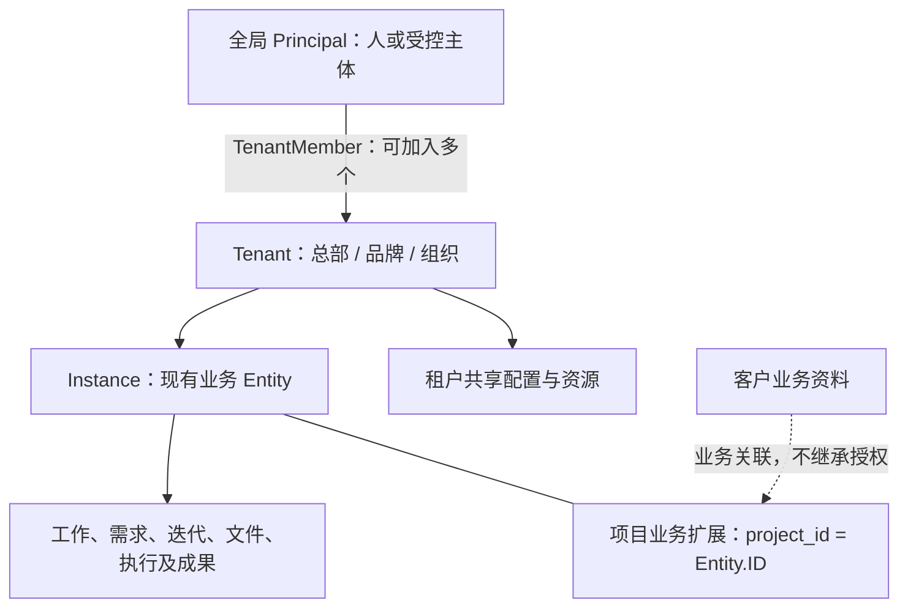

# 两层业务空间与原型落地方案

日期：2026-10-18；更新：2026-10-19。源码基线：`51d4922`。状态：**A 阶段空间导航和 B 阶段基础创建入口已实现并验证；历史层级已完成代码及隔离库只读盘点，尚未迁移；其余业务阶段和产品取舍未冻结。**

## 2026-10-19 Stage A execution status

The user continuation authorized Stage A only: frontend scope/navigation convergence in the existing production application. Implemented split tenant/instance selectors, five-area grouping of existing permitted pages, permission-union instance discovery, entity-keyed menu state, compatible resource preservation and file URL/history restoration. Existing IAM/Entity identity, backend hierarchy, API contracts and data remain unchanged. Conversation remains explicitly unavailable until its real workflow exists.

Acceptance: frontend typecheck/lint/test/build and isolated Web4317/API8087 live navigation plus mounted file-browser regressions. Live acceptance covers the same principal across two tenants with at least two admitted instances each, compatible file navigation, independent catalogs, history filter restoration, tenant-only guards and mobile controls. The second tenant was created through existing IAM APIs in the isolated acceptance database only. Broader migration/private-work/pagination policy proposals below are not approved by this stage.

## 1. 设计结论

沿用现有全局身份、Tenant、Entity 与 IAM。产品中的 **Instance 对应承担业务边界的现有 Entity**；在当前协作业务中，**项目就是实例**，不是实例下再创建一个项目作用域。`delivery_projects` 是项目业务扩展，不是另一套实例身份。不要新增 `instances` 身份表、InstanceMember、InstanceRole 或第二套鉴权服务。

当前最需要调整的是业务层级和应用外壳，而不是增加 CRUD 页面。项目列表的数据查询和 AutoTable 可以保留，放回租户工作台的实例管理；项目详情复用为实例工作台的业务概览。IAM 的实体配置是高级管理入口，不再与项目详情并列为普通用户的两个“概览”。

现有代码并非已经完全满足两层：项目创建把客户 Entity 设为项目 Entity 的父节点，IAM 会沿此关系继承 allow 和 deny。必须把客户业务关系与授权层级分开，不能只改显示名称或直接清空历史 parent_id。

## 2. 需求依据与资料优先级

1. 本次用户明确约束：一人可创建/加入多个租户；租户下多个实例；业务作用域只有两层；实例下管理资源；权限必须沿用底座。
2. `PRD_FINAL.md` 中最新已确认条款优先于早期章节：S11、末尾“集中交互评审后的统一规则”等。
3. 当前交互原型是 `docs/prototype`，不是旧 `docs/myrmidon/prototype.html`。原型源码用于核对交互，mock 不构成服务端能力。
4. 老规格仍提供工程约束，但与更新要求冲突时必须登记并修订，不能选择对当前实现最方便的一条。

已核实的冲突：

| 旧资料/现状 | 最新依据 | 方案 |
|---|---|---|
| 原型 README 说菜单不改变 URL/history | PRD S11（2422–2428 行）、原型 DESIGN 第40行要求准确位置恢复 | 稳定外壳内导航，URL 保存范围、菜单、对象和位置；不整页重载 |
| 早期知识/文件统一入口 | PRD 2618–2620 行 | 治理的知识库、协作的文件独立页面，来源与查看能力可复用 |
| 早期任务必须进入会话创建 | PRD 2652 行 | 任务/缺陷原位草稿弹窗，会话转工作复用同一确认命令 |
| 独立交付菜单 | PRD 2651 行 | 保留交付包和回执；从任务/成果/构建进入，不新增重复侧栏 |
| 原型截图只有前后页，旧规格要求 cursor-only | 用户明确要求数字页码；生产已有数字分页 | 保留用户要求；分页冲突单独处理，见第9节 |
| 旧规格允许 client → project | 本次两层要求 | 新业务不再用客户形成实例父节点；历史兼容单独迁移 |

静态截图已查看 `overview-desktop.png` 和 `list-design-desktop.png`：可借鉴五区外壳、单个实例选择器、剩余高度列表。截图上的旧菜单、分页外观不自动覆盖最新文字要求。

## 3. 对象、关系和命名

| 概念 | 当前实现/设计含义 | 边界 |
|---|---|---|
| Person | 全局 Principal；TenantMember 连接多个租户 | 账号不是第三层组织；不因创建租户复制账号 |
| Tenant | 成员、角色、共享治理和实例集合 | 一个人可在不同租户有不同身份与权限 |
| Instance | 现有 Entity 中被业务明确用作实例的对象；协作业务为 `type=project` | 直接归属 Tenant，实例之间不嵌套 |
| Project | 当前产品对 Instance 的业务称呼与扩展字段 | `project_id = entity_id`，不生成第二个项目 scope |
| Department | 人类组织与现有数据范围 | 组织结构可有树，不增加业务作用域层级 |
| Client | 客户关系/资料 | 不能仅因客户关联自动获得项目授权 |
| WorkItem 等 | 实例内领域对象，可有自己的父子/依赖关系 | 任务树不是实例树；对象关系不能绕过 IAM |
| 平台管理/个人账户 | 管理或账户入口 | 不是 Tenant 的额外业务父节点 |

`Entity` 原词并不是底座实现错误：它是可泛化的授权资源容器；问题在于把底层术语和树形能力直接暴露成产品结构。对外称“实例/项目”，内部保留 Entity 标识，能以更小代价兼容现有 API、文件根和角色绑定。

显示术语可配置：中立默认“租户/实例”，具体部署可用“品牌/商户”等。配置只控制称谓，不更改 ID、权限码和归属规则；语言包不等于已有部署术语机制，需要最小扩展现有部署配置/i18n，不另建术语管理平台。未来公司、商户等业务复用同一边界，不能为了可改名称把项目字段强塞给所有实例类型。

租户共享文件、知识、模板与治理是已有产品需求，仍直接属于租户，不新增共享实例。实例引用共享资源必须检查原来源权限与固定版本；实例私有资料不会因汇总视图自动公开。业务实例资源保留实例归属；身份、租户治理和共享配置并不因此必须伪造 project_id。

## 4. 已有能力与真实缺口

下列路径相对仓库根目录，行号为本次基线。

| 能力 | 源码证据 | 处理 |
|---|---|---|
| 全局身份、一人多租户 | `internal/iam/identity/model/model.go:10`；`internal/iam/core/model/directory.go:9`（均位于 backend-api） | 直接复用 |
| 租户创建与初始化成员/管理员 | `apps/backend-api/internal/iam/organization/tenant.go:239`；`core/tenantbootstrap.go:71` | 复用，不另写注册/Owner 系统；当前没有不可变 Tenant.owner 字段 |
| 租户内 Entity、成员角色、到期/拒绝 | `apps/backend-api/internal/iam/core/model/entity.go:9`；`core/model/authorization.go:57` | 作为实例授权基础 |
| 服务端资源归属与鉴权 | `apps/backend-api/pkg/extension/authz/register.go:217`、`:247`；`internal/delivery/http.go:50` | 新接口继续走 Registrar/Guard/OwnerResolver |
| 项目创建原子化 | `apps/backend-api/internal/delivery/project.go:103`、`:111`、`:133`、`:141`、`:154`、`:157` | Entity、项目扩展、角色、频道、审计和事件一并提交；保留 |
| 项目列表与详情 | `apps/frontend-web/apps/web/src/app/projects/page.tsx:128`、`:325`；`detail.tsx:43` | 保留 AutoTable、AutoForm、精确金额、数字分页；调整入口 |
| 当前切范围 | `apps/frontend-web/apps/web/src/app/layout.tsx:509`；`lib/navigation.ts:93` | 当前强制跳 overview/files；必须修改为保留当前资源职责 |
| 当前实例侧栏 | `apps/frontend-web/apps/web/src/components/app-sidebar.tsx:91`；`lib/navigation.ts:32` | 当前是 IAM 视图，需形成业务五区；复用权限过滤 |
| 文件能力 | 生产 FileBrowser；PRD 2638–2647 行指定复用现有预览 | 使用原文件能力，不重造文件 CRUD/查看器 |
| 工作与交付存储 | `apps/backend-api/internal/delivery/model/work_item.go:11`；`model/delivery.go:11` | 有表和模型不等于有完整命令/接口/可用业务流程 |
| 协作 | `apps/backend-api/internal/collab/channel.go` 与 module.go | 有频道创建底座，不等于完整消息、线程、执行会话已接入 |
| 执行节点 | `apps/runner/cmd/runner/main.go:6` | 仍是初始化提示；禁止声称已有真实执行 |

生产模块已在 `apps/backend-api/internal/app/bootstrap.go:146` 附近接入 intake、fleet、collab、governance、delivery。保留模块化单体和现有生命周期/能力注入，不因原型页面多就逐页拆后端模块。

## 5. 权限与数据所有权

授权仍由现有 IAM 决策。业务操作还要校验业务状态、目标版本和职责分离；这不是第二套角色权限引擎。

- 全局身份有效 + 租户成员关系有效 + 现有 IAM 对目标实例/资源允许 + 数据范围匹配 + 当前业务前置条件成立，操作才可执行。
- 成为租户成员不等于自动看到全部实例。租户管理员当前拥有的权限和 deny 优先规则保持现有语义，不凭新 UI 改写。
- 租户汇总是授权实例的聚合查询，必须在 SQL 过滤后统计/分页，不是把所有数据拉到前端筛。
- 资源详情用真实 owner 解析 Tenant/Entity。URL 或选择器值不是授权证据；跨实例混填的父对象、附件、成果版本都要校验。
- 业务成员维护复用 IAM Entity role bindings；执行者、负责人、评审者是具体工作的责任关系，不能直接变成任意对象都可操作的全局角色。
- IAM 限时角色申请、业务计划确认、工具授权、成果接受是不同对象和生命周期；可复用审计/身份/权限，不能把所有“审批”塞进 IAM 访问申请。
- 列表、计数、导出、搜索摘要、通知、文件下载、预览和后续实时订阅必须执行同一数据边界。前端菜单仅控制入口。
- `authz/decision.go:20` 明确 ResourceIDs 已展开，Ancestors 只表示授权来源；业务端不能自行二次扩张祖先权限。

数据所有者不变：IAM 管身份/成员/绑定；delivery 管项目扩展、工作、成果交接事实；collab 管会话事实及来源；files 管原件；fleet 管 Agent/节点目录；业务治理管理业务策略。新能力先查已有责任归属，仅在存在独立生命周期和依赖边界时才新增模块。

内部交接沿用现有已确认语义：上游 Human 接受后，下游指定 Human 接收固定包是 L3，不再重复要求一次上游批准；对外发布/发送另行取得适用授权。人类成员目录与 Agent 名册分开，小团队分派只引用它们，不把一次任务编组改成组织成员关系。

## 6. 两层收敛与存量兼容

已经存在的具体问题：`delivery/project.go:98` 把客户设为项目父节点，`:178` 可新建 client Entity；`core/query/authorization.go:300` 递归传播绑定的 effect，`:313` 保留 allow/deny；`core/entity.go:19` 最多16层。这是实际授权行为，隐藏树形 UI 不能解决。

建议分两条互不混淆的工作：

1. **产品呈现**：仅把明确的业务实例列入实例选择器；当前项目为实例，历史 client 不因也是 Entity 就自动作为实例展示。保留底座实体管理及旧 API，避免先做全仓 Entity 重命名。
2. **模型收敛**：项目客户使用已有 `delivery_projects.client_entity_id` 表达业务关联；目标是项目 Entity 不再通过客户 ParentID 建立授权继承。客户资料仍可引用原记录，暂不为此另建一个通用 CRM。

模型收敛前必须完成：

- 只读盘点 parent 链、全部显式/继承绑定、deny、条件、有效期、部门范围、资源关系、文件根及归档记录；不能假设没有真实存量。
- 生成迁移前的有效权限矩阵与来源，包含“应允许”和“应拒绝”。验证迁移后没有权限扩大，也没有已授权访问丢失。
- 能等价表达的绑定采用现有机制迁移；不能等价表达的条件、继承撤销语义不得盲目复制。历史祖先一次性复制成子级 allow 会丢 deny、到期和后续撤权联动，不采用。
- 在事务/维护窗口内迁移，驱动既有 policy revision/cache 失效；保留可回滚映射和验证结果。失败则整体回滚，不留下半套授权。
- 迁移完成后才在业务实例创建/改父入口约束直接归租户；不能仅限制新 UI 而保留一个可绕过的写 API。底座非业务实体的既有树能力不在本轮顺便删除。

这是需要正式迁移设计和批准的行为调整。当前设计分析没有改动任何数据，也没有承诺历史父级授权已迁移。

## 7. 工作区与导航

采用原型已有五区职责，复用生产路由/权限/组件；不把原型 mock store 和模拟角色判断搬入生产。

| 位置 | 租户视角 | 实例视角 |
|---|---|---|
| Logo 右侧 | 租户切换、创建、加入 | 同左；不重复登录 |
| 左侧唯一实例选择器 | 当前租户的授权实例汇总 | 当前实例；可回授权汇总 |
| 工作台 | 待我处理、授权汇总、全部实例管理 | 当前实例概览及当前工作 |
| 会话 | 有权频道与私信 | 实例关联频道/执行上下文；私信自身归属不被切换器迁移 |
| 协作 | 仅对有合理租户汇总语义的资源提供授权聚合 | 需求、目标、迭代、任务、测试计划/用例、缺陷、工作流/构建、文件 |
| 团队 | Human 名册、Agent 与可复用团队资源 | 同一目录在当前范围的授权配置，不复制成员身份 |
| 治理 | IAM 权限、知识库、预算、连接、审计等 | 当前实例的对应策略或对象，不重复维护另一份权限 |

平台管理/账户安全保留现有管理入口，不出现在业务层级树的上级。不同职责页不能通过只改标题和高亮伪装为已实现；尚无后端的业务入口不能展示伪成功。

切换规则：

- 在“文件”切实例仍是文件；在“任务”切实例仍是任务；相同集合可保留兼容筛选，实例特有筛选必须重新验证。
- 在具体对象详情切到别的实例，不能把旧对象 ID 套到新实例 URL。返回新范围的同类集合，并保留原详情的可返回历史；不把旧对象冒充新对象。
- 页面不具备租户汇总语义时，不伪造跨项目页面；明确显示需要选择实例及真实可选项。
- 切范围取消旧请求，查询缓存、选择、草稿按主体/租户/实例/对象隔离；延迟响应不得覆盖新范围；离开有未保存内容的编辑遵循既有保护。
- URL 与路由是范围权威来源，切换器从它派生，不另用 localStorage 维护一套相互矛盾的当前项目。刷新/新标签/后退恢复范围、菜单、tab、筛选及位置。

新路由优先沿用当前 `/admin/:tenantID`、Entity/project 规范地址；不把 PRD 尚属提案的 `/t` 前缀当成必须先全仓换路由的理由。新增地址保持一对象一主地址，旧链接在确需迁移时受控兼容，不删除可用书签。

## 8. 业务闭环与实现次序

完整目标链路：原位草稿或会话来源 → Human 确认工作/计划 → 授权执行 → 固定成果版本 → 独立检查 → Human 接受 → 固定交接/交付包 → 回执或有理由退回 → 可追溯返工/归档。

同一工作在列表、看板、会话卡片和评审面板引用同一个 ID。工作状态、专业步骤、Execution 状态、检查结论、Human 接受和交付回执分别保存，不能用一次“完成”覆盖所有事实。旧版本批准不能自动批准新版本。

不是“先做完所有列表，再开始业务”，也不是“先写完通用引擎”。按以下可验收阶段推进；阶段是依赖顺序，不删除其余完整需求：

| 阶段 | 具体交付 | 复用与边界 | 验收出口 |
|---|---|---|---|
| A：空间与导航 | 统一两层范围、五区稳定外壳，项目列表/详情归位；对齐冲突说明 | 现有 switcher/sidebar/router/permissions、项目 API、AutoTable；不在此阶段改继承数据 | 文件切实例不换菜单，后退恢复；无项目/无权限/归档可区分；旧链接可用 |
| B：实例可用 | 在租户工作台复用现有项目创建接口和表单，创建后进入同一实例；落实客户层级兼容方案 | 现有原子创建、角色绑定、频道、审计、幂等；不新增 Instance ID | 重复提交只产生一个实例，失败不留半个实例，成员与文件权限正确 |
| C：真实工作主链 | 工作列表/详情、原位草稿确认、责任分派、计划/基线、Human 手工推进/提交与历史 | 现有 delivery 模型、IAM、files、idempotency/events；先补领域命令与接口，不直接开放任意状态编辑 | 刷新后工作仍在；两人能协作；并发旧版本写入拒绝；会话来源可引用但不强制切频道 |
| D：质量与交付 | 成果固定版本、检查证据、Human 接受、交接包与回执/退回 | 同一成果查看器和业务对象；从工作进入，不新增交付菜单 | 缺证据不能接受；换版本旧结论失效；退回保留原包和来源，形成可追溯返工 |
| E：真实执行与反馈 | Execution/固定计划、Runner 领取/回执、模型与工具授权、日志/预览、取消与恢复 | 先查既有能力再实现；共用工作流/构建执行机制；Runner 当前不是已完成底座 | 离线/重复回执/失联/撤权/结果未知有真实状态；不把轮询或本地模拟冒充执行成功 |
| F：规模与扩展闭环 | 调度、知识、周期报告、预算/绩效、专业 QA、连接器及各列表配套 | 各领域按实际事实产出；不能以通用 CRUD 伪造报告/审批/运行 | 按 PRD 逐项验收真实服务、权限、来源、异常与规模，不以入口数量验收 |

C/D 先交付 Human 可以实际使用的闭环，清楚显示尚未接入的 Agent 能力；这不代表移除 Agent/Runner 需求。E 的协议设计可提前，与手工闭环共享领域命令，不能另造一个 Agent 专用任务系统。SOP/工作流的确认和版本要求保留；不能用随意状态下拉代替尚未实现的门禁。

### 开发工作 API 前必须解决的两个语义缺口

1. **简单任务与正式需求**：现有 `delivery/model/work_item.go:14–15` 强制 project_id、requirement_id，数据库也有 NOT NULL/FK；原型的轻量工作不能靠编造一个“默认需求”满足外键。建议任务始终有明确实例归属，正式 Requirement 仅在真实有关联时引用；计划/验收要求可直接属于工作。需要相应最小 schema 与契约设计，先确认约束再写创建 API。
2. **私人工作**：PRD 早期保留不强制项目的私人工作，原型甚至用 `private` 作为模拟 project；这与本次“业务资源在实例下”的统一模型存在边界问题。推荐当前业务入口统一选择真实实例，私密性使用已有 owner/data-scope 机制；不要自动造隐形租户、伪项目或第三类 scope。若仍需完全不归实例的私人工作，应明确为个人资源域并单独设计，不从本次两层要求推导自动创建策略。此点待确认，只阻塞无实例私人工作分支，不阻塞明确实例内的协作。

## 9. 列表能力与分页冲突

AutoTable/AutoForm 继续作为生产复用基础。列表接受标准包括：授权范围内的服务端搜索/过滤/稳定排序，固定左序号与右操作列、固定表头、撑满剩余高度、表格内双向滚动、数字分页、列设置、分体刷新及可关闭自动刷新。按最新要求核对30/60秒、倒计时、手动重置、离线/后台/编辑暂停及错误提示，不能仅凭组件存在宣称各页合格。

新增/导入只适用于可维护资源；任务走统一草稿确认；运行、审批、报告、接受历史不能通过导入伪造。适用能力要真实接入；不适用要给具体业务理由，不能一律隐藏按钮。

当前 H2 的 `exportable` 是已加载当前页导出，不能宣称等于“全部当前查询结果”导出。完整查询导出需要复用同一过滤/权限，在服务端受控读取/流式输出或现有任务能力上实现；不能导出未授权字段，也不能改动当前菜单和筛选。

**分页冲突是实际规格差异**：旧 spec07 第1515行要求 cursor-only；当前 `project_list_http.go:15` 和 `:47` 已提供 offset/limit/total，前端 page.tsx 第325行使用数字页码。此前测试通过证明了现有行为，没有证明符合 cursor-only 条款。

建议保留用户已明确要求的管理列表数字分页和已交付接口，不为了旧规格删页码。新方案应将“全部集合一律 cursor”改为按访问方式确定：需要任意跳页的管理表格保留 offset；消息/执行事件等增量流按序号或 cursor；深页成本用稳定排序、索引和真实规模测试评估。**这是待批准的规格修订建议，目前没有改写既有 API 或以设计文档冒充已批准 ADR。** 不在同一接口偷偷并存两套冲突参数，也不伪造 cursor 到任意页号的映射。

## 10. 第一阶段实施边界和验收

执行方式：本次分析采用 Hybrid，三个只读核查分别覆盖 IAM、工作区、业务链路；主代理负责整合。后续 A 阶段接口/导航高度耦合，优先 Direct，不按页面数量机械派发代理。

主要修改位置（计划，非已修改）：

- `apps/frontend-web/apps/web/src/app/layout.tsx`
- `apps/frontend-web/apps/web/src/components/workspace-switcher.tsx`
- `apps/frontend-web/apps/web/src/components/app-sidebar.tsx`
- `apps/frontend-web/apps/web/src/lib/navigation.ts` 及对应现有测试
- `app/projects/page.tsx`、`detail.tsx` 和 `app/entities/workspace.tsx` 的入口/嵌入边界
- 必要的 router/i18n/部署术语配置接线与文档冲突修订，按确认的设计最小调整

第一阶段不新增权限引擎、通用业务框架、微服务、全新项目模型；不全仓重命名 Entity，不清除旧数据，不接入真实 Runner，不顺便更换依赖。新增源文件仅在现有壳内无法清楚承担新职责时使用；目前无需预设一批抽象或 scaffold。

验收必须实际覆盖：

1. 同一人加入两个租户；各自多个实例；切换后标题、列表、详情、查询、权限一致。新建/加入空态可操作，不伪造示例项目。
2. 文件A → 切到实例B → 仍是文件；任务同理；后退恢复A的范围、过滤和位置。对象详情不被拼成跨实例假链接。
3. 普通成员只能看到授权实例；租户汇总计数不泄露其他实例；篡改 URL、详情、导出、文件与过期授权被服务端拒绝。
4. 原项目列表/详情、IAM 管理与旧书签继续可用；普通用户不再看到两个重复概览；平台/账户入口不被误解释为业务层级。
5. 长列表/短视口/手机验收 sticky、剩余高度、二维滚动、数字分页、刷新暂停与范围竞态；不回退用户此前明确要求。
6. 构建与现有相关测试通过后，再用浏览器和真实 API 验收；mock/截图不能作为生产接受证据。

## 11. 审计验证、风险与保留项

本次是定向业务架构审计，不是全仓安全认证或依赖健康审计。核查 IAM、composition root、业务模型/接口、生产工作区、PRD、最新原型源码与两张截图。未逐行审查所有模块、未验证所有原型需求、未评估外部依赖最新版本和许可证，未执行生产数据盘点及迁移。

### OpenAPI 全量结构检查与运行时抽样

- 已读取提交的 `apps/backend-api/docs/openapi.json`：277 paths、409 operations、455 schemas。operationId 重复0、缺失0，缺少 tags 为0；路径参数声明不匹配/未 required 为0，缺失 responses 为0。
- 全部 GET 中59个使用 offset/limit、6个仅 limit、115个没有这组分页参数。路径按租户集合、Entity/资源归属详情以及系统/账户等分组；不能仅为路径样式统一重写已用的 OwnerResolver 路由。
- 有 bearer/session、SCIM、clientBasic 等安全契约；35个 operation 未声明 security。此统计不是35个越权漏洞的结论，需要逐接口结合公开端点与实际注册核实。
- 项目业务只有 GET tenant/projects、POST tenant/projects、GET entity/project 及创建契约 OPTIONS；未见工作命令、执行、成果检查/接受等完整业务 operation。会员邀请/webhook 的 deliveries 路径不是业务交付实现。
- 隔离 API8087 匿名抽样：`GET /healthz` 为200；项目集合与项目详情各401。对照 `delivery/http.go:48–50` 的 Guard/Owned 注册符合本次抽样预期。
- 未完成全部运行时路由与规范的双向对账，未文档化/无实现路由数为**未知**。未据此声称全API评审通过；本次不重生成或修改契约。

### 相关测试

只读 IAM 核查代理实际执行两组定向 `go test -count=1`，结果 PASS：第一组覆盖 Entity 隔离、到期绑定、目录租户隔离、项目原子创建及客户解析；第二组覆盖父级 allow/deny、成员状态、管理员范围和 Entity grant 不授 Tenant action。完整命令保存在本次 MEMORY 的验证记录。它们证明当前底座行为，**不证明建议的扁平迁移或新壳已实现**。

本次未修改生产代码，未重新跑全仓 CI/前端构建。先前 H2 的构建/测试属于基线交付证据，不冒充本文方案的实现验收。

文档交付前另行检查引用路径、Markdown 本地链接、Git diff 与空白错误；这仅验证文档交付，不等于所提方案的运行验收。

### 高风险路径的反向检查

| 失效模式 | 本设计涉及处 | 当前防护/实施验收要求 |
|---|---|---|
| A1 暂存后提交 | 原位工作草稿、会话转工作 | 原型本地保存不等于云端持久；提交成功后才清草稿，失败/断线保留并防重复 |
| A2 大批量输入 | 导入、附件、查询导出 | 复用既有文件/查询边界；真实体量、上限+1、部分失败和权限逐项验证 |
| A3 中断的状态流 | 工作/检查/接受/交付/取消 | 领域命令校验状态与版本；不开放任意改状态；返工与未知结果可追溯 |
| A4 隔离旁路 | 切实例、计数、导出、预览、订阅 | 底座已有授权；每条业务读取仍需使用 DataConstraint 和真实归属 |
| A5 数值 | 预算、费用、投入 | 保留当前整数 micros/字符串精度；不因 UI 整合转 Number 或浮点累计 |
| A6 重复副作用 | 创建/提交/执行/回执 | 复用 idempotency；不同请求体冲突、重放、事务回滚和回执重复单独验收 |
| A7 历史兼容 | client 父链与旧路由 | 迁移前后 allow/deny/条件/有效期/部门逐项对照，不能只测新建 |
| A8 异步任务 | 自动刷新、后续执行/调度/导出任务 | 刷新仅重读；后端任务需租约/幂等/恢复与实际回执，当前 Runner 未实现 |

### 分级结论

**已在造成成本**：生产切实例强制落到 overview/files、业务外壳仍为 IAM 视图，独立项目入口偏离统一实例工作台；原型/PRD/旧规格冲突导致实现和验收容易各自选依据。先处理 A 阶段收益最大。

**下一步开发就会触发**：客户父链迁移会改变授权；工作创建会遇到强制需求/私人归属；全查询导出会超过当前页能力；真实执行会暴露 Runner 仍为空壳。分别在 B、C、列表完善和 E 前处理，不能等到页面堆完再补。

**记录但不动**：保留 Entity 底层名称、已有模块化单体、现有 IAM 树的非本业务用途、现有项目扩展表、文件和金额实现。没有证据支持先全仓改名、拆服务或增加通用工作框架。

## 12. 后续决策

两层范围和复用 IAM 是用户已明确要求，不再重复征询。接下来需要评审的是本文具体落地方案，尤其是：历史客户授权迁移、数字分页对旧 cursor-only 规格的修订，以及完全不归实例的私人工作是否继续保留。

建议先按 A 阶段收敛业务壳与导航，同时完成 B 的只读迁移盘点；再做实例创建与 C/D 的真实工作闭环。不要继续添加零散独立资源页，也不要先做全仓重命名。确认这些实质性设计后，再登记正式 ADR 并实施；本文不会替代批准记录。

## 13. 实施状态（2026-10-19）

A 阶段的租户/实例分离选择、真实权限菜单分区、资源内切换及历史状态恢复已完成。B 阶段的基础项目创建入口已完成：租户工作台与项目列表共用 AutoForm，沿用 `project_manage`、动态请求契约与 `project.create` 原子接口。项目和实例继续使用同一个 Entity ID；创建后刷新实例目录并进入该实例。基础表单提供名称、编码、描述，其余可选配置不在本次入口范围。

真实隔离 API/浏览器验收通过：契约加载失败重试、无效编码阻断、重复提交、成功提交后响应丢失及幂等回放、编码冲突保留输入、创建者角色/频道/文件访问、目录刷新/重新加载、受限账号接口403、桌面和手机弹窗适配。A 阶段跨租户/实例回归与前端 typecheck/lint/test/build 均通过。验收脚本和执行说明位于前端 `tests/README.md`。

历史客户父级授权迁移尚未实施，后端/数据库结构及既有权限语义未变。C-F 的任务、评审、验收交付和执行反馈闭环仍待实现，不能将入口验收视作整个原型完成。下一步先完成历史继承关系的只读盘点，再评审迁移等价性；不直接平移或删除旧授权。

## 14. 历史层级只读盘点与迁移门槛（2026-10-19）

### 14.1 范围与执行方式

本轮只读分析，没有修改业务代码、数据库、鉴权、配置或运行服务。直接执行，未新增委派：创建、鉴权、部门与文件所有权相互关联，由主会话核对完整调用链。复用已有模型、能力接口和回归测试，只更新本设计与任务记录；不增加迁移器、通用实例框架或额外状态文件。

数据来源仅为 `apps/backend-api/.temp/dev/h2-acceptance/acceptance.sqlite`。使用 Python 标准库 SQLite，以 URI `mode=ro` 打开并设置 `PRAGMA query_only=ON`，在同一只读事务内执行 SELECT。快照时间 `2026-10-19T23:33:21Z`；以下统计包含数据库内全部相关租户，项目统计不排除归档。未查询原服务数据库，也未读取登录密码、文件对象地址或文件内容。

### 14.2 已测数据与含义

| 检查项 | 隔离库结果 | 可得结论 |
|---|---|---|
| Entity | 8 个：project 5、company 2、unit 1；均 active；全部 parent_id 为空 | 此快照没有客户实体或嵌套实体 |
| 项目扩展 | 5 条；归档 0；缺失 Entity 0；Entity 类型错误 0 | 项目与实例身份完整 |
| 客户关联与项目父级 | client_entity_id 非空 0；项目父级非空 0；两者不一致 0 | 此快照没有待拆除的客户→项目关系 |
| 项目祖先链 | 深度 0 共 5 条；深度大于 0 为 0 | 此快照没有项目祖先授权来源，不存在要复制的父级绑定 |
| Entity 角色绑定 | allow 6；deny 0；限时 0 | 仅是已存绑定统计，不代表没有绑定的主体也有权限 |
| 角色数据范围 | department / selected_departments / self 各 1 条 | 部门和个人数据边界真实存在，不能按空库处理 |
| 部门 | active 2；均属于 unit Entity | 部门不是项目树节点，也不能自动转移到某个项目 |
| 文件根 | entity 8、department 2、tenant 2、account 18；均 active | 根范围有独立语义，不随 Entity 父级整体移动 |
| 实体/部门根完整性 | 10 个根；缺失空间 0；缺失实体/部门所有者 0 | 本次检查的根所有权引用存在；未据此声称所有文件闭包/版本已全量审计 |
| 根下后代节点 | entity 6、department 12、tenant 6、account 245 | 根下存在真实内容，不能通过删根重建来收敛 |
| 文件 ACL / 资源绑定 | ACL 234 条，均 owner/allow/self_and_descendants；文件资源绑定 18 条 | 文件权限和业务附件引用不能由 IAM Entity 迁移替代 |
| IAM 关系与角色条件 | iam_relationships 0、iam_resource_relationships 0；非空角色条件 0 | 此快照没有这些高风险样本；相关语义仍需用现有测试验证 |

**结论范围：当前隔离库不需要旧项目父级数据迁移，可以继续根实例上的新业务。不能外推到原服务、其他部署或生产库；未提供任何生产有效权限等价性证明。**

### 14.3 代码关联与禁止的简化

| 责任 | 实际实现 | 对迁移的约束 |
|---|---|---|
| 客户/项目关系 | `internal/delivery/project.go` 的 `createOn` / `clientOn` 同时设置 Entity.ParentID 和 Project.ClientEntityID；`project_input.go` 仍接受 client | 新 UI 不传客户，所以创建根实例；现有 API 仍可产生旧层级，尚不能宣称所有写入口已强制两层 |
| 模块所有权 | `internal/delivery/module.go` 预留 project Entity 类型；`internal/iam/core/entity.go` 拒绝通用接口改该类型的名称/父级 | 不能用通用实体 PATCH 或裸 SQL 绕过 delivery 生命周期；未来变更由业务命令组织 |
| 原子更新能力 | `internal/iam/core/entity_provisioning.go` 的 `EntityProvisioner.UpdateOn` 绑定调用方事务并复用 IAM 服务；`entity.go` 的 UpdateEntity 锁 policy revision、审计并标记 PolicyChanged | 将来可复用此窄能力，不新增跨模块表写入或第二套失效机制；现有能力不是已实现的迁移命令 |
| 祖先授权 | `internal/iam/core/query/authorization.go` 的 `scopedGrantStatement` 向下递归，保留 role、effect、来源 scope、condition、有效期及 active 状态；`directoryAncestorRoleIDsStatement` 还读取祖先角色 | 拆父级会同时改变权限、数据约束及授权解释/目录角色来源；不能只比较按钮或单个 GET |
| 部门所有权 | `internal/iam/organization/repository.go` 的 `insertDepartment` 要求租户部门有 EntityID，父子部门必须属于同一 Entity | 项目去父级不需要重写部门树；客户部门若存在，保留其所有者，不能复制/改挂来“补权限” |
| 文件归属 | `internal/files/root.go` 的 `resolveFileOwner` 根据 root_scope/root_owner_id 调用实体或部门 owner resolver；实体根、部门根在租户文件空间内独立绑定 | 保留 space/root/node/version/object ID、闭包和资源绑定；不是把客户目录物理搬到项目目录 |
| 文件授权 | `internal/files/permission.go` 的 `validateRoot` / `constraintAllowsRoot` 校验真实引用和 IAM ResourceIDs/DepartmentIDs/DeniedIDs，然后结合文件 ACL；`permission_store.go` 校验文件树自身根边界 | 即使文件物理位置不变，拆父级仍可能改变文件访问；必须在文件层验证允许与拒绝 |

特别需要区分两个事实：`parent_id` 改变影响 IAM Entity 树；文件节点也有 `parent_id`，但那是文件树。两者不是同一棵树。部门 closure 也是独立关系，不能一起清空或重建。

### 14.4 后续迁移分流与等价性检查

| 目标部署盘点结果 | 推荐动作 | 阻断条件 |
|---|---|---|
| 没有嵌套项目，也没有客户业务关联 | 不生成数据迁移；继续根实例功能 | 仍需单独评审旧创建 API 的兼容策略，不能因库空而静默改变 client 参数含义 |
| 有项目父级，但暂时没有有效祖先绑定 | 输出逐项目候选，不自动断开 | 当前无授予不等于未来父级授权没有含义；保留客户业务关联、审计历史与管理员确认 |
| 有继承 allow/deny、条件、限时或共享资源依赖 | 保留旧关系，先给出主体/权限/资源/来源差异，再决定目标授权 | 不能把快照复制成永久子级 allow；父级以后撤权、停用、条件变化等联动会丢失 |
| 有悬空/跨租户引用、循环、过深树、客户关联与父级不一致 | 停止该租户迁移，单独处理异常 | 不通过“清空坏引用”掩盖已有数据问题 |

迁移前后矩阵至少包含：租户、主体、实例、权限、资源 ID、评估时间、可信上下文、Allowed/Reason、匹配来源及生效约束（ResourceIDs、DeniedIDs、DepartmentIDs、OwnerIDs）。覆盖详情、列表/计数、导出、文件列举/下载/预览和角色目录解释。`Ancestors` 是来源证据，迁移后允许变化；不能把它当资源列表再次展开。

除同一时间点的结果外，还必须演练父级绑定删除、deny 新增/删除、到期边界、条件变更、父级停用、成员禁用。**保留当前结果与保留未来联动不是同一个承诺。** 如要取消父级联动并改为逐实例管理，那是需要明确接受的授权行为变更；不通过添加隐藏继承表把第三层重新造回来。

建议既有项目按租户显式评审，保留仍需使用的旧树，逐步收敛到现有 IAM 的实例直接绑定。是否终止旧父级对项目的未来联动，需要单独确认；本轮没有冻结该产品决定。

### 14.5 当前验证与实施准入

实际执行的相关测试覆盖：祖先 allow/子级 deny、继承数据约束与成员停用、条件/临时授权、绑定有效期、EntityProvisioner 调用方事务/回滚/租户隔离、部门 Entity 边界、文件根所有权/范围约束/保留内容、资源绑定隔离，以及客户解析/项目创建原子性。`core`、`organization`、`files`、`delivery` 四包选定测试均 PASS，使用 `go test ... -run ... -count=1`，未依赖缓存。

本轮仅改文档，未重跑前端构建、全后端 CI、MySQL/PostgreSQL 全量门禁或原型浏览器验收；此前 Stage A/B 验收不能作为尚未实现迁移的证明。实际迁移尚无命令、回滚演练和目标部署权限矩阵，因此迁移准入为 **NOT READY**；只读盘点范围已完成。

## 15. 需求与工作项创建：设计对照与实施边界

### 15.1 需求依据与现状

本阶段目标是将原型的真实工作创建接入现有实例与 IAM，不增加第三层作用域，不复制原型内的角色判断或私人项目占位 ID。直接执行；读写路径、基线与存储约束紧密关联，本轮不新增委派。当前是设计对照，不代表创建功能已实现。

| 核对项 | 实际证据 | 实施影响 |
|---|---|---|
| 原位创建 | PRD_FINAL 第2652行要求任务/缺陷原位草稿确认，不强制切频道 | 列表弹窗与以后会话转工作必须复用业务命令，不能各建一套任务 |
| 原型草稿确认 | `docs/prototype/src/store.js` 的 beginWorkDraft / confirmWorkDraft 要求目标与完成条件，Human 确认后生成工作；requirements 是文本数组 | 此处的 requirements 不是生产的 Requirement ID，不得按字段名称直接映射 |
| 私人归属 | PRD_FINAL REQ-DETAIL-001 明确私人集合实体复用与创建时机待冻结；原型 confirmWorkDraft 自动插入 id=private 的项目 | 不自动创建隐藏租户/项目，不以固定字符串代替真实 Instance ID。无实例私人工作须单独设计 |
| 已发布数据约束 | `apps/backend-api/internal/delivery/model/work_item.go` 与三方言00003要求 project_id、requirement_id 非空，要求关联同租户/同项目需求；baseline_version_no 指向需求版本 | “任务必须归实例”已有基础；“每项任务必须先建独立需求”是额外限制，是否保留需确认 |
| 需求基线 | model/requirement.go 与00002已有 Requirement、AcceptanceCriterion、RequirementVersion、ProjectCounter | 复用需求草稿、条款与不可变版本；不能用一个虚构需求接住所有普通任务 |
| 工作条款与命令 | 当前 delivery 无 WorkItemCriterion 模型/表，也无需求或工作项命令；提交的 OpenAPI 中 requirements/work-items/acceptance-criteria 相关 operation 为0 | 要先落实条款身份和固定版本，再接创建；表已存在不等于流程已存在 |
| 权限 | governance/manifest.go 已有 requirement_read/write、work_item_read/write 等角色意图；delivery/module.go 当前仅注册 project 动作 | 复用这些权限码并在已有注册表贡献真实动作，仍经 IAM；角色清单中的文字不是已生效的接口守卫 |
| 编号兼容 | 隔离库只读查询：Requirement1、WorkItem6、AcceptanceCriterion0、RequirementVersion0、ProjectCounter0 | 新建命令需在实例内从真实已有最大编号安全初始化计数器；不能假定没有历史记录或从1盲增 |

### 15.2 已确认的本批归属规则

建议每个正式任务/缺陷都必须归属一个真实实例，独立需求关联可选。任务必须有自己的目标、负责人和验收条款；关联独立需求用于追踪范围与需求版本，不作为所有简单任务的创建前置。无实例私人工作另行设计，当前不接入生产。

三个独立维度不能混用：

| 维度 | 使用的现有身份 | 不承担的职责 |
|---|---|---|
| 数据与权限归属 | Tenant + ProjectID（同 Entity.ID） | Requirement/任务父节点不成为额外授权作用域 |
| 需求追踪 | 可选 RequirementID + 需求版本 | 不为无关联任务制造“默认需求” |
| 工作拆解 | WorkItem.ParentID | 不继承 IAM 角色，不改变实例所有权 |

缺陷继续是同一个 WorkItem 的 BUG 类型，保留复现、预期/实际、版本与验证信息；不新增 Defect 身份表。已有 Type 枚举还包含 DOC、RESEARCH 等，不把原型的“软件/文档”展示分类直接覆盖到 BUG 类型或再造一套冲突枚举。

**已发出待答问题**：采用“实例必选、需求可选”，还是保留“全部工作必须关联独立需求”，或先只完成需求管理？这是产品及存储语义选择；未收到答案前不改相关模型、迁移或API。

### 15.3 若采用推荐方案，需要一并落地的契约

以下是供评审的实现边界，具体DDL及API在归属选择确认后再冻结。

1. 保留现有 Requirement/AcceptanceCriterion/RequirementVersion 的职责。WorkItem.RequirementID 改为可空；有值时仍验证同租户、同实例、可用需求及所选版本。无关联时旧 baseline_version_no 不冒充已确认需求版本；明确表示未关联，不能伪造版本1。
2. 落实已有规格规划的 `delivery_work_item_criteria` 责任，提供任务内稳定条款 ID 与固定文本/必需性/排序。关联需求时保留来源条款和来源版本，避免后续实时读取可变需求来替代已确认标准；独立任务同样有稳定条款，不能仅保存自由文本或假 criterion_id。
3. 工作自身简报/验收契约与需求基线分开版本化。确认固定目标、责任人、条款与验证方法快照及哈希；需求版本号、工作对象并发 version、工作契约版本不可混为一个数字。复用 delivery 内聚合及事件/审计，不建设通用版本引擎。旧数据没有这些记录时显示未确认，不回填伪造的 Human 确认。
4. 修改已确认契约走现有变更确认原则，不静默覆盖；工作版本变化与成果证据所引用的契约版本一致。没有完整计划/SOP/验证前置时，创建成功不等于可执行或已通过验收。
5. 只用增量三方言迁移；00001–00003保持不变，生成模型/query由生成器更新。SQLite重建须完整保留原约束、索引、旧行和已有外键；降级有不带需求的工作时不得靠删除这些行“成功回滚”。

不能只把 requirement_id 改为 NULL 就宣称支持独立任务：那会让任务失去现有需求条款与基线的唯一来源。

### 15.4 命令、页面及交付顺序

| 批次 | 复用与实现 | 验收结果 |
|---|---|---|
| C1 需求管理 | 在 delivery 内实现需求草稿创建/读取/编辑、条款维护与首次基线；复用现有表、project ownership、requirement_read/write、原子事务、幂等和版本锁 | 独立需求页面能新建真实需求、保留草稿、发布不可变基线，刷新可读；越权/冲突/错误条款有真实拒绝 |
| C2 手动工作创建 | 实例任务/缺陷列表共用 AutoForm 草稿确认动作及服务端 WorkItem 创建命令；按最终归属规则带目标、负责人、条款与可选需求来源 | 原位创建后保留列表范围/条件；真实条款可读、没有占位需求；失败不丢输入、重试不重复创建 |
| C3 Human 工作闭环 | 后续认领、成果固定版本、实际验证证据及 Human 接受复用同一个工作事实 | 不能用“改状态”代替成果/证据/职责校验，不伪称 Runner 已执行 |

创建/读取沿用规格已有路由职责：实例下 `/entities/{entity_id}/requirements` 与 `/entities/{entity_id}/work-items` 创建/列表，真实对象ID用于详情及后续命令。服务端解析真实 owner；客户端不提交可信 Tenant/Actor/Allowed/确认时间。对象跨租户或跨实例引用必须在同一事务内拒绝。

列表沿用用户已要求的数字分页、AutoTable sticky序号/操作列、剩余高度与内部滚动、搜索过滤、排序、复合刷新按钮及URL恢复。旧cursor-only条款仍是已记录冲突，不能在新列表偷偷退回前后页。全查询导出须执行相同权限/过滤，不能把当前页导出标成全量。

服务端创建顺序：验证身份/输入 → 按现有IAM顺序取得授权及主体/租户保护 → 校验实例与业务状态 → 幂等检查 → 同实例计数器初始化/分配 → 写对象、条款、固定契约与审计/事件 → 提交。编号以现有最大值为底，唯一约束兜底；幂等回放不能重复分配或发事件，任一步失败全部回滚。具体锁序需按既有 project.create 与 IAM 实现冻结，不在新服务自造另一套协调器。

手动工作本批不伪造会话来源：当前 collab 消息和统一来源接口尚未完整落地，会话转工作以后再接同一创建命令及真实来源读取/授权。UI本地未提交草稿按主体/租户/实例隔离，不能将客户端恢复记录当服务端确认记录。

### 15.5 文件与测试边界

确认后主要改动在 delivery 既有 module/http/model/query/dbgen/i18n/三方言迁移，以及前端既有 iam-api、路由、权限菜单与业务页；新增文件只承载需求或工作创建的实际职责。IAM内部算法、Entity ID/树、原服务数据、私人工作、Runner和其他专业资源不在本批顺便改动。

必测：同实例并发编号、存量编号初始化、事务每步回滚、幂等重试、越权主体/外租户/外实例引用、有效需求/过期版本/已退役条款、无需求任务的条款完整性、旧存储升级、版本冲突，以及AutoForm/AutoTable真实浏览器成功和失败路径。采用可选关联前，先保留旧约束测试，新增迁移后允许无需求但拒绝错误关联的测试，不修改旧迁移的预期来掩盖兼容性。

实际验证：`bun test tests/work-drafts.test.js` 为18 PASS / 160 assertions；初次因原型目录未安装react失败，执行已有锁文件的 `bun install --frozen-lockfile` 后通过，未改依赖声明/锁文件。后端在 tests 模块执行 `go test ./migration -run 'TestDelivery(ActivityStorageUpgradeAndConstraints|RequirementsConstraints)AcrossEngines/sqlite$' -count=1` PASS。这些测试证明原型约束和当前SQLite存储现状，不证明待实现的生产工作流。MySQL/PostgreSQL、本阶段生产UI构建/API/浏览器尚未执行。

### 15.6 本批实际落地与验收边界

用户继续后，按15.2落实“真实实例必需、需求可选、任务自有条款和确认契约”。15.1的“现状”是实施前调查快照，当前代码以本节和实际接口为准。本批先闭合C2手动工作创建/列表/详情；C1需求命令和基线页面仍待下一批，不能把现有需求存储当作需求流程已完成。

复用 delivery、EntityConstraintOn、既有主体锁/成员校验、幂等存储、审计和事件事务；新增00004迁移，未改已发布迁移。POST返回有界回执，详情读固定条款ID和SHA256契约。新任务保持DRAFT、readiness=false；确认创建不等于完成执行准备。

真实隔离环境工作页面已验收：响应提交后丢失再重试不重复、双提交锁、跨实例404、稳定条款/哈希、1500个补充平面字符输入和落库、2001字符失败提示且无POST、50个大条款回放、手机弹窗、固定序号/操作列、带省略号数字分页、第二页序号11、表内双轴滚动、底栏撑满工作区、筛选刷新恢复。前端typecheck/lint/test/build、后端delivery测试、三方言及真实MySQL升级/拒绝降级重试、性能门禁通过；全仓CI各门禁分阶段完成（主模块覆盖率92.5%）；通用迁移测试目标版本随新增迁移更新为4，原失败断言未删除。

表格导出仅当前页；导入、批量改写、全查询导出、工作执行/成果验证/接受交付未在本批伪造。下一步沿用同一delivery模块完善需求创建与基线确认，再接真实需求选择和Human工作闭环。

### 15.7 C1 Requirement implementation checkpoint

Requirement draft create/list/detail, metadata edit, criterion add/edit/archive and initial baseline now reuse the existing delivery storage; no additional migration was needed. Changes require the Requirement concurrency ETag. Baseline version is independent, and the first immutable snapshot records stable criterion IDs and SHA256. Archived clause codes are never reused. Baselined content is frozen; scope-change/version-successor commands remain outstanding.

The instance Requirement page uses AutoForm and AutoTable. Work creation selects actual same-instance baselined Requirements; an independent work item omits the association field. The optional schema accepts omission rather than null. Requirement-only members can discover their authorized instance; members with work access keep Work Items as the collaboration landing.

Real browser checks on the isolated environment cover draft edits, C2 archive followed by C3 creation, lost committed create/baseline responses and same-key replay, stale If-Match, immutable hash and IDs, cross-instance refusal, mobile fit and a linked work contract that remains DRAFT. The work/scope/project browser suites also passed after restoring collaboration landing order. All latest CI gates passed across phases: full invocation passed backend fmt/lint/schema lock/main tests/43 coverage gates/integration/build/OpenAPI; frontend contract initially caught two duplicate generated route entries, regenerated and then passed. Overall coverage91.2%, delivery90.4%. Fresh frontend typecheck/lint/test/build pass with220 web tests. Additional MySQL/performance checks are running. This is not completion of the full prototype.

### 15.8 C3 Human lifecycle implementation plan

- Goal / requirements: claim the existing work, retain an explicit readiness warning, submit a fixed result, record actual checks and require authorized Human acceptance of that exact version. Keep task, result, check and acceptance identities distinct.
- Existing implementation / reuse: delivery WorkItem, stable WorkItemCriterion and confirmed WorkItemContract; existing principal/member locks, EntityConstraintOn, idempotency, audit/outbox and files. Assignment, transitions, claim/result and evidence runtime commands are not already implemented. The execution module and Runner execution do not exist yet.
- Decomposition / execution mode: direct sequential work while storage and command boundaries are being established. First self-claim/lease/release with T29 acknowledgement; then fixed results/evidence; then independent checks/acceptance. Runner follows the same work facts later. Do not delegate shared schema or authority semantics before their contract is fixed.
- Design: use spec02 assignments and transition history for claim ownership; an active lease and current authorization are both necessary. DRAFT Human self-claim requires explicit acknowledgement and audit; it must not silently set readiness_ok=true. READY claim also checks existing project phase and pause/block conditions. No arbitrary status PATCH and no fake Execution success.
- Files to change/add: existing delivery model/query/dbgen/module/http/i18n and additive three-dialect migration, corresponding domain/HTTP/migration tests; existing work page/API/generated schema and three locales. Only responsibility-bearing domain/model/UI files are added.
- Files not to change / out of scope: published migrations, IAM algorithms, Entity hierarchy, original runtime services, private hidden instances and Agent/Runner simulation.
- Testing / acceptance: same-item concurrent claims have one winner; stale version, expired/revoked identity, explicit deny and cross-scope references fail; audit/event failure rolls back ownership/state/history; transport replay does not claim twice. Browser verifies acknowledgement, current claimant, persistent warning, release/reclaim and input/error handling. Subsequent result acceptance must reject absent evidence and superseded versions.
- Risks / dependencies: spec02 historically requires Execution for Claims, while the accepted current prototype explicitly includes Human manual work. Before result storage, reconcile that with current PRD rather than fabricate an execution or introduce a parallel task system. Missing module capabilities remain visible and unclaimed.

#### C3 dependency review (2026-10-20)

The scoped read-only review confirmed these existing requirements: both DRAFT and READY Human claim require ACTIVE project, nonarchived leaf work, no pause/block, current active Human membership and transactional work_item_execute authority. DRAFT requires explicit acknowledgement, records readiness_override_by and retains a visible warning even when the old readiness_issues array is empty. Human lease defaults to4h with15min–24h bounds and60s reclaim grace; NULL means suspended, never expired. Assignment version/ownership and work CAS plus unique ACTIVE slot protect renew/release/reclaim. Release/reclaim recomputes blockers/readiness; it cannot turn an override DRAFT into READY. Current execution references must cause an explicit refusal until a real execution query capability exists. Actual recovery of expired claims is required, using existing jobs/dlock rather than a second scheduler.

A further concrete prerequisite was found in source: project creation initializes INTAKE and no stage-transition command exists. Spec07 S1/S2/S4 requires DISCOVERY, PLANNING and then ACTIVE, with actual Requirement baseline and READY work guards; simply adding a claim button would leave new projects unusable. Therefore C3 execution order must include work readiness/verification-plan maintenance and the applicable authorized project phase commands before full claim acceptance. Do not mutate the acceptance database to ACTIVE as a substitute, add a direct stage dropdown, silently skip phases, or weaken ACTIVE guards. Independent work remains valid without its own Requirement; no hidden Requirement may be introduced to satisfy project gates. The current PRD and accepted manual-work flow remain the authority when resolving historical phase/gate conflicts.

### 15.9 C3 implementation boundary after source reconciliation

#### Goal / Requirements
Make a newly created instance reach a legitimate executable state and then support Human ownership. Preserve Tenant -> Entity/Instance -> work identity and existing IAM. A passing readiness check is a preparation fact, not evidence that work was executed, checked or accepted.

#### Existing Implementation / Reuse
WorkItem already owns objective, autonomy, estimate, context_refs, out_of_scope, verification_plan, budget and readiness fields. Its stable WorkItemCriterion IDs and immutable WorkItemContract are implemented. Project starts INTAKE. Intake Record.OpenRoundID is the current persisted clarification fact. Governance.Check intentionally supports only project_create today. Published role permissions alone do not implement stage authority. Reuse these owners, existing transactional authorization, principal locks, idempotency and audit/outbox.

#### Task Decomposition / Execution Mode
Direct implementation for the coupled readiness/state commands; bounded read-only reviewers independently check authorization/state/HTTP contracts. Ordered units: (1) readiness field maintenance and immutable checks; (2) owner-provided intake phase facts plus governance stage-authority branch; (3) legal early phase transitions and real readiness presentation; (4) Human claim/renew/release and scheduled expiry; (5) versioned result/check/acceptance. Do not implement claim acceptance against manually forced ACTIVE fixtures as proof of the new-instance workflow.

#### Design
- Readiness maintenance must preserve the confirmed work objective/criterion identities and original contract hash. It supplies planning data, not a new task resource. Missing objective or invalid historical contract cannot be silently repaired by inventing confirmation.
- Verification-plan entries reference stable work criterion IDs (not Requirement clause IDs or list positions). Exactly one primary method per criterion; methods TEST/COMMAND/AGENT_JUDGE/HUMAN/VISUAL. A HIGH-risk criterion with AGENT_JUDGE alone is insufficient. Textual creation-time verification_method is descriptive and cannot be silently classified into a method enum.
- Persist explicit out-of-scope confirmation; current default [] does not prove the Human confirmed it. Treat existing defaults/NULLs as missing information. Budget uses exact integers; never floating-point money. Context references and assigned Human must be validated through existing owner capabilities.
- Check records are immutable and retain their trigger and issues. Field completeness and system ready_guard are distinct: dependency/estimate/container/pause/block checks still apply. Existing quality issues cannot disappear merely because deterministic field checks pass. Missing quality/execution/dependency capabilities must remain explicit; an unavailable query never means zero issues.
- Readiness can be prepared in DISCOVERY/PLANNING. ACTIVE is a prerequisite for claim, not for preparation. This prevents a cycle between S4 requiring a READY work and claim requiring ACTIVE.
- Intake provides project-scoped source/clarification facts from its own queries in the caller transaction; delivery never imports intake model/query or guesses whether an unknown round is closed. Any future intake mutation that affects a phase guard must follow the same project serialization contract.
- Stage changes are authorized domain commands with immutable transition history, expected version and reason. Implement S1/S2/S3/S4 with their actual persisted prerequisites; report unsupported later transitions explicitly until their aggregates exist. No arbitrary stage PATCH, automatic advancement or hard-coded privileged bypass.
- Human ownership remains an Assignment with bounded lease and version/CAS, not an Execution. DRAFT override records acknowledgement and retains warning. Claim/release/reclaim use current authorization and must preserve DRAFT when preparation remains incomplete.

#### Files to Change / Files to Add / Files Not to Change
Extend existing delivery work/module/HTTP/model/query bindings and existing work detail/iam-api/i18n; extend intake references and governance authority only for capabilities actually consumed. Add delivery-owned readiness/transition/assignment persistence and additive three-dialect migrations only as their commands land; regenerate derived artifacts through generators. Do not modify published migrations, tenant/entity identity, IAM grant semantics, original running services, Runner scaffold behavior or unrelated modules.

#### Testing / Acceptance Criteria
New-instance end-to-end path: create -> real Requirement/baseline -> readiness preparation -> legal phase commands -> Human claim -> renew/release/reclaim. Reject phase skips, terminal writes, missing/foreign criterion IDs, missing confirmation/budget, inactive/revoked Human and stale versions. Assert zero business/history/counter writes after rejected commands, atomic audit/outbox rollback, exact replay, unique active assignment and expiry after grace. Verify UI uses AutoForm and existing scoped API contracts; warnings and actual next actions persist after reload. Independent work may omit its own Requirement and must not receive a hidden one.

#### Risks / Out of Scope
Historical spec02 Execution-centric result storage must be reconciled with current PRD Human manual flow before persisting results; do not manufacture Execution. Later phases require real delivery/acceptance/execution/constitution capabilities, not synthetic counters. Full prototype remains outstanding; this dependency plan is not a completion claim.

### 15.10 Early project stage commands: implementation plan

- Goal / Requirements: implement authorized S1 INTAKE -> DISCOVERY, S2 DISCOVERY -> PLANNING and S3 PLANNING -> DISCOVERY with immutable history and actual source/baseline/clarification guards. Continue to S4 only after its constitution and eligible-executor capabilities exist; unavailable capabilities must not mean satisfied guards.
- Existing Implementation / Reuse: Project.Version/Stage, Requirement/AcceptanceCriterion/RequirementVersion, Intake.Record.ProjectID/Status/OpenRoundID, governance seed identities, core transactional data constraints, principal locks, deliveryCommand, idempotency, audit/outbox and existing project overview.
- Task Decomposition / Execution Mode: direct for the coupled schema/authority/command contract; bounded read-only review for authority and OpenAPI. No shared implementation delegation.
- Design: principal lock -> IAM fence/current membership -> project UPDATE -> current locking reads of phase facts. Intake owns its fact query in the caller transaction. Only the legal transition table applies; no status selector or automatic advance. Optional reason is bounded and trimmed; S3 requires it. If-Match is required and compared under project lock. History and project CAS, audit and events commit together. History reads are tenant/project scoped and paginated. Project-created initial stage remains INTAKE.
- Files to Change: existing intake references/provider/tests; governance authority/provider/tests; delivery module/HTTP/query/dbgen/i18n/migration tests; existing project overview/API/locales and generated artifacts. Files to Add: responsibility-bearing project-stage domain/HTTP/model/UI files and additive three-dialect migration. Files Not to Change: published migrations, identity/hierarchy/grants, original runtime services and Runner scaffold.
- Testing / Acceptance Criteria: legal transitions and reason guard; real draft/baseline/clause/clarification facts; foreign/missing sources; no stage skips; current identity/scope/version; atomic history/audit/outbox rollback; exact replay; browser create -> baseline -> S1/S2/S3 with durable history and stale-version input handling. Relevant backend/frontend/migration gates and real database tests remain mandatory.
- Risks / Out of Scope: S4 additionally requires an ACTIVE constitution (BR-07-57; its old S3 reference is a numbering typo because the text names ACTIVE and S3 returns to DISCOVERY), READY work and an actual eligible member. No template/runtime data will be fabricated. Later transitions remain unavailable until their required aggregates exist. This ordered delivery does not remove them from the full prototype scope.

### 15.11 Constitution lifecycle implementation plan

- Goal / Requirements: actual project constitution proposal -> proposer submission -> Human project_manage approval/rejection. Only one ACTIVE version; approval supersedes previous ACTIVE atomically. Fixed body/hash, review history and project pointer remain durable. No invented execution/template approvals.
- Existing Implementation / Reuse: existing Project aggregate, Entity ownership resolver, current principal/member/fleet identity readers, EntityConstraintOn, deliveryCommand/idempotency, audit/outbox, generated queries, AutoForm/AutoTable and project overview.
- Task Decomposition / Execution Mode: direct coupled model/migration/domain/HTTP/UI; independent read-only review after implementation. No implementation delegation while contracts are being established.
- Design: sorted/current principal lock -> IAM fence -> project UPDATE -> constitution UPDATE. Authoritative scope is resolved from storage and rechecked under locks. Proposals need project_read and actual HUMAN/ACTIVE AGENT; only proposer may submit DRAFT; review needs current active HUMAN and project_manage, IN_REVIEW state and quoted version. Normalize line endings to LF, trim surrounding whitespace, enforce UTF8 body <=65536 bytes and summary/comment <=2000 characters. REJECT requires comment. Unique active_key and project serialization protect activation. Approval increments project version and points to the active constitution version; existing work contracts remain unchanged. Receipts/list omit body to remain bounded; detail reads full body with ETag. All commands support same-key replay.
- Files to Change / Add: existing delivery model/query/dbgen/HTTP/module/i18n and project detail/API/locales; one constitution model/domain/HTTP/UI responsibility and additive00006 in three dialects; relevant domain/HTTP/migration/browser tests and generated artifacts. Files Not to Change: published migrations, identity/permission semantics, original runtimes, Runner or frozen work contracts.
- Testing / Acceptance Criteria: actual proposal/submission/approve/reject, unique ACTIVE and atomic superseding, immutable body/hash, current authorization/lifecycle/scope, other-proposer denial, stale ETag, rollback/retry after audit/event failures, exact replay, UTF8 byte boundary, cross-instance404, pagination and real browser/mobile workflow. Required backend/frontend/real database/generation gates apply.
- Risks / Out of Scope: no template runtime exists, so new projects retain no invented draft/ACTIVE constitution. Actual template initialization remains outstanding. Execution version binding follows when the real execution owner is implemented. S1/S2 stage policy question remains pending; no answer is implied by this independent feature.

### 15.13 Human self-assignment implementation plan

- Goal / Requirements: implement existing spec02 Assignment responsibility for Human executor self-claim, own renewal and release; preserve the separate Claim/result identity. TTL4h default,15min..24h, explicit DRAFT readiness acknowledgement, immutable transition and audit/outbox. No Agent self-claim or fabricated Execution.
- Existing Implementation / Reuse: readiness principal/owner discovery and sorted locks, IAM work data scope, project/work locking, readiness evaluation, WorkItemTransition, deliveryCommand, generated queries and current work routes. Assignment storage is absent. Project stages and actual execution runtime remain absent.
- Task Decomposition / Execution Mode: direct coupled implementation of additive00007/model/query, shared existing lock extraction, domain/HTTP and tests; independent read-only review. Main retains integration/acceptance. Follow with actual lease expiry integration and work UI; do not call this entire lifecycle accepted without those pieces.
- Design: extract the existing preparation lock boundary without changing its guards, then reuse it for Assignment. Require current Human/member/execute and ACTIVE project on claim; reject paused/blocked/archived/container work, pending execution references, stale versions and existing ACTIVE executor. DRAFT acknowledgement preserves readiness=false and override warning. Renew/release require the current actual holder and assignment version. NULL expiry stays suspended; expiry never means authorization. Release recomputes current readiness/blockers; never promote an overridden DRAFT automatically.
- Files to Change / Add: delivery model/query/dbgen/module/HTTP/i18n and additive three-dialect00007; existing work views; domain/HTTP/migration/browser tests and generated artifacts. Files Not to Change: published migrations, IAM identity/role semantics, original runtimes and work contracts.
- Testing / Acceptance Criteria: scope/current principal/current policy/owner locking, stale state and competing holder, DRAFT explicit acknowledgement, lease bounds/suspension/expiry, transactional audit/event rollback, exact-key replay and unique slot constraints in all dialects. Build and applicable gates; real new-instance browser workflow only after stage policy is resolved and legitimate stage commands exist.
- Risks / Out of Scope: stage S1/S2 decision remains unanswered; do not mutate the acceptance DB to ACTIVE. PRD confirms Human production is valid but does not itself define a substitute Execution identity, so no result storage is invented here. Agent assignment/reviewer/Runner remain explicit later work.

### 15.12 Constitution history comparison implementation plan

- Goal / Requirements: complete spec07 constitution history/diff on the existing project tab; allow any listed version to be the comparison base, then compare another version without changing either document.
- Existing Implementation / Reuse: existing scoped list/detail APIs, AutoTable selection actions, current project tab, existing locale system. No existing diff implementation or dependency was found.
- Task Decomposition / Execution Mode: Direct implementation; bounded read-only UI reviewer. Main owns browser acceptance. No shared API/schema changes.
- Design: retain the selected base across list filters/pages, scope it to the existing instance, abort both detail reads when the comparison closes, expose query failure/retry. Compare immutable text with common prefix/suffix context and a replaced middle block, preserving original line numbers and both complete documents. This is a lossless block comparison, not a minimum edit sequence; linear time/storage avoids quadratic allocation at the 64KB limit. AutoTable paginates the result and contains both scroll axes. Explicit added/removed labels and symbols accompany colors; Markdown remains escaped text in the diff.
- Files to Change / Add: existing constitutions.tsx, three messages files, acceptance script/README; constitution-diff.ts with reconstruction/boundary tests. Files Not to Change: backend, schemas, permissions, migrations, runtime configuration and frozen document bodies.
- Testing / Acceptance Criteria: frontend typecheck/lint/test/build; reconstruction of both documents including Unicode/blank lines/maximum-size input; real browser selection/direction/changed and identical content/query retry/paging/mobile scroll; read-only review.
- Risks / Out of Scope: no minimum-edit algorithm, rendered Markdown engine or new dependencies. Project S1/S2 policy remains pending; version comparison does not resolve it. No commit/push.
