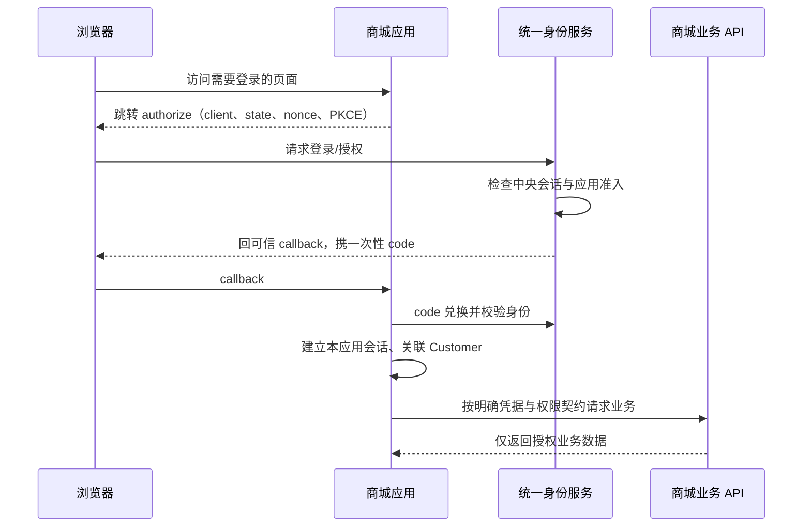
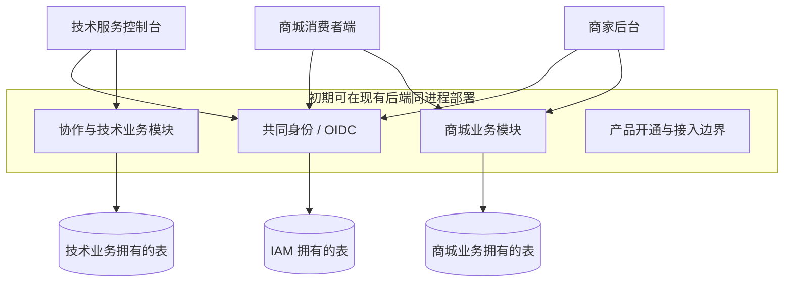

# 多业务平台架构：统一身份、技术服务与 B2B2C 商城

日期：2026-10-15。状态：**源码评估与建议方案，尚未实施架构改造**。

本方案补充 [原型转 Web 切换方案](myrmidon/frontend-web-migration.md) 与 [迁移验收清单](myrmidon/frontend-web-migration-checklist.md)。它解决“以后增加商城或其他产品时，是否还要重做身份、前端和后端架构”的问题；不将本轮规划扩大为立即开发商城或拆分服务。

## 1. 结论

**现有代码适合作为多业务平台基础，不需要推倒 IAM，也不需要先全面微服务化。** 推荐“统一身份基础 + 按产品划分业务域 + 独立应用入口 + 按实际需要独立部署”。先沿模块化单体增加业务，提前明确数据所有权与接口；有独立扩容、故障隔离、发布或组织归属的需求时，再提取服务。

当前支持的是：全局身份、多组织成员关系、实际 OIDC Provider、IAM 授权与文件等基础，以及可扩展的进程内模块体系。**还没有完整的消费者跨产品登录、产品开通/权益、跨业务 API 授权和跨应用退出闭环。** 这些需要有边界地扩展，不能只增加几个菜单就声称已支持 B2B2C。

“一次登录，进入不同产品”与“后端拆成多少服务”是两个独立决策。多个前端应用可以使用一个模块化后端；一个前端也可以调用多个服务。共同账号不意味着共同业务权限、共同数据库或共同管理菜单。

### 1.1 设计前提及待业务确认事项

本建议按同一运营主体提供多个产品、希望共同账号的场景设计。若未来产品属于独立运营主体/独立私有化部署，不默认共享身份库；可以各自拥有 issuer，再显式联合身份。租户隔离和跨运营主体的数据边界不能只凭“同一代码仓库”决定。

商城具体是单运营平台、多运营平台，商家是否跨市场经营、店铺归属、游客下单、企业采购审批、结算主体、币种/税务等还未定义。本文给推荐映射，不擅自冻结商业规则。X01 在开始商城业务模型之前确认这些问题，不阻塞当前协作页面设计。

## 2. 用户将看到怎样的产品组合

| 入口 | 使用者 | 内容 | 和共同账号的关系 |
|---|---|---|---|
| 身份/个人中心 | 所有注册主体 | 个人资料、安全、登录设备、应用授权、账户生命周期 | 统一身份源，不塞入所有业务资料 |
| 技术服务/协作控制台 | 企业成员、项目成员、运维/审核等角色 | 项目、任务、Agent、执行、工作流、资源、预算 | 在有效租户/项目授权内操作 |
| 商城消费者端 | 普通买家、企业采购人员 | 商品、购物车、自己的订单、售后、收货地址 | 可以只有共同账号与客户档案，无需加入商家租户 |
| 商家后台 | 商家负责人、员工 | 店铺、商品、库存、订单履约、售后、结算 | 共同身份 + 商家组织成员 + 业务角色 |
| 市场运营后台 | 平台运营人员 | 入驻审核、市场规则、争议、平台经营统计 | 专门运营授权，不因技术平台管理员身份自动获得 |
| 其他未来产品 | 对应业务用户 | 例如 CRM、培训、服务工单等各自业务 | 共用身份；自身客户/组织关系与权限仍独立 |

同一人可以同时是买家、某商家员工、另一企业的协作项目负责人；切换的是产品与业务上下文，不是复制三套密码账号。买家入口不展示租户管理、角色策略等后台概念。

消费者商城适合独立前端应用；商家和技术服务控制台可按实际用户与发布需求决定共用管理壳或分开应用。统一组件、主题和语言不要求所有产品拥有相同页面结构。不能把商城首页硬塞进现有 `/admin/:tenantID`。

## 3. 当前代码证据与能力判断

路径相对仓库根目录。以下是静态代码和已提交 OpenAPI 的事实；没有运行多域 SSO/商城端到端测试，也没有宣称 OIDC 全规范一致性或生产规模通过。

| 能力 | 当前证据 | 判断 |
|---|---|---|
| 全局主体 | `apps/backend-api/internal/iam/identity/model/model.go:10` 的 Principal 无 tenant 字段；`identity/service.go` 的 CreatePendingPrincipal 明确不授予租户 membership | 可复用为共同身份；消费者自注册不需要伪造商家成员 |
| 一人多组织 | IAM core 的 TenantMember 关联 tenant_id/principal_id；组织/角色/权限已有 | 可支撑员工组织关系；不等于客户/买家关系 |
| 运营平台语义 | `organization/platform.go:13` 的 Platform 是 Tenant 别名，scope_kind 固定 platform；Tenant 表无 platform_id/product_id | 系统/platform/tenant 是权限作用域，不能直接当“技术产品→商城→商家”的产品树 |
| 业务授权扩展 | `pkg/extension/authz/catalog.go` 的 Registry.Contribute，files 模块已使用；`decision.go` 输出 DataConstraint | 复用现有授权框架；业务仓储仍必须执行 tenant/entity/owner 等数据过滤，不会自动隔离 |
| OIDC Provider | `oauth/http.go:405` discovery，authorize/token/JWKS/userinfo/revoke/introspect；`oauth/service.go:870` 为 openid 签发 ID Token，aud=client ID；Code + S256 | 已有真实基础，继续扩展，不重造登录协议 |
| 应用准入 | `oauth/model/model.go` Client 必属 tenant；`oauth/service.go:419,848,907` 授权、兑换、刷新均检查 activeMember | 企业成员应用可用；任意消费者跨产品登录不是现成能力 |
| 未登录转登录 | `oauth/service.go:408` 未登录返回错误；`oauth/http.go:445` 错误映射；未见自动完成中央登录后恢复完整 authorize 请求的流程 | 需完成跨应用登录交互和受控 return-to；不能仅配置 client 就称 SSO 完整 |
| OAuth 与管理权限边界 | `pkg/extension/authz/register.go:824` 显式拒绝携 client_id 的 token 进入 guarded API | 值得保留的安全边界；不能直接删拒绝条件让商城取得 IAM 管理权 |
| API audience | `authn/web.go:979` 空 audience 用部署配置首项；授权码/刷新发 token 传空 audience；Client 无资源 audience 注册 | 独立业务 API 的 resource/audience/scope 准入仍需设计 |
| 应用授权页面 | `apps/frontend-web/apps/web/src/app/account/applications.tsx` 读取 oauthConsents | 是身份授权记录，不是“已购买技术服务/商城套餐”的产品开通清单 |
| 注销/撤销 | `authn/web.go` Logout/LogoutAll；`web_test.go:272` 明确已签 access token 在 logout-all 后仍有效；oauth grant 有本进程校验 | 需定义并验证跨应用退出与撤权时限；目前没有完整 OIDC RP/backchannel logout 证据 |
| 外部身份 | `internal/iam/federation` 有 OIDC/OAuth 社交/SAML，provider/link 带租户约束 | 企业联合身份可复用；不能冒充已实现独立消费者社交账号体系或按同邮箱自动合并 |
| 模块机制 | `internal/app/bootstrap.go` 构造模块清单；`pkg/module/services.go` 存 reflect.Type→进程内对象 | 是模块化单体，不是网络服务发现/微服务编排 |
| 数据库 | bootstrap 构造同一 runtime/database router；`pkg/extension/gorm/datasource.go:360` Write 轮询 writer | 配多个数据源不等于按技术服务/商城分库；不能通过增加连接串直接“拆业务” |
| 跨模块事务 | `identity/contracts.go` 接口接受调用方 `*gorm.DB`，部分拥有者发布表引用供 JOIN | 现有 IAM 内部模块不能无成本逐个拆服务；保留其共享事务边界 |
| gRPC 与消息 | 有 gRPC 生命周期；实际业务注册见 health/GUID。authn 通知 outbox 与 IAM audit webhook 存在 | 不是已实现商城事件总线、订单事务或微服务委托授权 |
| 多前端 | frontend-web 为 apps/*、packages/* workspace；目前只有 apps/web 应用和 packages/ui 共享包 | 可以新增 storefront/merchant 应用；现有 lazy route 不等于独立部署微前端 |

已提交 `apps/backend-api/docs/openapi.json` 共 275 路径/398 operation，包含上述 OIDC 端点；未发现 project/workflow/task/chat/budget 或商城领域路径。`cmd/infra-api/main.go` 为空入口，不计为已完成独立 IAM 服务。上述不代替实际部署的路由对账或安全测试。

## 4. 必须分清的对象

| 概念 | 所有者与职责 | 不能混同 |
|---|---|---|
| Principal / 外部 subject 映射 | IAM：身份、凭据、认证、安全状态 | 不存购物车/会员等级/商家商品；同邮箱不自动等于同一人 |
| Tenant / Member | IAM 组织与成员关系 | 不是每个产品、每个店铺、每个买家都必须新建一个租户 |
| Product | 产品目录：协作、商城、其他业务的稳定标识、入口、生命周期 | 不是 OAuth client，不是部署模块 Enabled，也不是菜单条目 |
| Application / OAuth Client | 登录接入：一个具体 Web/移动/后台应用的 client、可信回调和准入策略 | 一个产品可能有消费者端/商家端/移动端多个 client |
| Product enrollment / entitlement | 产品开通或使用资格，归组织或个人；付费时再关联订阅 | 不是 OAuth consent；登录成功不会自动开通付费产品 |
| Customer | 商城业务客户档案，关联共同主体；地址、偏好、会员等属于商城 | 不是商家后台员工 |
| Merchant / Store | 商城负责商家资质、入驻、店铺与经营关系 | 不与 IAM Tenant 无条件一对一等同；一个经营组织可以多店/多市场 |
| Marketplace | 商城的经营平台及市场规则、入驻关系 | 不默认等于 IAM scope_kind=platform，更不自动成为全部租户的数据父节点 |
| Resource permission | 所属业务的对象级能力、关系与状态 | 不是“能看到菜单就能调用所有 API” |

对需要独立成员、角色、SSO 和数据生命周期治理的商家，推荐映射为 IAM Tenant，员工是成员；店铺在商城内归该经营组织，一个组织可有多店。Marketplace 与商家通过显式入驻关系连接。若商家实际只是同一组织内的经营分支，可使用已有 entity 范围，不强制每家新建 tenant；须按独立治理责任确认。买家是全局 Principal 在商城的 Customer，购买不产生后台 membership。企业采购需额外校验组织采购身份，不能从个人登录推导。

技术服务企业也使用 Tenant；同一企业购买多个产品时复用其组织身份，各产品维护自己的开通、角色和业务数据。不为每购买一个产品复制企业，更不能让“协作项目管理员”自动变成“商城财务管理员”。

同一可信身份域内可引用稳定 Principal ID；跨 issuer 使用 `(iss, sub)` 映射，不能假定不同部署同样的数字 ID 或 email 属于同一个主体。当前 public subject 可复用身份关联；若将来引入 pairwise subject，必须通过可信映射，不从跨产品直接比较 sub 推断身份。

### 4.1 产品访问判断

受保护、且业务策略要求开通资格的操作，需同时满足：部署中产品可用、主体有产品使用资格、当前组织/客户/商家上下文有效、操作权限与资源关系匹配、业务状态允许。被明确标记为公开的商品浏览或产品介绍使用公开投影，不强制登录或开通；默认开放还是显式开通按产品策略确定，不能以本节为由给全部请求追加登录门槛。若使用 OAuth 委托，还要满足 client 与 API audience/resource 及 scopes 的许可交集。

产品开通可以一开始由配置或人工授权完成；只有真实收费/套餐需求出现时才建订阅/计费领域，不为商城设想先造一个通用商业化平台。客户端入口目录可以先是静态配置，但动态开通后的服务端资格校验不能只写在菜单里。

现有权限命名还要特别核对：`authz/catalog.go` 中 Action.Scope 的 `platform` 表示系统级权限，经营平台对应 `operating_platform`；不能按界面中文名称猜测权限等级。业务注册沿用 Registry.Contribute/authz.Register，角色和资源权限复用 IAM 原语，并在仓储落实 DataConstraint，不要求各产品另造角色引擎。

UI 展示权限不是授权事实。产品停用后的“不能新建”和“历史订单/退款/资料仍需处理”要按业务规则设计，不能删除菜单就把存量义务一起阻断或抹掉。

## 5. 单点登录如何实现

共同体验是：用户在技术服务已登录，访问商城时跳到统一身份站点；身份站点有有效会话，就无需再次输入密码，完成授权后回商城。商城建立自己的受控会话，再查询商城客户身份与权限。中央认证和每个应用的会话有独立边界。

图为目标流程，不代表当前跨域闭环已经实现。浏览器 SPA/native 使用 public client + Code/PKCE，不保存 client secret；有服务端会话/BFF的应用由其服务端兑换并保管凭据。是否新增 BFF 按首个真实客户端需要决定，不给所有应用预建一套。

必须交付：

1. **中央登录恢复授权请求。** 未登录、MFA、同意/拒绝、失效会话后正确回原应用；return-to 和 redirect 精确校验，PKCE/state/nonce、code 重放均有负向测试。
2. **应用所有者与用户准入分离。** 保留现有企业应用 active-member 策略；为第一方消费者应用增加明确的全局用户准入/产品登记策略。配置这些策略需要有权平台管理，不允许普通租户通过修改 client 绕过成员或获得其他租户身份。
3. **业务会话/API 凭据。** ID Token 仅用于应用确认登录，不直接当所有 API 的 access token。现有 IAM Cookie 会话可继续服务现有同源控制台；独立应用的本地会话或委托 token 必须有明确的 verifier、主体映射与业务权限检查，不把 OAuth 身份验证成功转换成无限制 IAM 管理 Cookie。
4. **resource/audience/scope。** 独立 API 或直接受委托调用时，注册允许的资源与 scope；接收端校验 issuer、audience、token 类型、期限、主体状态、client 及必要授权。商城 token 不进入技术服务 API；openid/profile/email 不等于 order.write。只在显式允许委托的业务路由放行，现有 IAM 管理路由继续隔离。
5. **工作负载身份。** 服务调用以 service account/client credential 或约束委托表达；不转发系统管理员凭据。需要代表用户时保留 actor/subject、audience 与权限交集，不能由外部任意传 principal_id header 冒充身份。
6. **退出与撤权。** 分别定义退出本应用、退出中央登录、退出全部产品；全局账号停用、退出企业、撤销某应用授权、订单退款权限变化是不同事件。需要跨应用 SLO 时实现 RP-initiated/backchannel 等选定协议；具体时限用 SSO 验收确定，不无依据承诺即时全局失效。跨进程需在线内省/授权版本或有界缓存/短 token 等方案，不假定 JWKS 验签知道撤权。
7. **敏感操作再认证。** 财务、退款、凭据管理等若要求新鲜认证/MFA，在能力契约明确 auth_time/acr/amr、max_age/prompt 支持。现有 provider 支持的 prompt 范围有限，按实际客户端补齐并测试，不宣称完整 OIDC 认证。

不同域通过标准顶层跳转复用中央身份；不共享父域 Cookie、不把 token 放在业务 URL、不依赖跨站 iframe 的第三方 Cookie。各应用会话保持 HttpOnly/Secure 与 CSRF 防护、允许的 Origin、明确的回调配置。产品域名与品牌使用部署配置，不硬编码现有名称。

## 6. 后端是继续加模块还是拆微服务

### 6.1 初期推荐：模块化单体，加业务域

同进程不等于共用一套业务模型。通过已有 `module.Module`、`Provide/Resolve`、模块自有 model/query/migrate/http/i18n 实现；新域放 `internal/<业务域>/`，不塞进 iam/core，也不先重写 pkg/module。

商城可以先按业务职责组织商家/店铺、商品、库存、交易订单、支付退款、履约、结算等模块，但这些不是第一天必须部署的七个微服务。先从一个最小交易闭环确定边界，不为每张表建服务。

初期允许同一物理数据库，由模块拥有各自表与迁移；业务模块不能任意读写其他模块存储。技术服务和商城不共享订单/任务等业务表。审计、文件、身份等通过拥有者公开的窄能力接入。

**技术协作的 Approval 和商城退款/采购 Approval 不能因名字相同合成一张万能审批表。** 可以复用被验证的组件/授权原语，具体状态机、金额和副作用仍属于各自业务。商城交易计费与技术 Token 预算也不能混成一个金额字段。

### 6.2 哪些情况下值得独立部署

出现下列有测量或明确交付责任的需求时才拆，不按表数量或想象中的用户数拍阈值：

| 触发条件 | 合理动作 | 必须先证明 |
|---|---|---|
| 商城大促影响协作/登录延迟 | 将商城读侧/交易部署与资源隔离，按瓶颈拆 | 真实负载、SLO、资源消耗及分离后的收益 |
| 支付/外部集成需要独立故障域 | 独立支付集成或异步执行边界 | 回调幂等、账务/订单归属、未知结果核对与重试机制 |
| 团队独立发布且互相阻塞 | 按稳定业务域拆服务 | 团队所有权、契约版本、独立测试/发布责任 |
| 法规/客户要求单独数据部署 | 独立进程/数据库/密钥与访问边界 | 具体隔离要求、数据流、备份恢复与运维责任 |
| 高成本任务/AI执行需要独立伸缩 | 独立 runner/worker，保留控制面 | 租约/幂等/取消/授权/预算及回执验证 |

服务拆出后要有自己的部署入口、数据所有权、接口与事件契约、工作负载身份、观测、容量与恢复。代码仍可放同一仓库。不要先引入 service mesh、Kubernetes、通用事件总线或微前端平台作为所有业务的前置条件。

### 6.3 真正的拆分成本

`module.Resolve` 不能跨进程；当前共享 runtime 和 `*gorm.DB` 事务也不能跨服务。不能把 in-process 窄接口换个 URL 就认为事务、撤权和故障语义一样。

提取服务需逐项处理：

- 它拥有的数据从谁读写，旧调用者改为受约束 API 或投影；不通过共享 IAM 数据库绕过隔离。
- API/事件定义、版本、超时与重试；写请求幂等键；外部动作未知结果的查询/人工核对。
- 本地事务 + outbox、消费者 inbox/幂等、补偿/对账按真实跨服务链路建设。现有认证通知 outbox、IAM 审计 webhook 不能直接当订单事件总线。
- 订单、库存、支付的状态与会计事实由拥有者负责。不能用“最终一致”允许超卖/重复扣款，也不宣称跨供应商 exactly-once。
- 账号禁用/撤权、租户关闭、开通资格变化通过明确协议传播，失败路径有有界策略；不是永久缓存 JWKS 后什么都放行。
- 数据迁移采用按域切流、校验与可回滚方案；不能未经对账长期双写。所有数据库结构改动仍遵守本仓方言/前缀/迁移规约。

建议最后才考虑拆 IAM 内部的 authn/identity/organization 等紧耦合模块。若确需独立 IAM，优先将身份底座整体作为一个边界提取，不先把一次身份生命周期事务拆成多个网络服务。

## 7. 对当前 Web 迁移方案的具体约束

这次协作迁移仍可继续，不必等商城建好，但前置设计要留住以下边界：

- M00/M01：协作是一个产品，不把当前菜单写成未来所有业务唯一入口。现有 system/platform/admin/user 路由继续表示权限/工作空间，产品入口另有稳定归属。
- M02：规则按操作与字段契约绑定，不把某产品字段/品牌/错误硬编码到共享 AutoForm。通用 `detail` 模式不覆盖业务对象自己的不可变历史/财务状态语义。
- M03：共享列表关注查询/呈现/授权列，不携带任务、订单等业务判断。所有查询缓存与偏好按实际产品/租户/对象命名空间隔离。
- M04/M05：项目与任务仍属协作产品；不得为每个未来商城店铺强建协作项目。ID 与 URL 的 tenant/project 归属校验继续有效。
- M12/M13：文件/组织/IAM 复用必须保持所有权；消费者客户档案不进入商家员工目录，业务文件所有者不靠目录名猜测。
- M16：协作预算/审批不预先升级为商城支付/结算引擎。
- M19/M20：多应用同账号、不同产品授权、跨产品跳转与退出加入验收；未来独立 storefront 的构建不影响既有 Web 路由。

现有 `apps/web` 可继续承载 IAM 管理和协作控制台。消费者商城启动时在 `apps/frontend-web/apps/` 新增独立应用；商家管理是否独立应用按真实角色与发布节奏决定。共享 `packages/ui` 保留；只有两个真实调用方需要时再提取共享认证客户端包，不预造 SDK 层。

公开商品页面有搜索引擎收录/首屏目标时，再选择 SSR/预渲染能力；这不要求把现有管理台换框架。外观统一与组件共享不等于要求同一个 bundle 或同一种渲染模式。

## 8. 改造实施清单

下表是新增的上位架构工作包，引用原 Mxx，不重编号或删掉原迁移需求。**X00/X01 当前一期边界已确认，业务改造尚未验收**。X00 的源码评估与一期约束已冻结；X01 的未来商城商业模型尚未定义，不能视为已实现。前置依赖指契约/设计输入，不要求未涉及的未来商城代码提前完成。

| 编号 / 时机 | 工作内容与交付物 | 现有影响位置 / 新责任 | 依赖 | 验收标准 |
|---|---|---|---|---|
| X00 当前规划 | 冻结本方案能力证据和产品边界，明确当前一期仍为 IAM+协作 | 本文、原 M00/M01；MEMORY/ADR | 无 | 当前/建议/未实现区分，单体/服务/前端分离不混同 |
| X01 当前迁移设计；商城前补业务决策 | 产品、应用、组织、客户/商家/店铺/市场映射及权限矩阵；处理现有 scope_kind=platform 语义 | organization/core 的契约消费者；新商城模型由业务域拥有 | X00 | 买家不成为商家成员；同企业可开多产品；商家多店不复制账号；记录未决商业规则 |
| X02 第二产品/跨域登录前 | 增加消费者应用准入，保留企业成员准入；所有者与受众分离 | oauth Client/授权/兑换/刷新/device/exchange 一致性，相关 model/query/三方言迁移/OpenAPI/前端配置 | X01 | 无组织买家登录成功、非成员企业应用拒绝；普通租户不能放宽别的产品策略 |
| X03 第二产品/跨域登录前 | 中央登录→授权恢复→应用 callback→本地会话；PKCE/state/nonce | authn/oauth 登录入口、Web auth/route loaders；首个新应用 callback | X02 | A→B 可复用中央会话，未登录/MFA/拒绝/过期/错误回调都能安全收束；不共享业务 Cookie |
| X04 独立应用受保护 API 前 | API资源/audience/scope与业务主体授权；服务账户/委托；明确本地会话验证 | authn token、oauth contract、authz 显式业务路由扩展；业务API | X01,X02 | A token 不能调用 B；身份 scope 不得管理IAM；业务权限不会超过主体/委托许可 |
| X05 对外承诺跨应用退出前 | 明确单产品/中央/全产品退出、账号停用与授权撤销的时限和传播 | authn sessions/refresh、oauth grants、必要RP/backchannel、业务会话 | X03,X04 | 多域/跨进程在声明时限内失效；服务不可用/缓存时效/重放分别验 |
| X06 第二产品准入前；付费前补订阅 | 最小产品目录/启用/开通资格；若确有套餐再接订阅，明确历史访问策略 | 新产品业务能力，复用IAM授权；前端入口与后端guard | X01 | 已登录未开通不能调用需资格的操作，明确公开能力仍按公开策略访问；停用不串产品；历史订单/退款按确认规则处理 |
| X07 商城启动时 | 独立消费者应用，商家/运营入口去向；共享 UI/i18n/branding | frontend-web/apps 新应用、packages/ui、Turbo脚本/部署配置 | X03,X04,X06 | 独立构建部署；原IAM/协作不回归；消费者无后台概念；三语言和响应式 |
| X08 商城领域实施时 | 商家/店铺、商品、库存、交易、支付退款、履约结算的最小闭环 | internal 新业务模块、bootstrap 接线、模块自有数据与接口 | X01,X04,X06 | 买家只看自己订单；员工只操作所属授权店；财务/库存/幂等/对账真实服务验收 |
| X09 首个跨域异步业务需要时 | 可靠事件与投影、账号/产品资格变动、支付等外部回执 | 事件拥有者本地事务/outbox、消费方幂等/恢复；不改审计为万能总线 | X04，具体拥有者契约 | 重复/乱序/丢失/重启不重复扣减或漏撤权；有补偿/重建证据 |
| X10 确有拆分触发时 | 选一个明确业务域独立部署：进程、数据库、API、迁移、切流、回滚 | 新部署入口/配置；拥有者服务，不默认改全部IAM内部模块 | X04,X05,X09及该域闭环 | 独立发布/扩容与故障隔离有收益；不跨写库；旧客户端兼容、回滚与真实故障演练通过 |
| X11 每阶段验收 | 原有IAM回归 + 新跨产品用例 + 静态/契约/服务/浏览器证据 | 现有各包测试、integration、Web browser suites | 本阶段涉及X项 | 原权限不放宽，无mock冒充服务；明确已支持产品/平台/部署形态 |

X02–X10 不是当前协作原型迁移的全部前置条件：**现在先执行 X00/X01 的边界设计并纳入 M00/M01，其余在对应触发点实施。** 对新增商业产品，X02–X08 的适用项是正式开放前的门禁，不得发布后再补。

后端实现继续用现有模块生命周期、拥有者接口、三方言迁移、统一 OpenAPI/respx/i18n，不另建全局中央业务 schema。业务 domain/type 名称须等边界确认后定，不因本文提到商家就创建空模块。

## 9. 测试验收清单

所有项目当前状态为未执行。每项记录源码版本、issuer/client/API、用户与组织、会话/凭据类型、环境及真实结果；不能只通过静态页面或 mock。

| 测试键 | 场景 | 必须观察的结果 |
|---|---|---|
| MB01 | 无租户 membership 的已验证用户登录消费者应用 | 成为合法客户；不自动加入任意商家/运营组织 |
| MB02 | 同一用户同时为买家、商家员工、技术企业成员 | 共同主体，三类资料/角色分别生效，不重复密码账号 |
| MB03 | 非成员登录企业型应用 | 保持拒绝，不因新增消费者准入而绕过 |
| MB04 | OAuth client 所有者修改准入/回调/权限 | 仅有权主体能改；不能越权操作其他产品或提升为IAM管理权限 |
| MB05 | 技术应用已登录，再进另一域商城；中央会话失效/MFA | 有会话按策略免重复密码；无会话走完整登录后返回原请求，不开放重定向 |
| MB06 | 错误state/nonce/PKCE、过期code、重复兑换、恶意redirect | 拒绝且无会话/业务副作用；不能泄露凭据 |
| MB07 | 技术 access token 调商城，ID token 调API，openid scope调管理接口 | audience/type/scope及路由边界均拒绝；不通过删除现有client_id隔离实现 |
| MB08 | 商城普通买家请求另一人订单/收货信息/附件 | 服务端拒绝，列表计数/搜索/导出/下载同样隔离 |
| MB09 | 商家A员工修改商家B商品、订单、结算；同企业多店 | 店铺/市场范围按已授予关系判断；不从URL/表单tenant_id取得权限 |
| MB10 | 产品未开通、已停用、订阅到期；已有退款义务 | 不允许新越权交易；存量处理遵循明确规则，不默认删除/冻结全部事实 |
| MB11 | 单应用退出、中央退出、全部退出、撤OAuth consent、禁用账号 | 每种动作符合各自语义和时限；跨域/跨进程同样验证，非仅本进程token校验 |
| MB12 | 用户退出企业但仍为商城买家 | 企业权限失效，个人商城资格不被误删；全局注销走独立流程 |
| MB13 | 不同企业IdP同邮箱；账号绑定与解绑 | 不自动串号；绑定经过已验证身份/明确授权；原审计与业务ID保持可追溯 |
| MB14 | 停用账号后某业务内省不可用/缓存尚未过期 | 依据明确风险策略有界处理；不永久接受旧JWT，不伪称即时撤权 |
| MB15 | 双击下单、重复/乱序支付回调、超时后重试 | 相同交易不重复扣款/扣库存；未知结果可查询对账，不直接盲重放 |
| MB16 | 拆出的服务停止、积压、重启、重复事件 | 不破坏其他产品事实；outbox/消费幂等可恢复；错误可定位 |
| MB17 | 新消费者应用部署，旧IAM/协作用户正常使用 | 登录/账户视角/组织/文件/已有路由不回归；品牌和语言配置有效 |
| MB18 | 回滚服务/客户端版本、迁移中断、新旧实例并存 | API/事件兼容、数据有校验与恢复路径；不假定回退代码即可回退数据 |

| MB19 | 已明确开放的商品浏览/产品介绍，匿名访问及隐藏字段请求 | 公开投影可访问，不要求成为租户成员或开通付费服务；内部成本/供应商凭据/其他客户数据不泄露；游客下单是否允许另依业务规则 |

实施验证：前端从 `apps/frontend-web` 跑 typecheck/lint/test/build，契约变化跑 check:api-types；后端按 `apps/backend-api/Makefile` 跑 ci，数据库和发布相关门禁按变更范围执行。跨域 SSO 至少需要两个独立 origin 的真实客户端；跨服务撤权至少需要两个进程，不能用同一进程测试证明网络隔离成立。

## 10. 本轮交付与下一步

本轮完成当前架构的适配判断和改造方案；不声称系统已经支持生产 B2B2C，不修改认证/权限来预先放行新场景。保留原迁移账本，将本文 X00/X01 作为 M00/M01 的设计输入。

建议确认的方向：**统一身份；产品与业务权限独立；前端按体验分应用；后端先模块化，满足拆分条件才拆服务。** 下一步先冻结产品/组织/客户模型及消费者准入策略，再继续协作迁移。实际商城开发前补充商城业务需求，不凭平台架构讨论擅自决定交易/结算规则。
